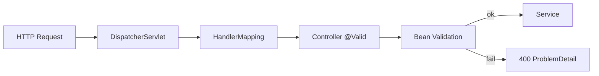
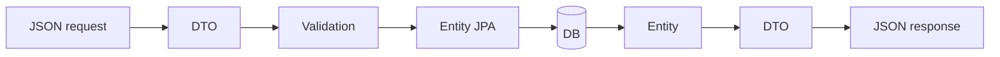
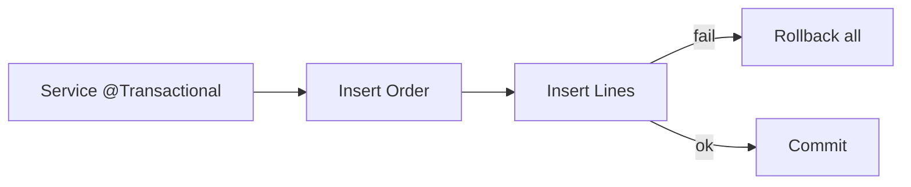
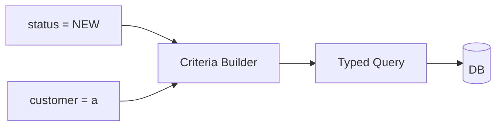
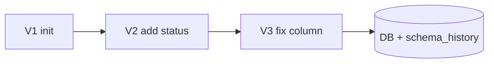
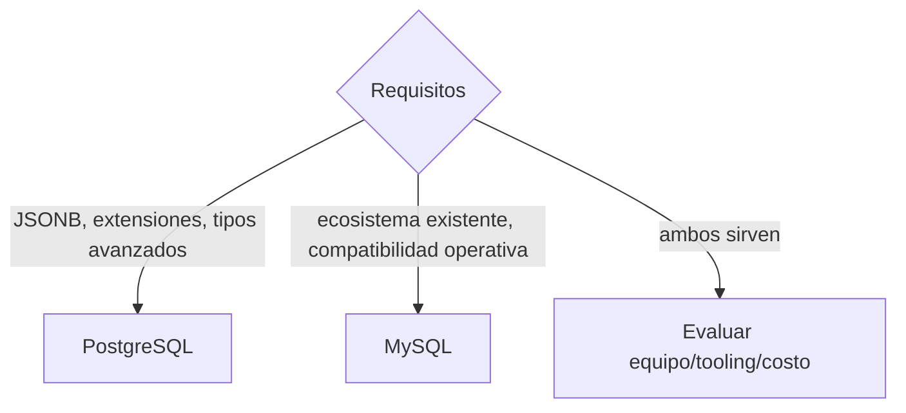

# Módulo 1 · Spring Web, datos y migraciones

Un microservicio Spring expone contratos HTTP, valida entrada, traduce errores, persiste datos y evoluciona su esquema. Este módulo cubre la base web + datos con enfoque de contrato, consistencia y operabilidad.

**Entorno de referencia verificado (2026-05-22):** JDK 27.0.1.0.2. Los smokes ejecutan validación, serialización, error mapping, transacciones simuladas, filtros tipados y migraciones en Java puro. Spring MVC/JPA/Flyway/Liquibase/Hibernate requieren dependencias/infra; se incluyen **Notas de verificación** honestas.

## Aprende construyendo

### Tema 1: Spring MVC: DispatcherServlet, Controllers y validación · Intermedio · 180 min

## El problema

`POST /orders` recibe JSON del frontend. El equipo confía en que el cliente valida. Un día llega `{"sku":"", "qty":0}` y el servicio lo acepta, persiste basura y luego falla en billing. El síntoma no es el 500 posterior; es que la validación estaba en el lugar equivocado.

## La idea clave

`DispatcherServlet` es como el recepcionista de un hotel: recibe toda petición, la clasifica, la envía al departamento correcto y entrega la respuesta. El controller es el departamento: orquesta, pero no hace el trabajo de negocio. La validación es el filtro de entrada: si el dato no cumple el contrato, no entra al hotel.



## Construyendo la solución

**Archivo:** `MvcValidationSmoke.java` → validación de entrada.

```java
import java.util.*;

public class MvcValidationSmoke {
  record OrderReq(String sku, Integer qty) {}

  static int handle(OrderReq r) {
    if (r.sku() == null || r.sku().isBlank()) return 400;
    if (r.qty() == null || r.qty() <= 0) return 400;
    return 201;
  }

  public static void main(String[] args) {
    System.out.println(handle(new OrderReq("A1", 1)));
    System.out.println(handle(new OrderReq("", 1)));
    System.out.println(handle(new OrderReq("A1", 0)));
  }
}
```

**Archivo:** controller Spring (conceptual).

```java
@RestController
@RequestMapping("/orders")
public class OrderController {
  private final OrderService service;

  public OrderController(OrderService service) { this.service = service; }

  @PostMapping
  public ResponseEntity<OrderResponse> create(@Valid @RequestBody OrderRequest req) {
    OrderResponse created = service.create(req);
    return ResponseEntity.status(201).body(created);
  }
}
```

**Lectura:** el smoke modela la regla: sku obligatorio y qty positivo. En Spring, `@Valid` + Bean Validation ejecuta antes de entrar al servicio. El controller no contiene lógica de negocio.

## Verificando con un experimento

1. Request válido. Esperas `201`.
2. `sku` vacío. Esperas `400`.
3. `qty=0`. Esperas `400`.
4. Quita `@Valid`. Observa que datos inválidos llegan al servicio.

Salida esperada:

```text
201
400
400
```

## Cierre del módulo y trade-offs

La validación en backend protege el sistema de datos inválidos. El costo es mantener el contrato de entrada explícito y consistente.

**Cuándo usarlo / cuándo no.** Usa `@Valid` + Bean Validation en toda entrada HTTP. No confíes en validación del cliente. No pongas lógica de negocio en controllers.

| Responsabilidad | Controller | Service |
|---|---|---|
| HTTP status, routing, binding | Sí | No |
| Validación de entrada (`@Valid`) | Sí | Apoyo |
| Reglas de negocio | No | Sí |
| Persistencia | No | Vía repository |

**Error común.** Confiar en validación del frontend. **Síntoma.** datos inválidos en DB. **Causa.** falta Bean Validation en backend. **Arreglo.** `@NotBlank`, `@Min`, `@Valid`, ProblemDetail. **Señal observable.** 500 o constraint violations inesperadas.

**Pregunta de entrevista.** ¿Por qué validar en backend si el frontend ya valida?  
**Respuesta modelo.** Porque el frontend es un cliente no confiable: puede ser manipulado, obviado o simplemente tener bugs. El backend es la última línea de defensa del contrato. Validar en ambos es correcto, pero el backend es obligatorio.

**Transferencia.**

1. **[NO-USAR-X]** Quitar `@Valid` porque “el frontend ya valida”. Respuesta: **No confiar solo en cliente**.
2. Un campo opcional que si viene debe ser positivo. ¿Cómo lo modelas?
3. ¿Qué diferencia hay entre validación sintáctica y regla de negocio?

#### Definición formal

`DispatcherServlet` es el front controller de Spring MVC. `@RestController` expone endpoints. Bean Validation valida entrada antes de entrar a la lógica de negocio.

#### Contrato / internals

- **HandlerMapping:** enruta por path/método.
- **HttpMessageConverter:** JSON ↔ objeto.
- **Bean Validation:** `@NotNull`, `@NotBlank`, `@Min`, etc.
- **@Valid:** activa validación recursiva.
- **Límite:** validación de entrada no es regla de negocio.

#### Ejemplo mínimo ejecutable

```bash
javac MvcValidationSmoke.java
java MvcValidationSmoke
```

Salida esperada:

```text
201
400
400
```

#### Caso real

`POST /orders` valida `sku` y `qty` con `@Valid`. Si falla, devuelve 400 con ProblemDetail y no entra a `OrderService`.

#### Verificación

Smoke Java ejecutado localmente (2026-05-22, JDK 27.0.1.0.2): `201`, `400`, `400`.

**Nota de verificación:** Spring MVC real requiere app Boot; validar con MockMvc/WebTestClient.

### Tema 2: DTOs, Jackson y validación · Intermedio · 120 min

## El problema

El equipo expone la entidad JPA `Order` directamente en la API. Al agregar una columna interna `internalNotes`, el JSON cambia y rompe clientes. Peor: la serialización lazy dispara queries y expone datos sensibles.

## La idea clave

Un DTO es como el menú de un restaurante: muestra lo que el cliente puede pedir, no la cocina completa. La entidad JPA es la cocina. Jackson es el mesero que traduce entre menú y cocina. Si dejas que el cliente entre a la cocina, se rompe todo.



## Construyendo la solución

**Archivo:** `DtoSmoke.java` → separación de contrato.

```java
import java.util.*;

public class DtoSmoke {
  record OrderRequest(String sku, int qty) {}
  record OrderResponse(String orderId, String sku, int qty) {}

  static OrderResponse toResponse(String orderId, OrderRequest req) {
    return new OrderResponse(orderId, req.sku(), req.qty());
  }

  public static void main(String[] args) {
    OrderRequest req = new OrderRequest("A1", 2);
    OrderResponse resp = toResponse("o-1", req);
    System.out.println(resp.orderId());
    System.out.println(resp.sku() + ":" + resp.qty());
  }
}
```

**Archivo:** DTO con Jackson (conceptual).

```java
public record OrderResponse(
    @JsonProperty("order_id") String orderId,
    String sku,
    int qty
) {}
```

**Lectura:** el smoke muestra que el DTO de respuesta tiene su propia forma (`order_id`, no `id` interno). La entidad JPA puede tener campos que nunca llegan al JSON.

## Verificando con un experimento

1. Crea request y response. Esperas `o-1` y `A1:2`.
2. Agrega campo interno a la entidad. El DTO no cambia; el JSON permanece estable.
3. Usa `@JsonProperty("order_id")`. El cliente ve `order_id`, no `orderId`.

Salida esperada:

```text
o-1
A1:2
```

## Cierre del módulo y trade-offs

DTOs en el borde protegen el contrato HTTP de cambios internos de persistencia. El costo es mapeo explícito, pero ese costo es mucho menor que un contrato roto.

**Cuándo usarlo / cuándo no.** Usa DTOs en toda entrada/salida HTTP. Usa Jackson para controlar nombres y serialización. No expongas entidades JPA directamente.

| Decisión | Cuándo | Cuándo NO |
|---|---|---|
| DTO request/response | Toda API HTTP | Prototipo desechable |
| `@JsonProperty` | Compatibilidad de contrato | Cambiar nombres sin razón |
| Entity JPA como DTO | Nunca en producción | Nunca |

**Error común.** Exponer entidad JPA. **Síntoma.** lazy loading en serialización, leaks de campos internos. **Causa.** acoplar contrato a persistencia. **Arreglo.** DTOs explícitos + mapper. **Señal observable.** `LazyInitializationException` o JSON con campos sensibles.

**Pregunta de entrevista.** ¿Por qué no exponer entidades JPA directamente?  
**Respuesta modelo.** Porque acopla el contrato HTTP a la persistencia: cambios de esquema rompen clientes, la serialización lazy puede disparar queries fuera de transacción, y campos internos/sensibles pueden filtrarse. Un DTO explícito define un contrato estable e independiente.

**Transferencia.**

1. **[NO-USAR-X]** Exponer `User` entity con `passwordHash` en JSON. Respuesta: **No exponer entidades**; usar DTO.
2. Un cliente legacy espera `order_id` y uno nuevo espera `orderId`. ¿Cómo lo manejas?
3. ¿Cómo evitas mapeo manual repetitivo sin perder control del contrato?

#### Definición formal

DTO es un objeto de transferencia para entrada/salida HTTP. Jackson serializa/deserializa JSON. `@JsonProperty` controla nombres de campos.

#### Contrato / internals

- **Jackson:** anotaciones, getters/setters, records, constructores.
- **Bean Validation:** se ejecuta antes del servicio.
- **DTO vs Entity:** separación de contratos.
- **Límite:** el mapeo debe ser explícito o con mapper controlado.

#### Ejemplo mínimo ejecutable

```bash
javac DtoSmoke.java
java DtoSmoke
```

Salida esperada:

```text
o-1
A1:2
```

#### Caso real

`OrderResponse` usa `@JsonProperty("order_id")` para compatibilidad con un cliente legacy. La entidad `OrderEntity` tiene campos internos que nunca se serializan.

#### Verificación

Smoke Java ejecutado localmente (2026-05-22, JDK 27.0.1.0.2): `o-1`, `A1:2`.

**Nota de verificación:** Jackson `@JsonProperty` real requiere dependencia Jackson; comportamiento verificado conceptualmente.

### Tema 3: Manejo global de excepciones (@ControllerAdvice) · Intermedio · 120 min

## El problema

Cada controller maneja sus propios try/catch y devuelve formatos distintos: uno devuelve `{"error":"bad"}`, otro devuelve stack trace, otro devuelve 200 con `{"success":false}`. Los clientes no saben cómo interpretar fallos y el soporte no tiene correlación.

## La idea clave

Un manejador global de excepciones es como la recepción de emergencias de un hospital: sin importar qué departamento falló, el paciente recibe una respuesta estandarizada con código, mensaje y referencia. ProblemDetail (RFC 9457) es ese formato estándar.

```mermaid
flowchart LR
  E[Excepción en controller/service] --> CA[@ControllerAdvice]
  CA --> M[@ExceptionHandler]
  M --> PD[ProblemDetail]
  PD --> R[HTTP 4xx/5xx + JSON estándar]
```

## Construyendo la solución

**Archivo:** `ProblemDetailSmoke.java` → mapeo de errores.

```java
import java.util.*;

public class ProblemDetailSmoke {
  static Map<String, Object> problem(int status, String title, String detail) {
    return Map.of("status", status, "title", title, "detail", detail);
  }

  static Map<String, Object> mapException(Exception e) {
    if (e instanceof IllegalArgumentException) return problem(400, "Bad Request", e.getMessage());
    if (e instanceof NoSuchElementException) return problem(404, "Not Found", e.getMessage());
    return problem(500, "Internal Server Error", "unexpected error");
  }

  public static void main(String[] args) {
    System.out.println(mapException(new IllegalArgumentException("sku is required")).get("status"));
    System.out.println(mapException(new NoSuchElementException("order not found")).get("title"));
  }
}
```

**Archivo:** `@ControllerAdvice` real (conceptual).

```java
@ControllerAdvice
public class GlobalExceptionHandler {
  @ExceptionHandler(MethodArgumentNotValidException.class)
  public ProblemDetail handleValidation(MethodArgumentNotValidException ex) {
    ProblemDetail pd = ProblemDetail.forStatus(400);
    pd.setTitle("Validation Failed");
    pd.setDetail("One or more fields are invalid");
    return pd;
  }

  @ExceptionHandler(NoSuchElementException.class)
  public ProblemDetail handleNotFound(NoSuchElementException ex) {
    return ProblemDetail.forStatusAndDetail(404, ex.getMessage());
  }
}
```

**Lectura:** el smoke modela el mapeo status→respuesta. En Spring, `@ControllerAdvice` + `@ExceptionHandler` centraliza y ProblemDetail estandariza.

## Verificando con un experimento

1. `IllegalArgumentException`. Esperas `400`.
2. `NoSuchElementException`. Esperas `Not Found`.
3. Excepción no mapeada. Esperas `500` con mensaje genérico, sin stack trace.

Salida esperada:

```text
400
Not Found
```

## Cierre del módulo y trade-offs

El manejo global convierte fallos en contratos HTTP consistentes. El costo es mantener el mapeo actualizado cuando se agregan nuevas excepciones de negocio.

**Cuándo usarlo / cuándo no.** Úsalo para centralizar errores y devolver ProblemDetail. No expongas stack traces ni detalles internos. No devuelvas 200 con error en body.

| Excepción | Status HTTP | Cuándo |
|---|---|---|
| Validación fallida | 400 | Input inválido |
| No encontrado | 404 | Recurso inexistente |
| Conflicto de estado | 409 | Transición inválida |
| Error inesperado | 500 | Fallo interno |

**Error común.** Devolver 200 con error en body. **Síntoma.** clientes no pueden manejar fallos. **Causa.** contrato HTTP incorrecto. **Arreglo.** códigos semánticos + ProblemDetail. **Señal observable.** métricas 2xx altas con fallos de negocio.

**Pregunta de entrevista.** ¿Por qué ProblemDetail (RFC 9457) es mejor que un JSON ad-hoc de error?  
**Respuesta modelo.** Porque estandariza campos (`type`, `title`, `status`, `detail`, `instance`) y extensiones, facilitando que clientes y herramientas interpreten errores de forma consistente. Un JSON ad-hoc obliga a cada equipo a inventar su propio contrato.

**Transferencia.**

1. **[NO-USAR-X]** Devolver stack trace completo al cliente en producción. Respuesta: **No exponer internals**; loguear internamente, devolver ProblemDetail.
2. ¿Cuándo usarías 409 vs 422?
3. ¿Cómo correlacionas un error con su traceId?

#### Definición formal

`@ControllerAdvice` centraliza manejo de excepciones en MVC. ProblemDetail (RFC 9457) estandariza respuestas de error con campos consistentes.

#### Contrato / internals

- `@ExceptionHandler`: mapea tipo de excepción.
- `ProblemDetail`: status, title, detail, instance, type.
- HTTP status semántico.
- No exponer stack trace.

#### Ejemplo mínimo ejecutable

```bash
javac ProblemDetailSmoke.java
java ProblemDetailSmoke
```

Salida esperada:

```text
400
Not Found
```

#### Caso real

`@ControllerAdvice` mapea `MethodArgumentNotValidException` → 400 con campos inválidos, `NoSuchElementException` → 404. El cliente recibe ProblemDetail consistente.

#### Verificación

Smoke Java ejecutado localmente (2026-05-22, JDK 27.0.1.0.2): `400`, `Not Found`.

**Nota de verificación:** Spring MVC real requiere app Boot; validar con MockMvc.

### Tema 4: Spring Data JPA, Hibernate, entidades, relaciones y transacciones · Avanzado · 240 min

## El problema

El equipo crea un pedido con 5 líneas. A mitad del proceso, falla la inserción de la línea 3. Sin transacción, quedan 2 líneas huérfanas en la base. Al listar pedidos, Hibernate dispara 1 query por pedido + 1 por cada línea (N+1). La API tarda 4 segundos para 50 pedidos.

## La idea clave

Una transacción es como una operación de cirugía: o se completa entera o se revierte. JPA gestiona el ciclo de vida de las entidades como un médico gestiona el estado del paciente (nuevo, en tratamiento, dado de alta). `@Transactional` es el quirófano: define los límites de la operación.



## Construyendo la solución

**Archivo:** `TransactionSmoke.java` → atomicidad simulada.

```java
import java.util.*;

public class TransactionSmoke {
  static class Db {
    final List<String> orders = new ArrayList<>();
    final List<String> lines = new ArrayList<>();
  }

  static void createOrder(Db db, boolean fail) {
    db.orders.add("order-1");
    db.lines.add("line-1");
    if (fail) throw new RuntimeException("boom");
    db.lines.add("line-2");
  }

  static int withoutTransaction(Db db) {
    try { createOrder(db, true); } catch (Exception ignored) {}
    return db.orders.size() + db.lines.size();
  }

  public static void main(String[] args) {
    Db db = new Db();
    System.out.println(withoutTransaction(db)); // orphan state
    System.out.println("use-@Transactional");
  }
}
```

**Archivo:** servicio Spring (conceptual).

```java
@Service
public class OrderService {
  @Transactional
  public OrderResponse create(CreateOrderRequest req) {
    OrderEntity order = orderRepository.save(new OrderEntity(req));
    for (LineRequest line : req.lines()) {
      lineRepository.save(new OrderLine(order, line));
    }
    return toResponse(order);
  }
}
```

**Lectura:** el smoke muestra el problema sin transacción: estado huérfano. `@Transactional` hace rollback automático ante `RuntimeException`. LAZY requiere sesión activa o fetch plan.

## Verificando con un experimento

1. Ejecuta sin transacción. Esperas `2` (1 order + 1 line orphan).
2. Con `@Transactional` y fallo, esperas `0` cambios persistidos (rollback).
3. Lista pedidos con relaciones lazy sin fetch join. Observa N+1 queries en logs SQL.

Salida esperada:

```text
2
use-@Transactional
```

## Cierre del módulo y trade-offs

JPA + `@Transactional` simplifican persistencia, pero exigen entender estados de entidad, lazy loading y límites de transacción. El N+1 es el bug más común y silencioso.

**Cuándo usarlo / cuándo no.** Usa JPA para modelos relacionales con invariantes. No ignores N+1, lazy loading ni límites de transacción. No pongas `@Transactional` en controllers.

| Problema | Causa | Arreglo |
|---|---|---|
| N+1 queries | Lazy load por elemento | fetch join, EntityGraph, DTO projection |
| LazyInitializationException | Sesión cerrada | fetch plan o `@Transactional` en service |
| Orphan data | Sin transacción | `@Transactional` + rollback |
| Transacción larga | Demasiado trabajo en @Transactional | Acotar, async para tareas pesadas |

**Error común.** N+1 queries. **Síntoma.** latencia alta al listar entidades con relaciones. **Causa.** lazy load por elemento en loop. **Arreglo.** fetch join, `@EntityGraph`, DTO projection. **Señal observable.** muchas queries SQL en logs para una sola request.

**Pregunta de entrevista.** ¿Qué es N+1 y cómo lo detectas?  
**Respuesta modelo.** Es cuando se ejecuta 1 query para obtener N entidades y luego N queries adicionales para cargar una relación lazy de cada una. Se detecta habilitando logs SQL y observando ráfagas de queries repetidas al listar. Se arregla con fetch join, EntityGraph o projection.

**Transferencia.**

1. **[NO-USAR-X]** Poner `@Transactional` en el controller. Respuesta: **No usar transacción en controller**; usar en service.
2. Un endpoint lista 100 pedidos con sus líneas. ¿Cómo evitas N+1?
3. ¿Cuándo usarías DTO projection en vez de entidad?

#### Definición formal

JPA es la especificación ORM de Java. Hibernate es la implementación más común. `@Transactional` delimita una unidad de trabajo atómica con rollback automático ante `RuntimeException`.

#### Contrato / internals

- **Estados de entidad:** transient, managed, detached, removed.
- **Dirty checking:** Hibernate detecta cambios y genera UPDATE.
- **Lazy loading:** proxy que carga al acceder.
- **Rollback:** por `RuntimeException` por defecto.
- **Límite:** transacciones largas bloquean y degradan.

#### Ejemplo mínimo ejecutable

```bash
javac TransactionSmoke.java
java TransactionSmoke
```

Salida esperada:

```text
2
use-@Transactional
```

#### Caso real

`OrderService.create()` con `@Transactional` inserta pedido y líneas. Si falla la línea 3, rollback completo. `OrderRepository.findAllWithLines()` usa fetch join para evitar N+1.

#### Verificación

Smoke Java ejecutado localmente (2026-05-22, JDK 27.0.1.0.2): `2`, `use-@Transactional`.

**Nota de verificación:** JPA/Hibernate real requiere Spring Data + DB. Verificación propuesta: app Boot con `spring.jpa.show-sql=true` y test de transacción con fallo.

### Tema 5: Criteria API y Specifications · Avanzado · 180 min

## El problema

El equipo construye queries dinámicas concatenando strings: `WHERE status = '` + status + `' AND customer = '` + customer + `'`. Un input con comilla rompe la query. Un input malicioso inyecta SQL. El problema no es el SQL; es construir queries con texto.

## La idea clave

Criteria API es como armar una query con bloques de Lego tipados: cada predicado es una pieza que se combina con `and/or`. No concatenas texto; compones objetos. Si un filtro es null, simplemente no agregas esa pieza.



## Construyendo la solución

**Archivo:** `CriteriaSmoke.java` → composición de predicados.

```java
import java.util.*;
import java.util.function.*;

public class CriteriaSmoke {
  record Order(String status, String customer) {}

  public static void main(String[] args) {
    var orders = List.of(
        new Order("NEW", "a"), new Order("PAID", "a"), new Order("NEW", "b"));

    Predicate<Order> statusNew = o -> "NEW".equals(o.status());
    Predicate<Order> customerA = o -> "a".equals(o.customer());

    // Composición: solo aplicar filtros no-null
    Predicate<Order> filter = statusNew.and(customerA);
    var result = orders.stream().filter(filter).toList();

    System.out.println(result.size());
    System.out.println(result.get(0).status() + ":" + result.get(0).customer());
  }
}
```

**Archivo:** Spring Data Specification (conceptual).

```java
public class OrderSpecs {
  public static Specification<Order> byStatus(String status) {
    return (root, query, cb) ->
        status == null ? null : cb.equal(root.get("status"), status);
  }
  public static Specification<Order> byCustomer(String customer) {
    return (root, query, cb) ->
        customer == null ? null : cb.equal(root.get("customer"), customer);
  }
}
// Uso: repo.findAll(byStatus("NEW").and(byCustomer("a")))
```

**Lectura:** el smoke muestra composición tipada. En Spring Data, `Specification` compone predicados con `and/or`. Null filters se omiten para queries flexibles.

## Verificando con un experimento

1. Filtro status=NEW y customer=a. Esperas `1` resultado.
2. Quita el filtro customer. Observa que la query se adapta sin concatenación.
3. Concatena input sin bind. Observa el riesgo de inyección.

Salida esperada:

```text
1
NEW:a
```

## Cierre del módulo y trade-offs

Criteria/Specifications permiten filtros dinámicos seguros. El costo es verbosidad, pero la seguridad y mantenibilidad compensan.

**Cuándo usarlo / cuándo no.** Úsalo para filtros dinámicos y reportes. No concatenes strings SQL con input. No uses Criteria para queries simples y estáticas (usa derived queries o JPQL).

| Enfoque | Cuándo | Cuándo NO |
|---|---|---|
| Derived query (`findByStatus`) | Filtros simples y fijos | Combinaciones dinámicas |
| JPQL estático | Query compleja pero fija | Input de usuario en WHERE |
| Criteria/Specifications | Filtros dinámicos, componibles | Over-engineering para CRUD simple |

**Error común.** Concatenar SQL/JPQL con input. **Síntoma.** inyección o queries rotas. **Causa.** input no parametrizado. **Arreglo.** Criteria/Specifications/bind params. **Señal observable.** hallazgos SAST o errores por comillas.

**Pregunta de entrevista.** ¿Cuándo usarías Specification en vez de una query derivada?  
**Respuesta modelo.** Cuando los filtros son dinámicos y combinables: el usuario puede filtrar por status, fecha, cliente o combinaciones. Una query derivada requiere un método por combinación; Specification compone predicados reutilizables de forma type-safe.

**Transferencia.**

1. **[NO-USAR-X]** `String sql = "WHERE status = '" + status + "'";`. Respuesta: **No concatenar input** en queries.
2. Un reporte permite filtrar por 8 campos opcionales. ¿Qué enfoque usas?
3. ¿Cómo testearías una Specification sin base de datos real?

#### Definición formal

Criteria API construye queries tipadas programáticamente. Spring Data Specifications compone predicados reutilizables sobre JPA.

#### Contrato / internals

- **Predicate:** condición tipada.
- **Root/Path:** navegación de entidades.
- **cb.equal/like/between:** operadores.
- **Specification.and/or:** composición.
- **Límite:** verbosidad; no para queries simples.

#### Ejemplo mínimo ejecutable

```bash
javac CriteriaSmoke.java
java CriteriaSmoke
```

Salida esperada:

```text
1
NEW:a
```

#### Caso real

`OrderRepository` extiende `JpaSpecificationExecutor`. El endpoint de búsqueda compone `byStatus`, `byCustomer`, `byDateRange` dinámicamente.

#### Verificación

Smoke Java ejecutado localmente (2026-05-22, JDK 27.0.1.0.2): `1`, `NEW:a`.

**Nota de verificación:** JPA/Hibernate real requiere Spring Data + DB. Verificación propuesta: test con Testcontainers PostgreSQL.

### Tema 6: Flyway/Liquibase · Intermedio · 120 min

## El problema

Un desarrollador edita `V1__init.sql` para “corregir” una columna. El checksum de Flyway no coincide y la app no arranca en producción. Otro entorno ya aplicó la migración; el historial es ahora inconsistente. La causa fue tratar migraciones como código editable.

## La idea clave

Las migraciones son como el libro de bitácora de un barco: cada entrada se escribe una vez, en orden, y no se borra. Si te equivocas, escribes una nueva entrada que corrige la anterior. El checksum es el sello que prueba que nadie alteró la entrada.



## Construyendo la solución

**Archivo:** `MigrationSmoke.java` → inmutabilidad de migraciones.

```java
import java.util.*;

public class MigrationSmoke {
  record Migration(String version, String checksum) {}

  static boolean apply(List<Migration> applied, Migration next) {
    for (Migration m : applied) {
      if (m.version().equals(next.version())) {
        return m.checksum().equals(next.checksum()); // mismo checksum = idempotente
      }
    }
    applied.add(next);
    return true;
  }

  public static void main(String[] args) {
    List<Migration> applied = new ArrayList<>();
    System.out.println(apply(applied, new Migration("V1", "abc")));
    System.out.println(apply(applied, new Migration("V1", "abc"))); // reintento seguro
    System.out.println(apply(applied, new Migration("V1", "xyz"))); // alteración = fallo
    System.out.println(apply(applied, new Migration("V2", "def"))); // nueva migración
    System.out.println(applied.size());
  }
}
```

**Archivo:** migraciones Flyway.

```text
db/migration/
  V1__init.sql
  V2__add_status.sql
  V3__fix_column.sql   (nueva, no editar V1/V2)
```

**Lectura:** el smoke modela la regla: misma versión + mismo checksum = OK (idempotente). Misma versión + distinto checksum = fallo (alteración). La corrección es una nueva migración.

## Verificando con un experimento

1. Aplica V1 primera vez. Esperas `true`.
2. Reintenta V1 mismo checksum. Esperas `true`.
3. Aplica V1 con checksum distinto. Esperas `false`.
4. Agrega V2 nueva. Esperas `applied.size()=2`.

Salida esperada:

```text
true
true
false
true
2
```

## Cierre del módulo y trade-offs

Las migraciones versionadas e inmutables hacen el esquema auditable y reproducible. El costo es disciplina: nunca editar lo aplicado.

**Cuándo usarlo / cuándo no.** Úsalo siempre que la DB evolucione. No edites migraciones aplicadas. No uses `ddl-auto=update` en producción.

| Práctica | Cuándo | Cuándo NO |
|---|---|---|
| Flyway/Liquibase | Producción, equipos | Prototipo desechable |
| Nueva migración correctiva | Error en migración aplicada | Editar migración vieja |
| `ddl-auto=update` | Nunca en prod | Solo dev local rápido |

**Error común.** Editar migración aplicada. **Síntoma.** checksum mismatch, arranque falla. **Causa.** historial inmutable alterado. **Arreglo.** nueva migración correctiva. **Señal observable.** error Flyway/Liquibase checksum.

**Pregunta de entrevista.** ¿Por qué una migración aplicada debe ser inmutable?  
**Respuesta modelo.** Porque el historial de migraciones es la fuente de verdad del estado del esquema. Si alteras una migración aplicada, distintos entornos tendrán el mismo version number con contenido distinto, rompiendo reproducibilidad y causando checksum mismatch. La corrección siempre es una nueva migración.

**Transferencia.**

1. **[NO-USAR-X]** Editar `V1__init.sql` para “arreglar” una columna en producción. Respuesta: **No editar migración aplicada**; crear V2 correctiva.
2. ¿Cómo manejas una migración que tarda 10 minutos en una tabla de 100M filas?
3. ¿Flyway o Liquibase? ¿Qué criterio usas?

#### Definición formal

Flyway y Liquibase versionan cambios de esquema como migraciones ordenadas e inmutables, con historial en tabla de metadata.

#### Contrato / internals

- **Versionado:** `V1__`, `V2__` o changesets.
- **Checksum:** detecta alteración.
- **Historial:** tabla de metadata en DB.
- **Inmutabilidad:** aplicada = no editable.
- **Límite:** migraciones largas requieren estrategia de zero-downtime.

#### Ejemplo mínimo ejecutable

```bash
javac MigrationSmoke.java
java MigrationSmoke
```

Salida esperada:

```text
true
true
false
true
2
```

#### Caso real

Spring Boot ejecuta Flyway al iniciar. `V1__init.sql` crea tablas; `V2__add_status.sql` agrega columna. Un error en V1 se corrige con V3, no editando V1.

#### Verificación

Smoke Java ejecutado localmente (2026-05-22, JDK 27.0.1.0.2): `true`, `true`, `false`, `2`.

**Nota de verificación:** Flyway/Liquibase real requiere DB. Verificación propuesta: Spring Boot + Testcontainers PostgreSQL con `spring.flyway.enabled=true`.

### Tema 7: PostgreSQL y MySQL · Intermedio · 120 min

## El problema

El equipo elige MySQL “porque todos lo conocen”. Luego necesita JSONB, extensiones geoespaciales y full-text avanzado. Migrar a PostgreSQL a mitad del proyecto cuesta semanas. La elección de DB no fue por requisitos, fue por inercia.

## La idea clave

Elegir una base de datos es como elegir vehículo: un sedán sirve para la mayoría, pero si necesitas transportar carga pesada, no compras un sedán y luego le agregas un remolque. PostgreSQL y MySQL son ambos sólidos, pero tienen fortalezas distintas.



## Construyendo la solución

**Archivo:** `DbChoiceSmoke.java` → decisión por requisitos.

```java
public class DbChoiceSmoke {
  static String pick(boolean needsJsonb, boolean needsExtensions, boolean teamMysqlExpertise) {
    if (needsJsonb || needsExtensions) return "postgres";
    if (teamMysqlExpertise && !needsJsonb) return "mysql-or-postgres";
    return "evaluate-with-poc";
  }
  public static void main(String[] args) {
    System.out.println(pick(true, false, false));
    System.out.println(pick(false, false, true));
  }
}
```

**Lectura:** la decisión se basa en requisitos reales, no en popularidad. PostgreSQL destaca en tipos avanzados (JSONB, arrays, rangos), extensiones (PostGIS) y MVCC. MySQL destaca en simplicidad operativa y ecosistema existente.

## Verificando con un experimento

1. Necesita JSONB. Esperas `postgres`.
2. Equipo experto en MySQL, sin JSONB. Esperas `mysql-or-postgres`.
3. Elige por moda sin POC. Observa migración costosa después.

Salida esperada:

```text
postgres
mysql-or-postgres
```

## Cierre del módulo y trade-offs

La elección de DB es una decisión de largo plazo. Documentarla con ADR y probar con Testcontainers reduce el riesgo.

**Cuándo usarlo / cuándo no.** Elige por requisitos reales: tipos, extensiones, replicación, tooling, equipo. No elijas por moda ni por inercia. No uses features propietarias sin conciencia de portabilidad.

| Aspecto | PostgreSQL | MySQL |
|---|---|---|
| JSON | JSONB nativo, indexable | JSON type, menos features |
| Extensiones | PostGIS, pg_trgm, etc. | Menos extensible |
| MVCC | Implementación robusta | InnoDB, comportamiento distinto |
| Tooling/ops | Excelente | Muy maduro, amplio |

**Error común.** Usar features propietarias sin portabilidad consciente. **Síntoma.** migración difícil. **Causa.** acoplamiento a dialecto. **Arreglo.** documentar decisión (ADR), abstraer donde valga. **Señal observable.** SQL no portable en tests multi-DB.

**Pregunta de entrevista.** ¿Cómo eliges entre PostgreSQL y MySQL?  
**Respuesta modelo.** Por requisitos reales: si necesito JSONB indexable, extensiones o tipos avanzados, PostgreSQL. Si el equipo y la infraestructura ya operan MySQL bien y no necesito features avanzadas, MySQL es válido. En ambos casos, uso Testcontainers con el motor real para no asumir compatibilidad.

**Transferencia.**

1. **[NO-USAR-X]** Elegir MySQL “porque todos lo conocen” sin evaluar JSONB. Respuesta: **No elegir por inercia**; evaluar requisitos.
2. Necesitas full-text search avanzado y geoespacial. ¿Qué eliges?
3. ¿Cómo validas portabilidad si en el futuro cambias de motor?

#### Definición formal

PostgreSQL y MySQL son RDBMS con SQL, transacciones e índices. Difieren en tipos, extensiones, MVCC, replicación y comportamiento operativo.

#### Contrato / internals

- **Driver JDBC:** `jdbc:postgresql://` / `jdbc:mysql://`.
- **Dialecto Hibernate:** configuración por motor.
- **Pool HikariCP:** común a ambos.
- **JSON:** JSONB (PG) vs JSON (MySQL).
- **Límite:** features propietarias reducen portabilidad.

#### Ejemplo mínimo ejecutable

```bash
javac DbChoiceSmoke.java
java DbChoiceSmoke
```

Salida esperada:

```text
postgres
mysql-or-postgres
```

#### Caso real

Tienda Aurora elige PostgreSQL por JSONB y extensiones. Usa Testcontainers PostgreSQL en CI para validar migraciones y queries.

#### Verificación

Smoke Java ejecutado localmente (2026-05-22, JDK 27.0.1.0.2): `postgres`, `mysql-or-postgres`.

**Nota de verificación:** conexión real a PostgreSQL/MySQL no ejecutada. Verificación propuesta: Testcontainers con ambos motores y suite de queries.

## Cierre del módulo

El borde HTTP y la persistencia son la superficie más atacada y más frágil de un microservicio. Contratos claros, validación, errores consistentes, transacciones, migraciones versionadas y elección consciente de DB evitan deuda operativa temprana.

## Checklist

- Controllers delgados, validación en backend.
- DTOs en borde, no entidades JPA expuestas.
- Errores HTTP consistentes con ProblemDetail.
- Transacciones y consultas seguras (sin N+1).
- Migraciones inmutables y DB elegida por trade-offs.
