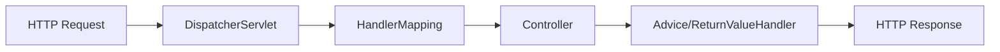

# Módulo 1 · Spring Web, datos y migraciones

Este módulo construye la capa web y de datos de un microservicio Java: MVC, DTOs, manejo de errores, JPA, consultas, migraciones y bases relacionales. El foco es contrato HTTP correcto y persistencia controlada.

**Entorno de referencia verificado (2026-05-22):** JDK 27.0.1.0.2, Maven 3.10.0, Spring Boot 3.5.0, H2 2.3.232.

## Aprende construyendo

### Tema 1: Spring MVC: DispatcherServlet, Controllers, Validación · Intermedio · 180 min

Caso guía: endpoint POST que valida input y devuelve 201.

#### DispatcherServlet

**Definición formal.** Front controller de Spring MVC que recibe requests, los enruta a handlers, aplica conversión/validación y resuelve la respuesta.



**Error común.** Poner lógica de negocio en controller. Corrección: controller fino, servicio con reglas.

### Tema 2: DTOs, @JsonProperty, Jackson · Intermedio · 120 min

Caso guía: separar nombre JSON de nombre Java sin exponer entidad.

#### DTO + Jackson

**Definición formal.** DTO modela contrato; Jackson mapea JSON↔Java. `@JsonProperty` define nombre/semántica del campo JSON.

**Ejemplo mínimo (concepto).**

```java
public record UserReq(@JsonProperty("user_name") @NotBlank String userName) {}
```

**Error común.** Usar entidad JPA como request/response. Corrección: DTOs.

### Tema 3: Manejo global de excepciones (@ControllerAdvice) · Intermedio · 120 min

Caso guía: errores consistentes con `ProblemDetail`/body propio.

#### `@RestControllerAdvice`

**Definición formal.** Componente transversal que transforma excepciones en respuestas HTTP.

**Error común.** Filtrar mensajes internos o stack traces. Corrección: error público controlado, detalle interno en logs.

### Tema 4: Spring Data JPA, Hibernate, entidades, relaciones, transacciones · Avanzado · 240 min

Caso guía: `Pedido` con items.

#### JPA/Hibernate

**Definición formal.** JPA es especificación ORM; Hibernate es implementación. Spring Data JPA simplifica repositorios.

**Error común.** N+1 y transacciones mal delimitadas. Corrección: fetch plan, DTO projection, `@Transactional` en servicio.

### Tema 5: Criteria API y Specifications · Avanzado · 180 min

Caso guía: filtros opcionales por estado/fecha.

#### Specifications

**Definición formal.** Abstracción de Spring Data sobre Criteria para componer predicados reutilizables.

**Error común.** Concatenar JPQL strings. Corrección: Specification/Criteria parametrizado.

### Tema 6: Flyway/Liquibase · Intermedio · 120 min

Caso guía: versionar esquema.

#### Migraciones

**Definición formal.** Scripts versionados aplicados en orden. Flyway usa SQL/versionado simple; Liquibase soporta changelog declarativo.

**Error común.** Editar migración aplicada. Corrección: nueva migración.

### Tema 7: PostgreSQL y MySQL · Intermedio · 120 min

Caso guía: elegir DB relacional por features/operación.

#### PostgreSQL/MySQL

**Definición formal.** RDBMS con dialectos SQL, tipos, índices y comportamiento transaccional propios.

**Regla.** Prueba queries críticas en la misma DB de producción. H2 es útil, no idéntico.

## Cierre

La capa web define el contrato; la capa de datos define la verdad persistente. Ambas necesitan límites, validación y migraciones.

## Checklist

- Controller fino, DTOs en borde.
- Errores globales consistentes.
- JPA con fetch plan consciente.
- Migraciones versionadas.
- Tests en DB real cuando importa.
