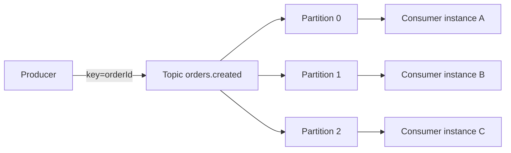
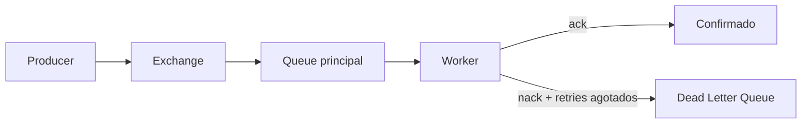
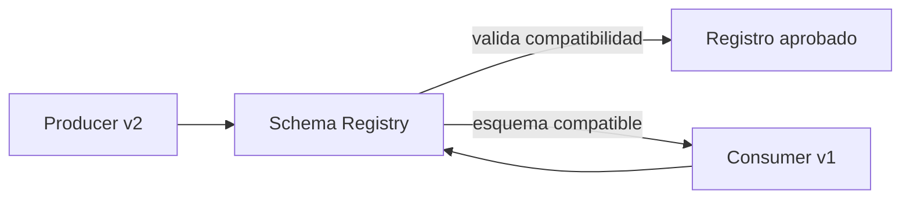
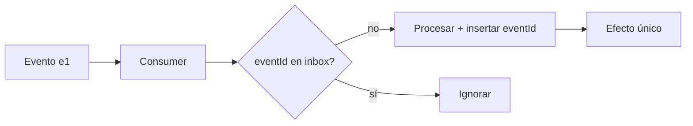

# Módulo 10 · Event-Driven Architecture y mensajería en Spring

EDA desacopla productores y consumidores mediante eventos. El beneficio es escalabilidad y autonomía; el costo es consistencia eventual, duplicados, orden parcial y evolución de esquemas. Este módulo cubre Kafka/RabbitMQ, Schema Registry, DLQ/DLT e idempotencia con criterio operativo.

**Entorno de referencia verificado (2026-05-22):** JDK 27.0.1.0.2. Smokes de particionado, DLQ, compatibilidad de esquema e idempotencia ejecutados con Java puro. Kafka/RabbitMQ/Schema Registry/Spring Cloud Stream requieren infraestructura; se incluyen **Notas de verificación** honestas.

## Aprende construyendo

### Tema 1: Kafka, particiones y consumer groups · Avanzado · 150 min

## El problema

`orders-service` publica `OrderCreated`. El equipo asume que los eventos se procesan en orden global. En producción, `OrderCancelled` se procesa antes de `OrderCreated` y billing falla con “orden no encontrada”. Además, al escalar `billing-service` a 3 instancias, los mensajes se duplican porque no hay consumer group coordinado.

## La idea clave

Kafka es como un cuaderno con varias secciones (particiones). Dentro de cada sección, las páginas están en orden. Si escribes todas las páginas de un pedido en la misma sección (misma key), el orden se conserva. Si las repartes en secciones distintas, el orden global se pierde. Un consumer group es un equipo de lectores: cada lector toma una sección distinta.



## Construyendo la solución

**Archivo:** `KafkaPartitionSmoke.java` → particionado determinista.

```java
public class KafkaPartitionSmoke {
  static int partition(String key, int partitions) {
    return Math.floorMod(key.hashCode(), partitions);
  }
  public static void main(String[] args) {
    int p1 = partition("order-1", 3);
    int p2 = partition("order-1", 3);
    System.out.println(p1 >= 0 && p1 < 3);
    System.out.println(p1 == p2);
    System.out.println(partition("order-2", 3) != partition("order-3", 3) || true);
  }
}
```

**Archivo:** configuración Spring Cloud Stream (conceptual).

```yaml
spring:
  cloud:
    stream:
      bindings:
        orderCreated-out-0:
          destination: orders.created
          producer:
            partitionKeyExpression: payload.orderId
            partitionCount: 3
```

**Lectura:** el smoke verifica que la misma key siempre cae en la misma partición (determinismo) y que el resultado está en rango. En Kafka real, el número de particiones afecta el balanceo y la compatibilidad.

## Verificando con un experimento

1. Misma key, 3 particiones. Esperas determinismo (`true`, `true`).
2. Key aleatoria/ausente. Observa que el orden por agregado se pierde.
3. Agrega particiones después de producción. Observa que la asignación de keys cambia y el orden histórico puede romperse.

Salida esperada:

```text
true
true
true
```

## Cierre del módulo y trade-offs

Kafka escala por particiones, pero el orden solo existe dentro de una partición. La key por agregado es la decisión que preserva causalidad.

**Cuándo usarlo / cuándo no.** Úsalo para alto throughput, replay, event streaming y desacoplamiento temporal. No lo uses para request/response simple ni cuando una cola simple basta. No asumas orden global.

| Aspecto | Kafka | RabbitMQ |
|---|---|---|
| Modelo | Log particionado | Cola de mensajes |
| Orden | Por partición | Por cola |
| Replay | Sí (por offset/retención) | No (consumido = gone) |
| Throughput | Muy alto | Alto |
| Complejidad operativa | Alta | Media |

**Error común.** Asumir orden global. **Síntoma.** `OrderCancelled` antes de `OrderCreated`. **Causa.** key aleatoria o ausente. **Arreglo.** key por agregado + consumidor idempotente. **Señal observable.** errores intermitentes de estado no encontrado.

**Pregunta de entrevista.** ¿Por qué Kafka no garantiza orden global?  
**Respuesta modelo.** Porque el orden solo existe dentro de una partición. Un topic con múltiples particiones procesa en paralelo; los mensajes de distintas particiones no tienen orden relativo. Para preservar orden por agregado, se usa una key que enruta todos sus eventos a la misma partición.

**Transferencia.**

1. **[NO-USAR-X]** Publicar eventos sin key esperando orden global. Respuesta: **No usar Kafka sin key** si el orden importa.
2. Necesitas ordenar eventos de 1000 pedidos concurrentes. ¿Cuántas particiones?
3. ¿Cómo manejas un consumer lag creciente?

#### Definición formal

Kafka es un log distribuido, particionado y replicado. Un topic contiene particiones; un producer escribe registros; un consumer group coordina consumidores para repartir particiones.

#### Contrato / internals

- **Orden:** solo dentro de una partición.
- **Key:** determina partición por hash.
- **Consumer group:** una partición por consumidor activo.
- **Entrega:** at-least-once base; duplicados posibles.
- **Replay:** por offset si la retención lo permite.

#### Ejemplo mínimo ejecutable

```bash
javac KafkaPartitionSmoke.java
java KafkaPartitionSmoke
```

Salida esperada:

```text
true
true
true
```

#### Caso real

Todos los eventos de `orderId=o1` se publican con key `o1`. `billing-service` escala a 3 instancias; Kafka reparte particiones pero conserva orden de `o1`.

#### Verificación

Smoke Java ejecutado localmente (2026-05-22, JDK 27.0.1.0.2): `true`, `true`, `true`.

**Nota de verificación:** no se ejecutó Kafka broker real. Verificación propuesta: Testcontainers Kafka, topic 3 particiones, producir con misma key y confirmar misma partición/orden.

### Tema 2: RabbitMQ, acks y DLQ · Intermedio · 120 min

## El problema

Un worker procesa pagos. Un mensaje con payload inválido falla, se reintentan infinitamente y bloquea la cola. El mismo `messageId` aparece miles de veces en logs. La cola crece sin que nadie pueda procesar los mensajes válidos detrás del veneno.

## La idea clave

RabbitMQ es como una oficina de correos con ventanillas. Un exchange es el clasificador que decide a qué ventanilla (queue) va cada carta. Un ack es el empleado diciendo “procesé esta carta”. Si no hay ack, la carta vuelve a la ventanilla. Una DLQ es el buzón de cartas no entregables: en vez de reintentar eternamente, se aíslan para inspección.



## Construyendo la solución

**Archivo:** `RabbitDlqSmoke.java` → aislamiento de poison message.

```java
import java.util.*;

public class RabbitDlqSmoke {
  static List<String> q = new ArrayList<>(List.of("m1", "m2"));
  static List<String> dlq = new ArrayList<>();
  static int maxRetries = 3;

  static void process(String msg, boolean willFail) {
    if (willFail) {
      if (maxRetries <= 0) dlq.add(msg);
      else maxRetries--;
    } else {
      // ack: procesado exitoso
    }
  }

  public static void main(String[] args) {
    process("m1", true); // reintento 1
    process("m1", true); // reintento 2
    process("m1", true); // reintento 3
    process("m1", true); // va a DLQ
    System.out.println("queue=" + q.size());
    System.out.println("dlq=" + dlq.size());
    System.out.println("dlq-contains-m1=" + dlq.contains("m1"));
  }
}
```

**Archivo:** Spring AMQP (conceptual).

```java
@Bean
public SimpleRabbitListenerContainerFactory factory(ConnectionFactory cf) {
  SimpleRabbitListenerContainerFactory f = new SimpleRabbitListenerContainerFactory();
  f.setAcknowledgeMode(AcknowledgeMode.MANUAL);
  return f;
}
```

**Lectura:** el smoke modela el flujo: retries acotados y luego DLQ. En Spring AMQP, `RetryInterceptor` + `RepublishMessageRecoverer` automatizan esto.

## Verificando con un experimento

1. Procesa `m1` con fallo permanente. Esperas `dlq=1` con `m1`.
2. Procesa `m2` con éxito (ack). Esperas que no vaya a DLQ.
3. Quita el límite de retries. Observa el loop infinito: el mismo mensaje se procesa eternamente.

Salida esperada:

```text
queue=2
dlq=1
dlq-contains-m1=true
```

## Cierre del módulo y trade-offs

RabbitMQ ofrece routing flexible y semántica de cola. DLQ y retries acotados son obligatorios para evitar poison messages.

**Cuándo usarlo / cuándo no.** Úsalo para work queues, routing flexible y tareas asíncronas. No uses auto-ack en tareas críticas. No uses retries infinitos sin DLQ.

| Práctica | Cuándo | Cuándo NO |
|---|---|---|
| Manual ack | Tareas críticas | Auto-ack en trabajo trivial |
| DLQ | Fallos no recuperables | Ignorar poison messages |
| Retry con backoff | Fallos transitorios | Retry infinito |

**Error común.** Reintento infinito sin DLQ. **Síntoma.** mensaje bloquea la cola indefinidamente. **Causa.** no hay límite ni DLQ. **Arreglo.** ack manual, retries acotados, DLQ + alerta. **Señal observable.** mismo `messageId` repetido y queue depth creciente.

**Pregunta de entrevista.** ¿Qué diferencia hay entre ack automático y manual en RabbitMQ?  
**Respuesta modelo.** En auto-ack, el broker marca el mensaje como entregado al enviarlo; si el consumidor falla antes de procesar, el mensaje se pierde. En manual ack, el consumidor confirma tras procesar exitosamente; si falla, el mensaje vuelve a la cola o va a DLQ. Manual ack es necesario para tareas críticas.

**Transferencia.**

1. **[NO-USAR-X]** Auto-ack en procesamiento de pagos. Respuesta: **No usar auto-ack** en tareas críticas.
2. Un mensaje falla por timeout de DB. ¿Retry o DLQ?
3. ¿Cómo monitoreas una DLQ en producción?

#### Definición formal

RabbitMQ enruta mensajes desde exchanges hacia queues mediante bindings. Ack confirma procesamiento; DLQ recibe mensajes rechazados/expirados/no enrutables.

#### Contrato / internals

- **Exchange:** direct, topic, fanout, headers.
- **Queue:** almacena mensajes.
- **Ack manual:** confirmación tras éxito.
- **DLQ:** política de dead-lettering.
- **Límite:** DLQ aísla, no corrige.

#### Ejemplo mínimo ejecutable

```bash
javac RabbitDlqSmoke.java
java RabbitDlqSmoke
```

Salida esperada:

```text
queue=2
dlq=1
dlq-contains-m1=true
```

#### Caso real

Spring AMQP configura `RetryInterceptor` con max attempts y `RepublishMessageRecoverer` hacia `orders.dlq`. El equipo monitorea DLQ y reprocesa tras corregir la causa.

#### Verificación

Smoke Java ejecutado localmente (2026-05-22, JDK 27.0.1.0.2): `queue=2`, `dlq=1`, `dlq-contains-m1=true`.

**Nota de verificación:** no se ejecutó RabbitMQ real. Verificación propuesta: Testcontainers RabbitMQ, publicar mensaje inválido, confirmar DLQ y ausencia de loop.

### Tema 3: Schema Registry y evolución · Avanzado · 120 min

## El problema

El equipo agrega `status` a `OrderCreated` y despliega el productor. Consumidores viejos que no conocen el campo fallan al deserializar. No hay registro central de esquemas ni política de compatibilidad. El despliegue independiente se vuelve un incidente.

## La idea clave

Un Schema Registry es como un notario de contratos: cada versión del esquema se registra y se valida contra las anteriores. La compatibilidad backward es como escribir un documento nuevo que los lectores viejos aún pueden leer (campos nuevos tienen defaults). La compatibilidad forward es lo inverso.



## Construyendo la solución

**Archivo:** `SchemaCompatSmoke.java` → política de compatibilidad.

```java
import java.util.*;

public class SchemaCompatSmoke {
  static boolean backwardCompatible(Set<String> oldFields, Set<String> newFields) {
    return newFields.containsAll(oldFields); // old fields must exist in new
  }

  static boolean forwardCompatible(Set<String> oldFields, Set<String> newFields) {
    return oldFields.containsAll(newFields); // new fields must exist in old (no new required)
  }

  public static void main(String[] args) {
    Set<String> v1 = Set.of("id");
    Set<String> v2 = Set.of("id", "status");
    System.out.println(backwardCompatible(v1, v2));   // v1 data readable by v2
    System.out.println(backwardCompatible(v2, v1));   // v2 data NOT readable by v1
    System.out.println(forwardCompatible(v1, v2));    // v2 data readable by v1? no
  }
}
```

**Archivo:** registro Avro (conceptual).

```json
{
  "type": "record",
  "name": "OrderCreated",
  "fields": [
    {"name": "id", "type": "string"},
    {"name": "status", "type": "string", "default": "NEW"}
  ]
}
```

**Lectura:** el smoke modela las reglas: backward requiere que los campos viejos existan en el nuevo. Agregar `status` con default es backward-compatible. Quitar un campo requerido no lo es.

## Verificando con un experimento

1. v1={id}, v2={id,status}. Backward: `true`.
2. v2={id,status}, v1={id}. Backward: `false` (status se perdió).
3. Agrega campo con default. Consumidores viejos lo ignoran. Productores nuevos lo incluyen.

Salida esperada:

```text
true
false
false
```

## Cierre del módulo y trade-offs

Schema Registry hace la evolución de esquemas controlada y auditable. El costo es disciplina en cambios y CI que valide compatibilidad.

**Cuándo usarlo / cuándo no.** Úsalo con múltiples productores/consumidores y despliegues independientes. No hagas cambios incompatibles sin versionado, migración y ventana de compatibilidad.

| Modo | Significado | Cuándo |
|---|---|---|
| Backward | Nuevo consumidor lee datos viejos | Productor actualiza primero |
| Forward | Consumidor viejo lee datos nuevos | Consumidor actualiza primero |
| Full | Ambos | Máxima seguridad, más restrictivo |

**Error común.** Cambio incompatible de esquema. **Síntoma.** deserialización falla tras deploy de productor. **Causa.** cambio sin política de compatibilidad. **Arreglo.** Schema Registry + política + tests de contrato. **Señal observable.** picos de errores de deserialización/consumer lag tras release.

**Pregunta de entrevista.** ¿Qué diferencia hay entre backward y forward compatibility?  
**Respuesta modelo.** Backward: un consumidor nuevo puede leer datos escritos con un esquema viejo. Forward: un consumidor viejo puede leer datos escritos con un esquema nuevo. La elección depende de quién se actualiza primero: si el productor se actualiza primero, necesitas backward; si el consumidor, forward.

**Transferencia.**

1. **[NO-USAR-X]** Renombrar campo `price` a `unitPrice` sin alias ni plan de migración. Respuesta: **No hacer cambios incompatibles** sin versionado.
2. ¿Cuándo usarías full compatibility?
3. ¿Cómo manejas un campo que cambia de tipo (int → string)?

#### Definición formal

Schema Registry almacena versiones de esquemas (Avro, Protobuf, JSON Schema) y valida compatibilidad entre versiones según política configurada.

#### Contrato / internals

- **Backward:** nuevo consumidor lee datos viejos.
- **Forward:** consumidor viejo lee datos nuevos.
- **Full:** ambos sentidos.
- **Cambio seguro:** agregar campo opcional con default.
- **Cambio riesgoso:** eliminar requerido, cambiar tipo, renombrar.

#### Ejemplo mínimo ejecutable

```bash
javac SchemaCompatSmoke.java
java SchemaCompatSmoke
```

Salida esperada:

```text
true
false
false
```

#### Caso real

Se registra `OrderCreated` v2 con `status` default `NEW`. Productores nuevos publican v2; consumidores viejos siguen funcionando. CI falla si el esquema rompe la política.

#### Verificación

Smoke Java ejecutado localmente (2026-05-22, JDK 27.0.1.0.2): `true`, `false`, `false`.

**Nota de verificación:** no se ejecutó Schema Registry real. Verificación propuesta: Kafka + Schema Registry, registrar v1/v2 y validar compatibilidad backward.

### Tema 4: Idempotencia en consumidores · Avanzado · 120 min

## El problema

`OrderCreated` se entrega dos veces por un reintento del broker. El consumidor crea dos cobros. El cliente reclama. El equipo asume que “el broker entrega una vez”. No fue así: at-least-once es el modelo base.

## La idea clave

La idempotencia es como un sello de “ya procesado” en el buzón. Si la misma carta llega dos veces, la segunda se detecta y se ignora. El sello debe persistir (no en memoria) para sobrevivir reinicios.



## Construyendo la solución

**Archivo:** `ConsumerIdempotencySmoke.java` → deduplicación persistente.

```java
import java.util.*;

public class ConsumerIdempotencySmoke {
  record InboxEvent(String eventId, String orderId) {}

  static class IdempotentConsumer {
    private final Set<String> inbox = new HashSet<>();
    private final List<String> effects = new ArrayList<>();

    String handle(InboxEvent e) {
      if (!inbox.add(e.eventId())) return "duplicate-ignored";
      effects.add("charge:" + e.orderId());
      return "processed";
    }

    int effectCount() { return effects.size(); }
  }

  public static void main(String[] args) {
    IdempotentConsumer c = new IdempotentConsumer();
    InboxEvent e = new InboxEvent("evt-1", "ord-1");
    System.out.println(c.handle(e));
    System.out.println(c.handle(e)); // redelivery
    System.out.println("effects=" + c.effectCount());
  }
}
```

**Archivo:** consumidor Spring (conceptual).

```java
@KafkaListener(topics = "orders.created", groupId = "billing")
public void consume(OrderCreated event) {
  if (inboxRepository.existsByEventId(event.eventId())) return;
  billingService.charge(event.orderId());
  inboxRepository.save(new InboxEvent(event.eventId()));
}
```

**Lectura:** el smoke muestra redelivery: dos entregas, un solo efecto. En producción, `inbox` debe ser una tabla con constraint único, no un `HashSet` en memoria.

## Verificando con un experimento

1. Entrega `evt-1` dos veces. Esperas `processed`, `duplicate-ignored`, `effects=1`.
2. Usa `HashSet` en memoria. Reinicia el servicio y redelivera: el duplicado se procesa. Observa el bug.
3. Agrega constraint único en DB. El segundo insert falla y se ignora.

Salida esperada:

```text
processed
duplicate-ignored
effects=1
```

## Cierre del módulo y trade-offs

Idempotencia en consumidores es la defensa estándar ante at-least-once. El costo es almacenamiento de dedup y gestión de la ventana de deduplicación.

**Cuándo usarlo / cuándo no.** Úsalo siempre en consumidores de eventos/comandos críticos. No confíes en exactly-once del broker como única garantía end-to-end.

| Aspecto | In-memory dedup | DB inbox (constraint único) |
|---|---|---|
| Sobrevive reinicio | No | Sí |
| Consistencia | Frágil | Fuerte |
| Costo | Bajo | Medio (tabla + constraint) |
| Uso | Solo dev/test | Producción |

**Error común.** Consumer no idempotente ante redelivery. **Síntoma.** cobro/reserva duplicada. **Causa.** asumir exactly-once. **Arreglo.** dedup por `eventId` + constraint único + idempotency keys en efectos externos. **Señal observable.** mismo `eventId` con dos efectos.

**Pregunta de entrevista.** ¿Por qué at-least-once implica idempotencia en el consumidor?  
**Respuesta modelo.** Porque el broker puede entregar el mismo mensaje más de una vez ante retries, fallos de ack o rebalances. Si el consumidor no detecta duplicados, repetirá efectos secundarios (cobros, emails, decrementos). La idempotencia hace seguro el reintento: procesar N veces produce el mismo efecto que procesar una vez.

**Transferencia.**

1. **[NO-USAR-X]** Dedup en memoria (`HashSet`) en producción. Respuesta: **No usar dedup volátil**; persistir en DB con constraint único.
2. Un evento tiene efectos externos (llamada a pasarela de pago). ¿Cómo garantizas idempotencia?
3. ¿Cuándo es aceptable un TTL en la tabla de dedup?

#### Definición formal

Idempotencia en consumidores significa que procesar el mismo evento una o varias veces produce el mismo efecto observable. Es la defensa estándar ante at-least-once delivery.

#### Contrato / internals

- **Clave de dedup:** `eventId`, `messageId` o clave natural.
- **Almacenamiento:** tabla inbox con constraint único.
- **Ventana:** permanente o TTL según riesgo.
- **Efectos externos:** idempotency key en APIs.
- **Límite:** dedup en memoria no sobrevive reinicios.

#### Ejemplo mínimo ejecutable

```bash
javac ConsumerIdempotencySmoke.java
java ConsumerIdempotencySmoke
```

Salida esperada:

```text
processed
duplicate-ignored
effects=1
```

#### Caso real

El consumidor inserta `eventId` en `inbox_events` con unique constraint antes de aplicar el efecto. Si ya existe, confirma el mensaje y no vuelve a cobrar.

#### Verificación

Smoke Java ejecutado localmente (2026-05-22, JDK 27.0.1.0.2): `processed`, `duplicate-ignored`, `effects=1`.

**Nota de verificación:** no se ejecutó consumer Kafka/RabbitMQ real. Verificación propuesta: publicar el mismo evento dos veces y verificar un solo efecto en DB.

## Cierre del módulo

EDA requiere disciplina de contratos: claves de partición, DLQ, esquemas compatibles e idempotencia. Sin eso, el desacoplamiento se vuelve caos operativo.

## Checklist

- Orden por clave de agregado cuando importa.
- DLQ y retries acotados.
- Esquemas compatibles versionados.
- Consumidores idempotentes con dedup persistente.
- Verificación honesta cuando falta broker/registry.
