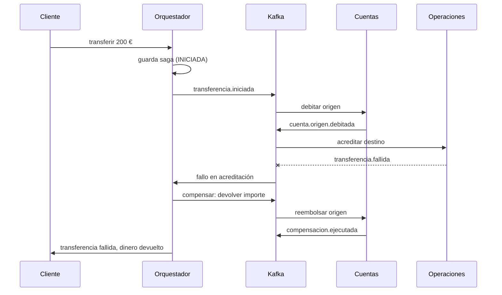

# Módulo 11 · Consistencia distribuida en Tienda Aurora

Cuando un proceso de negocio cruza servicios y bases de datos, no hay transacción ACID global simple. Tienda Aurora necesita crear un pedido que reserve stock, cobre el pago y notifique al cliente. Si el pago falla después de reservar, hay que compensar. Este módulo cubre outbox, CDC, sagas, idempotencia real y por qué 2PC suele ser una mala elección en microservicios.

**Entorno de referencia verificado (2026-11-22):** JDK 27.0.1.0.2, Gradle 9.8.2. Examples de outbox, saga, idempotencia y decisión 2PC ejecutados con Java puro. Debezium/Kafka Connect/Temporal requieren infraestructura; se incluyen notas de verificación honestas.

## Proyecto desde cero: tienda-aurora-consistency

### Prerrequisitos

```bash
java -version    # JDK 25+
gradle --version # Gradle 9.x
docker --version  # Docker 24+ (para PostgreSQL, Kafka, Debezium)
```

### Estructura del proyecto

```text
tienda-aurora-consistency/
├── build.gradle.kts
├── settings.gradle.kts
├── docker-compose.yml
├── orders-service/
│   ├── build.gradle.kts
│   └── src/main/java/com/aurora/orders/
│       ├── OrdersApplication.java
│       ├── domain/Order.java
│       ├── domain/OrderCreated.java
│       └── outbox/OutboxEvent.java
├── billing-service/
│   ├── build.gradle.kts
│   └── src/main/java/com/aurora/billing/
│       ├── BillingApplication.java
│       └── consumer/OrderCreatedConsumer.java
└── inventory-service/
    ├── build.gradle.kts
    └── src/main/java/com/aurora/inventory/
        ├── InventoryApplication.java
        └── saga/InventorySaga.java
```

### build.gradle.kts (raíz)

```kotlin
plugins {
    java
    id("org.springframework.boot") version "3.5.0" apply false
    id("io.spring.dependency-management") version "1.1.7" apply false
}

subprojects {
    apply(plugin = "java")
    java { toolchain { languageVersion = JavaLanguageVersion.of(25) } }
    repositories { mavenCentral() }
    dependencies {
        implementation("org.springframework.boot:spring-boot-starter-web")
        implementation("org.springframework.boot:spring-boot-starter-data-jpa")
        implementation("org.postgresql:postgresql")
        testImplementation("org.springframework.boot:spring-boot-starter-test")
    }
}
```

### settings.gradle.kts

```kotlin
rootProject.name = "tienda-aurora-consistency"
include("orders-service", "billing-service", "inventory-service")
```

### docker-compose.yml

```yaml
services:
  postgres:
    image: postgres:16
    environment:
      POSTGRES_DB: aurora
      POSTGRES_USER: aurora
      POSTGRES_PASSWORD: aurora
    ports:
      - "5432:5432"

  kafka:
    image: confluentinc/cp-kafka:7.6.0
    ports:
      - "9092:9092"
    environment:
      KAFKA_BROKER_ID: 1
      KAFKA_ZOOKEEPER_CONNECT: zookeeper:2181
      KAFKA_ADVERTISED_LISTENERS: PLAINTEXT://localhost:9092
      KAFKA_OFFSETS_TOPIC_REPLICATION_FACTOR: 1

  zookeeper:
    image: confluentinc/cp-zookeeper:7.6.0
    ports:
      - "2181:2181"
    environment:
      ZOOKEEPER_CLIENT_PORT: 2181
```

### Tema 1: Outbox y CDC con Debezium · Avanzado · 150 min

## Outbox y CDC: publicar eventos sin dual write

Al crear un pedido en Tienda Aurora, `orders-service` debe guardar el estado en PostgreSQL y publicar `OrderCreated` a Kafka. El equipo hace dual write: primero `INSERT orders`, luego `kafka.send()`. Un día Kafka está lento: el INSERT commita, el send falla. El pedido existe, pero nadie se entera. Al día siguiente, el send se reintenta y publica un evento fantasma de un pedido que ya fue cancelado. Inconsistencia en ambas direcciones.

El outbox es como dejar una nota en la misma bandeja de salida del pedido: si el pedido se guardó, la nota también se guardó, porque están en la misma transacción. Un relay (CDC/Debezium) lee esa bandeja y la envía al broker. Si el broker falla, la nota sigue en la bandeja para reintentar. El consumidor debe ser idempotente porque el relay puede reenviar.

```java
import java.util.*;

public class OutboxExample {
    static class Db {
        final List<String> orders = new ArrayList<>();
        final List<String> outbox = new ArrayList<>();
    }

    static void createOrder(Db db, String orderId) {
        db.orders.add(orderId);
        db.outbox.add("OrderCreated:" + orderId);
    }

    static int relay(Db db, List<String> published) {
        published.addAll(db.outbox);
        int n = db.outbox.size();
        db.outbox.clear();
        return n;
    }

    public static void main(String[] args) {
        Db db = new Db();
        List<String> published = new ArrayList<>();
        createOrder(db, "o1");
        System.out.println("outbox-before-relay=" + db.outbox.size());
        System.out.println("relay-sent=" + relay(db, published));
        System.out.println("outbox-after-relay=" + db.outbox.size());
        System.out.println("published=" + published);
    }
}
```

```bash
javac OutboxExample.java
java OutboxExample
```

Salida esperada:

```text
outbox-before-relay=1
relay-sent=1
outbox-after-relay=0
published=[OrderCreated:o1]
```

El error más común es dual write sin outbox. El síntoma es pedido creado pero evento no publicado. La causa es dos sistemas sin transacción compartida. La corrección es outbox transaccional + relay/CDC.

### Tema 2: Sagas orquestadas y coreografiadas · Avanzado · 120 min

## Motivación

Comprar en Tienda Aurora toca tres servicios: pedidos crea el pedido, inventario reserva la unidad y pagos cobra la tarjeta. Cada uno tiene su propia base de datos, así que no existe una transacción que abarque los tres. Si la tarjeta se rechaza después de reservar, la unidad queda apartada para un pedido que nunca se pagará, y el cliente siguiente ve «agotado» aunque hay stock.

## Concepto

Una **saga** es una secuencia de **transacciones locales**, una por servicio, que juntas forman una sola operación de negocio. Cada paso confirma su cambio en su propia base de datos y tiene definida una **compensación**: una acción de negocio que contrarresta su efecto. Si un paso falla y no puede recuperarse, la saga ejecuta las compensaciones de los pasos ya hechos **en orden inverso**.

Compensar no es retroceder el tiempo. Cancelar un pedido no lo borra: lo deja en estado `CANCELADO`, y durante la saga otros pueden ver estados intermedios (un pedido `PENDIENTE` con stock reservado). Por eso una saga ofrece **consistencia eventual**, no la atomicidad de una transacción ACID.

Hay dos formas de coordinar los pasos:

| | Orquestación | Coreografía |
|---|---|---|
| Quién decide el siguiente paso | Un orquestador central que guarda el estado de la saga | Cada servicio, al escuchar el evento del anterior |
| Dónde se ve el flujo | En un solo lugar (el orquestador) | Repartido entre los servicios |
| Ventaja | Fácil de seguir, probar y cambiar | Sin punto central; servicios más desacoplados |
| Riesgo | El orquestador concentra lógica | Con muchos pasos, nadie ve el flujo completo y aparecen ciclos de eventos |
| Cuándo | Flujos de 3+ pasos con compensaciones | Flujos cortos, de 2–3 pasos |

## Ejemplo mínimo

Un orquestador en Java puro: cada `Paso` une una acción con su compensación, y el orquestador apila los pasos completados para deshacerlos en orden inverso si alguno falla.

**Archivo:** `SagaPedido.java`

```java
import java.util.ArrayDeque;
import java.util.ArrayList;
import java.util.Deque;
import java.util.HashMap;
import java.util.List;
import java.util.Map;

public class SagaPedido {

    /** Un paso de la saga: una transacción local y la acción que la compensa. */
    record Paso(String nombre, Runnable accion, Runnable compensacion) {}

    static class Pedidos {
        final Map<String, String> estado = new HashMap<>();
        void crear(String id)    { estado.put(id, "PENDIENTE"); }
        void confirmar(String id) { estado.put(id, "CONFIRMADO"); }
        void cancelar(String id)  { estado.put(id, "CANCELADO"); }
    }

    static class Inventario {
        private final Map<String, Integer> stock = new HashMap<>(Map.of("TEC-1042", 5));
        private final Map<String, String> reservas = new HashMap<>();

        void reservar(String pedido, String sku) {
            int disponible = stock.get(sku);
            if (disponible == 0) throw new IllegalStateException("sin stock de " + sku);
            stock.put(sku, disponible - 1);
            reservas.put(pedido, sku);
        }

        /** Idempotente: liberar dos veces la misma reserva devuelve una sola unidad. */
        void liberar(String pedido) {
            String sku = reservas.remove(pedido);
            if (sku != null) stock.merge(sku, 1, Integer::sum);
        }

        int disponible(String sku) { return stock.get(sku); }
    }

    static class Pagos {
        private final boolean tarjetaRechazada;
        Pagos(boolean tarjetaRechazada) { this.tarjetaRechazada = tarjetaRechazada; }
        void cobrar(String pedido) {
            if (tarjetaRechazada) throw new IllegalStateException("pago rechazado");
        }
        void reembolsar(String pedido) { }
    }

    static class Orquestador {
        final List<String> registro = new ArrayList<>();

        boolean ejecutar(List<Paso> pasos) {
            Deque<Paso> hechos = new ArrayDeque<>();
            for (Paso paso : pasos) {
                try {
                    paso.accion().run();
                    hechos.push(paso);
                    registro.add("ok          " + paso.nombre());
                } catch (RuntimeException e) {
                    registro.add("falla       " + paso.nombre() + " (" + e.getMessage() + ")");
                    while (!hechos.isEmpty()) {           // orden inverso
                        Paso hecho = hechos.pop();
                        hecho.compensacion().run();
                        registro.add("compensado  " + hecho.nombre());
                    }
                    return false;
                }
            }
            return true;
        }
    }

    static void comprar(String pedido, boolean tarjetaRechazada) {
        var pedidos = new Pedidos();
        var inventario = new Inventario();
        var pagos = new Pagos(tarjetaRechazada);
        var saga = new Orquestador();

        boolean exito = saga.ejecutar(List.of(
            new Paso("crear pedido",   () -> pedidos.crear(pedido),                  () -> pedidos.cancelar(pedido)),
            new Paso("reservar stock", () -> inventario.reservar(pedido, "TEC-1042"), () -> inventario.liberar(pedido)),
            new Paso("cobrar pago",    () -> pagos.cobrar(pedido),                   () -> pagos.reembolsar(pedido))
        ));
        if (exito) pedidos.confirmar(pedido);

        System.out.println("== " + pedido + (tarjetaRechazada ? " (tarjeta rechazada)" : ""));
        saga.registro.forEach(linea -> System.out.println("  " + linea));
        System.out.println("  pedido: " + pedidos.estado.get(pedido)
                + " | stock TEC-1042: " + inventario.disponible("TEC-1042"));

        if (!exito) {
            inventario.liberar(pedido);   // llega un reintento duplicado de la compensación
            System.out.println("  compensación repetida, stock: " + inventario.disponible("TEC-1042"));
        }
    }

    public static void main(String[] args) {
        comprar("P-1", false);
        comprar("P-2", true);
    }
}
```

```text
$ java SagaPedido.java
== P-1
  ok          crear pedido
  ok          reservar stock
  ok          cobrar pago
  pedido: CONFIRMADO | stock TEC-1042: 4
== P-2 (tarjeta rechazada)
  ok          crear pedido
  ok          reservar stock
  falla       cobrar pago (pago rechazado)
  compensado  reservar stock
  compensado  crear pedido
  pedido: CANCELADO | stock TEC-1042: 5
  compensación repetida, stock: 5
```

En P-2 el pago falla. El orquestador compensa primero la reserva y después el pedido, en orden inverso, y el stock vuelve a 5. La última línea simula que la compensación llega dos veces: el stock sigue en 5 porque `liberar` es idempotente.

## Cómo funciona por dentro

En producción el orquestador no llama métodos: publica **comandos** y escucha **eventos** en un broker como Kafka, y guarda el estado de cada saga en su propia tabla para retomarla si se reinicia. Una transferencia bancaria con orquestador se ve así:



La tabla de la saga es lo que permite sobrevivir a caídas: si el orquestador se reinicia a mitad, lee el último estado guardado y continúa o compensa.

## Reglas y casos límite

- **Toda compensación debe ser idempotente.** Con mensajería «al menos una vez», el mismo comando puede llegar dos veces. Usa el id del pedido como clave, como hace `liberar`.
- **Una compensación también puede fallar.** Se reintenta con backoff; si se agotan los reintentos, la saga queda en un estado que requiere intervención humana, con alerta. Nunca se ignora en silencio.
- **Hay pasos que no se compensan.** Un correo enviado no se «des-envía». Esos pasos van al final, después del último que puede fallar; en el ejemplo, la confirmación al cliente se envía solo si el pago pasó.
- **Publica eventos con Outbox (Tema 1).** Si el servicio guarda en su base de datos y luego cae antes de publicar el evento, la saga se queda colgada.

> **Advertencia.** Una saga no aísla: entre la reserva y el pago, otro proceso puede leer el stock ya descontado. Si eso importa al negocio, se añade un estado explícito (`RESERVADO_PENDIENTE_PAGO`) que los demás procesos sepan interpretar.

## Compruébalo

1. En `SagaPedido`, haz que falle la reserva de stock en lugar del pago. ¿Qué pasos se compensan? Predícelo y ejecútalo.
2. Quita la comprobación `if (sku != null)` de `liberar` y repite la compensación duplicada. ¿Qué número muestra el stock y por qué es un error de negocio?
3. ¿Coreografía u orquestación para una transferencia con débito, crédito, antifraude y notificación? Justifícalo con la tabla del Concepto.

### Tema 3: Idempotencia real y exactly-once práctico · Avanzado · 120 min

## Idempotencia real y exactly-once

El equipo afirma "usamos exactly-once de Kafka, así que no hay duplicados". En producción, un consumer se reinicia a mitad del procesamiento y el mismo evento se vuelve a entregar. El pago se aplica dos veces. La garantía del broker no cubrió el efecto en la base de datos ni en la pasarela externa.

Exactly-once end-to-end es como prometer que un paquete llega una sola vez en un sistema de correos imperfecto. La solución práctica no es "un correo perfecto", sino "el destinatario firma un recibo y no procesa el mismo paquete dos veces". Ese recibo es el dedup store.

```java
import java.util.*;

public class ExactlyOnceExample {
    record PaymentEvent(String eventId, String orderId, int amount) {}

    static class PaymentProcessor {
        private final Set<String> dedup = new HashSet<>();
        private final List<String> ledger = new ArrayList<>();

        String process(PaymentEvent e) {
            if (!dedup.add(e.eventId())) return "duplicate-ignored";
            ledger.add("charge:" + e.orderId() + ":" + e.amount());
            return "applied";
        }

        int ledgerSize() { return ledger.size(); }
    }

    public static void main(String[] args) {
        PaymentProcessor p = new PaymentProcessor();
        PaymentEvent e = new PaymentEvent("evt-1", "ord-1", 100);
        System.out.println("first=" + p.process(e));
        System.out.println("retry=" + p.process(e));
        System.out.println("ledger-size=" + p.ledgerSize());
    }
}
```

```bash
javac ExactlyOnceExample.java
java ExactlyOnceExample
```

Salida esperada:

```text
first=applied
retry=duplicate-ignored
ledger-size=1
```

Exactly-once end-to-end es un objetivo, no una garantía mágica. La práctica es at-least-once + idempotencia + dedup + transacciones locales. El error más común es asumir exactly-once del broker: doble cargo o reserva.

### Tema 4: Por qué evitar 2PC · Avanzado · 90 min

## Por qué evitar 2PC

El equipo propone XA/2PC para "garantizar consistencia" entre la DB de orders y Kafka. En el primer load test, la latencia se triplica y los locks duran segundos. Cuando el coordinator falla, los recursos quedan bloqueados y nadie puede procesar nuevas órdenes.

2PC es como una votación donde todos deben levantar la mano antes de que el presidente diga "aprobado". Si alguien no responde, todos quedan con la mano levantada esperando. En microservicios, esa espera bloquea recursos, aumenta latencia y crea un punto único de falla.

```java
public class TwoPcDecisionExample {
    static String choose(boolean sameDatabase, boolean needsGlobalAtomicity) {
        if (sameDatabase) return "local-transaction";
        if (needsGlobalAtomicity) return "evaluate-2pc-with-caution";
        return "outbox-or-saga";
    }

    public static void main(String[] args) {
        System.out.println("same-db=" + choose(true, true));
        System.out.println("cross-system=" + choose(false, false));
        System.out.println("needs-atomicity=" + choose(false, true));
    }
}
```

```bash
javac TwoPcDecisionExample.java
java TwoPcDecisionExample
```

Salida esperada:

```text
same-db=local-transaction
cross-system=outbox-or-saga
needs-atomicity=evaluate-2pc-with-caution
```

2PC busca atomicidad global a costa de latencia, locks y disponibilidad. En microservicios, outbox + saga + idempotencia suelen ser el trade-off correcto.

## Cierre

La consistencia distribuida se diseña: outbox para publicar confiablemente, sagas para procesos largos, idempotencia para duplicados. 2PC rara vez es el trade-off correcto en microservicios. Para Tienda Aurora, esto significa que cuando un pedido se confirma, el stock se reserva, el pago se procesa y la notificación se envía, todo con compensaciones si algo falla, sin bloquear el sistema entero. Gradle coordina el build multi-módulo con dependencias por servicio.

## Checklist

- Outbox/CDC para DB+broker.
- Sagas con compensaciones idempotentes.
- Consumidores idempotentes con dedup persistente.
- Evito 2PC por defecto.
- Verificación honesta ante falta de infraestructura distribuida.
