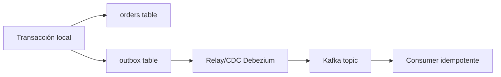
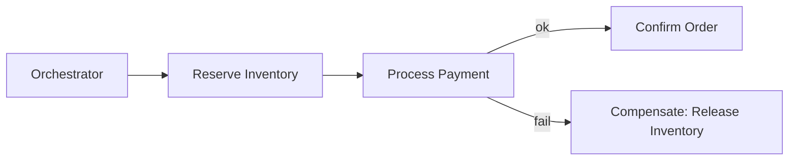
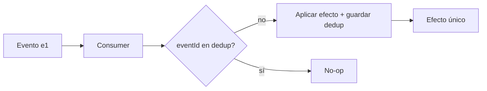
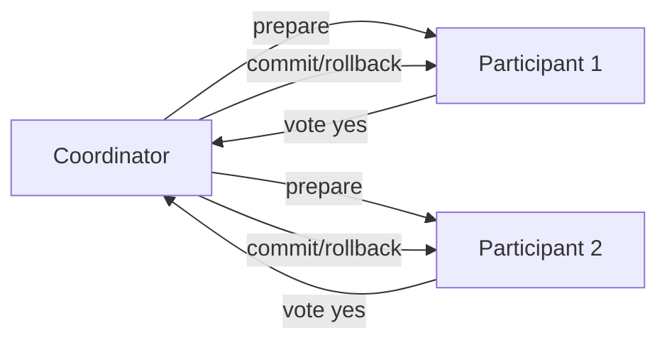

# Módulo 11 · Consistencia distribuida en Spring

Cuando un proceso de negocio cruza servicios y bases de datos, no hay transacción ACID global simple. Este módulo cubre outbox, CDC, sagas, idempotencia real y por qué 2PC suele ser una mala elección en microservicios.

**Entorno de referencia verificado (2026-05-22):** JDK 27.0.1.0.2. Smokes de outbox, saga, idempotencia y decisión 2PC ejecutados con Java puro. Debezium/Kafka Connect/Temporal requieren infraestructura; se incluyen **Notas de verificación** honestas.

## Aprende construyendo

### Tema 1: Outbox y CDC con Debezium · Avanzado · 150 min

#### Paso 1 · El dolor

Al crear un pedido, `orders-service` debe guardar el estado en PostgreSQL y publicar `OrderCreated` a Kafka. El equipo hace dual write: primero `INSERT orders`, luego `kafka.send()`. Un día Kafka está lento: el INSERT commita, el send falla. El pedido existe, pero nadie se entera. Al día siguiente, el send se reintenta y publica un evento fantasma de un pedido que ya fue cancelado. Inconsistencia en ambas direcciones.

#### Paso 2 · La intuición

El outbox es como dejar una nota en la misma bandeja de salida del pedido: si el pedido se guardó, la nota también se guardó, porque están en la misma transacción. Un relay (CDC/Debezium) lee esa bandeja y la envía al broker. Si el broker falla, la nota sigue en la bandeja para reintentar. El consumidor debe ser idempotente porque el relay puede reenviar.



#### Paso 3 · La construcción

**Archivo:** `OutboxSmoke.java` → atomicidad local.

```java
import java.util.*;

public class OutboxSmoke {
  static class Db {
    final List<String> orders = new ArrayList<>();
    final List<String> outbox = new ArrayList<>();
  }

  static void createOrder(Db db, String orderId) {
    db.orders.add(orderId);              // negocio
    db.outbox.add("OrderCreated:" + orderId); // evento en misma transacción
  }

  static int relay(Db db, List<String> published) {
    published.addAll(db.outbox);
    int n = db.outbox.size();
    db.outbox.clear();
    return n;
  }

  public static void main(String[] args) {
    Db db = new Db();
    List<String> published = new ArrayList<>();
    createOrder(db, "o1");
    System.out.println("outbox-before-relay=" + db.outbox.size());
    System.out.println("relay-sent=" + relay(db, published));
    System.out.println("outbox-after-relay=" + db.outbox.size());
    System.out.println("published=" + published);
  }
}
```

**Archivo:** Debezium config (conceptual).

```json
{
  "name": "outbox-connector",
  "config": {
    "connector.class": "io.debezium.connector.postgresql.PostgresConnector",
    "table.include.list": "public.outbox_events",
    "transforms": "outbox",
    "transforms.outbox.type": "io.debezium.transforms.outbox.EventRouter"
  }
}
```

**Lectura:** el smoke muestra que negocio y outbox se guardan juntos (misma transacción). El relay vacía el outbox y publica. Si el relay falla, el outbox retiene el evento.

#### Paso 4 · El experimento

1. Crea pedido. Esperas `outbox-before-relay=1`.
2. Relay ejecuta. Esperas `relay-sent=1`, `outbox-after-relay=0`.
3. Simula fallo del relay (no ejecutar relay). Observa que el outbox retiene el evento para reintento.
4. Redelivera el evento. El consumidor idempotente lo ignora.

Salida esperada:

```text
outbox-before-relay=1
relay-sent=1
outbox-after-relay=0
published=[OrderCreated:o1]
```

#### Paso 5 · El cierre

Outbox elimina el dual write al hacer atómico negocio + evento en la misma DB. CDC/Debezium automatiza la publicación. El costo es complejidad operativa y almacenamiento.

**Cuándo usarlo / cuándo no.** Úsalo ante dual write DB+broker donde perder/publicar evento fantasma tiene costo. No lo omitas en flujos críticos. No lo uses si una transacción local en un solo servicio resuelve el problema.

| Aspecto | Dual write (sin outbox) | Outbox + CDC |
|---|---|---|
| Atomicidad | No garantizada | Local (DB) |
| Publicación | Inmediata pero frágil | Relay asíncrono |
| Consistencia | Riesgo de desync | Eventual pero controlada |
| Complejidad | Baja | Media-alta |

**Error común.** Dual write sin outbox. **Síntoma.** pedido creado pero evento no publicado (o viceversa). **Causa.** dos sistemas sin transacción compartida. **Arreglo.** outbox transaccional + relay/CDC. **Señal observable.** discrepancia entre filas DB y mensajes en topic.

**Pregunta de entrevista.** ¿Por qué outbox + CDC es mejor que “guardar y publicar” en dos pasos?  
**Respuesta modelo.** Porque el outbox hace atómico el cambio de negocio y el evento en la misma transacción local. Si el broker falla, el evento queda en la tabla outbox para reintentar. Sin outbox, un fallo entre el commit DB y el publish deja el sistema inconsistente sin forma automática de recuperar.

**Transferencia.**

1. **[NO-USAR-X]** `INSERT orders` y luego `kafka.send()` sin outbox en un flujo crítico. Respuesta: **No usar dual write** sin outbox.
2. ¿Cuándo usarías polling publisher en vez de Debezium CDC?
3. ¿Cómo manejas el orden de eventos con outbox y múltiples agregados?

#### Definición formal

Outbox pattern persiste el evento en una tabla dentro de la misma transacción local del cambio de negocio. CDC (Change Data Capture) lee cambios y los publica a otro sistema. Debezium es una plataforma CDC común.

#### Contrato / internals

- **Atomicidad local:** negocio + outbox en una transacción DB.
- **Relay/CDC:** publica y marca enviado.
- **At-least-once:** el relay puede republicar; consumidor idempotente.
- **Orden:** por agregado cuando importa.
- **Límite:** complejidad operativa y almacenamiento.

#### Ejemplo mínimo ejecutable

```bash
javac OutboxSmoke.java
java OutboxSmoke
```

Salida esperada:

```text
outbox-before-relay=1
relay-sent=1
outbox-after-relay=0
published=[OrderCreated:o1]
```

#### Caso real

`orders-service` inserta `orders` y `outbox_events` en la misma transacción. Debezium publica a Kafka; el consumidor actualiza read model idempotentemente.

#### Verificación

Smoke Java ejecutado localmente (2026-05-22, JDK 27.0.1.0.2): `outbox-before-relay=1`, `relay-sent=1`, `outbox-after-relay=0`, `published=[OrderCreated:o1]`.

**Nota de verificación:** no se ejecutó Debezium/Kafka Connect real. Verificación propuesta: Postgres + Kafka + Debezium, insertar pedido y confirmar evento publicado desde outbox.

### Tema 2: Sagas orquestadas/coreografiadas · Avanzado · 180 min

#### Paso 1 · El dolor

Crear un pedido implica reservar inventario y cobrar pago. Si el pago falla después de reservar, la reserva queda tomada y el stock se pierde. No hay transacción ACID global; el equipo no sabe cómo compensar.

#### Paso 2 · La intuición

Una saga es como un viaje con escalas: cada escala (transacción local) se confirma por separado, y si una falla, tomas el vuelo de regreso (compensación). No es un rollback de base de datos; es una acción de negocio que deshace el efecto. La orquestación es como un director de orquesta que indica quién toca; la coreografía es como músicos que escuchan al anterior y saben cuándo entrar.



#### Paso 3 · La construcción

**Archivo:** `SagaSmoke.java` → orquestación con compensación.

```java
public class SagaSmoke {
  static String run(boolean paymentOk, boolean inventoryReserved) {
    if (!inventoryReserved) return "fail: no inventory";
    if (!paymentOk) return "compensate: release inventory";
    return "ok: order confirmed";
  }

  static boolean compensationIdempotent(int attempts) {
    // La compensación debe poder ejecutarse N veces con el mismo resultado.
    return attempts >= 1;
  }

  public static void main(String[] args) {
    System.out.println(run(false, true));
    System.out.println(run(true, true));
    System.out.println(run(true, false));
    System.out.println(compensationIdempotent(3));
  }
}
```

**Archivo:** orquestador (conceptual, Temporal/Camunda).

```java
// Saga state machine
stateMachine.transition(OrderCreated.class, () -> reserveInventory());
stateMachine.transition(InventoryReserved.class, () -> processPayment());
stateMachine.onFailure(PaymentFailed.class, () -> releaseInventory());
```

**Lectura:** el smoke modela los tres resultados: pago falla → compensar; todo ok → confirmar; sin inventario → fallar. La compensación debe ser idempotente.

#### Paso 4 · El experimento

1. Pago falla, inventario reservado. Esperas `compensate: release inventory`.
2. Todo ok. Esperas `ok: order confirmed`.
3. Sin inventario. Esperas `fail: no inventory`.
4. Ejecuta compensación 3 veces. Esperas `true` (idempotente).

Salida esperada:

```text
compensate: release inventory
ok: order confirmed
fail: no inventory
true
```

#### Paso 5 · El cierre

Las sagas coordinan procesos multi-servicio con compensaciones. No dan aislamiento ACID global; los estados intermedios son visibles.

**Cuándo usarlo / cuándo no.** Úsala en procesos multi-servicio de negocio (pedido, pago, inventario). No la uses si una transacción local en un servicio resuelve el problema. Evita 2PC distribuido como default.

| Aspecto | Saga orquestada | Saga coreografiada |
|---|---|---|
| Control | Centralizado (orquestador) | Distribuido (eventos) |
| Visibilidad | Alta (estado central) | Baja (estado disperso) |
| Acoplamiento | Al orquestador | Al broker/eventos |
| Complejidad | Estado del orquestador | Trazabilidad del flujo |

**Error común.** Falta de compensación o no idempotente. **Síntoma.** reserva queda tomada sin pago. **Causa.** no diseñar compensaciones o reintentos inseguros. **Arreglo.** compensaciones idempotentes, estado persistido, reintentos seguros. **Señal observable.** recursos huérfanos en estado “RESERVED”.

**Pregunta de entrevista.** ¿Por qué una compensación no es un rollback técnico?  
**Respuesta modelo.** Porque un rollback de base de datos revierte cambios dentro de una transacción ACID. Una compensación es una acción de negocio nueva que deshace el efecto semántico: liberar reserva, reembolsar, cancelar envío. Puede tener efectos secundarios propios y debe ser idempotente porque puede ejecutarse más de una vez.

**Transferencia.**

1. **[NO-USAR-X]** Usar 2PC/XA para coordinar pago e inventario en microservicios. Respuesta: **No usar 2PC por defecto**; usar saga con compensaciones.
2. ¿Cuándo elegirías orquestada vs coreografiada?
3. ¿Cómo manejas un paso que no tiene compensación posible (ej. email enviado)?

#### Definición formal

Una saga es una secuencia de transacciones locales donde cada paso tiene una compensación. Orquestada: un coordinador decide. Coreografiada: los servicios reaccionan a eventos.

#### Contrato / internals

- **Transacción local:** cada servicio confirma su DB.
- **Compensación:** acción semántica inversa, idempotente.
- **Estado:** persistir estado del proceso (orquestada).
- **Idempotencia:** pasos y compensaciones toleran reintentos.
- **Límite:** sin aislamiento ACID global; estados intermedios visibles.

#### Ejemplo mínimo ejecutable

```bash
javac SagaSmoke.java
java SagaSmoke
```

Salida esperada:

```text
compensate: release inventory
ok: order confirmed
fail: no inventory
true
```

#### Caso real

Orquestador: crea pedido → reserva inventario → cobra pago. Si pago falla, emite compensación `ReleaseInventory` (idempotente por `sagaId`).

#### Verificación

Smoke Java ejecutado localmente (2026-05-22, JDK 27.0.1.0.2): `compensate: release inventory`, `ok: order confirmed`, `fail: no inventory`, `true`.

**Nota de verificación:** no se ejecutó orquestador Temporal/Camunda ni saga coreografiada con broker real. Verificación propuesta: simular fallo en paso 2 y confirmar compensación aplicada una sola vez.

### Tema 3: Idempotencia real y exactly-once práctico · Avanzado · 120 min

#### Paso 1 · El dolor

El equipo afirma “usamos exactly-once de Kafka, así que no hay duplicados”. En producción, un consumer se reinicia a mitad del procesamiento y el mismo evento se vuelve a entregar. El pago se aplica dos veces. La garantía del broker no cubrió el efecto en la base de datos ni en la pasarela externa.

#### Paso 2 · La intuición

Exactly-once end-to-end es como prometer que un paquete llega una sola vez en un sistema de correos imperfecto: el correo puede entregarlo dos veces. La solución práctica no es “un correo perfecto”, sino “el destinatario firma un recibo y no procesa el mismo paquete dos veces”. Ese recibo es el dedup store.



#### Paso 3 · La construcción

**Archivo:** `ExactlyOnceSmoke.java` → idempotencia end-to-end.

```java
import java.util.*;

public class ExactlyOnceSmoke {
  record PaymentEvent(String eventId, String orderId, int amount) {}

  static class PaymentProcessor {
    private final Set<String> dedup = new HashSet<>();
    private final List<String> ledger = new ArrayList<>();

    String process(PaymentEvent e) {
      if (!dedup.add(e.eventId())) return "duplicate-ignored";
      ledger.add("charge:" + e.orderId() + ":" + e.amount());
      return "applied";
    }

    int ledgerSize() { return ledger.size(); }
  }

  public static void main(String[] args) {
    PaymentProcessor p = new PaymentProcessor();
    PaymentEvent e = new PaymentEvent("evt-1", "ord-1", 100);
    System.out.println(p.process(e));
    System.out.println(p.process(e)); // redelivery
    System.out.println("ledger=" + p.ledgerSize());
  }
}
```

**Lectura:** el smoke muestra redelivery: dos entregas, un solo efecto en el ledger. En producción, `dedup` debe ser una tabla con constraint único, no un `HashSet` en memoria.

#### Paso 4 · El experimento

1. Procesa `evt-1` dos veces. Esperas `applied`, `duplicate-ignored`, `ledger=1`.
2. Usa dedup en memoria. Reinicia el servicio y redelivera: el duplicado se procesa. Observa el bug.
3. Agrega constraint único en DB. El segundo insert falla y se ignora.

Salida esperada:

```text
applied
duplicate-ignored
ledger=1
```

#### Paso 5 · El cierre

Exactly-once end-to-end es un objetivo, no una garantía mágica. La práctica es at-least-once + idempotencia + dedup + transacciones locales.

**Cuándo usarlo / cuándo no.** Úsalo en todo consumidor/command handler crítico. No afirmes “exactly-once” sin acotar el alcance técnico real. No confíes en el broker como única garantía.

| Garantía | Alcance | Límite |
|---|---|---|
| At-least-once | Broker entrega ≥1 vez | Duplicados posibles |
| Idempotencia | Efecto único por clave | Requiere dedup store |
| Exactly-once (Kafka) | Dentro del ecosistema Kafka | No cubre sistemas externos |
| Exactly-once end-to-end | Prácticamente imposible sin coordinación | Costo alto |

**Error común.** Asumir exactly-once del broker. **Síntoma.** doble cargo/reserva. **Causa.** garantía no cubre efecto en DB/API externa. **Arreglo.** idempotencia end-to-end con dedup + claves. **Señal observable.** dos filas de efecto con mismo `eventId`.

**Pregunta de entrevista.** ¿Qué es exactly-once en la práctica?  
**Respuesta modelo.** Es el efecto de negocio aplicado una sola vez, aunque la entrega ocurra varias veces. Se logra con at-least-once delivery + idempotencia (dedup por clave) + transacciones locales. No es una garantía mágica del broker; es un diseño del consumidor.

**Transferencia.**

1. **[NO-USAR-X]** Afirmar “exactly-once” sin dedup store ni idempotency key. Respuesta: **No afirmar exactly-once** sin acotar alcance y evidencia.
2. Un consumer llama a una pasarela de pago externa. ¿Cómo garantizas idempotencia?
3. ¿Cuándo es aceptable at-least-once sin dedup?

#### Definición formal

Exactly-once end-to-end es difícil en sistemas distribuidos heterogéneos. En práctica se usa at-least-once delivery + idempotencia + deduplicación + transacciones locales.

#### Contrato / internals

- **Dedup store:** tabla con unique constraint por `eventId`.
- **Orden:** registrar dedup + aplicar efecto en transacción local.
- **Idempotency key:** para APIs externas.
- **Reintentos:** seguros solo con protección.
- **Límite:** Kafka exactly-once no cubre sistemas externos.

#### Ejemplo mínimo ejecutable

```bash
javac ExactlyOnceSmoke.java
java ExactlyOnceSmoke
```

Salida esperada:

```text
applied
duplicate-ignored
ledger=1
```

#### Caso real

`PaymentApplied` con `eventId=e1` se procesa; el segundo intento detecta unique constraint y termina como no-op.

#### Verificación

Smoke Java ejecutado localmente (2026-05-22, JDK 27.0.1.0.2): `applied`, `duplicate-ignored`, `ledger=1`.

**Nota de verificación:** no se ejecutó flujo Kafka+DB real. Verificación propuesta: redelivery del mismo evento y assertion de un único efecto persistido.

### Tema 4: Por qué evitar 2PC · Avanzado · 90 min

#### Paso 1 · El dolor

El equipo propone XA/2PC para “garantizar consistencia” entre la DB de orders y Kafka. En el primer load test, la latencia se triplica y los locks duran segundos. Cuando el coordinator falla, los recursos quedan bloqueados y nadie puede procesar nuevas órdenes.

#### Paso 2 · La intuición

2PC es como una votación donde todos deben levantar la mano antes de que el presidente diga “aprobado”. Si alguien no responde, todos quedan con la mano levantada esperando. En microservicios, esa espera bloquea recursos, aumenta latencia y crea un punto único de falla (el coordinador). La alternativa es aceptar consistencia eventual con outbox y sagas.



#### Paso 3 · La construcción

**Archivo:** `TwoPcDecisionSmoke.java` → decisión por contexto.

```java
public class TwoPcDecisionSmoke {
  static String choose(boolean sameDatabase, boolean needsGlobalAtomicity) {
    if (sameDatabase) return "local-transaction";
    if (needsGlobalAtomicity) return "evaluate-2pc-with-caution";
    return "outbox-or-saga";
  }
  public static void main(String[] args) {
    System.out.println(choose(true, true));
    System.out.println(choose(false, false));
    System.out.println(choose(false, true));
  }
}
```

**Lectura:** el smoke modela la decisión: misma DB → transacción local. Distinto sistema sin atomicidad global fuerte → outbox/saga. Solo evaluar 2PC si realmente se necesita atomicidad distribuida fuerte.

#### Paso 4 · El experimento

1. Misma DB. Esperas `local-transaction`.
2. DB + broker, sin atomicidad global fuerte. Esperas `outbox-or-saga`.
3. DB + broker, con atomicidad global fuerte requerida. Esperas `evaluate-2pc-with-caution`.

Salida esperada:

```text
local-transaction
outbox-or-saga
evaluate-2pc-with-caution
```

#### Paso 5 · El cierre

2PC busca atomicidad global a costa de latencia, locks y disponibilidad. En microservicios, outbox + saga + idempotencia suelen ser el trade-off correcto.

**Cuándo usarlo / cuándo no.** Evítalo por defecto en microservicios. Considera solo en entornos controlados con participantes compatibles y requerimiento real de atomicidad distribuida fuerte. Prefiere transacción local + outbox/saga.

| Aspecto | 2PC/XA | Outbox + Saga |
|---|---|---|
| Atomicidad | Global fuerte | Eventual + compensaciones |
| Latencia | Alta (locks) | Menor (async) |
| Disponibilidad | Dependiente del coordinator | Mayor autonomía |
| Complejidad | Protocolo distribuido | Diseño de compensaciones |
| Fit microservicios | Pobre | Bueno |

**Error común.** Usar 2PC por “garantía de consistencia”. **Síntoma.** latencia alta, locks prolongados, bloqueos. **Causa.** coordinación distribuida con dependencia del coordinator. **Arreglo.** modelar consistencia eventual con outbox/saga/idempotencia. **Señal observable.** timeouts del coordinator y transacciones en prepare prolongadas.

**Pregunta de entrevista.** ¿Por qué 2PC es problemático en microservicios?  
**Respuesta modelo.** Porque introduce locks distribuidos, latencia alta, dependencia de un coordinator y dificultad de recuperación ante fallos de red. En microservicios, donde la autonomía y disponibilidad son prioritarias, la consistencia eventual con outbox, sagas e idempotencia suele ser un mejor trade-off.

**Transferencia.**

1. **[NO-USAR-X]** Usar XA para coordinar 5 servicios en un checkout de alta concurrencia. Respuesta: **No usar 2PC por defecto**; usar saga.
2. Todo está en la misma DB PostgreSQL. ¿Necesitas 2PC?
3. ¿En qué escenario 2PC podría ser justificado?

#### Definición formal

Two-Phase Commit (2PC) es un protocolo de transacción distribuida con fases de preparación y commit coordinadas por un transaction coordinator. Busca atomicidad global entre participantes.

#### Contrato / internals

- **Fase 1 (prepare):** participantes prometen poder commitear.
- **Fase 2 (commit/rollback):** coordinador decide.
- **Costo:** locks largos, latencia, dependencia del coordinator.
- **Fallo:** particiones y caídas complican recuperación; puede bloquear recursos.
- **Límite:** no encaja bien con microservicios autónomos.

#### Ejemplo mínimo ejecutable

```bash
javac TwoPcDecisionSmoke.java
java TwoPcDecisionSmoke
```

Salida esperada:

```text
local-transaction
outbox-or-saga
evaluate-2pc-with-caution
```

#### Caso real

Si todo está en la misma DB, usa transacción local. Si cruza DB y Kafka, usa outbox. Si cruza múltiples servicios, usa saga con compensaciones.

#### Verificación

Smoke Java ejecutado localmente (2026-05-22, JDK 27.0.1.0.2): `local-transaction`, `outbox-or-saga`, `evaluate-2pc-with-caution`.

**Nota de verificación:** no se ejecutó XA/2PC real. Verificación propuesta: comparar latencia y comportamiento ante fallo de coordinator en laboratorio XA vs outbox/saga.

## Cierre

La consistencia distribuida se diseña: outbox para publicar confiablemente, sagas para procesos largos, idempotencia para duplicados. 2PC rara vez es el trade-off correcto en microservicios.

## Checklist

- Outbox/CDC para DB+broker.
- Sagas con compensaciones idempotentes.
- Consumidores idempotentes con dedup persistente.
- Evito 2PC por defecto.
- Verificación honesta ante falta de infraestructura distribuida.
