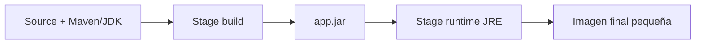
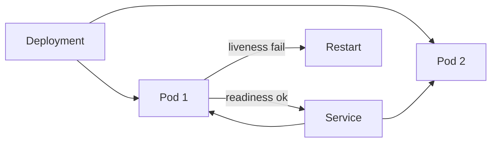
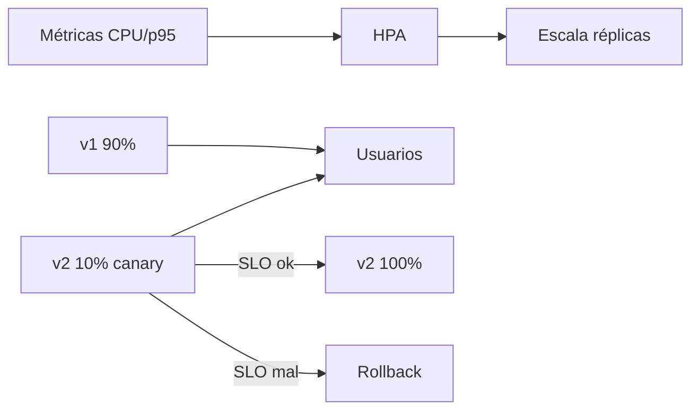
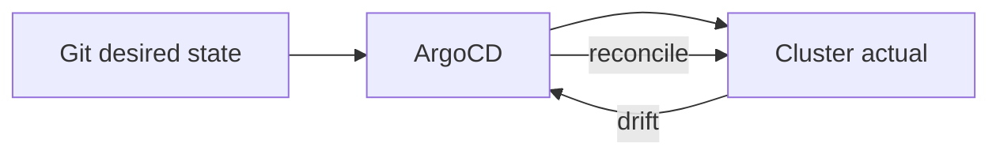
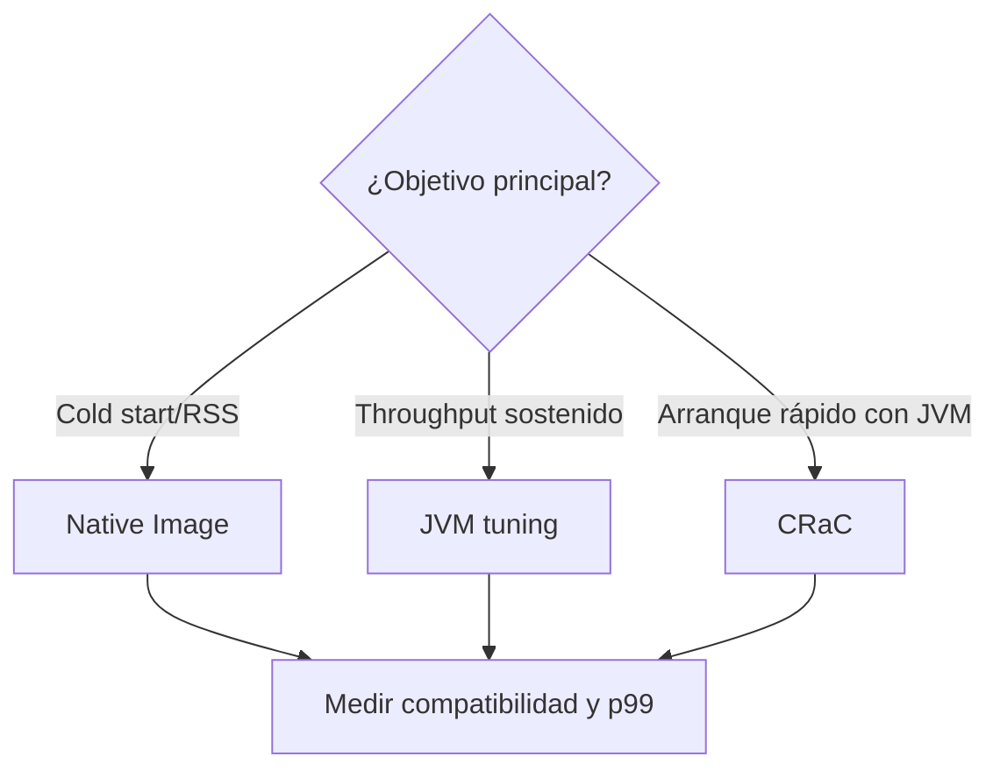

# Módulo 12 · Contenedores, Kubernetes y entrega continua

Un microservicio no termina cuando compila: termina cuando se despliega, escala, se observa y se revierte sin drama. Este módulo cubre Docker, Kubernetes, HPA/Helm/despliegues progresivos, GitOps y decisiones de runtime Java para contenedores.

**Entorno de referencia verificado (2026-05-22):** JDK 27.0.1.0.2, Node 24.18.0, Docker 29.9.3 instalado. Los smokes validan Dockerfiles/manifiestos/decisiones con Java y Node. Kubernetes, ArgoCD, Native Image y CRaC reales requieren cluster/toolchain específico; se incluyen **Notas de verificación** honestas.

## Aprende construyendo

### Tema 1: Dockerfile multi-stage y runtime Java · Intermedio · 120 min

## El dolor

El equipo empaqueta `catalog-service` con una imagen que contiene JDK, Maven, código fuente, cache y la app. La imagen pesa 1.2 GB, tarda minutos en subir y además corre como root. Un scanner de seguridad reporta vulnerabilidades que no tienen nada que ver con la app, sino con herramientas de build que nunca debieron llegar a producción.

## La intuición

El multi-stage build es como cocinar en la cocina y servir en el comedor. En la cocina necesitas ollas, cuchillos y harina por todos lados; en el comedor solo llega el plato. El JDK y Maven son la cocina; el JRE y el JAR son el plato.



## La construcción

**Archivo:** `Dockerfile`

```dockerfile
FROM eclipse-temurin:21-jdk AS build
WORKDIR /app
COPY . .
RUN ./mvnw -DskipTests package

FROM eclipse-temurin:21-jre
WORKDIR /app
COPY --from=build /app/target/app.jar app.jar
RUN useradd -r -u 1000 appuser
USER 1000
EXPOSE 8080
ENTRYPOINT ["java","-jar","/app/app.jar"]
```

**Archivo:** `.dockerignore`

```text
target/
.git/
.idea/
*.log
```

**Lectura:** el stage `build` compila; el stage runtime solo copia el artefacto. `USER 1000` evita root. `.dockerignore` reduce contexto y evita filtrar archivos.

## El experimento

1. Incluye `AS build` y `jre` en el Dockerfile. Esperas `true`, `true`.
2. Quita `USER 1000`. El contenedor corre como root: el scanner lo marca.
3. Usa JDK en runtime. La imagen crece y la superficie de ataque aumenta.

Smoke de estructura:

```bash
node -e "const fs=require('fs');const d=fs.readFileSync('Dockerfile','utf8');console.log(d.includes('AS build'));console.log(d.includes('jre'))"
```

Salida esperada:

```text
true
true
```

## El cierre

La imagen final quedó pequeña, reproducible y con menos superficie de ataque. El costo es mantener el build correcto y no esconder dependencias del runtime.

**Cuándo usarlo / cuándo no.** Usa multi-stage en todo servicio Java. Usa usuario no root, imagen base mínima y `.dockerignore`. No metas toolchain de build en runtime. No copies secretos al contexto de build.

| Decisión | Cuándo | Cuándo NO |
|---|---|---|
| Multi-stage | Siempre en Java | Casi nunca evitar |
| JRE/runtime | Producción | Necesitas herramientas de debug en imagen base |
| Root | Nunca por defecto | Solo casos excepcionales justificados |

**Error común.** Correr como root. **Síntoma.** mayor impacto ante compromiso. **Causa.** imagen sin `USER`. **Arreglo.** usuario no root, FS read-only cuando sea posible, capabilities mínimas. **Señal observable.** política de admisión/scanner falla.

**Pregunta de entrevista.** ¿Por qué multi-stage build mejora seguridad y no solo tamaño?  
**Respuesta modelo.** Porque reduce la superficie de ataque: el runtime no contiene compiladores, package managers, código fuente ni herramientas innecesarias. Menos componentes significan menos CVEs potenciales y menos utilidades disponibles si un atacante compromete el contenedor.

**Transferencia.**

1. **[NO-USAR-X]** Copiar `.env` con secretos al Docker build context. Respuesta: **No usar secretos en contexto/build**; inyectarlos en runtime por secret manager.
2. ¿Cuándo usarías distroless o JRE slim?
3. ¿Cómo versionas imágenes para rollback confiable?

#### Definición formal

Un Dockerfile multi-stage separa fases de build y runtime en una misma definición, permitiendo que la imagen final contenga solo artefactos necesarios para ejecutar.

#### Contrato / internals

- **Build stage:** JDK + Maven/Gradle + source.
- **Runtime stage:** JRE/binario + JAR + config runtime.
- **USER no root:** menor privilegio.
- **Inmutabilidad:** imagen no cambia en runtime.
- **.dockerignore:** controla contexto.

#### Ejemplo mínimo ejecutable

```bash
node -e "const fs=require('fs');const d=fs.readFileSync('Dockerfile','utf8');console.log(d.includes('AS build'));console.log(d.includes('jre'))"
```

Salida esperada:

```text
true
true
```

#### Caso real

`catalog-service` construye con JDK 21 y corre en JRE 21. La imagen baja de 1.2GB a ~220MB y el scanner deja de reportar CVEs de Maven.

#### Verificación

Smoke Node ejecutado localmente (2026-05-22, Node 24.18.0): `true`, `true`.

**Nota de verificación:** no se ejecutó `docker build`/`docker run` en esta sesión. Verificación propuesta: `docker build -t catalog:local .` y `docker run --rm -p 8080:8080 catalog:local`.

### Tema 2: Kubernetes Deployments, Services, ConfigMaps, Secrets, probes · Avanzado · 150 min

## El dolor

`orders-service` se despliega en Kubernetes. Arranca, pero tarda 30 segundos en cargar caches y conexiones. Kubernetes manda tráfico a los 5 segundos porque no hay readiness probe. Los primeros usuarios reciben 500. Otro día, la base de datos se cae y la liveness probe depende de DB: Kubernetes reinicia todos los pods, empeorando la caída.

## La intuición

Kubernetes es el gerente de turno: necesita saber si el empleado llegó (started), si puede atender clientes (ready) y si está colapsado y necesita reinicio (live). Si confundes estas señales, le das instrucciones equivocadas al gerente.



## La construcción

**Archivo:** `deploy.yaml`

```yaml
apiVersion: apps/v1
kind: Deployment
metadata: {name: orders-api}
spec:
  replicas: 2
  selector: {matchLabels: {app: orders-api}}
  template:
    metadata: {labels: {app: orders-api}}
    spec:
      containers:
        - name: api
          image: ghcr.io/acme/orders-api:1.0.0
          ports: [{containerPort: 8080}]
          readinessProbe:
            httpGet: {path: /actuator/health/readiness, port: 8080}
          livenessProbe:
            httpGet: {path: /actuator/health/liveness, port: 8080}
          resources:
            requests: {cpu: "100m", memory: "256Mi"}
            limits: {cpu: "500m", memory: "512Mi"}
```

**Archivo:** `service.yaml`

```yaml
apiVersion: v1
kind: Service
metadata: {name: orders-api}
spec:
  selector: {app: orders-api}
  ports: [{port: 80, targetPort: 8080}]
```

**Lectura:** Deployment controla réplicas y rollout. Service da identidad de red estable. Readiness controla tráfico; liveness controla reinicio. Requests/limits evitan noisy neighbors.

## El experimento

1. Verifica probes en el manifiesto. Esperas `true`, `true`.
2. Haz que liveness dependa de DB. Si DB cae, K8s reinicia pods sanos: cascada.
3. Quita requests/limits. Un pod puede consumir memoria excesiva y generar OOMKilled.

Smoke:

```bash
node -e "const fs=require('fs');const y=fs.readFileSync('deploy.yaml','utf8');console.log(y.includes('readinessProbe'));console.log(y.includes('livenessProbe'))"
```

Salida esperada:

```text
true
true
```

## El cierre

Los probes correctos evitaron tráfico prematuro y reinicios en cascada. Kubernetes ahora tiene señales confiables para operar el servicio.

**Cuándo usarlo / cuándo no.** Usa readiness/liveness/startup probes y requests/limits en todo despliegue. No hagas liveness dependiente de dependencias externas. No uses ConfigMap para secretos.

| Probe | Cuándo | Cuándo NO |
|---|---|---|
| Readiness | Dependencias necesarias para servir | Señal de proceso vivo local |
| Liveness | Proceso colgado/local irrecuperable | Fallo de DB externa |
| Startup | Apps con arranque lento | App arranca rápido |

**Error común.** Liveness depende de DB. **Síntoma.** reinicios en cascada. **Causa.** probe mal diseñado. **Arreglo.** liveness local, readiness para dependencias, startup para arranque lento. **Señal observable.** restart count sube durante caída de DB.

**Pregunta de entrevista.** ¿Diferencia entre readiness y liveness?  
**Respuesta modelo.** Readiness indica si el pod puede recibir tráfico; si falla, Kubernetes lo quita del Service. Liveness indica si el proceso está sano localmente; si falla, Kubernetes lo reinicia. Confundirlas puede causar reinicios en cascada o enviar tráfico a pods no listos.

**Transferencia.**

1. **[NO-USAR-X]** Poner password DB en ConfigMap. Respuesta: **No usar ConfigMap para secretos**; usar Secret/secret manager.
2. Tu app tarda 60s en arrancar. ¿Qué probe agregas?
3. ¿Qué pasa si no defines requests/limits?

#### Definición formal

Deployment gestiona réplicas y rollouts declarativos. Service expone endpoints estables. ConfigMap/Secret externalizan configuración. Probes reportan estado de salud al orquestador.

#### Contrato / internals

- **Deployment:** desired state, replicas, rolling update.
- **Service:** selector + puerto estable.
- **Readiness/Liveness/Startup:** señales distintas.
- **Resources:** requests/limits para scheduling y aislamiento.
- **Secret:** base64 no es cifrado; usar cifrado/secret manager.

#### Ejemplo mínimo ejecutable

```bash
node -e "const fs=require('fs');const y=fs.readFileSync('deploy.yaml','utf8');console.log(y.includes('readinessProbe'));console.log(y.includes('livenessProbe'))"
```

Salida esperada:

```text
true
true
```

#### Caso real

`orders-service` usa startup probe de 60s, readiness en `/actuator/health/readiness` y liveness local. Evita tráfico prematuro y reinicios por caída externa.

#### Verificación

Smoke Node ejecutado localmente (2026-05-22, Node 24.18.0): `true`, `true`.

**Nota de verificación:** no se aplicó en cluster Kubernetes real. Verificación propuesta: `kubectl apply -f deploy.yaml -f service.yaml`, `kubectl rollout status`, y pruebas de probe con fallo simulado.

### Tema 3: HPA, Helm y despliegues progresivos · Avanzado · 120 min

## El dolor

En Black Friday, `catalog-service` recibe 10x tráfico. Tiene 2 réplicas fijas y se satura. Otro día, un deploy nuevo tiene un bug y el rollout 100% tumba el catálogo. Escalar manualmente y desplegar “big bang” es operar a ciegas.

## La intuición

HPA es el termostato: mide temperatura/carga y ajusta. Helm es el paquete de instalación parametrizable. Canary es abrir la puerta nueva solo al 10% de la gente antes de dejar pasar a todos.



## La construcción

**Archivo:** `hpa.yaml`

```yaml
apiVersion: autoscaling/v2
kind: HorizontalPodAutoscaler
metadata: {name: orders-api}
spec:
  scaleTargetRef:
    apiVersion: apps/v1
    kind: Deployment
    name: orders-api
  minReplicas: 2
  maxReplicas: 10
  metrics:
    - type: Resource
      resource:
        name: cpu
        target: {type: Utilization, averageUtilization: 70}
```

**Archivo:** `values.yaml` (Helm conceptual).

```yaml
image:
  repository: ghcr.io/acme/orders-api
  tag: "1.0.0"
replicaCount: 2
```

**Lectura:** HPA escala por métrica. Helm parametriza manifests. Canary/blue-green requieren métricas de gate y rollback automático o runbook claro.

## El experimento

1. Verifica HPA con min/max. Esperas `true`, `true`.
2. Sube tráfico sin HPA: saturación. Con HPA: escala hasta max.
3. Canary con 5xx alto sin gate: la versión mala avanza. Con gate SLO: rollback.

Smoke:

```bash
node -e "const fs=require('fs');const y=fs.readFileSync('hpa.yaml','utf8');console.log(y.includes('minReplicas: 2'));console.log(y.includes('maxReplicas: 10'))"
```

Salida esperada:

```text
true
true
```

## El cierre

Escalado y rollout progresivo convierten picos y despliegues en eventos controlados. El costo es observabilidad, tuning y disciplina operativa.

**Cuándo usarlo / cuándo no.** Usa HPA en servicios stateless con métricas confiables. Usa canary/blue-green con SLO gates y rollback. No escales sin límites. No hagas canary sin métricas.

| Estrategia | Cuándo | Cuándo NO |
|---|---|---|
| HPA | Carga variable, stateless | Estado local no replicable |
| Canary | Riesgo medio/alto, métricas claras | Sin observabilidad |
| Blue-green | Cambio rápido con switch | Costo duplicado inaceptable |

**Error común.** Canary sin métricas. **Síntoma.** versión mala avanza. **Causa.** no hay gates. **Arreglo.** definir SLO, comparar canary vs baseline, rollback automático. **Señal observable.** 5xx o p99 sube en canary.

**Pregunta de entrevista.** ¿Qué necesitas antes de hacer canary?  
**Respuesta modelo.** Métricas de salud comparables (error rate, p99, saturación), capacidad de enrutar un porcentaje pequeño, criterio de promoción/rollback y observabilidad suficiente para distinguir ruido de regresión. Sin eso, el canary es solo un despliegue parcial a ciegas.

**Transferencia.**

1. **[NO-USAR-X]** Escalar a infinito sin `maxReplicas`. Respuesta: **No usar HPA sin límite**; protege costo y dependencias.
2. ¿Cuándo elegirías blue-green sobre canary?
3. ¿Qué métrica usarías además de CPU para escalar?

#### Definición formal

HPA ajusta réplicas según métricas. Helm empaqueta y parametriza manifests Kubernetes. Despliegues progresivos (canary/blue-green) liberan cambios gradualmente con capacidad de rollback.

#### Contrato / internals

- **HPA:** min/max, métricas, scaleTargetRef.
- **Helm:** chart, values, templates, release.
- **Canary:** porcentaje, análisis, promoción/rollback.
- **Límite:** métricas malas generan escalado o rollback malo.

#### Ejemplo mínimo ejecutable

```bash
node -e "const fs=require('fs');const y=fs.readFileSync('hpa.yaml','utf8');console.log(y.includes('minReplicas: 2'));console.log(y.includes('maxReplicas: 10'))"
```

Salida esperada:

```text
true
true
```

#### Caso real

Black Friday: HPA escala `catalog-service` de 2 a 10 por CPU y p95. Un canary de 10% detecta subida de 5xx y hace rollback.

#### Verificación

Smoke Node ejecutado localmente (2026-05-22, Node 24.18.0): `true`, `true`.

**Nota de verificación:** no se ejecutó HPA/Helm/canary en cluster real. Verificación propuesta: metrics-server, HPA, load test y Argo Rollouts/Flagger.

### Tema 4: GitOps con ArgoCD · Avanzado · 120 min

## El dolor

Alguien arregla un incidente con `kubectl edit` en producción. Funciona. Dos semanas después, otro deploy pisa el cambio y el incidente vuelve. Nadie sabe qué estaba diferente en el cluster porque Git no refleja la realidad.

## La intuición

GitOps es tratar la infraestructura como código con reconciliación continua. Git es la fuente de verdad; el cluster es una copia que debe converger. Si alguien cambia el cluster a mano, el reconciliador lo marca como drift. Es como el plano eléctrico de un edificio: si un técnico cambia cables sin actualizar el plano, el próximo mantenimiento falla.



## La construcción

**Archivo:** `desired.json`

```json
{"image":"orders:1.0.0","replicas":2}
```

**Archivo:** `check.mjs`

```js
import fs from 'node:fs';
const desired = JSON.parse(fs.readFileSync('desired.json', 'utf8'));
const actual = { image: 'orders:0.9.0', replicas: 2 };
console.log(desired.image === actual.image);
```

**Lectura:** el estado deseado dice `1.0.0`; el actual está en `0.9.0`. Hay drift. ArgoCD detectaría `OutOfSync` y reconciliaría según política.

## El experimento

1. Compara desired vs actual. Esperas `false` (drift).
2. Cambia actual a `1.0.0`. Esperas `true`.
3. Haz un hotfix manual en cluster sin PR. Esperas drift; la corrección correcta es PR + reconciliación.

Smoke:

```bash
node check.mjs
```

Salida esperada:

```text
false
```

## El cierre

GitOps hace visible el drift y auditable el cambio. El costo es disciplina: nada de cambios manuales sin pasar por Git.

**Cuándo usarlo / cuándo no.** Usa GitOps cuando quieras auditoría, rollback por commit y reconciliación declarativa. No uses hotfix manual sin reconciliar. No guardes secretos planos en Git.

| Práctica | Cuándo | Cuándo NO |
|---|---|---|
| Git como fuente de verdad | Entornos K8s maduros | Cambios manuales ad hoc |
| PR + review | Todo cambio de despliegue | Emergencia sin postmortem/regularización |
| Reconciliación automática | Estado declarativo estable | Recursos con operadores/manual drift esperado |

**Error común.** Drift manual. **Síntoma.** Git no refleja cluster. **Causa.** `kubectl apply/edit` ad hoc. **Arreglo.** PR, review, reconciliación, auditoría. **Señal observable.** ArgoCD `OutOfSync`.

**Pregunta de entrevista.** ¿Qué problema resuelve GitOps que no resuelve CI/CD tradicional?  
**Respuesta modelo.** CI/CD tradicional empuja cambios al entorno; GitOps además reconcilia continuamente el estado real contra el deseado en Git. Eso detecta drift, facilita auditoría y hace el rollback un revert de commit, no un procedimiento manual.

**Transferencia.**

1. **[NO-USAR-X]** Hotfix con `kubectl edit` en prod y olvidar Git. Respuesta: **No usar cambios manuales sin reconciliar**.
2. ¿Cómo manejas un secreto en GitOps?
3. ¿Cuándo usarías reconciliación manual en vez de automática?

#### Definición formal

GitOps es una práctica operativa donde el estado deseado del sistema se declara en Git y un reconciliador automático lo aplica y mantiene en el entorno.

#### Contrato / internals

- **Desired state:** manifests/charts en Git.
- **Reconciler:** ArgoCD/Flux compara y aplica.
- **Drift:** diferencia entre Git y cluster.
- **Rollback:** revert commit.
- **Límite:** secretos y estado no declarativo requieren manejo especial.

#### Ejemplo mínimo ejecutable

```bash
node check.mjs
```

Salida esperada:

```text
false
```

#### Caso real

Cambio de `replicas` pasa por PR. ArgoCD sincroniza y registra quién, cuándo y qué cambió.

#### Verificación

Smoke Node ejecutado localmente (2026-05-22, Node 24.18.0): `false`.

**Nota de verificación:** no se ejecutó ArgoCD/cluster real. Verificación propuesta: instalar ArgoCD, crear Application y provocar drift con `kubectl`.

### Tema 5: GraalVM Native Image, CRaC y JVM tuning para contenedores · Avanzado · 120 min

## El dolor

`catalog-service` escala a 30 réplicas en picos. Cada pod tarda 8 segundos en estar listo, y el autoscaler llega tarde. El equipo lee “usa Native Image” y lo aplica sin medir: el arranque mejora, pero un endpoint falla por reflexión no registrada y el throughput baja en carga sostenida.

## La intuición

Elegir runtime es elegir vehículo. Un auto deportivo arranca rápido (native), pero no lleva la misma carga ni se repara igual que un camión. La JVM caliente puede rendir mejor en viajes largos. CRaC es como dejar el motor precalentado y guardado para arrancar más rápido, pero solo si el taller controla el procedimiento.



## La construcción

**Archivo:** `RuntimeChoice.java`

```java
public class RuntimeChoice {
  static String choose(int coldStartMs, boolean dynamicReflection, boolean canCheckpoint) {
    if (coldStartMs <= 500) return "JVM_TUNED";
    if (!dynamicReflection) return "NATIVE_IMAGE";
    if (canCheckpoint) return "CRAC";
    return "JVM_TUNED_AOT";
  }
  public static void main(String[] args) {
    System.out.println(choose(200, true, false));
    System.out.println(choose(8000, false, false));
    System.out.println(choose(8000, true, true));
  }
}
```

**Archivo:** `HeapBudget.java`

```java
public class HeapBudget {
  static int heapMb(int containerMb, int percent) {
    return containerMb * percent / 100;
  }
  public static void main(String[] args) {
    System.out.println(heapMb(512, 75));
  }
}
```

**Lectura:** el smoke no decide por ti; muestra la lógica de decisión. En producción, mides arranque, RSS, p95/p99, throughput, costo de build y compatibilidad.

## El experimento

1. Cold start 200ms ya aceptable. Esperas `JVM_TUNED`.
2. Cold start 8s, sin reflexión dinámica. Esperas `NATIVE_IMAGE`.
3. Cold start 8s, reflexión dinámica, checkpoint posible. Esperas `CRAC`.
4. Container 512MiB al 75%. Esperas `384`.

Salida esperada:

```text
JVM_TUNED
NATIVE_IMAGE
CRAC
384
```

## El cierre

La decisión de runtime quedó basada en objetivos medibles. Native, CRaC y JVM no son religiones; son trade-offs.

**Cuándo usarlo / cuándo no.** Usa JVM tuning siempre en contenedores. Usa Native Image cuando cold start/RSS dominen y el stack sea compatible. Usa CRaC cuando controlas checkpoint/restore. No copies flags sin medir. No asumas que native siempre mejora p99.

| Opción | Cuándo | Cuándo NO |
|---|---|---|
| JVM tuning | Default en contenedores | Nunca omitir |
| Native Image | Cold start/RSS críticos, stack compatible | Reflección dinámica no controlada, throughput crítico sin medir |
| CRaC | Entorno controlado, restore seguro | Recursos externos difíciles de coordinar |

**Error común.** Ir a native sin medir. **Síntoma.** endpoint falla o p99 empeora. **Causa.** reflexión/metadata o perfil de ejecución distinto. **Arreglo.** pruebas sobre native, tracing agent/hints, benchmark comparativo. **Señal observable.** `MissingReflectionRegistrationError`, p99 peor en carga sostenida.

**Error común.** JVM sin límite relativo al contenedor. **Síntoma.** OOMKilled. **Causa.** heap/Metaspace fuera de presupuesto. **Arreglo.** `-XX:MaxRAMPercentage`, límites y profiling. **Señal observable.** restart count por OOM.

**Pregunta de entrevista.** ¿Cuándo NO elegirías GraalVM Native Image?  
**Respuesta modelo.** Cuando el beneficio de cold start no compensa el costo: hay reflexión dinámica difícil de controlar, el throughput sostenido empeora, la observabilidad/herramientas necesarias no son compatibles, o el tiempo de build/operación supera la ganancia. Lo decido con benchmarks representativos.

**Transferencia.**

1. **[NO-USAR-X]** Activar native en todos los servicios porque “es más rápido”. Respuesta: **No usar native por defecto** sin medir compatibilidad y p99.
2. Un servicio serverless arranca pocas veces y vive mucho. ¿JVM o native?
3. ¿Qué métricas compararías antes de migrar?

#### Definición formal

GraalVM Native Image compila AOT a binario nativo. CRaC checkpoint/restore reduce arranque restaurando estado JVM. JVM tuning en contenedores ajusta memoria/GC a límites cgroup.

#### Contrato / internals

- **Native:** closed-world assumption, metadata/hints.
- **CRaC:** coordinar sockets, archivos, DB, threads antes de checkpoint.
- **JVM:** `MaxRAMPercentage`, GC, metaspace, threads.
- **Métrica:** arranque, RSS, p95/p99, throughput, costo build.

#### Ejemplo mínimo ejecutable

```bash
javac RuntimeChoice.java
java RuntimeChoice
javac HeapBudget.java
java HeapBudget
```

Salida esperada:

```text
JVM_TUNED
NATIVE_IMAGE
CRAC
384
```

#### Caso real

El equipo primero ajusta JVM (`MaxRAMPercentage`, GC, warmup) y baja cold start a 3s. Luego evalúa native para un servicio compatible con autoscaling extremo, comparando p99 y costo de build.

#### Verificación

Smokes Java ejecutados localmente (2026-05-22, JDK 27.0.1.0.2): `JVM_TUNED`, `NATIVE_IMAGE`, `CRAC`, `384`.

**Nota de verificación:** no se ejecutó build native, CRaC ni Kubernetes real. Verificación propuesta: `./mvnw -Pnative -DskipTests native:compile`, benchmark de arranque/RSS/p99 y prueba de restore CRaC.

## Cierre

Entregar software en microservicios es ingeniería de producción: imágenes pequeñas, despliegues declarativos, probes correctos, escalado con métricas, reconciliación GitOps y runtime elegido por evidencia. Una buena entrega hace que el cambio sea aburrido.

## Checklist

- Imagen multi-stage, no root, sin secretos.
- Probes y requests/limits definidos.
- HPA/canary con métricas y rollback.
- Git como fuente de verdad; drift visible.
- Runtime elegido por medición, con nota honesta si no se ejecutó.
