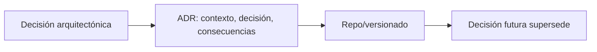
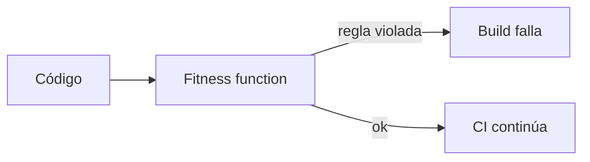
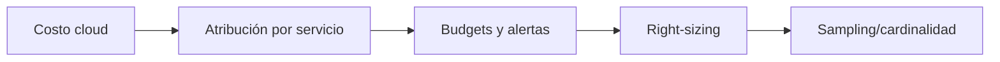
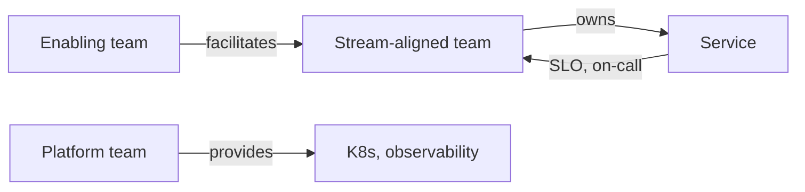

# Módulo 13 · Gobernanza, FinOps y organización

Los microservicios no fallan solo por código; fallan por decisiones no registradas, costos invisibles y equipos mal alineados. Este módulo cubre ADRs, C4, fitness functions, FinOps y Team Topologies con un enfoque práctico y verificable.

**Entorno de referencia verificado (2026-05-22):** JDK 27.0.1.0.2. Smokes de ADR, fitness functions, presupuesto y alineación de equipos ejecutados con Java puro. Herramientas FinOps/observabilidad reales quedan con nota de verificación.

## Aprende construyendo

### Tema 1: ADRs y C4 · Intermedio · 120 min

El equipo eligió Kafka para eventos de pedidos hace seis meses. Hoy nadie recuerda por qué no se usó RabbitMQ ni qué trade-offs se aceptaron. Un nuevo integrante propone cambiar a RabbitMQ “porque es más simple”. La discusión se repite desde cero porque la decisión nunca se registró.

Un ADR es como el acta de una reunión importante: registra qué se decidió, por qué, qué alternativas se consideraron y qué consecuencias se aceptaron. No es documentación exhaustiva; es memoria institucional. C4 es como un mapa a distintas escalas: desde la ciudad (contexto) hasta el edificio (componentes). No dibujas todos los detalles en un solo mapa.



**Archivo:** `AdrSmoke.java` → estructura mínima de ADR.

```java
import java.util.*;

public class AdrSmoke {
  record Adr(String id, String status, String decision, List<String> consequences) {}

  public static void main(String[] args) {
    Adr adr = new Adr("ADR-001", "accepted", "Kafka for events",
        List.of("replay capability", "operational complexity"));
    System.out.println(adr.status());
    System.out.println(adr.consequences().size());
    System.out.println(adr.id() + ":" + adr.decision());
  }
}
```

**Archivo:** `docs/adr/0001-use-kafka.md` (conceptual).

```markdown
# ADR-001: Usar Kafka para eventos de dominio
## Status: Accepted
## Context: Necesitamos event streaming con replay.
## Decision: Kafka.
## Consequences: replay, alta complejidad operativa.
## Alternatives: RabbitMQ (más simple, sin replay).
```

**Lectura:** el smoke modela la estructura mínima. En la práctica, el ADR vive en el repo y se versiona con el código.

1. Crea ADR con status accepted. Esperas `accepted`, `2`, `ADR-001:Kafka for events`.
2. Marca un ADR como superseded por otro. Observa que no se borra; se reemplaza.
3. Intenta decidir sin ADR. Observa que la discusión se repite.

Salida esperada:

```text
accepted
2
ADR-001:Kafka for events
```

ADRs y C4 hacen la arquitectura comunicable y auditable. El costo es disciplina de escribir decisiones relevantes, no todas.

**Cuándo usarlo / cuándo no.** Usa ADR para decisiones costosas de revertir (broker, DB, modelo de consistencia, frontera). Usa C4 para comunicar a distintas audiencias. No hagas ADR para cada cambio de código.

| Nivel C4 | Audiencia | Pregunta que responde |
|---|---|---|
| Context | Stakeholders | ¿Qué sistema y quiénes interactúan? |
| Containers | Arquitectos/devs | ¿Qué deployables y cómo se conectan? |
| Components | Devs | ¿Qué módulos dentro de un container? |
| Code | Devs | ¿Qué clases/interfaces? (rara vez necesario) |

**Error común.** Decisiones sin ADR. **Síntoma.** se repite la discusión cada trimestre. **Causa.** no hay memoria institucional. **Arreglo.** ADR corto con trade-offs y estado. **Señal observable.** decisiones contradictorias entre equipos.

**Pregunta de entrevista.** ¿Qué debe contener un ADR mínimo?  
**Respuesta modelo.** Id, fecha, estado, contexto (por qué se decide), decisión (qué se decidió), consecuencias (trade-offs aceptados) y alternativas consideradas. Debe ser corto y versionado con el código.

**Transferencia.**

1. **[NO-USAR-X]** ADR de 10 páginas para cada cambio de variable. Respuesta: **No hacer ADR para todo**; solo decisiones costosas de revertir.
2. ¿Cuándo un ADR debe marcarse como superseded?
3. ¿Qué nivel C4 mostrarías a un stakeholder no técnico?

#### Definición formal

ADR registra una decisión arquitectónica con contexto, decisión, opciones y consecuencias. C4 model comunica arquitectura en cuatro niveles de abstracción.

#### Contrato / internals

- **ADR mínimo:** id, fecha, estado, contexto, decisión, consecuencias, alternativas.
- **Inmutabilidad:** ADR aceptado no se reescribe; se supersede.
- **C4:** cada nivel responde preguntas distintas.
- **Límite:** documentación sin mantenimiento miente.

#### Ejemplo mínimo ejecutable

```bash
javac AdrSmoke.java
java AdrSmoke
```

Salida esperada:

```text
accepted
2
ADR-001:Kafka for events
```

#### Caso real

`ADR-007` decide outbox + Kafka. Contexto: dual write causó inconsistencias. Consecuencias: complejidad operativa, pero entrega confiable.

#### Verificación

Smoke Java ejecutado localmente (2026-05-22, JDK 27.0.1.0.2): `accepted`, `2`, `ADR-001:Kafka for events`.

**Nota de verificación:** C4/ADR son artefactos de proceso; verificación real es revisión por pares y presencia en repo.

### Tema 2: Fitness functions y ATAM ligero · Avanzado · 120 min

La arquitectura documenta que `domain` no depende de `web`. Tres meses después, alguien importa un DTO web en el dominio. Nadie se da cuenta hasta un refactor. La regla era humana, no ejecutable.

Una fitness function es como una alarma en la puerta: si alguien intenta entrar por la puerta prohibida, la alarma suena en CI, no en producción. ATAM ligero es como una revisión de riesgos pragmática: identificas escenarios de calidad, evalúas decisiones y documentas trade-offs sin el peso de un proceso formal largo.



**Archivo:** `FitnessSmoke.java` → regla de dependencia.

```java
public class FitnessSmoke {
  static boolean noDomainToWeb(String from, String to) {
    return !(from.equals("domain") && to.equals("web"));
  }
  static boolean noCycles(Map<String, String> deps) {
    // Simplificado: A->B y B->A es ciclo.
    for (var e : deps.entrySet()) {
      String reverse = deps.get(e.getValue());
      if (reverse != null && reverse.equals(e.getKey())) return false;
    }
    return true;
  }
  public static void main(String[] args) {
    System.out.println(noDomainToWeb("domain", "app"));
    System.out.println(noDomainToWeb("domain", "web"));
  }
}
```

**Archivo:** ArchUnit real (conceptual).

```java
@ArchTest
static final ArchRule domainDoesNotDependOnWeb =
    noClasses().that().resideInAPackage("..domain..")
        .should().dependOnClassesThat().resideInAPackage("..web..");
```

**Lectura:** el smoke modela la regla. En CI, ArchUnit inspecciona bytecode y falla si la regla se viola.

1. `domain` → `app`. Esperas `true`.
2. `domain` → `web`. Esperas `false`.
3. Agrega regla de ciclos. Observa que detecta erosión temprana.

Salida esperada:

```text
true
false
```

Fitness functions hacen la arquitectura ejecutable. ATAM ligero documenta trade-offs sin proceso pesado. El costo es elegir pocas reglas de alto valor.

**Cuándo usarlo / cuándo no.** Úsalo para invariantes arquitectónicos estables. No automatices todo; prioriza reglas que prevengan erosión costosa. No uses ATAM completo para cada decisión.

| Regla | Cuándo | Cuándo NO |
|---|---|---|
| Capas (domain no depende de web) | Arquitectura hexagonal/clean | Proyecto sin capas definidas |
| Naming de clases | Convenciones estables | Nombres en discusión |
| Ciclos entre paquetes | Prevenir erosión | Reglas que cambian cada sprint |

**Error común.** Reglas solo en wiki. **Síntoma.** la arquitectura documentada no coincide con el código. **Causa.** sin enforcement automático. **Arreglo.** fitness functions en CI. **Señal observable.** dependencias prohibidas en PRs sin bloqueo.

**Pregunta de entrevista.** ¿Qué es una fitness function arquitectónica?  
**Respuesta modelo.** Es una verificación automatizada que asegura que una propiedad arquitectónica se mantiene en el tiempo. ArchUnit es una fitness function: ejecuta reglas sobre el código y falla si la arquitectura se degrada.

**Transferencia.**

1. **[NO-USAR-X]** Codificar 50 reglas ArchUnit en un proyecto sin arquitectura definida. Respuesta: **No usar reglas volátiles**; empezar con 3-5 de alto valor.
2. ¿Qué regla prohibiría que un controller llame directamente a un repository?
3. ¿Cómo detectas dependencias cíclicas entre módulos?

#### Definición formal

Fitness function es una prueba automatizada que verifica una característica arquitectónica. ATAM ligero evalúa trade-offs con escenarios y riesgos de forma pragmática.

#### Contrato / internals

- **Fitness function:** ejecutable en CI; falla ante regresión.
- **Herramientas:** ArchUnit, linters, tests de performance, OPA.
- **ATAM ligero:** escenarios de calidad, decisiones, riesgos, trade-offs.
- **Límite:** automatizar reglas inestables crea ruido.

#### Ejemplo mínimo ejecutable

```bash
javac FitnessSmoke.java
java FitnessSmoke
```

Salida esperada:

```text
true
false
```

#### Caso real

ArchUnit en CI bloquea imports `..web..` desde `..domain..`. ATAM ligero evalúa Kafka vs RabbitMQ con escenarios de throughput, replay y costo.

#### Verificación

Smoke Java ejecutado localmente (2026-05-22, JDK 27.0.1.0.2): `true`, `false`.

**Nota de verificación:** no se ejecutó ArchUnit real. Verificación propuesta: regla ArchUnit en `src/test/java` y `./mvnw test`.

### Tema 3: FinOps: costo, right-sizing y observability tax · Intermedio · 120 min

La factura cloud crece 40% tras agregar tracing, logs detallados y réplicas por defecto. Nadie sabe qué servicio cuesta más. El equipo de observabilidad no tiene budget. El CFO pregunta “¿cuánto cuesta un pedido?” y nadie puede responder.

FinOps es como el medidor de agua de un edificio: si no mides por apartamento, nadie ahorra. Right-sizing es ajustar el tamaño del apartamento al número de personas. El observability tax es el costo de medir: si mides todo con la máxima resolución, el medidor cuesta más que el agua.



**Archivo:** `FinOpsSmoke.java` → budget y right-sizing.

```java
public class FinOpsSmoke {
  static boolean withinBudget(double cost, double budget) { return cost <= budget; }
  static int rightSize(int actualCpu, int requestedCpu) {
    // Simplificado: si usa menos del 50%, recomendar mitad.
    if (actualCpu < requestedCpu / 2) return requestedCpu / 2;
    return requestedCpu;
  }
  public static void main(String[] args) {
    System.out.println(withinBudget(80, 100));
    System.out.println(withinBudget(120, 100));
    System.out.println(rightSize(20, 100));
  }
}
```

**Lectura:** el smoke modela la lógica de budget y right-sizing. En producción, se usa el dashboard del proveedor cloud y alertas de budget.

1. Costo 80, budget 100. Esperas `true`.
2. Costo 120, budget 100. Esperas `false`.
3. CPU real 20%, solicitado 100%. Esperas `50` (right-size).
4. Cardinalidad alta en métricas. Observa costo de observabilidad disparado.

Salida esperada:

```text
true
false
50
```

FinOps hace el costo visible y accionable. El trade-off es no sacrificar observabilidad crítica por ahorro.

**Cuándo usarlo / cuándo no.** Úsalo siempre en cloud. Atribuye costo por servicio/equipo. No optimices costo eliminando observabilidad crítica ni bajando recursos por debajo del SLO.

| Práctica | Cuándo | Cuándo NO |
|---|---|---|
| Budgets/alertas | Siempre en cloud | Sin visibilidad de costo |
| Right-sizing | Uso real < 50% del solicitado | Bajar por debajo del SLO |
| Sampling/cardinalidad | Alta cardinalidad, costo de traces | Eliminar trazas críticas |

**Error común.** Factura de observabilidad supera el servicio. **Síntoma.** costo por GB/log/serie crece. **Causa.** alta cardinalidad, retención excesiva, debug en prod. **Arreglo.** budgets, sampling, cardinalidad controlada, retención por valor. **Señal observable.** costo crece sin mejora en MTTR.

**Pregunta de entrevista.** ¿Qué es el observability tax?  
**Respuesta modelo.** Es el costo de recolectar, almacenar y consultar telemetría (métricas, logs, traces). Si no se controla (alta cardinalidad, retención excesiva, debug en prod), puede superar el costo del servicio mismo. La solución es sampling, cardinalidad controlada y retención por valor operativo.

**Transferencia.**

1. **[NO-USAR-X]** Eliminar todas las trazas para ahorrar costo. Respuesta: **No eliminar observabilidad crítica**; usar sampling.
2. ¿Cómo atribuyes costo por servicio en Kubernetes?
3. ¿Qué métrica usarías para decidir right-sizing?

#### Definición formal

FinOps gestiona costo cloud con visibilidad, accountability y optimización. Right-sizing ajusta recursos al uso real. Observability tax es el costo de telemetría.

#### Contrato / internals

- **Visibilidad:** costo por servicio/equipo/entorno.
- **Budgets/alertas:** detectar desvíos.
- **Cardinalidad:** labels con IDs únicos disparan costo.
- **Retención/sampling:** ajustar al valor operativo.
- **Límite:** ahorrar no debe romper SLOs.

#### Ejemplo mínimo ejecutable

```bash
javac FinOpsSmoke.java
java FinOpsSmoke
```

Salida esperada:

```text
true
false
50
```

#### Caso real

Se detecta label `userId` en métricas (alta cardinalidad). Se mueve a logs/traces con sampling. Se define budget por servicio y alerta al 80%.

#### Verificación

Smoke Java ejecutado localmente (2026-05-22, JDK 27.0.1.0.2): `true`, `false`, `50`.

**Nota de verificación:** no se ejecutó herramienta FinOps/cloud billing real. Verificación propuesta: dashboard de costo por servicio y alerta de budget en el proveedor cloud.

### Tema 4: Ley de Conway y Team Topologies · Intermedio · 90 min

Dos equipos comparten un servicio crítico. Los incidentes rebotan entre ellos: “no es mío”. Los cambios requieren coordinación constante. El MTTR es alto porque nadie es dueño completo. La arquitectura refleja la organización disfuncional.

La Ley de Conway dice que el sistema refleja la estructura de comunicación de la organización. Si dos equipos comparten un servicio, el servicio tendrá dos dueños y ninguna responsabilidad clara. Team Topologies propone equipos stream-aligned (dueños de un flujo de valor), platform (servicios internos), enabling (ayudan a otros) y complicated-subsystem (especialistas). La regla: you build it, you run it.



**Archivo:** `TeamTopologySmoke.java` → ownership.

```java
public class TeamTopologySmoke {
  static boolean aligned(boolean ownsCode, boolean ownsOnCall, boolean ownsSlo) {
    return ownsCode && ownsOnCall && ownsSlo;
  }
  static String interactionMode(boolean sharedService) {
    return sharedService ? "collaboration-needed" : "x-as-a-service";
  }
  public static void main(String[] args) {
    System.out.println(aligned(true, true, true));
    System.out.println(aligned(true, false, true));
    System.out.println(interactionMode(true));
  }
}
```

**Lectura:** el smoke modela la regla: ownership end-to-end requiere código + on-call + SLO. Si falta alguno, el ownership es difuso.

1. Equipo dueño de código, on-call y SLO. Esperas `true`.
2. Equipo dueño de código pero sin on-call. Esperas `false`.
3. Servicio compartido entre equipos. Esperas `collaboration-needed`.

Salida esperada:

```text
true
false
collaboration-needed
```

La gobernanza organizacional es tan importante como la técnica. Ownership claro y cognitive load controlado son prerequisitos para microservicios exitosos.

**Cuándo usarlo / cuándo no.** Úsalo al definir ownership de servicios y plataformas. No crees un microservicio por persona ni un equipo por repo sin capacidad operativa. No reorganices equipos sin alinear con el dominio.

| Tipo de equipo | Responsabilidad | Cuándo |
|---|---|---|
| Stream-aligned | Flujo de valor end-to-end | Servicios de negocio |
| Platform | Servicios internos (K8s, obs) | Infraestructura compartida |
| Enabling | Ayudar a otros equipos | Adopción de prácticas |
| Complicated-subsystem | Especialistas (ML, crypto) | Componentes complejos |

**Error común.** Ownership difuso. **Síntoma.** incidentes rebotan, MTTR alto. **Causa.** sin on-call claro, equipos compartiendo servicio. **Arreglo.** ownership end-to-end por servicio/capacidad. **Señal observable.** “no es mío” en incidentes.

**Pregunta de entrevista.** ¿Qué es cognitive load en Team Topologies?  
**Respuesta modelo.** Es la cantidad de complejidad que un equipo puede manejar efectivamente. Si un equipo posee demasiados servicios, dominios o tecnologías, su cognitive load excede la capacidad y la calidad baja. La solución es limitar ownership y usar platform/enabling teams para reducir carga.

**Transferencia.**

1. **[NO-USAR-X]** Crear un microservicio y un equipo por cada desarrollador. Respuesta: **No fragmentar** sin capacidad operativa.
2. Un equipo de 4 personas opera 15 microservicios. ¿Qué problema hay?
3. ¿Cómo defines el boundary de un equipo stream-aligned?

#### Definición formal

Ley de Conway: las organizaciones diseñan sistemas que reflejan sus estructuras de comunicación. Team Topologies define tipos de equipo y modos de interacción para reducir cognitive load y acoplamiento.

#### Contrato / internals

- **Ownership:** build + run (you build it, you run it).
- **Cognitive load:** límite de complejidad por equipo.
- **Interfaces de equipo:** APIs, plataformas, SLOs.
- **Límite:** reorganizar no arregla mal dominio.

#### Ejemplo mínimo ejecutable

```bash
javac TeamTopologySmoke.java
java TeamTopologySmoke
```

Salida esperada:

```text
true
false
collaboration-needed
```

#### Caso real

Equipo `checkout` stream-aligned dueño de `checkout-service` con on-call y SLO. Platform provee K8s/observabilidad. MTTR bajo por ownership claro.

#### Verificación

Smoke Java ejecutado localmente (2026-05-22, JDK 27.0.1.0.2): `true`, `false`, `collaboration-needed`.

**Nota de verificación:** Team Topologies es un modelo organizacional; se verifica por claridad de ownership, on-call y métricas DORA/MTTR.

La gobernanza ligera evita caos: decisiones registradas, reglas automatizadas, costos visibles y equipos con ownership. En microservicios, la arquitectura también es organización y economía operativa.

## Checklist

- ADRs con consecuencias y estado.
- Fitness functions en CI para invariantes clave.
- FinOps visible por servicio/equipo.
- Ownership end-to-end y cognitive load controlado.
- Notas honestas cuando la verificación es organizacional/herramienta externa.
