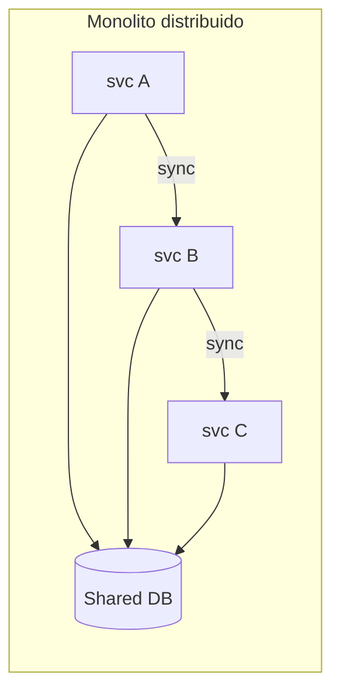
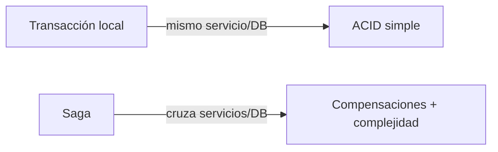
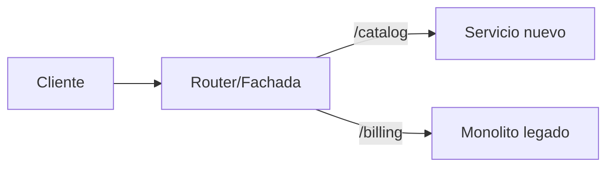
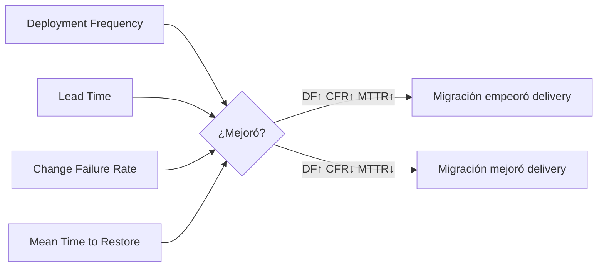

# Módulo 14 · Anti-patrones, migración y evolución

Migrar a microservicios es fácil de empezar y difícil de sostener. Este módulo cubre anti-patrones, monolito distribuido, sobre-descomposición, Strangler Fig, DORA y deuda técnica.

**Entorno de referencia verificado (2026-05-22):** JDK 27.0.1.0.2. Smokes de detección de smells, decisión local-vs-saga, routing de migración y DORA ejecutados con Java puro.

## Aprende construyendo

### Tema 1: Monolito distribuido y sobre-descomposición · Avanzado · 120 min

El sistema tiene 20 “microservicios”, pero un cambio de esquema obliga a desplegar 8 servicios juntos y la base de datos es compartida. Los PRs coordinados son la norma. La latencia de un checkout cruza 7 hops. El equipo tiene más repos que antes y menos autonomía.

Un monolito distribuido es como una casa con paredes de papel: parece que hay habitaciones separadas, pero todo se oye y se siente. La sobre-descomposición es como dividir una pizza en 100 porciones: más piezas, más bordes, más desorden. El microservicio no es el objetivo; la autonomía con costo aceptable lo es.



**Archivo:** `DistributedMonolithSmoke.java` → detección de smells.

```java
public class DistributedMonolithSmoke {
  static int smells(boolean sharedDb, boolean lockstepDeploy, int syncChain, boolean diffuseOwnership) {
    int s = 0;
    if (sharedDb) s++;
    if (lockstepDeploy) s++;
    if (syncChain > 3) s++;
    if (diffuseOwnership) s++;
    return s;
  }
  public static void main(String[] args) {
    System.out.println(smells(true, true, 5, true));
    System.out.println(smells(false, false, 1, false));
  }
}
```

**Lectura:** el smoke cuantifica smells. 3+ smells indica monolito distribuido probable.

1. Shared DB + lockstep + cadena sync de 5 + ownership difuso. Esperas `4`.
2. Sin smells. Esperas `0`.
3. Agrega un servicio sin frontera clara. Observa que el número de smells no baja.

Salida esperada:

```text
4
0
```

Detectar el monolito distribuido es el primer paso para recomponer. La solución no es más servicios; es mejores límites.

**Cuándo usarlo / cuándo no.** Usa estos criterios para diagnosticar. No resuelvas acoplamiento creando más servicios. No extraigas un servicio sin frontera de dominio y contrato claro.

| Smell | Causa | Arreglo |
|---|---|---|
| DB compartida | Acoplamiento por datos | Database-per-service + eventos |
| Deploy lockstep | Contratos implícitos | Versionado + contract tests |
| Cadena sync larga | Acoplamiento temporal | Async + timeout budget |
| Ownership difuso | Sin dueño claro | You build it, you run it |

**Error común.** Muchos repos, baja autonomía. **Síntoma.** PRs coordinados para un cambio simple. **Causa.** acoplamiento por DB/contratos. **Arreglo.** database-per-service, contratos explícitos, Bounded Contexts, recomponer si hace falta. **Señal observable.** cambios cross-service frecuentes.

**Pregunta de entrevista.** ¿Cómo sabes si tienes un monolito distribuido?  
**Respuesta modelo.** Si cambios simples requieren coordinar deploys de múltiples servicios, la base de datos es compartida, las cadenas síncronas son largas y el ownership es difuso. La prueba no es el número de servicios, sino la autonomía real de cada uno.

**Transferencia.**

1. **[NO-USAR-X]** Extraer un servicio por cada tabla de la DB. Respuesta: **No descomponer por tabla**; descomponer por dominio/capacidad.
2. ¿Cuándo recompondrías servicios en vez de crear más?
3. ¿Qué métrica usarías para medir autonomía de deploy?

#### Definición formal

Monolito distribuido: sistema dividido en procesos pero acoplado por datos, contratos, releases o llamadas síncronas. Sobre-descomposición: demasiados servicios sin límites ni capacidad operativa.

#### Contrato / internals

- **Smells:** DB compartida, deploy lockstep, cadenas sync largas, ownership difuso.
- **Costo:** cada servicio agrega CI/CD, observabilidad, seguridad, red, on-call.
- **Límite:** “microservicio” no es objetivo; es trade-off.

#### Ejemplo mínimo ejecutable

```bash
javac DistributedMonolithSmoke.java
java DistributedMonolithSmoke
```

Salida esperada:

```text
4
0
```

#### Caso real

Tres servicios leen/escriben la misma tabla `orders`. Cualquier migración requiere coordinar deploys.

#### Verificación

Smoke Java ejecutado localmente (2026-05-22, JDK 27.0.1.0.2): `4`, `0`.

**Nota de verificación:** heurístico. Verificación real requiere revisar acoplamiento de deploy, esquema, incidentes y lead time.

### Tema 2: Sagas innecesarias y acoplamiento temporal · Avanzado · 120 min

Un equipo usa saga con compensaciones para actualizar dos tablas dentro del mismo servicio y misma base de datos. La complejidad se triplicó: estados intermedios, compensaciones, idempotencia, observabilidad. Todo para un problema que una transacción local resolvía.

Una saga innecesaria es como usar un convoy de camiones para mover una caja dentro de la misma habitación. La transacción local es recoger la caja y ponerla en el estante. La saga solo tiene sentido cuando el objeto debe cruzar fronteras (otro servicio, otra DB). El acoplamiento temporal es como una cadena de favores: si uno no está disponible, todos se bloquean.



**Archivo:** `SagaNecessitySmoke.java` → decisión local vs saga.

```java
public class SagaNecessitySmoke {
  static String choose(boolean crossesServiceBoundary, boolean singleDatabase) {
    if (singleDatabase && !crossesServiceBoundary) return "local-transaction";
    if (crossesServiceBoundary) return "evaluate-saga";
    return "local-transaction";
  }
  static boolean temporalCoupling(int syncHops) { return syncHops > 3; }
  public static void main(String[] args) {
    System.out.println(choose(false, true));
    System.out.println(choose(true, false));
    System.out.println(temporalCoupling(5));
  }
}
```

**Lectura:** el smoke modela la decisión: mismo servicio/DB → transacción local. Cruza frontera → evaluar saga. Cadena sync > 3 → acoplamiento temporal.

1. Mismo servicio, misma DB. Esperas `local-transaction`.
2. Cruza frontera de servicio. Esperas `evaluate-saga`.
3. Cadena sync de 5 hops. Esperas `true` (acoplamiento temporal).

Salida esperada:

```text
local-transaction
evaluate-saga
true
```

Las sagas son poderosas pero costosas. Usarlas donde no se necesitan es sobre-ingeniería distribuida.

**Cuándo usarlo / cuándo no.** Usa transacción local si la invariante vive en un servicio/DB. Usa saga solo cuando el proceso cruza límites reales. No conviertas invariantes locales en flujos distribuidos.

| Situación | Solución | Cuándo NO |
|---|---|---|
| Mismo servicio/DB | Transacción local | Saga |
| Cruza servicios/DB | Saga con compensaciones | 2PC por defecto |
| Cadena sync larga | Async + timeout budget | Más hops síncronos |

**Error común.** Saga innecesaria. **Síntoma.** bugs de compensación en flujos simples. **Causa.** saga aplicada sin necesidad. **Arreglo.** preferir transacción local y límites de agregado claros. **Señal observable.** compensaciones para operaciones que podrían ser ACID locales.

**Pregunta de entrevista.** ¿Cuándo una saga es innecesaria?  
**Respuesta modelo.** Cuando la invariante vive dentro de un solo servicio y una sola base de datos. En ese caso, una transacción local ACID es más simple, más fuerte y más fácil de razonar. La saga solo se justifica cuando el proceso cruza límites de servicio o de datos donde no hay transacción local viable.

**Transferencia.**

1. **[NO-USAR-X]** Usar saga con compensaciones para actualizar dos tablas en la misma DB. Respuesta: **No usar saga** donde basta transacción local.
2. Un checkout actualiza pedido y reserva stock en el mismo servicio. ¿Saga o local tx?
3. ¿Cómo reduces acoplamiento temporal en una cadena sync?

#### Definición formal

Saga innecesaria: aplicación de coordinación distribuida a un problema resoluble con transacción local. Acoplamiento temporal: flujo que requiere múltiples servicios disponibles simultáneamente.

#### Contrato / internals

- **Transacción local:** ACID dentro de una DB/servicio.
- **Saga:** solo cuando cruza límites reales.
- **Acoplamiento temporal:** cadenas sync A→B→C.
- **Límite:** saga agrega compensaciones, estados, idempotencia.

#### Ejemplo mínimo ejecutable

```bash
javac SagaNecessitySmoke.java
java SagaNecessitySmoke
```

Salida esperada:

```text
local-transaction
evaluate-saga
true
```

#### Caso real

`orders-service` actualiza pedido y outbox en la misma DB: transacción local. Si también debe reservar inventario en `inventory-service`, se evalúa saga.

#### Verificación

Smoke Java ejecutado localmente (2026-05-22, JDK 27.0.1.0.2): `local-transaction`, `evaluate-saga`, `true`.

**Nota de verificación:** la decisión real requiere revisar límites de servicio, propiedad de datos e invariantes.

### Tema 3: Strangler Fig y coexistencia de datos · Avanzado · 120 min

El monolito legacy de billing tiene 8 años. Reescribirlo desde cero en 6 meses suena tentador. A los 4 meses, el nuevo sistema no cubre casos borde, el viejo sigue recibiendo cambios y nadie sabe cuál es la fuente de verdad. El big bang falla.

Strangler Fig es como renovar un edificio por pisos mientras la gente sigue viviendo ahí. No demueles todo; rediriges una capacidad a la parte nueva, verificas que funciona y recién después cierras la vieja. El router es la puerta temporal que decide a dónde va cada persona.



**Archivo:** `StranglerSmoke.java` → routing por capacidad migrada.

```java
import java.util.*;

public class StranglerSmoke {
  static String route(String capability, Set<String> migrated) {
    return migrated.contains(capability) ? "new" : "legacy";
  }
  static boolean safeCutover(boolean backfillDone, boolean checksumsMatch, boolean rollbackReady) {
    return backfillDone && checksumsMatch && rollbackReady;
  }
  public static void main(String[] args) {
    Set<String> migrated = new HashSet<>(Set.of("catalog"));
    System.out.println(route("catalog", migrated));
    System.out.println(route("billing", migrated));
    System.out.println(safeCutover(true, true, true));
    System.out.println(safeCutover(true, false, true));
  }
}
```

**Lectura:** el smoke modela routing por capacidad y condiciones de cutover seguro.

1. `catalog` migrado, `billing` no. Esperas `new`, `legacy`.
2. Cutover con backfill + checksums + rollback. Esperas `true`.
3. Cutover sin checksums. Esperas `false`.
4. Migra sin source of truth definido. Observa datos divergentes.

Salida esperada:

```text
new
legacy
true
false
```

Strangler Fig reduce riesgo al hacer la migración incremental y reversible. La disciplina está en el cutover, backfill y verificación.

**Cuándo usarlo / cuándo no.** Úsalo en sistemas vivos con riesgo alto de big bang. No hagas dual write indefinido sin reconciliación, métricas y plan de retiro.

| Fase | Qué hacer | Riesgo si falta |
|---|---|---|
| Route | Dirigir una capacidad | No hay control |
| Verify | Comparar resultados/metrics | Corte ciego |
| Cutover | Cambiar source of truth | Datos divergentes |
| Retire | Apagar legado | Coste duplicado eterno |

**Error común.** Rollback imposible. **Síntoma.** caída masiva tras migración. **Causa.** big bang sin ruta incremental. **Arreglo.** Strangler Fig, feature flags, backfill, reconciliación, rollback plan. **Señal observable.** cutover único con caída masiva y sin camino de retorno.

**Pregunta de entrevista.** ¿Por qué Strangler Fig es más seguro que big bang?  
**Respuesta modelo.** Porque limita el blast radius: migras una capacidad a la vez, mantienes rollback, comparas resultados y solo retiras el legado cuando hay evidencia. Un big bang concentra todo el riesgo en un solo corte.

**Transferencia.**

1. **[NO-USAR-X]** Reescribir todo el monolito y cortar tráfico en un solo día sin rollback. Respuesta: **No usar big bang** cuando puedes migrar incrementalmente.
2. ¿Qué capacidad migrarías primero: la más crítica o una acotada?
3. ¿Cómo verificas que el sistema nuevo responde igual que el legado?

#### Definición formal

Strangler Fig es una estrategia de migración incremental donde una fachada enruta capacidades hacia un sistema nuevo por etapas, hasta retirar el legado.

#### Contrato / internals

- **Router/fachada:** decide destino por ruta/capacidad.
- **Coexistencia:** legacy y nuevo conviven.
- **Cutover:** cambio controlado de source of truth.
- **Rollback:** volver a enrutar al legado.
- **Límite:** dual write requiere estrategia explícita.

#### Ejemplo mínimo ejecutable

```bash
javac StranglerSmoke.java
java StranglerSmoke
```

Salida esperada:

```text
new
legacy
true
false
```

#### Caso real

Gateway enruta `/catalog` al nuevo servicio. `/billing` sigue en el monolito hasta completar backfill y verificación.

#### Verificación

Smoke Java ejecutado localmente (2026-05-22, JDK 27.0.1.0.2): `new`, `legacy`, `true`, `false`.

**Nota de verificación:** migración real requiere pruebas de reconciliación de datos, carga y rollback.

### Tema 4: Métricas DORA y deuda técnica · Intermedio · 90 min

Tras migrar a microservicios, el equipo despliega más (DF sube), pero también rompe más (CFR sube). El MTTR empeora porque hay más servicios que diagnosticar. Nadie mide si la migración mejoró realmente la entrega. La deuda técnica se acumula porque “funciona” y nadie la prioriza.

DORA metrics son como el tablero de un hospital: deployment frequency es cuántas operaciones se hacen, lead time es cuánto tarda una desde que se agenda, change failure rate es cuántas salen mal, MTTR es cuánto tarda en recuperarse. Si solo miras “cuántas operaciones”, puedes celebrar mientras la mortalidad sube. La deuda técnica es como no cambiar el aceite: el auto funciona hasta que no.



**Archivo:** `DoraSmoke.java` → evaluación de salud de delivery.

```java
public class DoraSmoke {
  record DoraMetrics(double changeFailRate, int mttrHours, double deployFreqPerWeek) {}

  static boolean healthy(DoraMetrics m) {
    return m.changeFailRate() < 0.15 && m.mttrHours() < 24;
  }

  static String assessment(DoraMetrics before, DoraMetrics after) {
    if (after.deployFreqPerWeek() > before.deployFreqPerWeek()
        && after.changeFailRate() < before.changeFailRate()
        && after.mttrHours() < before.mttrHours()) return "improved";
    if (after.deployFreqPerWeek() > before.deployFreqPerWeek()
        && (after.changeFailRate() >= before.changeFailRate()
            || after.mttrHours() >= before.mttrHours())) return "worse-or-mixed";
    return "neutral";
  }

  public static void main(String[] args) {
    System.out.println(healthy(new DoraMetrics(0.1, 2, 10)));
    System.out.println(healthy(new DoraMetrics(0.3, 30, 15)));
    DoraMetrics before = new DoraMetrics(0.2, 12, 2);
    DoraMetrics after = new DoraMetrics(0.08, 4, 8);
    System.out.println(assessment(before, after));
  }
}
```

**Lectura:** el smoke evalúa salud individual y comparación antes/después de migración.

1. CFR 10%, MTTR 2h. Esperas `true`.
2. CFR 30%, MTTR 30h. Esperas `false`.
3. Antes: CFR 20%, MTTR 12h, DF 2/sem. Después: CFR 8%, MTTR 4h, DF 8/sem. Esperas `improved`.

Salida esperada:

```text
true
false
improved
```

DORA metrics miden si la evolución mejoró la entrega. La deuda técnica necesita dueño y plan. Sin medición, la migración es un acto de fe.

**Cuándo usarlo / cuándo no.** Úsalo para evaluar evolución arquitectónica y entrega. No uses solo DF o cantidad de servicios como indicador de éxito. No ignores CFR/MTTR.

| Métrica | Qué mide | Señal de problema |
|---|---|---|
| Deployment Frequency | Frecuencia de deploy | Baja = entrega lenta |
| Lead Time | Commit → producción | Alto = cuellos de botella |
| Change Failure Rate | % cambios que fallan | Alto = calidad baja |
| MTTR | Tiempo de restauración | Alto = observabilidad/ops débiles |

**Error común.** Medir solo velocidad. **Síntoma.** más despliegues, más incidentes. **Causa.** ignorar CFR/MTTR. **Arreglo.** balancear las 4 métricas y pagar deuda técnica. **Señal observable.** CFR/MTTR suben mientras DF sube.

**Pregunta de entrevista.** ¿Qué es deuda técnica y cómo la gestionas?  
**Respuesta modelo.** Es el costo futuro de decisiones que aceleraron la entrega ahora pero dificultan cambios seguros después. Se gestiona identificándola (code smells, complejidad, tests faltantes), asignándole dueño, priorizándola por impacto y pagándola incrementalmente, no en un big bang.

**Transferencia.**

1. **[NO-USAR-X]** Medir éxito de migración solo por número de microservicios creados. Respuesta: **No medir por cantidad**; medir por autonomía, estabilidad y DORA.
2. ¿Qué métrica DORA priorizarías si CFR es alto?
3. ¿Cómo asignas dueño a la deuda técnica?

#### Definición formal

DORA metrics: Deployment Frequency, Lead Time for Changes, Change Failure Rate, Mean Time to Restore. Deuda técnica: costo futuro de decisiones de diseño/código que aceleran ahora pero dificultan cambios seguros después.

#### Contrato / internals

- **DF:** frecuencia de despliegues a producción.
- **LT:** tiempo desde commit a producción.
- **CFR:** % cambios que causan fallo/rollback/hotfix.
- **MTTR:** tiempo para restaurar servicio.
- **Límite:** optimizar una métrica aislada empeora el sistema.

#### Ejemplo mínimo ejecutable

```bash
javac DoraSmoke.java
java DoraSmoke
```

Salida esperada:

```text
true
false
improved
```

#### Caso real

Después de introducir outbox y CI con contract tests, DF sube, CFR baja y MTTR mejora. Sin esas prácticas, la migración solo aumentó complejidad.

#### Verificación

Smoke Java ejecutado localmente (2026-05-22, JDK 27.0.1.0.2): `true`, `false`, `improved`.

**Nota de verificación:** DORA real se calcula con datos de CI/CD/incidentes. Este smoke solo valida la regla de evaluación.

Evolucionar a microservicios requiere podar complejidad. El éxito se mide en autonomía, estabilidad y delivery, no en cantidad de servicios.

## Checklist

- Detecto monolito distribuido.
- Evito sagas innecesarias.
- Migro incrementalmente con Strangler Fig.
- Mido DORA antes/después.
- La deuda técnica tiene dueño y plan.
