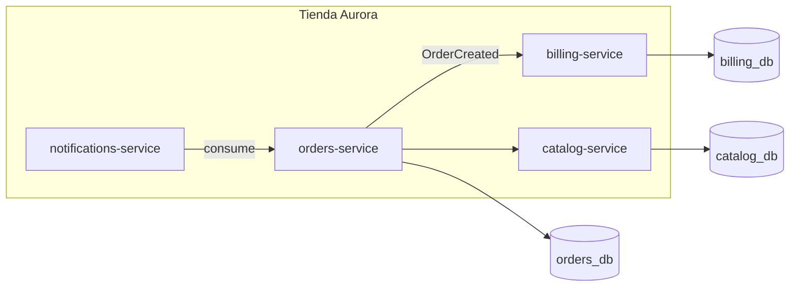
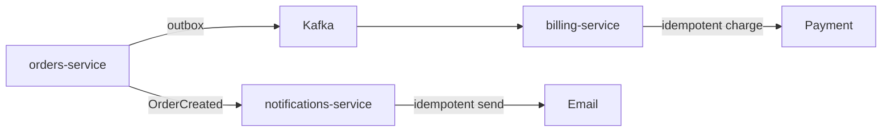
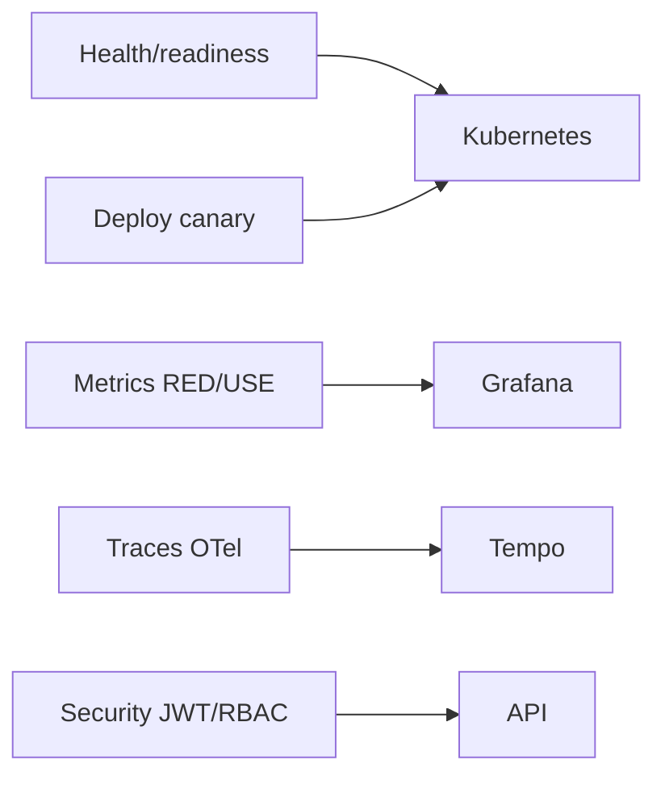
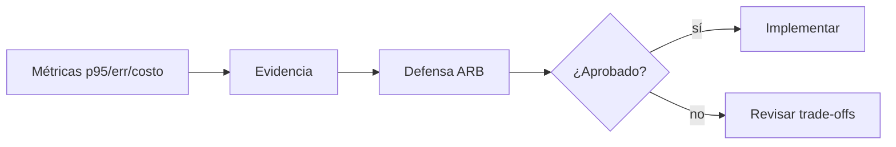

# Módulo 15 · Proyecto final: capstone Spring microservicios

El capstone cierra el track: diseño, implementación, operación y defensa. El objetivo es demostrar criterio arquitectónico con evidencia, no solo código funcionando.

**Entorno de referencia verificado (2026-05-22):** JDK 27.0.1.0.2. Los smokes son ejecutables con Java; infraestructura completa (Kafka/Keycloak/K8s/Gatling) queda con **Nota de verificación**.

## Aprende construyendo

### Tema 1: Diseño del sistema y límites · Experto · 360 min

## El problema

El equipo empieza el capstone creando repos, pipelines y clusters antes de definir qué servicios existen y por qué. Tres semanas después, un cambio de requisito obliga a reestructurar 4 servicios porque los límites eran arbitrarios. El diseño llegó después de la infraestructura.

## La idea clave

Diseñar límites es como dibujar el plano de una casa antes de construir. Si empiezas por los cimientos sin plano, cada habitación queda mal ubicada. Los bounded contexts son las habitaciones: cada una tiene una función clara, puertas definidas y un dueño.



## Construyendo la solución

**Archivo:** `CapstoneDesignSmoke.java` → validación de límites.

```java
import java.util.*;

public class CapstoneDesignSmoke {
  record Service(String name, String owner, String db) {}

  static boolean validDesign(List<Service> services) {
    // Sin DB compartida: cada servicio tiene su propia DB.
    Set<String> dbs = new HashSet<>();
    for (Service s : services) dbs.add(s.db());
    if (dbs.size() != services.size()) return false;
    // Cada servicio tiene owner.
    return services.stream().allMatch(s -> !s.owner().isBlank());
  }

  public static void main(String[] args) {
    List<Service> services = List.of(
        new Service("orders", "team-orders", "orders_db"),
        new Service("catalog", "team-catalog", "catalog_db"),
        new Service("billing", "team-billing", "billing_db"),
        new Service("notifications", "team-notifications", "notifications_db")
    );
    System.out.println(services.size());
    System.out.println(validDesign(services));
    System.out.println(!services.stream().map(Service::db).toList().contains("shared-db"));
  }
}
```

**Archivo:** ADR (conceptual).

```markdown
# ADR-010: Bounded contexts del capstone
## Status: Accepted
## Context: 4 dominios con ownership claro.
## Decision: orders, catalog, billing, notifications.
## Consequences: autonomía por servicio, contratos por evento/API.
```

**Lectura:** el smoke valida que no hay DB compartida y que cada servicio tiene owner. En la práctica, el diseño se documenta con C4 + ADRs.

## Verificando con un experimento

1. 4 servicios con DB propia y owner. Esperas `4`, `true`, `true`.
2. Comparte una DB entre dos servicios. Esperas `false` (diseño inválido).
3. Agrega un servicio sin owner. Esperas `false`.

Salida esperada:

```text
4
true
true
```

## Cierre del módulo y trade-offs

El diseño con límites claros es la base de todo lo demás. Sin él, la implementación es re-trabajo.

**Cuándo usarlo / cuándo no.** Diseña antes de infraestructura masiva. No empieces por Kubernetes/Kafka antes de definir límites, contratos y modos de fallo.

| Decisión | Cuándo | Cuándo NO |
|---|---|---|
| 4 bounded contexts | Dominios claros con ownership | MVP de 3 devs sin fronteras |
| Database-per-service | Autonomía de evolución | Servicios que leen la misma tabla |
| Eventos + REST | Comunicación por contrato | Llamadas síncronas largas |

**Error común.** Sobre-descomposición. **Síntoma.** 12 servicios para un MVP. **Causa.** dividir sin frontera real. **Arreglo.** pocos contextos claros, extraer por evidencia. **Señal observable.** cambios simples requieren coordinación entre muchos repos.

**Pregunta de entrevista.** ¿Cómo defines los límites de un microservicio?  
**Respuesta modelo.** Por bounded context: cada servicio posee un modelo de dominio coherente, su base de datos y su ciclo de vida. El límite se valida por autonomía de deploy, evolución de esquema y ownership de equipo. No se define por tablas ni por capas técnicas.

**Transferencia.**

1. **[NO-USAR-X]** Crear 10 microservicios para un MVP de 3 desarrolladores. Respuesta: **No sobre-descomponer**; empezar modular.
2. ¿Qué servicio extraerías primero si el monolito ya existe?
3. ¿Cómo validas que un límite es correcto antes de implementar?

#### Definición formal

El diseño del capstone define bounded contexts, contratos, ownership de datos, SLOs, riesgos y límites de consistencia. Se documenta con C4/ADRs.

#### Contrato / internals

- **Bounded context:** modelo + DB propios.
- **Contratos:** REST/gRPC/eventos versionados.
- **SLO:** latencia, disponibilidad, freshness, error budget.
- **Riesgos:** acoplamiento temporal, consistencia eventual, costos.
- **Límite:** microservicios solo si la autonomía lo justifica.

#### Ejemplo mínimo ejecutable

```bash
javac CapstoneDesignSmoke.java
java CapstoneDesignSmoke
```

Salida esperada:

```text
4
true
true
```

#### Caso real

`orders` es dueño del estado del pedido; `billing` del cobro; `notifications` solo envía. No existe tabla compartida.

#### Verificación

Smoke Java ejecutado localmente (2026-05-22, JDK 27.0.1.0.2): `4`, `true`, `true`.

**Nota de verificación:** el diseño real se valida con revisión ARB/ADR y walkthrough de escenarios.

### Tema 2: Contratos, idempotencia y saga/outbox · Experto · 360 min

## El problema

El capstone tiene 4 servicios y 3 flujos críticos. En el primer test de integración, un reintento de red duplica el cobro y el email se envía dos veces. El equipo asume que “el broker entrega una vez”. No fue así.

## La idea clave

Los contratos son como los planos eléctricos del edificio: cada servicio sabe qué cable conectar. La idempotencia es como el número de ticket: aunque te atiendan dos veces, el trámite se procesa una. El outbox es el buzón de salida del pedido. La saga es el plan de contingencia cuando un paso falla.



## Construyendo la solución

**Archivo:** `CapstoneFlowSmoke.java` → contrato + idempotencia.

```java
import java.util.*;

public class CapstoneFlowSmoke {
  record Event(String eventId, String orderId) {}

  static class IdempotentProcessor {
    private final Set<String> seen = new HashSet<>();
    private final List<String> effects = new ArrayList<>();

    String process(Event e, String effect) {
      if (!seen.add(e.eventId())) return "duplicate-ignored";
      effects.add(effect + ":" + e.orderId());
      return "processed";
    }

    int effectCount() { return effects.size(); }
  }

  public static void main(String[] args) {
    IdempotentProcessor p = new IdempotentProcessor();
    Event e = new Event("evt-1", "ord-1");
    System.out.println(p.process(e, "charge"));
    System.out.println(p.process(e, "charge")); // redelivery
    System.out.println("effects=" + p.effectCount());
  }
}
```

**Archivo:** outbox (conceptual).

```java
@Transactional
public Order createOrder(CreateOrderRequest req) {
  Order order = orderRepository.save(new Order(req));
  outboxRepository.save(new OutboxEvent("OrderCreated", order.getId()));
  return order;
}
```

**Lectura:** el smoke muestra redelivery con un solo efecto. En el capstone, cada consumidor deduplica por `eventId`.

## Verificando con un experimento

1. Procesa `evt-1` dos veces. Esperas `processed`, `duplicate-ignored`, `effects=1`.
2. Quita dedup. Observa doble efecto.
3. Agrega outbox. Observa que el evento se publica confiablemente.

Salida esperada:

```text
processed
duplicate-ignored
effects=1
```

## Cierre del módulo y trade-offs

Los contratos y la idempotencia son la base de la confianza en el sistema. Sin ellos, los retries son peligrosos.

**Cuándo usarlo / cuándo no.** Usa outbox + idempotencia + saga en todo flujo distribuido crítico. No uses dual write ni confíes en exactly-once sin diseño end-to-end.

| Componente | Propósito | Cuándo NO |
|---|---|---|
| Contrato versionado | Compatibilidad | Cambio sin versionar |
| Outbox | Publicación confiable | Dual write frágil |
| Idempotencia | Tolerar duplicados | Sin dedup store |
| Saga | Compensar fallos | Transacción local suficiente |

**Error común.** Doble cobro/email. **Síntoma.** efectos duplicados. **Causa.** retries sin idempotencia. **Arreglo.** outbox, dedup, idempotency keys, compensaciones. **Señal observable.** mismo `eventId` produce dos efectos.

**Pregunta de entrevista.** ¿Cómo garantizas que un reintento no duplica un cobro?  
**Respuesta modelo.** Con una idempotency key persistente: el primer intento guarda la clave y el resultado; los reintentos con la misma clave devuelven el resultado original sin re-ejecutar el cobro. En eventos, el consumidor deduplica por `eventId` con constraint único en DB.

**Transferencia.**

1. **[NO-USAR-X]** Reintentar un cobro por timeout sin idempotency key. Respuesta: **No usar retry ciego** en operaciones no idempotentes.
2. ¿Cómo manejas un paso de saga que no tiene compensación?
3. ¿Qué observabilidad mínima necesitas para depurar un flujo distribuido?

#### Definición formal

La consistencia práctica combina contratos versionados, outbox, idempotencia y sagas para tolerar fallos y duplicados en flujos distribuidos.

#### Contrato / internals

- **Contrato:** schema/API con versión y compatibilidad.
- **Outbox:** estado + evento en transacción local.
- **Idempotencia:** dedup por `eventId`/idempotency key.
- **Saga:** compensación semántica.
- **Observabilidad:** traceId end-to-end.

#### Ejemplo mínimo ejecutable

```bash
javac CapstoneFlowSmoke.java
java CapstoneFlowSmoke
```

Salida esperada:

```text
processed
duplicate-ignored
effects=1
```

#### Caso real

`orders-service` guarda pedido y outbox. `billing-service` consume con dedup. Si cobra pero falla notificación, la saga compensa o reintenta.

#### Verificación

Smoke Java ejecutado localmente (2026-05-22, JDK 27.0.1.0.2): `processed`, `duplicate-ignored`, `effects=1`.

**Nota de verificación:** el flujo completo requiere Kafka/DB/servicios. Verificación propuesta: Testcontainers o entorno de integración.

### Tema 3: Observabilidad, seguridad y despliegue · Experto · 240 min

## El problema

El capstone “funciona en local”. En producción, un deploy causa downtime porque no hay readiness probe. Un incidente ocurre y nadie puede reconstruir la request porque no hay traceId. Un endpoint admin está expuesto sin auth. El sistema funcional no es operable.

## La idea clave

La operación productiva es como el sistema de soporte vital de un hospital: no es la cirugía (el código), pero sin él el paciente no sobrevive. Observabilidad es el monitor, seguridad es el control de acceso, despliegue es la anestesia que permite operar sin dolor.



## Construyendo la solución

**Archivo:** `CapstoneOpsSmoke.java` → readiness y autorización.

```java
public class CapstoneOpsSmoke {
  static boolean ready(boolean db, boolean broker, boolean cache) {
    return db && broker && cache;
  }
  static boolean authorized(String role, String action) {
    if ("ADMIN".equals(role)) return true;
    return "USER".equals(role) && "read".equals(action);
  }
  public static void main(String[] args) {
    System.out.println(ready(true, true, true));
    System.out.println(ready(true, false, true));
    System.out.println(authorized("USER", "delete"));
  }
}
```

**Lectura:** el smoke modela readiness (todas las dependencias) y autorización (rol + acción).

## Verificando con un experimento

1. DB + broker + cache UP. Esperas `true`.
2. Broker DOWN. Esperas `false` (no recibir tráfico).
3. USER intenta delete. Esperas `false`.
4. Agrega traceId a todos los logs. Observa que el incidente se reconstruye en minutos.

Salida esperada:

```text
true
false
false
```

## Cierre del módulo y trade-offs

La operación productiva es tan importante como el código. Sin observabilidad, seguridad y entrega segura, el sistema no está listo.

**Cuándo usarlo / cuándo no.** Usa todo antes de exponer a usuarios reales. No pospongas seguridad/observabilidad al “final”.

| Aspecto | Mínimo viable | Producción |
|---|---|---|
| Observabilidad | Health + logs | Métricas + traces + SLOs |
| Seguridad | Auth básica | OAuth2/JWT + RBAC + secretos + CVE scan |
| Despliegue | Manual | Imagen reproducible + probes + canary + GitOps |

**Error común.** Downtime en deploy. **Síntoma.** 503 en rollout. **Causa.** probes mal definidas o sin graceful shutdown. **Arreglo.** readiness/liveness separadas, graceful shutdown, canary. **Señal observable.** errores durante deploy.

**Pregunta de entrevista.** ¿Qué necesita un microservicio para estar “listo para producción”?  
**Respuesta modelo.** Health/readiness probes, métricas y traces correlacionados, SLOs con alertas, autenticación/autorización, secretos fuera de git, CVE scan, imagen reproducible, graceful shutdown y runbooks. Funcionar en local no es suficiente.

**Transferencia.**

1. **[NO-USAR-X]** Exponer a producción sin observabilidad ni seguridad “porque funciona en local”. Respuesta: **No exponer sin operación productiva**.
2. ¿Qué diferencia hay entre liveness y readiness en el capstone?
3. ¿Cómo correlacionas un incidente con un deploy específico?

#### Definición formal

La operación productiva combina observabilidad (logs/métricas/trazas), seguridad (authn/authz/secretos) y entrega segura (contenedores, probes, rollout, GitOps).

#### Contrato / internals

- **Observabilidad:** health, métricas RED/USE, traces, SLOs.
- **Seguridad:** OAuth2/JWT, RBAC/scopes, secretos, CVE scan.
- **Despliegue:** imagen reproducible, probes, rollout progresivo.
- **Límite:** funcional ≠ operable.

#### Ejemplo mínimo ejecutable

```bash
javac CapstoneOpsSmoke.java
java CapstoneOpsSmoke
```

Salida esperada:

```text
true
false
false
```

#### Caso real

Readiness UP solo con DB + broker + cache. Admin exige `ROLE_ADMIN`. Deploy canary con rollback por SLO.

#### Verificación

Smoke Java ejecutado localmente (2026-05-22, JDK 27.0.1.0.2): `true`, `false`, `false`.

**Nota de verificación:** no se ejecutó K8s/Keycloak/OTel completo. Verificación propuesta: deploy en cluster de prueba.

### Tema 4: Carga, restricción sobrevenida y defensa ARB · Experto · 240 min

## El problema

El ARB pide “reduce costo 30% sin romper p95 < 300ms ni error rate < 1%”. El equipo no tiene métricas, no tiene load test y no tiene ADR. La defensa se convierte en opinión. El ARB rechaza.

## La idea clave

La defensa ARB es como un juicio: necesitas evidencia, no opiniones. p95 es el testigo experto, el error rate es el informe de daños, el costo es el presupuesto. Sin números, la defensa es “creo que funciona”. Con números, es “aquí está la evidencia”.



## Construyendo la solución

**Archivo:** `CapstoneArbSmoke.java` → evaluación de restricción.

```java
public class CapstoneArbSmoke {
  record Constraints(int p95Ms, double errorRate, double costDelta) {}

  static boolean pass(Constraints c) {
    return c.p95Ms() < 300 && c.errorRate() < 0.01 && c.costDelta() <= 0;
  }

  static String defense(Constraints c) {
    if (pass(c)) return "approved";
    if (c.p95Ms() >= 300) return "fail: p95 too high";
    if (c.errorRate() >= 0.01) return "fail: error rate too high";
    return "fail: cost not reduced";
  }

  public static void main(String[] args) {
    System.out.println(defense(new Constraints(180, 0.002, -0.1)));
    System.out.println(defense(new Constraints(400, 0.002, -0.1)));
    System.out.println(defense(new Constraints(180, 0.02, -0.1)));
  }
}
```

**Lectura:** el smoke evalúa la restricción compuesta. Si falla un criterio, dice cuál.

## Verificando con un experimento

1. p95 180, error 0.2%, costo -10%. Esperas `approved`.
2. p95 400. Esperas `fail: p95 too high`.
3. error 2%. Esperas `fail: error rate too high`.
4. Ante “reduce 30%”, propón right-sizing + sampling con impacto medido.

Salida esperada:

```text
approved
fail: p95 too high
fail: error rate too high
```

## Cierre del módulo y trade-offs

La defensa ARB requiere evidencia cuantitativa y trade-offs explícitos. Sin números, no hay defensa.

**Cuándo usarlo / cuándo no.** Úsalo al cerrar el capstone o justificar una decisión mayor. No defiendas con “funciona en mi máquina” ni solo con diapositivas.

| Evidencia | Qué demuestra | Sin ella |
|---|---|---|
| p95/p99 | Latencia real | “es rápido” (opinión) |
| Error rate | Estabilidad | “no falla” (sin datos) |
| Costo | Impacto económico | “ahorra” (sin medición) |
| Traces | Causa raíz | “creo que es X” |

**Error común.** Claims sin métricas. **Síntoma.** rechazo en ARB. **Causa.** sin números ni trade-offs. **Arreglo.** llevar p95/error/costo, trazas, alternativas y riesgos. **Señal observable.** preguntas básicas sin respuesta cuantitativa.

**Pregunta de entrevista.** ¿Cómo defiendes una decisión arquitectónica ante un ARB?  
**Respuesta modelo.** Con evidencia: métricas (p95, error rate, costo), trazas de incidentes, ADRs con alternativas y trade-offs, y plan de rollback. La defensa no es convencer; es mostrar datos que permitan tomar una decisión informada.

**Transferencia.**

1. **[NO-USAR-X]** Defender una decisión con “funciona en mi máquina” sin métricas. Respuesta: **No defender sin evidencia**; llevar números y trade-offs.
2. El ARB pide reducir costo 30% más. ¿Qué propones?
3. ¿Cómo manejas una restricción que contradice el SLO?

#### Definición formal

La defensa ARB es la presentación técnica de una decisión con contexto, alternativas, trade-offs, evidencia, riesgos y respuesta a restricciones.

#### Contrato / internals

- **Métricas:** p95/p99, error rate, throughput, costo, saturación.
- **Evidencia:** load tests, traces, dashboards, ADRs, postmortems.
- **Restricción sobrevenida:** cambio de requisito; se responde con trade-offs y datos.
- **Límite:** sin números no hay defensa.

#### Ejemplo mínimo ejecutable

```bash
javac CapstoneArbSmoke.java
java CapstoneArbSmoke
```

Salida esperada:

```text
approved
fail: p95 too high
fail: error rate too high
```

#### Caso real

Se presenta ADR de caching: reduce costo 20% y p95 de 420ms a 210ms, con riesgo de stale data mitigado por invalidación. Ante “reduce 30%”, se propone right-sizing + sampling.

#### Verificación

Smoke Java ejecutado localmente (2026-05-22, JDK 27.0.1.0.2): `approved`, `fail: p95 too high`, `fail: error rate too high`.

**Nota de verificación:** no se ejecutó Gatling/k6 ni cluster real. Verificación propuesta: prueba de carga reproducible, dashboard de SLO/costo y ADR con resultados.

## Cierre del módulo

El capstone Spring demuestra que puedes diseñar, operar y defender un sistema distribuido con evidencia. Microservicios es un medio, no el objetivo.

## Checklist

- Límites y ownership claros.
- Contratos, idempotencia y saga/outbox.
- Observabilidad, seguridad y entrega.
- ADR y defensa con métricas.
- Verificación honesta de lo ejecutado vs no ejecutado.
