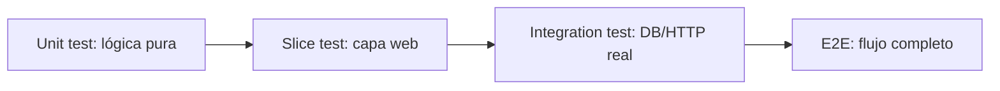
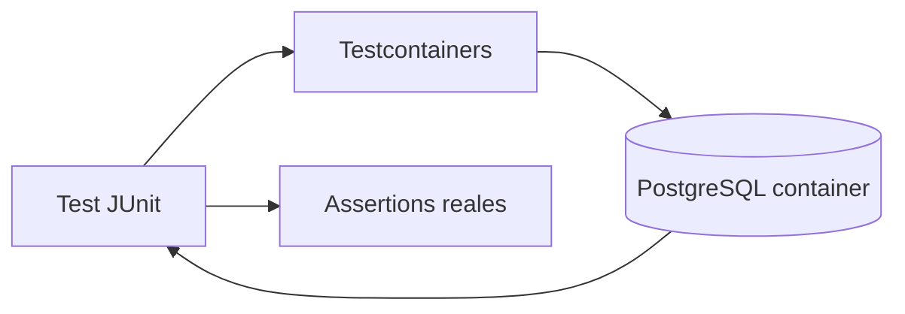
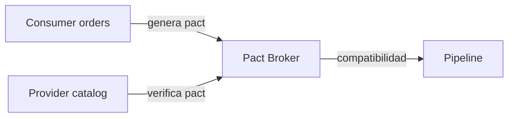
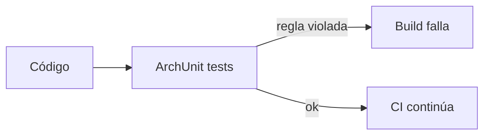
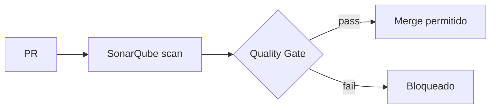

# Módulo 2 · Testing de microservicios Java

Los microservicios fallan en las fronteras: contratos, datos, red, configuración y arquitectura. El testing no busca “100% cobertura”; busca confianza con feedback rápido. Este módulo cubre pirámide de tests, dobles, integración realista, contratos, arquitectura y calidad estática.

**Entorno de referencia verificado (2026-05-22):** JDK 27.0.1.0.2. Los smokes ejecutan reglas de decisión, dobles, contratos, invariantes arquitectónicas, gates y configuración cloud-like en Java puro. JUnit/Mockito/MockMvc/Testcontainers/Pact/ArchUnit/SonarQube/Spring Modulith reales requieren dependencias e infraestructura; se incluyen **Notas de verificación** honestas.

## Aprende construyendo

### Tema 1: JUnit 5, Mockito y MockMvc · Intermedio · 180 min

#### Paso 1 · El dolor

El equipo tiene “90% de cobertura” y aun así un deploy rompe producción. Los tests mockean el repositorio, el cliente HTTP y el servicio de pagos; verifican que los mocks se llamen con ciertos argumentos, pero nunca verifican una regla de negocio real ni un contrato de datos. La cobertura es alta, la confianza es cero.

#### Paso 2 · La intuición

Un unit test es como revisar el motor del auto en el taller: rápido, aislado y útil. Un integration test es como sacar el auto a la calle. Si solo revisas en el taller, no sabes si las ruedas tocan bien el pavimento. Mockear todo convierte el taller en un simulador sin contacto con la realidad.



#### Paso 3 · La construcción

**Archivo:** `TaxAndPriceSmoke.java` → doble controlado en frontera.

```java
public class TaxAndPriceSmoke {
  interface TaxProvider { double rate(); }

  static class PriceService {
    private final TaxProvider tax;
    PriceService(TaxProvider tax) { this.tax = tax; }
    double total(double base) { return base * (1 + tax.rate()); }
  }

  public static void main(String[] args) {
    TaxProvider stub = () -> 0.21; // doble: solo en frontera de impuestos
    PriceService service = new PriceService(stub);
    System.out.println(service.total(100));
    System.out.println(stub.rate());
  }
}
```

**Archivo:** test Spring (conceptual).

```java
@WebMvcTest(OrderController.class)
class OrderControllerTest {
  @Autowired MockMvc mockMvc;
  @MockBean OrderService orderService;

  @Test
  void returnsOrder() throws Exception {
    when(orderService.findById("o1")).thenReturn(new OrderDto("o1", "PAID"));
    mockMvc.perform(get("/orders/o1"))
        .andExpect(status().isOk())
        .andExpect(jsonPath("$.status").value("PAID"));
  }
}
```

**Lectura:** el smoke muestra el principio: el doble se usa en una frontera (impuestos), no para inventar todo el sistema. MockMvc prueba la capa web sin levantar HTTP real, pero sigue validando serialización y routing.

#### Paso 4 · El experimento

1. Inyecta `TaxProvider` stub a 21%. Esperas `121.0`.
2. Cambia el stub a 0% (exención). Esperas `100.0`.
3. Intenta mockear `PriceService` dentro de sí mismo. Observa que pierdes la regla de negocio; el test se vuelve tautológico.

Salida esperada:

```text
121.0
0.21
```

#### Paso 5 · El cierre

Los tests unit/slice son rápidos y útiles, pero solo si no se convierten en ficción. El doble debe representar una frontera real, no reemplazar el sistema entero.

**Cuándo usarlo / cuándo no.** Usa unit tests para lógica pura y reglas. Usa MockMvc para la capa web y serialización. No mockees todo: valida integración en DB/HTTP reales. No persigas cobertura sin confianza.

| Tipo | Cuándo | Cuándo NO |
|---|---|---|
| Unit | Lógica pura, invariantes | Código con side effects externos |
| Slice (MockMvc) | Controller, filtros, serialización | Lógica de negocio profunda |
| Mock | Frontera externa (clock, gateway) | Repositorio y DB (usar integración) |

**Error común.** Mockear todo. **Síntoma.** tests verdes y prod falla. **Causa.** dobles no representan contratos reales. **Arreglo.** dobles en fronteras, integración para DB/HTTP. **Señal observable.** alta cobertura con bugs de integración.

**Pregunta de entrevista.** ¿Qué diferencia hay entre un mock y un stub?  
**Respuesta modelo.** Un stub proporciona respuestas predefinidas para aislar una dependencia; un mock además verifica interacciones (qué método se llamó y con qué argumentos). En la práctica, se usan para fronteras externas, no para reemplazar el sistema completo ni el dominio.

**Transferencia.**

1. **[NO-USAR-X]** Mockear `OrderRepository` y no probar la query real. Respuesta: **No usar mock para DB**; usar Testcontainers.
2. ¿Qué probarías con `@WebMvcTest` y qué no?
3. ¿Qué métrica de cobertura usarías como guardrail sin convertirla en objetivo?

#### Definición formal

JUnit 5 ejecuta tests en Java. Mockito crea dobles para aislar dependencias. MockMvc permite probar la capa web Spring MVC sin servidor HTTP completo.

#### Contrato / internals

- `@Test`, lifecycle, extensiones.
- `mock/when/verify` en fronteras.
- MockMvc usa DispatcherServlet simulado.
- Slice tests cargan solo parte del contexto.

#### Ejemplo mínimo ejecutable

```bash
javac TaxAndPriceSmoke.java
java TaxAndPriceSmoke
```

Salida esperada:

```text
121.0
0.21
```

#### Caso real

`OrderControllerTest` usa `@WebMvcTest` + `MockMvc` para verificar 200/404 y serialización. `OrderServiceTest` usa Mockito para la frontera de pago. `OrderRepositoryIT` usa Testcontainers para la query real.

#### Verificación

Smoke Java ejecutado localmente (2026-05-22, JDK 27.0.1.0.2): `121.0`, `0.21`.

**Nota de verificación:** no se ejecutó JUnit/Mockito/MockMvc real. Verificación propuesta: proyecto Spring Boot con tests `@WebMvcTest` y `MockMvc`.

### Tema 2: Testcontainers · Intermedio · 180 min

#### Paso 1 · El dolor

El equipo usa H2 para tests porque “es rápido”. En producción PostgreSQL falla por un tipo JSON, un índice o un lock. El test pasó, el deploy falló. La causa fue confiar en una base distinta a la de producción.

#### Paso 2 · La intuición

Testcontainers es como pedir el plato real en vez de una foto. El contenedor efímero levanta PostgreSQL real, se destruye al final y cada test empieza limpio. Es más lento que H2, pero prueba el contrato real de la base.



#### Paso 3 · La construcción

**Archivo:** `TestcontainersDecisionSmoke.java` → cuándo usar contenedor real.

```java
public class TestcontainersDecisionSmoke {
  static String strategy(String dependency) {
    return switch (dependency) {
      case "unit-pure-logic" -> "NO_CONTAINER";
      case "postgres-repository" -> "TESTCONTAINERS_POSTGRES";
      case "redis-cache" -> "TESTCONTAINERS_REDIS";
      case "cloud-s3" -> "FLOCI_OR_LOCALSTACK";
      default -> "EVALUATE";
    };
  }
  public static void main(String[] args) {
    System.out.println(strategy("postgres-repository"));
    System.out.println(strategy("unit-pure-logic"));
  }
}
```

**Archivo:** test real (conceptual).

```java
@Testcontainers
class OrderRepositoryIT {
  @Container
  static PostgreSQLContainer<?> pg = new PostgreSQLContainer<>("postgres:16");
  @DynamicPropertySource
  static void props(DynamicPropertyRegistry r) {
    r.add("spring.datasource.url", pg::getJdbcUrl);
  }
}
```

**Lectura:** Testcontainers no es para todo. Úsalo donde el comportamiento del motor importa: SQL, índices, JSON, locks, migraciones, brokers.

#### Paso 4 · El experimento

1. Repositorio PostgreSQL. Esperas `TESTCONTAINERS_POSTGRES`.
2. Lógica pura. Esperas `NO_CONTAINER`.
3. Reemplaza Testcontainers por H2 para una query con JSONB. Observa que el test puede pasar y prod fallar.

Salida esperada:

```text
TESTCONTAINERS_POSTGRES
NO_CONTAINER
```

#### Paso 5 · El cierre

Testcontainers compra realismo a costa de tiempo. La regla es usarlo donde el motor importa, no en cada test unitario.

**Cuándo usarlo / cuándo no.** Úsalo para DB, broker, cache y dependencias con semántica específica. No lo uses para lógica pura. No asumas H2 compatible con PostgreSQL/MySQL.

| Dependencia | Estrategia | Cuándo NO |
|---|---|---|
| PostgreSQL/MySQL | Testcontainers real | H2 como sustituto perfecto |
| Redis | Testcontainers real | fake in-memory si importa TTL/eviction |
| Kafka/RabbitMQ | Testcontainers real | mocks si solo validas llamada |
| Cloud S3/SQS | Floci/LocalStack | cuenta cloud en cada test |

**Error común.** Usar H2 para todo. **Síntoma.** falla en prod por dialecto. **Causa.** diferencias de SQL/tipos. **Arreglo.** Testcontainers con motor real. **Señal observable.** tests verdes, prod con `SQLGrammarException`.

**Pregunta de entrevista.** ¿Cuándo Testcontainers no es la mejor opción?  
**Respuesta modelo.** Cuando el costo/tiempo de levantar contenedores no aporta valor: lógica pura, transformaciones, validaciones o reglas sin dependencia externa. También cuando hay infraestructura costosa o no contenedorizable; ahí se usan fakes controlados o tests en entorno dedicado.

**Transferencia.**

1. **[NO-USAR-X]** Usar H2 para validar una migración Flyway con JSONB y locks. Respuesta: **No usar H2** para semántica real de PostgreSQL.
2. ¿Qué probarías con Testcontainers y qué con mocks?
3. ¿Cómo mantienes los tests rápidos si todo usa contenedores?

#### Definición formal

Testcontainers levanta dependencias reales en contenedores Docker durante tests, con ciclo de vida automatizado y configuración dinámica.

#### Contrato / internals

- `@Container`, lifecycle start/stop.
- URL dinámica inyectada al Spring context.
- Requiere Docker daemon.
- Reutilización posible con cuidado.
- Límite: más lento que unit tests.

#### Ejemplo mínimo ejecutable

```bash
javac TestcontainersDecisionSmoke.java
java TestcontainersDecisionSmoke
```

Salida esperada:

```text
TESTCONTAINERS_POSTGRES
NO_CONTAINER
```

#### Caso real

`OrderRepositoryIT` levanta PostgreSQL real con Testcontainers y valida una query con JSONB y migración Flyway.

#### Verificación

Smoke Java ejecutado localmente (2026-05-22, JDK 27.0.1.0.2): `TESTCONTAINERS_POSTGRES`, `NO_CONTAINER`.

**Nota de verificación:** no se levantó Docker/Testcontainers real. Verificación propuesta: `./mvnw -Dtest=*IT test` con Docker disponible.

### Tema 3: Contract Testing con Pact · Avanzado · 180 min

#### Paso 1 · El dolor

`orders-service` consume `catalog-service`. El equipo de catalog cambia el campo `price` a `unitPrice` y despliega. `orders` deja de mapear precios y cobra mal. Los tests de ambos servicios pasaron porque cada uno probó contra su propio mock, no contra el contrato real.

#### Paso 2 · La intuición

Un contract test es como un acuerdo firmado entre dos equipos: el consumidor dice “yo espero estos campos” y el proveedor se compromete a cumplirlo. Si alguien cambia el contrato, el CI lo detecta antes del deploy, no en producción.



#### Paso 3 · La construcción

**Archivo:** `ContractShapeSmoke.java` → contrato mínimo y evolución.

```java
import java.util.*;

public class ContractShapeSmoke {
  static boolean providerSatisfiesConsumer(Map<String, Object> providerResponse) {
    return providerResponse.containsKey("id")
        && providerResponse.containsKey("price")
        && providerResponse.get("price") instanceof Number;
  }

  static boolean compatibleEvolution(Map<String, Object> oldResp, Map<String, Object> newResp) {
    return providerSatisfiesConsumer(newResp)
        && oldResp.keySet().stream().allMatch(newResp::containsKey);
  }

  public static void main(String[] args) {
    Map<String, Object> oldResp = Map.of("id", "p1", "price", 10);
    Map<String, Object> newResp = Map.of("id", "p1", "price", 10, "currency", "USD");
    Map<String, Object> broken = Map.of("id", "p1", "unitPrice", 10);

    System.out.println(providerSatisfiesConsumer(oldResp));
    System.out.println(providerSatisfiesConsumer(broken));
    System.out.println(compatibleEvolution(oldResp, newResp));
  }
}
```

**Lectura:** el smoke modela el contrato: el consumidor necesita `id` y `price`. Agregar `currency` es compatible. Renombrar `price` a `unitPrice` rompe el contrato.

#### Paso 4 · El experimento

1. Respuesta con `id` y `price`. Esperas `true`.
2. Respuesta con `unitPrice` en vez de `price`. Esperas `false`.
3. Agrega `currency` manteniendo campos viejos. Esperas compatible `true`.
4. Pact real: consumer genera pact; provider CI verifica contra Pact Broker.

Salida esperada:

```text
true
false
true
```

#### Paso 5 · El cierre

Contract testing detecta quiebres de compatibilidad antes de deploy. No reemplaza unit tests ni E2E; cubre la frontera entre servicios.

**Cuándo usarlo / cuándo no.** Úsalo entre servicios con despliegue independiente y contratos HTTP/mensajería. No lo uses para reemplazar tests de lógica ni E2E. No hagas contratos sobre-especificados.

| Aspecto | Contract test | E2E |
|---|---|---|
| Velocidad | Rápido | Lento |
| Alcance | Frontera consumidor/proveedor | Flujo completo |
| Infra | Mínima | Alta |
| Detección de quiebre | Antes del deploy | Tarde |

**Error común.** Contratos sobre-especificados. **Síntoma.** fallos por campos irrelevantes. **Causa.** verificar más de lo que el consumidor usa. **Arreglo.** contrato mínimo basado en uso real. **Señal observable.** rupturas por campos no consumidos.

**Pregunta de entrevista.** ¿Qué detecta un contract test que no detecta un E2E?  
**Respuesta modelo.** Detecta quiebres de compatibilidad en la frontera de forma rápida y aislada, antes de integrar todo el sistema. Un E2E detecta problemas de flujo completo, pero es lento y costoso; además, si falla, no siempre dice cuál contrato se rompió.

**Transferencia.**

1. **[NO-USAR-X]** Pact que exige todos los campos del DTO del provider, incluso los no usados. Respuesta: **No sobre-especificar** contratos.
2. Un equipo cambia un campo opcional por uno requerido. ¿El contract test debe fallar?
3. ¿Cómo manejas contratos entre más de dos servicios?

#### Definición formal

Pact captura expectativas del consumidor como contrato (pact file). El provider verifica que cumple ese contrato. Pact Broker versiona y publica contratos.

#### Contrato / internals

- **Consumer-driven:** el consumidor define lo que necesita.
- **Provider verification:** ejecuta contra el pacto.
- **Broker:** versionado y compatibilidad.
- **Límite:** no reemplaza E2E ni unit tests.

#### Ejemplo mínimo ejecutable

```bash
javac ContractShapeSmoke.java
java ContractShapeSmoke
```

Salida esperada:

```text
true
false
true
```

#### Caso real

Consumer `orders` genera pact contra `catalog`. En CI, catalog verifica el pacto antes de desplegar. Un renombre de campo falla el pipeline.

#### Verificación

Smoke Java ejecutado localmente (2026-05-22, JDK 27.0.1.0.2): `true`, `false`, `true`.

**Nota de verificación:** no se ejecutó Pact/Pact Broker real. Verificación propuesta: integrar `pact-jvm` consumer/provider tests en CI.

### Tema 4: ArchUnit · Intermedio · 120 min

#### Paso 1 · El dolor

El equipo define “domain no depende de web” en una wiki. Con el tiempo, alguien importa `spring-web` en un aggregate. Nadie se da cuenta hasta que un refactor rompe la arquitectura. La regla era humana, no ejecutable.

#### Paso 2 · La intuición

ArchUnit convierte una regla arquitectónica en un test que falla el build. Es como poner una alarma en la puerta: si alguien intenta entrar por la puerta prohibida, la alarma suena en CI, no en producción.



#### Paso 3 · La construcción

**Archivo:** `ArchRuleSmoke.java` → regla de dependencia.

```java
import java.util.*;

public class ArchRuleSmoke {
  static boolean allowed(String fromPackage, String toPackage) {
    if (fromPackage.contains("domain") && toPackage.startsWith("spring")) return false;
    if (fromPackage.contains("domain") && toPackage.contains("web")) return false;
    return true;
  }

  public static void main(String[] args) {
    System.out.println(allowed("com.aurora.domain", "java.util"));
    System.out.println(allowed("com.aurora.domain", "org.springframework.web"));
  }
}
```

**Archivo:** test ArchUnit real (conceptual).

```java
@AnalyzeClasses(packages = "com.aurora")
class ArchitectureTest {
  @ArchTest
  static final ArchRule domainDoesNotDependOnWeb =
      noClasses().that().resideInAPackage("..domain..")
          .should().dependOnClassesThat().resideInAPackage("..web..");
}
```

**Lectura:** el smoke modela la regla. En producción, ArchUnit inspecciona bytecode real y falla si la regla se viola.

#### Paso 4 · El experimento

1. `domain` → `java.util`. Esperas `true`.
2. `domain` → `spring.web`. Esperas `false`.
3. Agrega una regla para prohibir ciclos entre paquetes. Observa que detecta erosión temprana.

Salida esperada:

```text
true
false
```

#### Paso 5 · El cierre

ArchUnit hace la arquitectura ejecutable. La regla deja de ser un deseo y se convierte en gate de CI.

**Cuándo usarlo / cuándo no.** Úsalo para reglas estables y de alto valor. No codifiques reglas volátiles o triviales. No uses ArchUnit para reemplazar revisiones de diseño.

| Regla | Cuándo | Cuándo NO |
|---|---|---|
| Capas (domain no depende de web) | Arquitectura hexagonal/clean | Proyecto sin capas definidas |
| Naming de clases | Convenciones estables | Nombres en discusión |
| Ciclos entre paquetes | Prevenir erosión | Reglas que cambian cada sprint |

**Error común.** Reglas solo en documentación. **Síntoma.** erosión arquitectónica gradual. **Causa.** sin enforcement automático. **Arreglo.** ArchUnit en CI con reglas clave. **Señal observable.** imports indebidos en PR sin detección.

**Pregunta de entrevista.** ¿Qué es una fitness function arquitectónica?  
**Respuesta modelo.** Es una verificación automatizada que asegura que una propiedad arquitectónica se mantiene en el tiempo. ArchUnit es una fitness function: ejecuta reglas sobre el código y falla si la arquitectura se degrada.

**Transferencia.**

1. **[NO-USAR-X]** Codificar 50 reglas ArchUnit para un proyecto sin arquitectura definida. Respuesta: **No usar reglas volátiles**; empezar con 3-5 reglas de alto valor.
2. ¿Qué regla prohibiría que un controller llame directamente a un repository?
3. ¿Cómo detectas dependencias cíclicas entre módulos?

#### Definición formal

ArchUnit ejecuta reglas de arquitectura sobre bytecode Java, integrándose con JUnit para fallar el build ante violaciones.

#### Contrato / internals

- `@AnalyzeClasses` define alcance.
- Reglas sobre paquetes, clases, dependencias.
- Se ejecuta como test JUnit.
- Falla el build ante violación.

#### Ejemplo mínimo ejecutable

```bash
javac ArchRuleSmoke.java
java ArchRuleSmoke
```

Salida esperada:

```text
true
false
```

#### Caso real

`ArchitectureTest` en CI falla si `domain` depende de `web` o si hay ciclos entre módulos.

#### Verificación

Smoke Java ejecutado localmente (2026-05-22, JDK 27.0.1.0.2): `true`, `false`.

**Nota de verificación:** no se ejecutó ArchUnit real. Verificación propuesta: proyecto con dependencia `archunit-junit5` y test de capas.

### Tema 5: SonarQube · Intermedio · 120 min

#### Paso 1 · El dolor

El equipo acumula deuda técnica: métodos de 300 líneas, complejidad ciclomática alta, duplicación y vulnerabilidades conocidas. Nadie las arregla porque “funciona”. Cuando un bug crítico aparece, la causa es código que nadie quería tocar.

#### Paso 2 · La intuición

SonarQube es como el inspector de calidad de una fábrica. No construye el producto, pero detecta defectos antes de que salgan. El quality gate es la línea de rechazo: si el producto no cumple estándares, no sale. El objetivo no es “cero warnings”; es no aceptar deuda nueva.



#### Paso 3 · La construcción

**Archivo:** `QualityGateSmoke.java` → gate razonable.

```java
public class QualityGateSmoke {
  static boolean gate(boolean testsPass, int criticalBugs, double newCoverage) {
    return testsPass && criticalBugs == 0 && newCoverage >= 80.0;
  }
  public static void main(String[] args) {
    System.out.println(gate(true, 0, 85.0));
    System.out.println(gate(true, 1, 90.0));
  }
}
```

**Archivo:** pipeline (conceptual).

```yaml
- name: SonarQube Scan
  run: sonar-scanner -Dsonar.qualitygate.wait=true
```

**Lectura:** el gate debe ser útil, no persecutorio. Empieza con 0 bugs críticos y cobertura razonable sobre código nuevo; ajusta gradualmente.

#### Paso 4 · El experimento

1. Tests pasan, 0 bugs críticos, cobertura 85%. Esperas `true`.
2. 1 bug crítico. Esperas `false`, aunque la cobertura sea alta.
3. Baja cobertura a 60%. Esperas `false`; el gate bloquea deuda nueva.

Salida esperada:

```text
true
false
```

#### Paso 5 · El cierre

SonarQube no arregla código; hace visible la deuda y bloquea la nueva. El valor está en la tendencia y en el gate, no en el número absoluto.

**Cuándo usarlo / cuándo no.** Úsalo como guardrail en CI con gate razonable. No persigas cobertura sin entender hallazgos. No bloquees por reglas triviales sin consenso.

| Métrica | Cuándo bloquear | Cuándo solo observar |
|---|---|---|
| Bugs críticos/vulnerabilidades | Sí | No |
| Code smells nuevos | Sí, gradual | Legacy incremental |
| Cobertura en código nuevo | Sí, umbral razonable | Código legacy masivo |
| Complejidad | Observar/tendencia | Bloquear bruscamente |

**Error común.** Ignorar quality gate. **Síntoma.** deuda crece sin control. **Causa.** no bloquear merges. **Arreglo.** gate razonable y gradual, revisión de hallazgos. **Señal observable.** tendencia creciente de issues.

**Pregunta de entrevista.** ¿Cómo evitas que SonarQube se convierta en ruido?  
**Respuesta modelo.** Definiendo un quality gate pequeño y accionable: 0 bugs/vulnerabilidades nuevos, cobertura razonable en código nuevo y sin deuda nueva. Los hallazgos legacy se gestionan por deuda técnica priorizada, no bloqueando todo el desarrollo de golpe.

**Transferencia.**

1. **[NO-USAR-X]** Bloquear todo PR por un code smell de baja severidad en código legacy. Respuesta: **No bloquear por ruido**; gestionar deuda por prioridad.
2. ¿Qué umbral de cobertura pondrías en código nuevo?
3. ¿Cómo introduces SonarQube en un proyecto con deuda masiva?

#### Definición formal

SonarQube analiza código fuente para detectar bugs, vulnerabilidades, code smells y cobertura, aplicando quality gates en CI.

#### Contrato / internals

- **Scanner:** analiza código y envía resultados.
- **Quality gate:** condiciones de aceptación.
- **Cobertura:** requiere reporte externo (JaCoCo).
- **Límite:** no reemplaza tests ni diseño.

#### Ejemplo mínimo ejecutable

```bash
javac QualityGateSmoke.java
java QualityGateSmoke
```

Salida esperada:

```text
true
false
```

#### Caso real

Pipeline ejecuta SonarQube en cada PR. El gate bloquea si hay bug crítico nuevo o cobertura en código nuevo < 80%.

#### Verificación

Smoke Java ejecutado localmente (2026-05-22, JDK 27.0.1.0.2): `true`, `false`.

**Nota de verificación:** no se ejecutó SonarQube/scanner real. Verificación propuesta: `sonar-scanner` en proyecto con JaCoCo y quality gate configurado.

### Tema 6: Floci para emular dependencias cloud en tests/CI · Avanzado · 120 min

#### Paso 1 · El dolor

Un microservicio usa S3 y SQS de AWS. En CI no hay cuenta cloud ni credenciales seguras. El equipo usa mocks de SDK, pero nunca valida serialización, permisos básicos ni wiring real. En producción, una diferencia de API o configuración causa fallos.

#### Paso 2 · La intuición

Floci es como un decorado de estudio: parece AWS para las llamadas que importan en tests, pero no es AWS real. Sirve para validar integración local sin costo ni credenciales reales. El error es confundir el decorado con el set real.

```mermaid
flowchart LR
  Test[JUnit test] --> SDK[AWS SDK]
  SDK --> Floci[Floci container]
  Floci -->|emulado<|end|> S3[S3-like API]
  Floci -->|emulado| SQS[SQS-like API]
```

#### Paso 3 · La construcción

**Archivo:** `FlociConfigSmoke.java` → configuración correcta por entorno.

```java
public class FlociConfigSmoke {
  record ClientCfg(String endpoint, String creds, String region) {}

  static ClientCfg cfg(boolean emulator) {
    if (emulator) return new ClientCfg("http://localhost:4566", "test/test", "us-east-1");
    return new ClientCfg("https://s3.amazonaws.com", "iam-role", "us-east-1");
  }

  public static void main(String[] args) {
    System.out.println(cfg(true));
    System.out.println(cfg(false).creds());
  }
}
```

**Archivo:** test real (conceptual, Testcontainers + Floci).

```java
@Testcontainers
class S3IntegrationTest {
  @Container
  static FlociContainer floci = new FlociContainer("0.1.0");

  @Test
  void uploadAndRead() {
    S3Client client = S3Client.builder()
        .endpointOverride(floci.getEndpoint())
        .credentialsProvider(StaticCredentialsProvider.create(
            AwsBasicCredentials.create("test", "test")))
        .region(Region.US_EAST_1)
        .build();
    // crear bucket, put object, get object, assertions
  }
}
```

**Lectura:** el smoke muestra la regla: endpoint y credenciales cambian según emulador o cloud real. En producción, no uses credenciales dummy ni endpoint local.

#### Paso 4 · El experimento

1. Config emulador. Esperas endpoint `http://localhost:4566` y creds `test/test`.
2. Config cloud real. Esperas creds `iam-role`.
3. Asume paridad total del emulador. Observa fallos en AWS real por IAM, cuotas o features no emuladas.

Salida esperada:

```text
ClientCfg[endpoint=http://localhost:4566, creds=test/test, region=us-east-1]
iam-role
```

#### Paso 5 · El cierre

Floci da feedback rápido y determinista en CI, pero no reemplaza la validación en cloud real para riesgos críticos de IAM, cuotas y latencia.

**Cuándo usarlo / cuándo no.** Úsalo para integración local/CI rápida sin costo ni credenciales reales. No lo uses como única evidencia para producción. No asumas paridad total con AWS real.

| Uso | Floci/emulador | Cloud real |
|---|---|---|
| Wiring SDK, serialización | Sí | También |
| IAM fino, políticas | No | Sí |
| Cuotas/throttling | No | Sí |
| Latencia de red | No | Sí |

**Error común.** Asumir paridad total. **Síntoma.** test pasa en CI, falla en AWS. **Causa.** emulador no cubre IAM/cuotas/latencia/features. **Arreglo.** emulador para feedback rápido + smoke selectivo en cloud real. **Señal observable.** `AccessDenied`, throttling o semántica distinta solo en prod.

**Pregunta de entrevista.** ¿Por qué un test con emulador no basta para validar integración cloud?  
**Respuesta modelo.** Porque el emulador valida wiring y semántica básica de API, pero no cubre IAM, cuotas, throttling, latencia real ni todas las features. La estrategia correcta es pirámide: emulador para feedback rápido y smoke selectivo en cloud real para riesgos críticos.

**Transferencia.**

1. **[NO-USAR-X]** Usar credenciales dummy `test/test` contra AWS real. Respuesta: **No usar credenciales de prueba** en cloud real.
2. ¿Qué validarías con Floci y qué en AWS real?
3. ¿Cómo evitas que tests de integración cloud sean lentos y costosos?

#### Definición formal

Floci emula APIs cloud (S3, SQS, etc.) localmente con endpoint compatible. Se integra con Testcontainers para tests de integración sin cuenta cloud real.

#### Contrato / internals

- **Endpoint:** `http://localhost:4566` en emulador.
- **Credenciales:** de prueba en emulador; IAM real en cloud.
- **Paridad parcial:** no cubre todo.
- **Aislamiento:** crear/limpiar recursos por test.

#### Ejemplo mínimo ejecutable

```bash
javac FlociConfigSmoke.java
java FlociConfigSmoke
```

Salida esperada:

```text
ClientCfg[endpoint=http://localhost:4566, creds=test/test, region=us-east-1]
iam-role
```

#### Caso real

Test JUnit levanta FlociContainer, configura S3Client con endpointOverride y valida upload/download. Nightly ejecuta smoke contra AWS real.

#### Verificación

Smoke Java ejecutado localmente (2026-05-22, JDK 27.0.1.0.2): `ClientCfg[endpoint=http://localhost:4566, creds=test/test, region=us-east-1]`, `iam-role`.

**Nota de verificación:** no se ejecutó Floci/Testcontainers. Verificación propuesta: `./mvnw -Dtest=*FlociIT test` con dependencia `io.floci:testcontainers-floci`.

## Cierre

Testing en microservicios es economía de confianza: rápido en unit/slice, realista en integración, contractual en fronteras, arquitectónico en CI y con quality gates que bloquean deuda nueva.

## Checklist

- Unit para lógica, slice para web, integration para DB/broker.
- No mockear lo que necesitas validar como real.
- Contratos versionados para servicios independientes.
- Reglas de arquitectura en CI.
- Quality gate con señal útil y gradual.
- Emulador para feedback rápido, cloud real para riesgos críticos.
