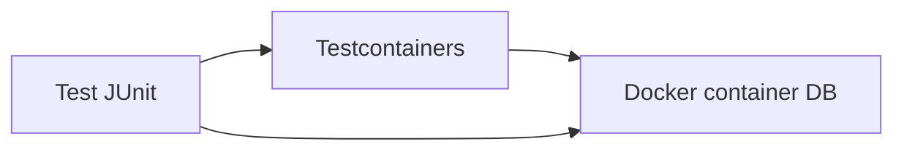

# Módulo 2 · Testing de microservicios Java

Testing en microservicios no es solo JUnit: incluye slices, bases reales con Testcontainers, contratos entre servicios, reglas de arquitectura y calidad estática. El objetivo es confianza con feedback rápido.

**Entorno de referencia verificado (2026-05-22):** JDK 27.0.1.0.2, Maven 3.10.0, Spring Boot 3.5.0, Docker 29.9.3.

## Aprende construyendo

### Tema 1: JUnit 5, Mockito, MockMvc · Intermedio · 180 min

Caso guía: probar regla de negocio, mockear dependencia y verificar endpoint.

#### JUnit 5 + Mockito

**Definición formal.** JUnit 5 ejecuta tests; Mockito crea dobles para aislar dependencias.

**Ejemplo mínimo (ejecutable con Maven/JUnit).**

```java
@ExtendWith(MockitoExtension.class)
class ServiceTest {
  @Mock Repo repo;
  @InjectMocks Service svc;
  @Test void ok(){ when(repo.get()).thenReturn("A"); assertEquals("A", svc.run()); }
}
```

**Error común.** Mockear todo, incluso el valor que se quiere probar. Corrección: mockear solo fronteras.

#### MockMvc

**Definición formal.** Simula requests HTTP contra la capa MVC sin servidor real completo.

**Error común.** Testear solo happy path 200. Corrección: cubrir 400/404/409/500 según contrato.

### Tema 2: Testcontainers · Intermedio · 180 min

Caso guía: validar repositorio contra PostgreSQL real.

#### Testcontainers

**Definición formal.** Librería que levanta contenedores Docker efímeros para tests de integración.



**Error común.** Compartir estado entre tests. Corrección: rollback/truncate/fixtures aisladas.

**Nota de verificación.** Docker disponible; ejecución pesada, lab reproducible.

### Tema 3: Contract Testing con Pact y Pact Broker · Avanzado · 180 min

Caso guía: frontend/consumer espera campos que provider quiere cambiar.

#### Pact

**Definición formal.** Contract testing verifica que provider y consumer cumplen un pacto. Pact Broker publica y versiona pactos.

**Error común.** Solo E2E. Corrección: contratos para compatibilidad entre servicios, E2E para pocos flujos críticos.

**Nota de verificación.** Requiere setup Pact/Broker; no se finge salida.

### Tema 4: ArchUnit · Intermedio · 120 min

Caso guía: impedir que `domain` dependa de `controller`.

#### ArchUnit

**Definición formal.** Framework para escribir tests sobre reglas de arquitectura del código Java.

**Ejemplo mínimo.**

```java
noClasses().that().resideInPackage("..domain..")
  .should().dependOnClassesThat().resideInPackage("..web..");
```

**Error común.** Arquitectura solo en diagrama. Corrección: regla ejecutable.

### Tema 5: SonarQube · Intermedio · 120 min

Caso guía: detectar code smells, bugs y cobertura en CI.

#### SonarQube

**Definición formal.** Plataforma de análisis estático/calidad que reporta issues, hotspots de seguridad, duplicación y cobertura.

**Error común.** Tratar Sonar como burocracia y silenciar todo. Corrección: quality gate razonable, corregir issues reales.

## Cierre

Testing de microservicios es una pirámide pragmática: unit rápido, slices, integración real, contratos y reglas de arquitectura.

## Checklist

- Aíslo con Mockito solo fronteras.
- Uso Testcontainers para DB real.
- Verifico contratos entre servicios.
- Enforce arquitectura con ArchUnit.
- Miro calidad en CI.
