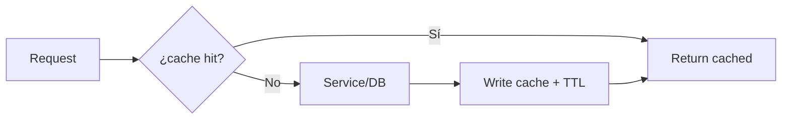
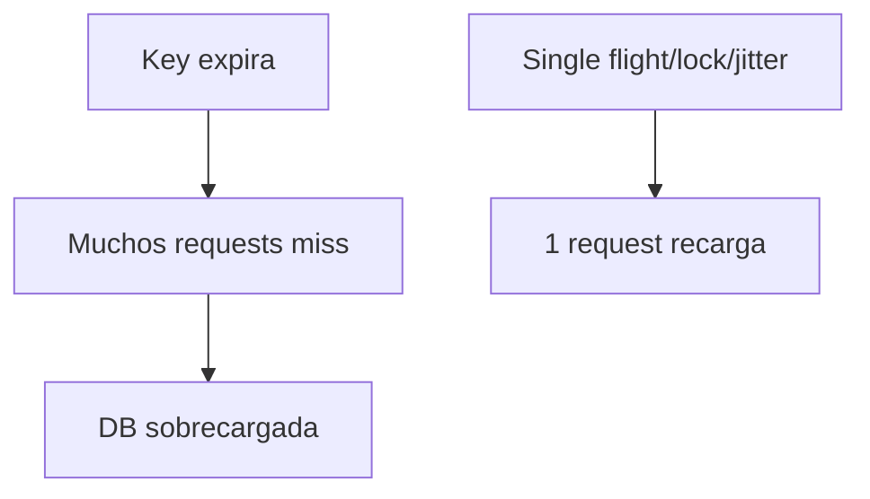

# Módulo 3 · Caching con Redis

El caché mejora latencia y reduce carga, pero introduce invalidez, consistencia eventual y fallos propios: stampede, datos viejos, claves mal diseñadas. Este módulo cubre Redis, patrones de cacheo y locking distribuido.

**Entorno de referencia verificado (2026-05-22):** JDK 27.0.1.0.2, Spring Boot 3.5.0, Docker 29.9.3 (Redis local posible por contenedor).

## Aprende construyendo

### Tema 1: Caching con Redis: @Cacheable, @CacheEvict, TTL · Intermedio · 180 min

Caso guía: cachear catálogo de productos por 60s.

#### Spring Cache + Redis

**Definición formal.** `@Cacheable` retorna valor cacheado o ejecuta método y guarda; `@CacheEvict` invalida; TTL limita staleness.

**Error común.** Cachear sin invalidación/TTL. Corrección: definir política por dato.

**Nota de verificación.** Requiere Redis; Docker disponible.

### Tema 2: Patrones: Read-Through, Write-Behind, Write-Through · Intermedio · 150 min

Caso guía: decidir cómo se sincroniza cache y DB.

#### Patrones

**Definición formal.** Read-through: cache carga desde DB en miss. Write-through: escribe DB y cache. Write-behind: escribe cache y persiste async después.

**Trade-off.** Write-behind da latencia baja pero riesgo de pérdida si no se diseña bien.

**Error común.** Usar write-behind en datos financieros sin durabilidad. Corrección: elegir por criticidad.

### Tema 3: Distributed Locking con Redlock y Fencing Tokens · Avanzado · 180 min

Caso guía: solo un worker debe recalcular un recurso.

#### Lock distribuido

**Definición formal.** Mecanismo de exclusión entre procesos/nodos. Redlock es un algoritmo de Redis para locks distribuidos; fencing token es un contador monotónico para evitar writes stale.

**Error común.** Lock sin expiración o sin fencing token en sistemas críticos. Corrección: TTL, ownership, fencing donde importe.

**Nota de verificación.** Redlock tiene debate de seguridad en fallos de red/reloj; usar con criterio y entender garantías.

### Tema 4: Cache stampede y solución con locks · Avanzado · 120 min

Caso guía: expira una key caliente y 1000 requests golpean DB.

#### Stampede

**Definición formal.** Tormenta de misses concurrentes sobre la misma clave tras expiración.

**Soluciones.** Mutex/single-flight, jitter en TTL, soft TTL/refresh async.

**Error común.** TTL igual para todas las keys calientes. Corrección: jitter y protección de stampede.

## Cierre

Cachea para mejorar, no para esconder problemas de modelo. Toda cache necesita política de invalidez, consistencia y fallo.

## Checklist

- Defino TTL e invalidación.
- Elijo patrón read/write apropiado.
- Protejo stampede.
- Uso locks distribuidos con cautela.
