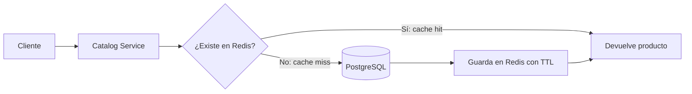
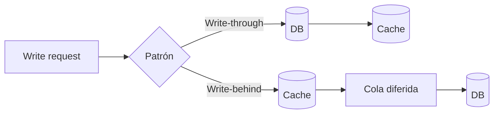
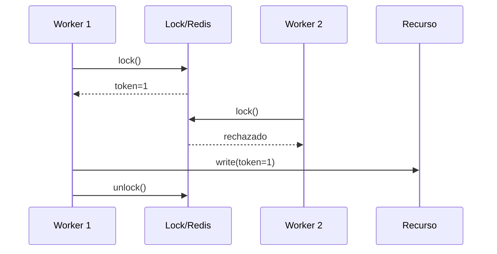
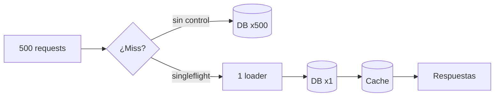

# Módulo 3 · Caching con Redis en Spring

El cache mejora latencia y reduce carga, pero introduce consistencia eventual, invalidación y modos de fallo nuevos. En Tienda Aurora, el catálogo recibe miles de lecturas repetidas: la base de datos hace el mismo trabajo una y otra vez. Este módulo te enseña a resolver ese dolor con Redis, sin esconder el costo de la coherencia.

**Entorno de referencia verificado (2026-05-22):** JDK 27.0.1.0.2. Los smokes de lógica de cache/locks/stampede se ejecutan con Java puro. La integración real con Spring Cache/Redis/Testcontainers requiere Redis y dependencias Spring; se marca con **Nota de verificación** honesta.

## Aprende construyendo

### Tema 1: @Cacheable, @CacheEvict y TTL · Intermedio · 180 min

#### Paso 1 · El dolor

Abres Tienda Aurora en una promoción. `GET /productos/1` responde bien con diez usuarios. Con mil usuarios, la misma consulta golpea PostgreSQL repetidamente. La CPU de la base sube, la latencia crece y el catálogo se degrada.

La pregunta es directa: si el producto no cambió, ¿por qué volver al almacén cada vez?

#### Paso 2 · La intuición

Imagina el mostrador de Tienda Aurora. El almacén es PostgreSQL: completo, confiable, pero lejos. El mostrador tiene una ficha rápida con productos consultados. Si la ficha existe y está vigente, respondes al instante. Si no existe, vas al almacén, traes el producto y actualizas la ficha. La ficha es Redis; su vigencia es el TTL (*time to live*).



La analogía tiene límite: una ficha rápida puede quedar desactualizada si alguien cambia el precio en el almacén. La caché compra velocidad y paga con coherencia.

#### Paso 3 · La construcción

Vas a construir Cache-Aside con Spring Cache y Redis. La aplicación consulta Redis antes de PostgreSQL; en miss, carga desde DB y guarda con TTL.

**Archivo:** `pom.xml` → agrega cache y Redis.

```xml
<dependency>
  <groupId>org.springframework.boot</groupId>
  <artifactId>spring-boot-starter-cache</artifactId>
</dependency>
<dependency>
  <groupId>org.springframework.boot</groupId>
  <artifactId>spring-boot-starter-data-redis</artifactId>
</dependency>
```

**Archivo:** `src/main/resources/application.yml` → configura Redis y TTL.

```yaml
spring:
  data:
    redis:
      host: localhost
      port: 6379
  cache:
    type: redis

app:
  cache:
    producto-ttl: PT10M
```

**Archivo:** `src/main/java/com/aurora/catalogo/config/CacheConfig.java` → define TTL y desactiva nulos.

```java
@Configuration
public class CacheConfig {
  @Bean
  CacheManager cacheManager(RedisConnectionFactory cf,
      @Value("${app.cache.producto-ttl}") Duration ttl) {
    RedisCacheConfiguration config = RedisCacheConfiguration.defaultCacheConfig()
        .entryTtl(ttl)
        .disableCachingNullValues();
    return RedisCacheManager.builder(cf).cacheDefaults(config).build();
  }
}
```

**Archivo:** `src/main/java/com/aurora/catalogo/service/CatalogoService.java` → aplica cache-aside.

```java
@Service
public class CatalogoService {
  private static final Logger log = LoggerFactory.getLogger(CatalogoService.class);
  private final ProductoRepository repo;

  public CatalogoService(ProductoRepository repo) { this.repo = repo; }

  @Cacheable(cacheNames = "productos", key = "#id")
  @Transactional(readOnly = true)
  public Producto buscarPorId(Long id) {
    log.info("DB hit para producto {}", id);
    return repo.findById(id).orElseThrow(() -> new ProductoNoEncontradoException(id));
  }

  @CachePut(cacheNames = "productos", key = "#id")
  @Transactional
  public Producto cambiarPrecio(Long id, BigDecimal nuevoPrecio) {
    Producto p = repo.findById(id).orElseThrow(() -> new ProductoNoEncontradoException(id));
    p.cambiarPrecio(nuevoPrecio);
    return repo.save(p);
  }

  @CacheEvict(cacheNames = "productos", key = "#id")
  @Transactional
  public void eliminar(Long id) { repo.deleteById(id); }
}
```

**Lectura del código:** `@Cacheable` evita ejecutar el método en hit. `@CachePut` actualiza la ficha tras escritura. `@CacheEvict` elimina una ficha obsoleta o eliminada. El log `DB hit` solo aparece en miss.

#### Paso 4 · El experimento

**Experimento A: TTL corto.** Cambia `producto-ttl` a `PT2S`, consulta dos veces con 3 segundos de pausa. Esperas dos `DB hit`: la ficha venció.

**Experimento B: stale por update externo.** Cambia el precio directo en SQL y consulta la API. Esperas el precio viejo: la caché no vio el cambio.

**Experimento C: invalidación.** Llama al endpoint de cambio de precio con `@CachePut`. Esperas el precio nuevo inmediatamente.

#### Paso 5 · El cierre

La ficha rápida resolvió el dolor de lectura repetida, pero te obligó a decidir frescura, invalidación y fallos. La caché no reemplaza al almacén; lo protege.

| Opción | Cuándo usarla | Cuándo NO usarla |
|---|---|---|
| Cache-Aside | Lecturas frecuentes, control simple en app, stale breve tolerable | Consistencia fuerte inmediata entre múltiples escritores |
| Read-Through | Quieres centralizar carga en cache layer | Cuando agrega complejidad innecesaria |
| Write-Behind | Escrituras intensas con tolerancia controlada | Cuando perder una escritura es inaceptable |
| Sin caché | Dato cambia en cada lectura, bajo tráfico, consistencia fuerte | BD saturada por lecturas repetidas y predecibles |

**Error común.** El endpoint devuelve datos viejos después de actualizar. **Causa.** TTL largo o falta de invalidación tras escritura. **Arreglo.** Usa `@CachePut`/`@CacheEvict`, define TTL según frescura y prueba actualizaciones. **Señal observable.** precio en API distinto al de DB tras update.

**Pregunta de entrevista.** ¿Cuándo usarías Redis para cachear un endpoint y cuándo no lo usarías?  
**Respuesta modelo.** Lo usaría cuando el dato se lee con frecuencia, la consulta es costosa y el negocio tolera frescura eventual. Aplicaría Cache-Aside con TTL e invalidación en escrituras. No lo usaría cuando el dato cambia en cada request, la consistencia fuerte es crítica o la complejidad operativa supera el beneficio.

**Transferencia.**

1. **[NO-USAR-X]** Saldo de gift card exacto en cada lectura: no usar caché con TTL ciego; priorizar consistencia fuerte o invalidación transaccional.
2. 1 millón de productos, 200 calientes: define patrón, TTL inicial y métricas (`hit ratio`, p95, carga DB).
3. Proceso externo actualiza precios en PostgreSQL: propone invalidación por evento/CDC o TTL corto + reconciliación, con trade-offs.

#### Definición formal

Spring Cache abstrae el caching mediante anotaciones. `@Cacheable` devuelve valor cacheado o ejecuta el método y guarda el resultado; `@CachePut` actualiza cache; `@CacheEvict` invalida; el TTL controla expiración.

#### Contrato / internals

- **Key:** por defecto los argumentos del método; puede definirse con SpEL `key="#id"`.
- **Cache miss:** ejecuta método, serializa valor, almacena en Redis con TTL.
- **Cache hit:** deserializa y retorna sin ejecutar método.
- **Invalidación:** explícita (`@CacheEvict/@CachePut`) o por expiración (TTL).
- **Límite:** Spring Cache no resuelve por sí solo stampede, coherencia fuerte ni fallos de Redis.

#### Ejemplo mínimo ejecutable

Crea el archivo `CacheDemo.java`:

```java
import java.util.*;
public class CacheDemo {
  static Map<String, String> cache = new HashMap<>();
  static int dbCalls = 0;
  static String get(String id) {
    if (cache.containsKey(id)) return cache.get(id);
    dbCalls++;
    String v = "product-" + id;
    cache.put(id, v);
    return v;
  }
  public static void main(String[] args) {
    System.out.println(get("1"));
    System.out.println(get("1"));
    System.out.println(dbCalls);
  }
}
```

```bash
javac CacheDemo.java
java CacheDemo
```

Salida esperada:

```text
product-1
product-1
1
```

#### Caso real

En Tienda Aurora, `GET /productos/{id}` se cachea con key `productos::{id}` y TTL de 10 minutos. Cuando administración cambia el precio, `@CachePut` actualiza la ficha. Un proceso externo que escriba directo en DB exige invalidación por evento o TTL corto.

#### Verificación

Smoke Java ejecutado localmente (2026-05-22, JDK 27.0.1.0.2): `product-1`, `product-1`, `1`.

**Nota de verificación:** Redis/Spring Cache real no se ejecutó en esta sesión. Verificación propuesta:

```bash
docker run --rm -p 6379:6379 redis:7.4-alpine
./mvnw spring-boot:run
curl -s http://localhost:8081/api/productos/1
curl -s http://localhost:8081/api/productos/1
```

Resultado esperado: el log `DB hit para producto 1` aparece una sola vez.

### Tema 2: Read-through, write-through, write-behind · Intermedio · 150 min

#### Paso 1 · El dolor

Cacheaste lecturas, pero ahora el precio cambia desde el panel de administración. Un usuario ve el precio viejo; otro compra con precio nuevo; soporte recibe reclamos. El problema ya no es leer rápido, sino decidir cómo se sincronizan cache y base de datos.

#### Paso 2 · La intuición

Piensa en tres políticas para la ficha del mostrador. Read-through: si no hay ficha, el mostrador la pide y la guarda. Write-through: al cambiar el precio, actualizas almacén y ficha al mismo tiempo. Write-behind: actualizas la ficha y dejas la actualización del almacén para después. La última es rápida, pero peligrosa si el mostrador se incendia antes de enviar el cambio.



#### Paso 3 · La construcción

**Archivo:** `Patterns.java` → modela read-through y write-through.

```java
import java.util.*;
public class Patterns {
  static Map<String, String> db = new HashMap<>();
  static Map<String, String> cache = new HashMap<>();
  static void writeThrough(String k, String v) { db.put(k, v); cache.put(k, v); }
  static String readThrough(String k) { return cache.computeIfAbsent(k, db::get); }
  public static void main(String[] args) {
    db.put("a", "1");
    System.out.println(readThrough("a"));
    writeThrough("b", "2");
    System.out.println(cache.get("b"));
  }
}
```

#### Paso 4 · El experimento

Cambia `writeThrough` para que solo escriba cache (`cache.put(k,v)`) y simula un “restart” limpiando `db` en memoria. Observa la pérdida: el dato existía en ficha pero no en almacén. Ese es el riesgo de write-behind sin durabilidad.

#### Paso 5 · El cierre

| Patrón | Cuándo usar | Cuándo NO usar |
|---|---|---|
| Read-through | Lecturas frecuentes con carga lazy | Escrituras complejas con consistencia fuerte |
| Write-through | Consistencia simple cache+DB | Alta latencia de escritura inaceptable |
| Write-behind | Escrituras muy frecuentes y tolerancia controlada | Datos críticos sin cola duradera/idempotencia |

**Error común.** Write-behind sin durabilidad. **Causa.** buffer en memoria no persistido. **Arreglo.** cola duradera, reintentos, idempotencia y reconciliación. **Señal observable.** datos desaparecen tras reinicio.

**Pregunta de entrevista.** ¿Cuándo elegirías write-through sobre write-behind?  
**Respuesta modelo.** Elegiría write-through cuando la corrección importa más que la latencia de escritura, porque DB y cache se actualizan sincrónicamente. Usaría write-behind solo con cola duradera, idempotencia y tolerancia explícita a retraso o pérdida controlada.

**Transferencia.**

1. **[NO-USAR-X]** Ledger contable: no usar write-behind sin durabilidad transaccional.
2. Contadores de likes: ¿aceptarías write-behind? ¿Qué garantías necesitas?
3. Configuración crítica: compara write-through y invalidación explícita.

#### Definición formal

Read-through carga desde DB al cache en miss. Write-through escribe DB y cache sincrónicamente. Write-behind escribe cache y difiere la persistencia en DB asincrónicamente.

#### Contrato / internals

- **Read-through:** miss -> origen -> populate cache -> respuesta.
- **Write-through:** write -> DB commit -> cache update; consistencia más simple, mayor latencia.
- **Write-behind:** write -> cache/buffer -> ack -> persistencia async; requiere durabilidad e idempotencia.
- **Riesgo:** write-behind puede perder/reordenar sin cola duradera.

#### Ejemplo mínimo ejecutable

```bash
javac Patterns.java
java Patterns
```

Salida esperada:

```text
1
2
```

#### Caso real

Catálogo de productos: read-through en lecturas; write-through al cambiar precio. Contadores no críticos pueden usar write-behind con cola duradera.

#### Verificación

Smoke Java ejecutado localmente (2026-05-22, JDK 27.0.1.0.2): `1`, `2`.

**Nota de verificación:** patrones productivos con Redis/Spring requieren configuración real y pruebas de fallo/reinicio.

### Tema 3: Distributed locking y fencing tokens · Avanzado · 180 min

#### Paso 1 · El dolor

Una clave caliente expira y dos workers recalculan el mismo reporte costoso. Ambos escriben. Uno lo hace con datos viejos porque estuvo pausado por GC. El resultado final es incorrecto.

#### Paso 2 · La intuición

Un lock distribuido es como la llave de una bodega compartida. Solo quien tiene la llave entra. Pero si la llave expira y se entrega a otro mientras el primero sigue adentro, hay conflicto. El fencing token es un número de turno: el almacén solo acepta escrituras del turno más reciente.



#### Paso 3 · La construcción

**Archivo:** `Lock.java` → lock con fencing token.

```java
import java.util.concurrent.atomic.*;
public class Lock {
  static AtomicBoolean locked = new AtomicBoolean(false);
  static AtomicLong fence = new AtomicLong(0);
  static long tryLock() { return locked.compareAndSet(false, true) ? fence.incrementAndGet() : -1; }
  static void unlock() { locked.set(false); }
  public static void main(String[] args) {
    long t1 = tryLock();
    System.out.println(t1 > 0);
    long t2 = tryLock();
    System.out.println(t2 == -1);
    unlock();
    System.out.println(tryLock() > 0);
  }
}
```

#### Paso 4 · El experimento

Simula un worker stale: guarda `t1`, libera lock, toma `t2`, e intenta escribir con `t1`. La regla correcta es rechazar escrituras con token menor al último aceptado. Observa que el lock solo no basta; necesitas fencing.

#### Paso 5 · El cierre

| Opción | Cuándo usarla | Cuándo NO usarla |
|---|---|---|
| Lock distribuido con fencing | Recurso compartido, escritura única, token verificable | Cuando idempotencia/optimistic concurrency basta |
| Idempotencia/concurrencia optimista | Operaciones naturalmente deduplicables | Cuando el recurso externo no soporta token/versión |
| Single writer por partición | Flujos de eventos ordenados | Cuando necesitas alta concurrencia multi-writer |

**Error común.** Confiar en lock sin fencing. **Causa.** lock stale por pausa GC, red o expiración. **Arreglo.** fencing token, timeouts, y diseño idempotente. **Señal observable.** sobrescrituras fuera de orden.

**Pregunta de entrevista.** ¿Por qué un lock distribuido no garantiza por sí solo seguridad de escritura?  
**Respuesta modelo.** Porque el holder puede pausarse o perder el lock por expiración y seguir escribiendo después. Sin fencing token o verificación monotónica en el recurso, una escritura stale puede sobrescribir una más reciente.

**Transferencia.**

1. **[NO-USAR-X]** Job idempotente con clave natural: no usar lock distribuido como primera opción.
2. Recalculo de reporte caro: ¿lock, singleflight o cola? Justifica.
3. Recurso externo sin soporte de token: ¿qué alternativa segura propones?

#### Definición formal

Un lock distribuido coordina exclusión mutua entre procesos. Redlock es un algoritmo para Redis; los fencing tokens son contadores monotónicos que evitan escrituras de un lock holder stale.

#### Contrato / internals

- **Adquisición:** atómica, con TTL para evitar lock huérfano.
- **Fencing token:** incrementa en cada adquisición; el recurso rechaza tokens viejos.
- **Fallo:** GC pause, clock drift, partición de red pueden romper supuestos.
- **Límite:** Redis locks tienen garantías limitadas; para corrección fuerte evaluar consenso (ZooKeeper/etcd/DB).

#### Ejemplo mínimo ejecutable

```bash
javac Lock.java
java Lock
```

Salida esperada:

```text
true
true
true
```

#### Caso real

Solo un worker recalcula recomendaciones por `productId`. El recurso almacena el último fencing token aceptado y rechaza escrituras stale.

#### Verificación

Smoke Java ejecutado localmente (2026-05-22, JDK 27.0.1.0.2): `true`, `true`, `true`.

**Nota de verificación:** Redlock real requiere múltiples nodos Redis y análisis de garantías. No se ejecutó en esta sesión.

### Tema 4: Cache stampede y mitigaciones · Avanzado · 120 min

#### Paso 1 · El dolor

Un producto destacado expira en Redis a las 10:00:00. En el mismo segundo llegan 500 requests. Las 500 ven miss, las 500 consultan PostgreSQL y la base cae durante la promoción.

#### Paso 2 · La intuición

Es como si todos los clientes llegaran al mostrador justo cuando se acabó la ficha rápida. Si todos corren al almacén al mismo tiempo, bloquean la puerta. La mitigación es simple: una persona va al almacén y las demás esperan o reciben una ficha temporal.



#### Paso 3 · La construcción

**Archivo:** `Stampede.java` → singleflight simple.

```java
import java.util.concurrent.atomic.*;
public class Stampede {
  static AtomicInteger dbCalls = new AtomicInteger(0);
  static AtomicBoolean loading = new AtomicBoolean(false);
  static String value = null;
  static String get() {
    if (value != null) return value;
    if (loading.compareAndSet(false, true)) {
      dbCalls.incrementAndGet();
      value = "v";
      loading.set(false);
    }
    return value == null ? "miss" : value;
  }
  public static void main(String[] args) {
    System.out.println(get());
    System.out.println(get());
    System.out.println(dbCalls.get());
  }
}
```

#### Paso 4 · El experimento

Quita el `loading.compareAndSet` y simula múltiples llamadas concurrentes conceptualmente: el contador de DB crecería. Con singleflight, el origen recibe una carga. Experimenta también con jitter de TTL: dos keys calientes con el mismo TTL expiran juntas; con jitter, expiran en ventanas distintas.

#### Paso 5 · El cierre

| Mitigación | Cuándo usar | Cuándo NO usar |
|---|---|---|
| Singleflight/mutex por key | Key caliente, recomputación costosa | Keys frías de bajo costo |
| TTL + jitter | Muchas keys con expiración similar | Cuando necesitas expiración exacta estricta |
| Stale-while-revalidate | Puede servir dato ligeramente viejo | Datos que no toleran staleness |
| Sin mitigación | Bajo tráfico, origen barato | Keys calientes en promoción/campaña |

**Error común.** TTL igual para todas las keys calientes. **Causa.** expiración sincronizada. **Arreglo.** jitter, warmup, singleflight o stale-while-revalidate. **Señal observable.** picos periódicos de carga en DB al vencer TTL.

**Pregunta de entrevista.** ¿Qué es un cache stampede y cómo lo mitigarías?  
**Respuesta modelo.** Es un pico de carga al origen cuando muchas requests ven miss simultáneo de una key caliente. Lo mitigaría con singleflight por key, jitter en TTL, warmup o stale-while-revalidate, según la tolerancia a staleness y el costo de recomputación.

**Transferencia.**

1. **[NO-USAR-X]** Configuración interna leída 2 veces por hora: no agregar lock/stampede complejo.
2. Home de e-commerce en Black Friday: diseña TTL, jitter y fallback.
3. API de tipo de cambio con tolerancia de 60s: ¿usarías stale-while-revalidate?

#### Definición formal

Cache stampede (thundering herd) ocurre cuando muchas solicitudes concurrentes detectan miss de la misma clave y regeneran el valor simultáneamente, sobrecargando el origen.

#### Contrato / internals

- **Disparador:** expiración, invalidación masiva o cold start.
- **Mitigaciones:** mutex/singleflight, jitter, warmup, stale-while-revalidate, request coalescing.
- **Métrica:** hit ratio, DB QPS, latencia p95/p99 durante expiración.
- **Límite:** las mitigaciones agregan complejidad; aplicarlas a keys calientes medidas.

#### Ejemplo mínimo ejecutable

```bash
javac Stampede.java
java Stampede
```

Salida esperada:

```text
v
v
1
```

#### Caso real

El producto “Café Aurora 500g” es clave caliente en campaña. Se aplica TTL base 10 min + jitter aleatorio de ±60s y singleflight por `productId`.

#### Verificación

Smoke Java ejecutado localmente (2026-05-22, JDK 27.0.1.0.2): `v`, `v`, `1`.

**Nota de verificación:** la prueba de concurrencia real requiere carga concurrente, Redis y observabilidad de DB QPS/hit ratio.

## Cierre

Caching es una optimización con costo semántico. En Tienda Aurora, Redis bajó la carga de PostgreSQL, pero exigió decidir TTL, invalidación, consistencia y mitigaciones de stampede. La ficha rápida del mostrador es útil solo cuando sabes cuándo confiar en ella y cuándo volver al almacén.

## Checklist

- Identifiqué el dolor de lectura repetida antes de cachear.
- Definí TTL e invalidación por tipo de dato.
- Evalué Cache-Aside, Read/Write-through y Write-behind.
- Usé locks distribuidos con cautela y fencing.
- Mitigué stampede en keys calientes con evidencia.
- Marqué con Nota de verificación lo no ejecutado en infraestructura real.
