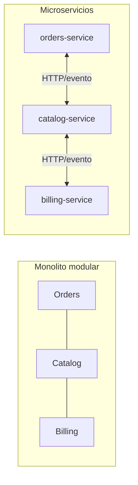
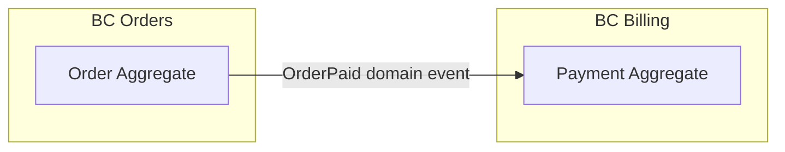
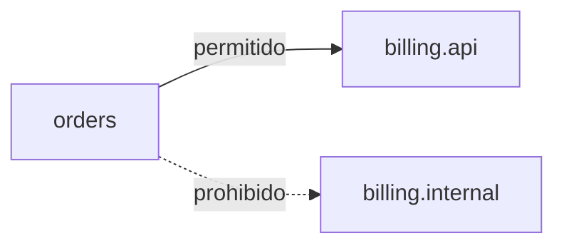
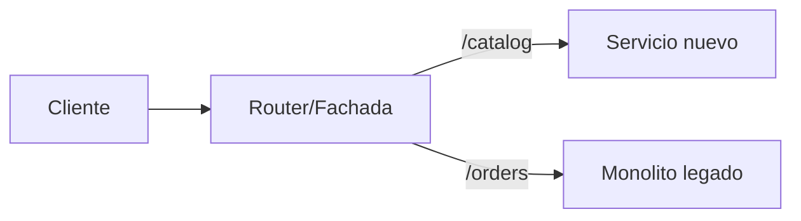
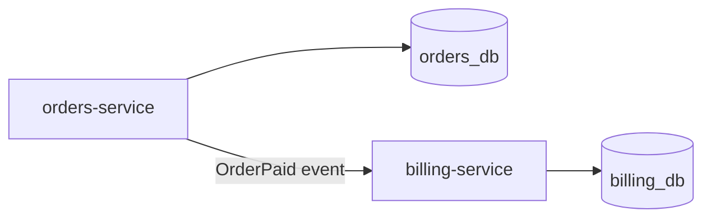

# Módulo 4 · Arquitectura y límites de servicio en Spring

Dividir un sistema en microservicios sin criterio crea un monolito distribuido: más latencia, más fallos, más coordinación y menos autonomía. Este módulo enseña a decidir límites con evidencia: monolito modular vs microservicios, DDD táctico, Spring Modulith, Strangler Fig y database-per-service.

**Entorno de referencia verificado (2026-05-22):** JDK 27.0.1.0.2. Los smokes ejecutan modelos de decisión, invariantes de agregados, reglas de dependencia modular, routing de strangler y ownership de datos en Java puro. Spring Modulith real requiere dependencias Spring; se incluye **Nota de verificación** honesta.

## Aprende construyendo

### Tema 1: Monolito modular vs microservicios · Intermedio · 120 min

#### Paso 1 · El dolor

El equipo de Tienda Aurora tiene 6 personas y un solo producto. Alguien propone “pasarnos a microservicios” porque es lo moderno. Tres meses después hay 9 repos, despliegues coordinados, trazas rotas y un bug que cruza 4 servicios. El tiempo de entrega subió y los incidentes también.

El problema no fue la tecnología: fue dividir antes de tener límites claros.

#### Paso 2 · La intuición

Un monolito modular es una casa con habitaciones bien separadas: una sola puerta de entrada, pero paredes claras. Los microservicios son edificios separados con calles entre ellos. Las calles dan autonomía, pero también tráfico, semáforos y accidentes. No construyes calles dentro de tu sala por estética.



#### Paso 3 · La construcción

**Archivo:** `ArchitectureDecisionSmoke.java` → decisión basada en evidencia.

```java
public class ArchitectureDecisionSmoke {
  record Signals(boolean clearBoundary, boolean independentDeploy, boolean teamReady,
                 boolean differentScaling, int coordinationPain) {}

  static String choose(Signals s) {
    int score = 0;
    if (s.clearBoundary()) score++;
    if (s.independentDeploy()) score++;
    if (s.teamReady()) score++;
    if (s.differentScaling()) score++;
    if (s.coordinationPain() >= 7) score++;
    return score >= 4 ? "microservice-candidate" : "modular-monolith";
  }

  public static void main(String[] args) {
    System.out.println(choose(new Signals(true, true, true, true, 8)));
    System.out.println(choose(new Signals(true, false, true, false, 3)));
  }
}
```

**Lectura:** no hay una variable mágica. La decisión combina límites claros, despliegue independiente, madurez del equipo, escalado distinto y dolor de coordinación. Si faltan piezas, el monolito modular es la opción más responsable.

#### Paso 4 · El experimento

1. Caso con límites claros, equipos listos y alto dolor de coordinación. Esperas `microservice-candidate`.
2. Caso con buen límite pero sin despliegue independiente ni escalado distinto. Esperas `modular-monolith`.
3. Agrega más servicios sin cambiar señales. Observa que la complejidad sube sin beneficio.

Salida esperada:

```text
microservice-candidate
modular-monolith
```

#### Paso 5 · El cierre

La arquitectura correcta es la que minimiza el costo total: coordinación, operación, latencia y cambio. Microservicios no son promoción; son costo que se justifica con evidencia.

**Cuándo usarlo / cuándo no.** Empieza modular. Extrae microservicios cuando haya límites claros, autonomía real, necesidad de escalado/despliegue independiente y capacidad operativa. No dividas por moda, por currículum ni por “porque Netflix”.

| Señal | Monolito modular | Microservicio |
|---|---|---|
| Límites | En evolución | Claros y estables |
| Equipo | Pequeño/compartido | Autónomo, dueño end-to-end |
| Operación | Simple | Observabilidad, CI/CD, on-call maduros |
| Escalado | Similar | Diferente por dominio |

**Error común.** Microservicios prematuros. **Síntoma.** más incidentes y despliegues coordinados. **Causa.** límites inmaduros y costo distribuido subestimado. **Arreglo.** empezar modular, medir coordinación, extraer por evidencia. **Señal observable.** lead time sube tras la división.

**Pregunta de entrevista.** ¿Cuándo NO recomendarías microservicios?  
**Respuesta modelo.** Cuando el dominio aún no tiene límites claros, el equipo es pequeño, no hay necesidad real de despliegue o escalado independiente, y la organización no tiene madurez operativa. En ese caso, un monolito modular bien disciplinado entrega más valor con menos riesgo.

**Transferencia.**

1. **[NO-USAR-X]** Separar en 10 microservicios un MVP de 3 desarrolladores. Respuesta: **No usar microservicios prematuros**; empezar modular.
2. Billing tiene requisitos regulatorios y ritmo de cambio distinto. ¿Candidato a extracción?
3. ¿Qué métricas usarías para justificar una extracción?

#### Definición formal

Un monolito modular es un único despliegue con límites internos explícitos. Los microservicios son unidades desplegables independientes con contratos remotos y propiedad de datos.

#### Contrato / internals

- **Monolito modular:** llamadas in-process, transacciones locales simples, menor costo operativo.
- **Microservicios:** red, latencia, consistencia eventual, observabilidad, CI/CD, versionado de contratos.
- **Límite:** autonomía sin ownership es caos distribuido.

#### Ejemplo mínimo ejecutable

```bash
javac ArchitectureDecisionSmoke.java
java ArchitectureDecisionSmoke
```

Salida esperada:

```text
microservice-candidate
modular-monolith
```

#### Caso real

Tienda Aurora mantiene catálogo y pedidos en un monolito modular. Extrae billing cuando el dominio regula facturación, tiene otro ritmo de cambio y necesita escalado independiente.

#### Verificación

Smoke Java ejecutado localmente (2026-05-22, JDK 27.0.1.0.2): `microservice-candidate`, `modular-monolith`.

**Nota de verificación:** la decisión arquitectónica real requiere métricas de equipo, incidentes, lead time y costo operativo; el smoke solo modela el criterio.

### Tema 2: DDD: bounded contexts, aggregates y domain events · Avanzado · 180 min

#### Paso 1 · El dolor

En el monolito, la clase `Order` hace de todo: calcula impuestos, reserva stock, cobra, envía email y guarda auditoría. Cualquier cambio en pagos rompe pedidos. Dos equipos tocan el mismo modelo con significados distintos de “cliente” y “estado”.

#### Paso 2 · La intuición

Un bounded context es una frontera lingüística: la palabra “cuenta” significa algo distinto en contabilidad y en soporte técnico. Un aggregate es una pequeña fortaleza: dentro de ella las reglas se cumplen en cada transacción. Un domain event es un anuncio público: “algo importante pasó”, sin exponer las tripas internas.



#### Paso 3 · La construcción

**Archivo:** `DddSmoke.java` → aggregate con invariante y evento.

```java
import java.util.*;

public class DddSmoke {
  record OrderCreated(String orderId) {}
  record OrderPaid(String orderId) {}

  static class OrderAggregate {
    private final String id;
    private String status = "NEW";
    private final List<Object> events = new ArrayList<>();

    OrderAggregate(String id) {
      this.id = id;
      events.add(new OrderCreated(id));
    }

    void pay() {
      if (!"NEW".equals(status)) throw new IllegalStateException("invalid-transition");
      status = "PAID";
      events.add(new OrderPaid(id));
    }

    String status() { return status; }
    List<Object> events() { return List.copyOf(events); }
  }

  public static void main(String[] args) {
    OrderAggregate order = new OrderAggregate("o1");
    order.pay();
    System.out.println(order.status());
    System.out.println(order.events().size());
    try {
      order.pay();
    } catch (IllegalStateException e) {
      System.out.println(e.getMessage());
    }
  }
}
```

**Lectura:** el aggregate protege la invariante de transición de estado. El evento `OrderPaid` comunica un hecho; no permite que otro contexto modifique tablas internas de Orders.

#### Paso 4 · El experimento

1. Crea pedido y págalo. Esperas `PAID`, `2` eventos.
2. Intenta pagar dos veces. Esperas `invalid-transition`.
3. Mueve lógica de email dentro del aggregate. Observa acoplamiento: el aggregate debe proteger invariantes, no orquestar infraestructura.

Salida esperada:

```text
PAID
2
invalid-transition
```

#### Paso 5 · El cierre

DDD táctico sirve para dominios con reglas reales. En CRUD simple, agrega ceremonia. El valor está en límites claros e invariantes protegidas.

**Cuándo usarlo / cuándo no.** Usa bounded contexts/aggregates cuando el dominio tiene invariantes, lenguaje y reglas complejas. No fuerces aggregates y eventos en CRUD trivial. No uses domain events para llamar directamente a la base de otro contexto.

| Concepto | Cuándo | Cuándo NO |
|---|---|---|
| Bounded context | Mismo término con significados distintos | Modelo pequeño y uniforme |
| Aggregate | Invariante transaccional clara | Objeto anémico sin reglas |
| Domain event | Hecho de negocio relevante | Cada setter/acción trivial |

**Error común.** Aggregate gigante. **Síntoma.** contención, transacciones largas, merges dolorosos. **Causa.** meter invariantes no relacionadas en la misma raíz. **Arreglo.** aggregates pequeños, consistencia eventual entre aggregates. **Señal observable.** locks, latencia en writes, conflictos frecuentes.

**Pregunta de entrevista.** ¿Qué invariante debe proteger un aggregate?  
**Respuesta modelo.** Debe proteger las reglas de negocio que necesitan ser consistentes dentro de una misma transacción. No debe incluir todo lo relacionado con la entidad; solo el clúster mínimo de estado que debe cambiar de forma atómica para no violar el dominio.

**Transferencia.**

1. **[NO-USAR-X]** Poner stock, pago, email y auditoría en el mismo aggregate por comodidad. Respuesta: **No usar aggregate gigante**; separar invariantes.
2. “Cliente” significa usuario en soporte y contribuyente en facturación. ¿Qué haces?
3. ¿Cuándo publicarías un domain event?

#### Definición formal

Bounded context delimita un modelo consistente. Aggregate es un clúster con raíz e invariantes transaccionales. Domain event representa un hecho pasado del dominio.

#### Contrato / internals

- **Aggregate root:** único punto de modificación externa.
- **Invariante:** se cumple antes y después de la transacción.
- **Domain event:** inmutable, nombrado en pasado.
- **Límite:** consistencia entre aggregates suele ser eventual.

#### Ejemplo mínimo ejecutable

```bash
javac DddSmoke.java
java DddSmoke
```

Salida esperada:

```text
PAID
2
invalid-transition
```

#### Caso real

`Order` publica `OrderPaid`. Billing consume el evento y mantiene su propio modelo de factura, sin escribir tablas de Orders.

#### Verificación

Smoke Java ejecutado localmente (2026-05-22, JDK 27.0.1.0.2): `PAID`, `2`, `invalid-transition`.

**Nota de verificación:** no se ejecutó un proyecto Spring DDD completo; se verificó la invariante y evento con smoke Java puro.

### Tema 3: Spring Modulith · Avanzado · 120 min

#### Paso 1 · El dolor

El monolito modular “en teoría” tiene módulos, pero en la práctica cualquier paquete importa cualquier clase interna. Cuando intentas extraer `billing`, descubres 47 dependencias ocultas. El límite existía en el diagrama, no en el código.

#### Paso 2 · La intuición

Spring Modulith es como poner puertas con tarjeta en una oficina. No basta con decir “esta área es de finanzas”; el sistema debe impedir que cualquiera entre por la puerta trasera. Los tests de módulos son el guardia que verifica las puertas.



#### Paso 3 · La construcción

**Archivo:** `ModulithBoundarySmoke.java` → regla de frontera.

```java
import java.util.*;

public class ModulithBoundarySmoke {
  record Dependency(String from, String to) {}

  static boolean allowed(Dependency dep) {
    if (dep.from().equals("orders") && dep.to().equals("billing.internal")) return false;
    return true;
  }

  public static void main(String[] args) {
    List<Dependency> deps = List.of(
        new Dependency("orders", "billing.api"),
        new Dependency("orders", "billing.internal")
    );
    for (Dependency dep : deps) {
      System.out.println(dep.to() + "=" + allowed(dep));
    }
  }
}
```

**Archivo:** test real con Spring Modulith (requiere dependencia).

```java
@Test
void verifiesModules() {
  ApplicationModules.of(AuroraApplication.class).verify();
}
```

**Lectura:** la regla importante es permitir API pública y prohibir internals. Spring Modulith automatiza esta verificación sobre la estructura real de la app Spring.

#### Paso 4 · El experimento

1. Dependencia a `billing.api`. Esperas permitido.
2. Dependencia a `billing.internal`. Esperas prohibido.
3. En proyecto real, ejecuta `ApplicationModules.verify()` y observa fallos por imports cruzados.

Salida esperada:

```text
billing.api=true
billing.internal=false
```

#### Paso 5 · El cierre

Modulith convierte límites arquitectónicos en tests fallables. Eso baja el costo de una futura extracción a microservicios.

**Cuándo usarlo / cuándo no.** Úsalo en monolitos modulares o como paso previo a microservicios. No lo uses como excusa para no definir contratos. No ignores fallos de verificación “temporalmente”.

| Práctica | Cuándo | Cuándo NO |
|---|---|---|
| `ApplicationModules.verify()` | CI en monolito modular | Proyecto sin límites modulares definidos |
| Eventos internos | Comunicación entre módulos | Acceso directo a internals |
| API de módulo | Contrato estable | Exponer entidades internas |

**Error común.** Módulos sin test de frontera. **Síntoma.** acoplamiento invisible. **Causa.** imports cruzados no detectados. **Arreglo.** verificar módulos en CI y exponer APIs. **Señal observable.** cambio pequeño rompe otro módulo.

**Pregunta de entrevista.** ¿Qué valor tiene Spring Modulith si todavía no tienes microservicios?  
**Respuesta modelo.** Te permite validar límites modulares dentro del monolito antes de pagar el costo distribuido. Si los módulos no pueden respetar fronteras en proceso, extraerlos a microservicios solo multiplicará el acoplamiento con red.

**Transferencia.**

1. **[NO-USAR-X]** Importar `billing.internal.InvoiceRepository` desde orders “porque es más rápido”. Respuesta: **No usar internals cross-module**.
2. ¿Qué expondrías como API de módulo?
3. ¿Cómo usarías Modulith como paso previo a Strangler Fig?

#### Definición formal

Spring Modulith es un conjunto de herramientas para estructurar, verificar y documentar módulos lógicos en una aplicación Spring Boot.

#### Contrato / internals

- **Módulo:** paquete raíz con API e internos.
- **Verificación:** detecta dependencias no permitidas.
- **Eventos:** publicación/escucha entre módulos.
- **Límite:** no reemplaza decisiones de dominio.

#### Ejemplo mínimo ejecutable

```bash
javac ModulithBoundarySmoke.java
java ModulithBoundarySmoke
```

Salida esperada:

```text
billing.api=true
billing.internal=false
```

#### Caso real

El equipo ejecuta `ApplicationModules.verify()` en CI y bloquea PRs que importan internals de otro módulo.

#### Verificación

Smoke Java ejecutado localmente (2026-05-22, JDK 27.0.1.0.2): `billing.api=true`, `billing.internal=false`.

**Nota de verificación:** no se ejecutó Spring Modulith real. Verificación propuesta: proyecto Spring Boot con dependencia `spring-modulith` y test `ApplicationModules.verify()`.

### Tema 4: Strangler Fig · Intermedio · 120 min

#### Paso 1 · El dolor

El monolito de facturación tiene 8 años. Reescribirlo desde cero en 6 meses suena tentador. A los 4 meses, el nuevo sistema no cubre casos borde, el viejo sigue recibiendo cambios y nadie sabe cuál es la fuente de verdad. El big bang falla.

#### Paso 2 · La intuición

Strangler Fig es como renovar un edificio por pisos mientras la gente sigue viviendo ahí. No demueles todo el edificio; rediriges una capacidad a la parte nueva, verificas que funciona y recién después cierras la vieja. El router es la puerta temporal que decide a dónde va cada persona.



#### Paso 3 · La construcción

**Archivo:** `StranglerSmoke.java` → routing por capacidad migrada.

```java
import java.util.*;

public class StranglerSmoke {
  static String route(String capability, Set<String> migrated) {
    return migrated.contains(capability) ? "new" : "legacy";
  }

  public static void main(String[] args) {
    Set<String> migrated = new HashSet<>(Set.of("catalog"));
    System.out.println(route("catalog", migrated));
    System.out.println(route("orders", migrated));
    migrated.add("orders");
    System.out.println(route("orders", migrated));
  }
}
```

**Lectura:** la migración ocurre por capacidad. El router decide por ruta/feature. Cada corte debe tener rollback y fuente de verdad definida.

#### Paso 4 · El experimento

1. `catalog` migrado, `orders` no. Esperas `new`, `legacy`.
2. Migra `orders`. Esperas `new`.
3. Migra sin definir source of truth ni backfill. Observas datos divergentes: el problema clásico de doble escritura.

Salida esperada:

```text
new
legacy
new
```

#### Paso 5 · El cierre

Strangler Fig reduce riesgo al hacer la migración incremental y reversible. La disciplina está en el cutover, el backfill y la verificación.

**Cuándo usarlo / cuándo no.** Úsalo para migrar sistemas vivos por capacidad. No uses big bang si puedes evitarlo. No migres sin source of truth, backfill y plan de rollback.

| Fase | Qué hacer | Riesgo si falta |
|---|---|---|
| Route | Dirigir una capacidad | No hay control |
| Verify | Comparar resultados/metrics | Corte ciego |
| Cutover | Cambiar source of truth | Datos divergentes |
| Retire | Apagar legado | Coste duplicado eterno |

**Error común.** Doble escritura sin estrategia. **Síntoma.** datos divergentes entre legacy y nuevo. **Causa.** no definir source of truth/cutover. **Arreglo.** CDC/outbox, backfill, reconciliación, rollback. **Señal observable.** conteos distintos entre sistemas.

**Pregunta de entrevista.** ¿Por qué Strangler Fig es más seguro que un big bang?  
**Respuesta modelo.** Porque limita el blast radius: migras una capacidad a la vez, mantienes rollback, comparas resultados y solo retiras el legado cuando hay evidencia. Un big bang concentra todo el riesgo en un solo corte y hace difícil aislar fallos.

**Transferencia.**

1. **[NO-USAR-X]** Reescribir todo el monolito y cortar tráfico en un solo día sin rollback. Respuesta: **No usar big bang** cuando puedes migrar incrementalmente.
2. ¿Qué capacidad migrarías primero: la más crítica o una acotada?
3. ¿Cómo verificas que el sistema nuevo responde igual que el legado?

#### Definición formal

Strangler Fig es un patrón de migración incremental donde una fachada enruta capacidades hacia un sistema nuevo por etapas, hasta retirar el legado.

#### Contrato / internals

- **Router/fachada:** decide destino por ruta/capacidad.
- **Coexistencia:** legacy y nuevo conviven.
- **Cutover:** cambio controlado de source of truth.
- **Rollback:** volver a enrutar al legado.
- **Límite:** doble escritura requiere estrategia explícita.

#### Ejemplo mínimo ejecutable

```bash
javac StranglerSmoke.java
java StranglerSmoke
```

Salida esperada:

```text
new
legacy
new
```

#### Caso real

El gateway enruta `/catalog` al nuevo servicio. `/orders` sigue en el monolito hasta completar backfill y verificación.

#### Verificación

Smoke Java ejecutado localmente (2026-05-22, JDK 27.0.1.0.2): `new`, `legacy`, `new`.

**Nota de verificación:** no se ejecutó gateway/proxy real. Verificación propuesta: rutas en Spring Cloud Gateway o Nginx con canary por path.

### Tema 5: Database-per-service · Avanzado · 120 min

#### Paso 1 · El dolor

`orders-service` y `billing-service` comparten la misma base de datos. Un cambio de columna para billing rompe queries de orders en producción. Nadie puede desplegar de forma independiente porque el esquema es un punto de acoplamiento global.

#### Paso 2 · La intuición

Database-per-service es como tener tu propio cuaderno. Puedes escribir en tu cuaderno sin pedir permiso al equipo de al lado. Si necesitas información del otro, le preguntas o lees un aviso publicado, pero no le arrancas páginas a su cuaderno.



#### Paso 3 · La construcción

**Archivo:** `DatabaseOwnershipSmoke.java` → regla de ownership.

```java
import java.util.*;

public class DatabaseOwnershipSmoke {
  static boolean canWrite(String service, String tableOwner) {
    return service.equals(tableOwner);
  }

  static String readStrategy(String consumer, String owner) {
    return consumer.equals(owner) ? "LOCAL_QUERY" : "API_OR_EVENT_PROJECTION";
  }

  public static void main(String[] args) {
    System.out.println(canWrite("orders", "orders"));
    System.out.println(canWrite("billing", "orders"));
    System.out.println(readStrategy("billing", "orders"));
  }
}
```

**Lectura:** escribir directo en tablas ajenas rompe autonomía. Leer datos ajenos se hace por API o proyección alimentada por eventos, aceptando consistencia eventual.

#### Paso 4 · El experimento

1. `orders` escribe su propia tabla. Esperas `true`.
2. `billing` intenta escribir tabla de orders. Esperas `false`.
3. `billing` necesita datos de orders. Esperas `API_OR_EVENT_PROJECTION`.

Salida esperada:

```text
true
false
API_OR_EVENT_PROJECTION
```

#### Paso 5 · El cierre

Database-per-service compra autonomía con complejidad: ya no hay joins cross-service ni transacciones ACID simples entre servicios. Esa complejidad es el precio real de la independencia.

**Cuándo usarlo / cuándo no.** Úsalo cuando la autonomía de despliegue y evolución de esquema importe. No compartas DB para “ir más rápido”. No uses vistas/tablas compartidas como atajo para microservicios.

| Necesidad | Mismo servicio/DB | Database-per-service |
|---|---|---|
| Join local | Simple | Proyección/API |
| Autonomía de esquema | Baja | Alta |
| Transacción cross-domain | Local | Saga/eventual consistency |
| Acoplamiento | Alto si compartida | Bajo si contratos claros |

**Error común.** Base de datos compartida entre servicios. **Síntoma.** despliegues coordinados por migración. **Causa.** acoplamiento por datos. **Arreglo.** ownership, API/eventos, proyecciones. **Señal observable.** cambio de columna rompe otro servicio.

**Pregunta de entrevista.** ¿Qué pierdes al adoptar database-per-service?  
**Respuesta modelo.** Pierdes simplicidad: joins cross-service, transacciones ACID distribuidas fáciles y reporting inmediato sobre un solo esquema. A cambio ganas autonomía de despliegue y evolución. Por eso solo lo adopto cuando esa autonomía vale el costo y tengo mecanismos como eventos, sagas y proyecciones.

**Transferencia.**

1. **[NO-USAR-X]** Dar acceso SQL directo de `billing-service` a tablas de `orders-service`. Respuesta: **No usar DB compartida**.
2. Reporting necesita datos de orders y billing. ¿Qué opciones tienes?
3. ¿Cómo manejarías una actualización que antes era una transacción única?

#### Definición formal

Database-per-service es un patrón donde cada servicio es dueño de su almacenamiento y expone datos a otros mediante contratos, no por acceso directo a su base de datos.

#### Contrato / internals

- **Ownership:** un servicio escribe su esquema.
- **Integración:** API síncrona o eventos/proyecciones.
- **Consistencia:** eventual entre servicios.
- **Límite:** reportes/joins requieren read models o pipelines.

#### Ejemplo mínimo ejecutable

```bash
javac DatabaseOwnershipSmoke.java
java DatabaseOwnershipSmoke
```

Salida esperada:

```text
true
false
API_OR_EVENT_PROJECTION
```

#### Caso real

Orders mantiene `orders_db`. Billing consume `OrderPaid` y guarda su proyección local para facturar sin consultar tablas de Orders.

#### Verificación

Smoke Java ejecutado localmente (2026-05-22, JDK 27.0.1.0.2): `true`, `false`, `API_OR_EVENT_PROJECTION`.

**Nota de verificación:** no se ejecutó infraestructura con dos bases reales. Verificación propuesta: dos servicios Spring Boot con datasources separados y comunicación por evento.

## Cierre

Los límites correctos son la decisión arquitectónica más cara de revertir. DDD, Modulith y Strangler Fig ayudan a dividir con evidencia; database-per-service protege la autonomía una vez que la división es real.

## Checklist

- Decisión modular vs microservicio basada en evidencia.
- Bounded contexts y aggregates con invariantes claras.
- Fronteras de módulo verificadas en CI.
- Migración incremental con source of truth y rollback.
- Sin acceso cross-service directo a base de datos.
