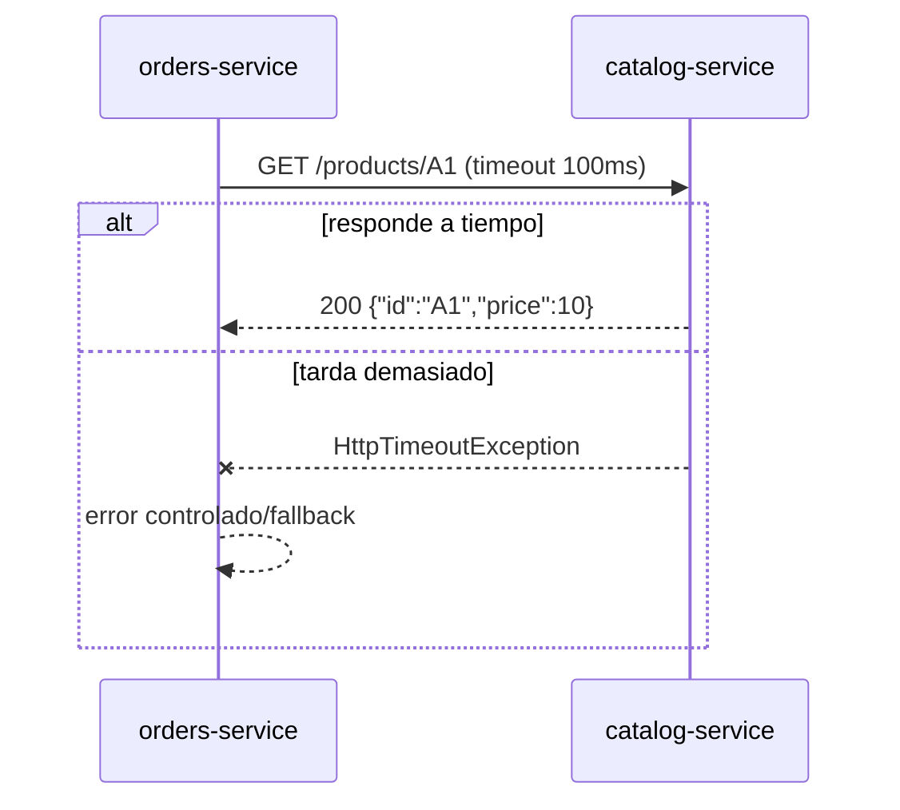
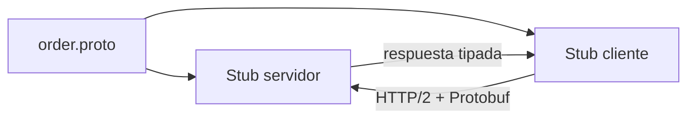
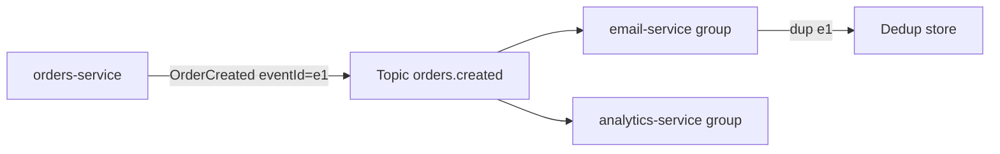
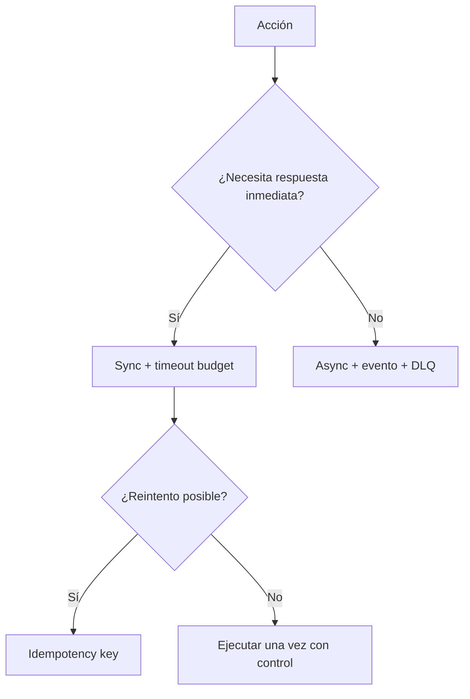

# Módulo 5 · Comunicación síncrona y asíncrona en Spring

Los microservicios no fallan por falta de endpoints: fallan por contratos ambiguos, timeouts ausentes, reintentos peligrosos y acoplamiento temporal. Este módulo enseña a elegir y construir comunicación REST/WebClient, gRPC, mensajería con Spring Cloud Stream, HTTP Service Clients declarativos y RSocket, con idempotencia y criterio operativo.

**Entorno de referencia verificado (2026-05-22):** JDK 27.0.1.0.2. Los smokes ejecutan comportamiento real con JDK (`com.sun.net.httpserver.HttpServer`, `HttpClient`, codificación binaria Protobuf-like, colas/redelivery e `InvocationHandler`). Spring WebClient, gRPC starters, Spring Cloud Stream, Kafka/RabbitMQ y RSocket reales requieren dependencias/infra; se incluyen **Notas de verificación** honestas.

## Aprende construyendo

### Tema 1: REST con Spring MVC y WebClient · Intermedio · 150 min

## El dolor

`orders-service` necesita el precio actual desde `catalog-service`. El desarrollador hace una llamada HTTP sin timeout. Un día `catalog-service` se degrada y tarda 5 segundos por respuesta. Los hilos de `orders-service` quedan esperando, el pool se agota y el checkout deja de responder. Un servicio lento tumbó otro servicio sano.

El síntoma no es un 500 inmediato: es un sistema que se queda “pensando” hasta colapsar.

## La intuición

Una llamada REST síncrona es como llamar por teléfono y quedarte en la línea. Si la otra persona no contesta, necesitas decidir cuánto esperar antes de colgar. El **connect timeout** es cuánto esperas a que contesten; el **request/read timeout** es cuánto esperas a que terminen de hablar. Colgar a tiempo es doloroso, pero mejor que bloquear toda la operación.



## La construcción

Primero construyes un cliente HTTP que falla rápido. Luego lo expresas con WebClient en Spring.

**Archivo:** `RestTimeoutSmoke.java` → servidor lento real + cliente con timeout.

```java
import com.sun.net.httpserver.HttpServer;
import java.io.OutputStream;
import java.net.InetSocketAddress;
import java.net.URI;
import java.net.http.HttpClient;
import java.net.http.HttpRequest;
import java.net.http.HttpResponse;
import java.time.Duration;

public class RestTimeoutSmoke {
  public static void main(String[] args) throws Exception {
    HttpServer server = HttpServer.create(new InetSocketAddress(0), 0);
    server.createContext("/slow", exchange -> {
      try { Thread.sleep(500); } catch (InterruptedException ignored) {}
      byte[] body = "{\"id\":\"A1\",\"price\":10}".getBytes();
      exchange.sendResponseHeaders(200, body.length);
      try (OutputStream os = exchange.getResponseBody()) { os.write(body); }
    });
    server.start();
    int port = server.getAddress().getPort();

    HttpClient client = HttpClient.newBuilder()
        .connectTimeout(Duration.ofMillis(200))
        .build();
    HttpRequest req = HttpRequest.newBuilder(URI.create("http://127.0.0.1:" + port + "/slow"))
        .timeout(Duration.ofMillis(100))
        .GET()
        .build();

    try {
      client.send(req, HttpResponse.BodyHandlers.ofString());
      System.out.println("ok");
    } catch (java.net.http.HttpTimeoutException e) {
      System.out.println("timeout");
    } finally {
      server.stop(0);
    }
  }
}
```

**Archivo:** `CatalogClient.java` → WebClient con timeout en Spring.

```java
@Service
public class CatalogClient {
  private final WebClient webClient;

  public CatalogClient(WebClient.Builder builder) {
    this.webClient = builder
        .baseUrl("http://catalog-service")
        .build();
  }

  public Mono<ProductDto> getProduct(String id) {
    return webClient.get()
        .uri("/products/{id}", id)
        .retrieve()
        .onStatus(HttpStatusCode::isError,
            resp -> resp.createException().flatMap(Mono::error))
        .bodyToMono(ProductDto.class)
        .timeout(Duration.ofMillis(500));
  }
}
```

**Lectura:** el smoke demuestra el comportamiento real: el servidor responde, pero tarde; el cliente corta por timeout. En Spring, WebClient/HttpClient deben configurar connect timeout, response timeout y manejo de errores. El timeout no arregla al servicio lento; protege tu servicio.

## El experimento

1. Ejecuta el smoke con timeout 100ms y servidor dormido 500ms. Esperas `timeout`.
2. Cambia `timeout(Duration.ofMillis(100))` a `Duration.ofMillis(1000)`. Esperas `ok` (o respuesta exitosa). Esto muestra el trade-off: timeout muy agresivo da falsos errores; muy laxo bloquea recursos.
3. En WebClient, añade retry solo para `GET` y códigos transitorios (`503`). Verifica que un `POST` de cobro **no** se reintente sin `Idempotency-Key`.

Salida esperada:

```text
timeout
```

## El cierre

REST sigue siendo la opción más simple e interoperable para request-response. La lección de producción es que una llamada remota sin presupuesto de tiempo es una deuda que se cobra en el peor momento.

**Cuándo usarlo / cuándo no.** Usa REST/WebClient para consultas y comandos request-response con interoperabilidad clara. No uses cadenas síncronas largas. No hagas llamadas remotas sin connect/response timeout. No reintentes ciegamente operaciones no idempotentes.

| Decisión | Cuándo | Cuándo NO |
|---|---|---|
| REST + WebClient | Contratos HTTP, interoperabilidad, CRUD/queries | Streaming bidireccional complejo |
| Timeout corto | Checkout, APIs interactivas | Jobs batch con SLA largo (ajustar budget) |
| Retry | GET idempotente, 503/timeout transitorio | POST de pago sin idempotency key |

**Error común.** Llamada HTTP sin timeout. **Síntoma.** hilos/requests colgados, pool agotado, p99 alto. **Causa.** dependencia lenta o caída parcial. **Arreglo.** connect/response timeout, timeout budget, circuit breaker y observabilidad. **Señal observable.** thread dump con esperas en I/O y métricas de pool saturado.

**Pregunta de entrevista.** ¿Qué diferencia hay entre connect timeout y response timeout?  
**Respuesta modelo.** Connect timeout limita el tiempo para establecer la conexión TCP; response/read timeout limita el tiempo esperando la respuesta o datos después de conectar. Son fallas distintas: un servicio puede aceptar conexiones pero tardar en responder. Configurar ambos evita bloqueos por modos diferentes de degradación.

**Transferencia.**

1. **[NO-USAR-X]** Cadena síncrona de 6 servicios para confirmar compra. Respuesta: **No usar cadena síncrona larga**; mantener sync mínimo y mover lo secundario a async.
2. `catalog-service` responde 503 intermitente en GET. ¿Qué política aplicas?
3. Un POST `/payments` da timeout después de enviar la request. ¿Reintentas automáticamente?

#### Definición formal

REST es un estilo de comunicación sobre HTTP donde recursos se exponen mediante URIs, métodos y códigos de estado. WebClient es el cliente HTTP reactivo/no bloqueante de Spring; `java.net.http.HttpClient` es el cliente estándar del JDK.

#### Contrato / internals

- **Connect timeout:** establecimiento TCP/TLS.
- **Response/read timeout:** espera de respuesta/datos.
- **Errores:** 4xx cliente, 5xx servidor; no confundir con timeout.
- **Idempotencia:** GET seguro de reintentar; POST necesita diseño explícito.
- **Backpressure/cancelación:** en clientes reactivos, cancelar evita trabajo inútil.

#### Ejemplo mínimo ejecutable

```bash
javac RestTimeoutSmoke.java
java RestTimeoutSmoke
```

Salida esperada:

```text
timeout
```

#### Caso real

`orders-service` consulta `catalog-service` con WebClient, timeout 500ms, retry selectivo en GET y circuit breaker. Si el catálogo falla, el checkout devuelve error controlado o usa política de degradación definida.

#### Verificación

Smoke Java ejecutado localmente (2026-05-22, JDK 27.0.1.0.2): `timeout`.

**Nota de verificación:** no se ejecutó WebClient/Spring Boot real. Verificación propuesta: dos apps Spring Boot y un test con WireMock/Toxiproxy simulando latencia 2s; se espera timeout controlado y métrica de cliente.

### Tema 2: gRPC con Spring · Avanzado · 120 min

## El dolor

Dos servicios internos intercambian miles de mensajes por segundo. JSON funciona, pero el parsing cuesta CPU y, peor, un equipo cambia el campo `status` por `state` en un payload y rompe consumidores en producción. No hubo contrato tipado ni regla de compatibilidad.

## La intuición

Protobuf es como un formulario con casillas numeradas: la casilla 1 es `order_id`, la casilla 2 es `status`. Si reusas la casilla 1 para otra cosa, el receptor lee basura “válida” con una interpretación equivocada. gRPC usa esos contratos binarios sobre HTTP/2 para llamadas eficientes y tipadas.



## La construcción

Primero entiendes el contrato de campos Protobuf. Luego ves cómo se expresa en gRPC/Spring.

**Archivo:** `GrpcCompatibilitySmoke.java` → tag Protobuf y riesgo de reuso.

```java
import java.util.*;

public class GrpcCompatibilitySmoke {
  // Wire type 0 = varint. Tag = (fieldNumber << 3) | wireType.
  static byte[] encodeVarintField(int fieldNumber, int value) {
    int tag = (fieldNumber << 3) | 0;
    return new byte[] { (byte) tag, (byte) value };
  }

  static int decodeFieldNumber(byte[] payload) {
    return (payload[0] & 0xFF) >> 3;
  }

  static int decodeVarintValue(byte[] payload) {
    return payload[1] & 0xFF;
  }

  static Map<Integer, Integer> decodeMessage(byte[] payload) {
    Map<Integer, Integer> fields = new HashMap<>();
    for (int i = 0; i + 1 < payload.length; i += 2) {
      int field = (payload[i] & 0xFF) >> 3;
      int value = payload[i + 1] & 0xFF;
      fields.put(field, value);
    }
    return fields;
  }

  public static void main(String[] args) {
    byte[] oldPayload = encodeVarintField(1, 7); // field 1 = status=7
    System.out.println(decodeFieldNumber(oldPayload));
    System.out.println(decodeVarintValue(oldPayload));

    // Mala evolución: reusar tag 1 con otro significado semántico.
    byte[] badReuse = encodeVarintField(1, 42); // ahora alguien interpreta 1 como age
    Map<Integer, Integer> decoded = decodeMessage(badReuse);
    System.out.println(decoded.get(1));

    // Evolución compatible: agregar campo nuevo con tag nuevo.
    byte[] compatible = new byte[] { (byte) ((1 << 3) | 0), 7, (byte) ((2 << 3) | 0), 3 };
    Map<Integer, Integer> decodedCompatible = decodeMessage(compatible);
    System.out.println(decodedCompatible.get(1) + ":" + decodedCompatible.get(2));
  }
}
```

**Archivo:** `order.proto` → contrato gRPC.

```proto
syntax = "proto3";
package aurora.orders;

service OrderQuery {
  rpc GetOrder(GetOrderRequest) returns (OrderResponse);
}

message GetOrderRequest {
  string order_id = 1;
}

message OrderResponse {
  string order_id = 1;
  int32 status = 2;
}
```

**Lectura:** el smoke muestra el punto crítico: el wire format conserva el número de campo. Si reutilizas el tag 1 para otro significado, el binario decodifica “bien” pero la semántica queda corrupta. La regla real de Protobuf es: no reusar tags, no cambiar wire type incompatible, agregar campos nuevos con tags nuevos.

## El experimento

1. Ejecuta el smoke. Esperas `1`, `7`, `42`, `7:3`.
2. Observa el tercer valor: `42` se decodifica sin error. Ese es el peligro: corrupción silenciosa, no excepción obvia.
3. Agrega un campo nuevo con tag 2. Los consumidores viejos lo ignoran; los nuevos lo leen. Esa es evolución compatible.

Salida esperada:

```text
1
7
42
7:3
```

## El cierre

gRPC/Protobuf da eficiencia y contratos fuertes, pero exige disciplina de esquema. La compatibilidad no es accidental: se diseña con reglas de evolución.

**Cuándo usarlo / cuándo no.** Usa gRPC para comunicación interna de alto volumen, baja latencia o streaming. No lo expongas directo a browser sin gateway/grpc-web. No reuses tags ni cambies el significado de un campo. No elijas gRPC solo por moda si REST resuelve el caso.

| Aspecto | gRPC/Protobuf | REST/JSON |
|---|---|---|
| Contrato | Tipado, binario, generado | Texto, flexible |
| Evolución | Reglas estrictas de tags | Reglas de versionado JSON/OpenAPI |
| Debug manual | Más difícil | Simple con curl |
| Streaming | Nativo HTTP/2 | SSE/WebSocket/extra |

**Error común.** Reusar tag Protobuf. **Síntoma.** datos corruptos o comportamiento errático. **Causa.** el consumidor interpreta el mismo tag con semántica nueva. **Arreglo.** reservar tags eliminados, agregar campos nuevos con tags nuevos, usar CI de compatibilidad. **Señal observable.** campos con valores “válidos” pero incorrectos tras deploy.

**Pregunta de entrevista.** ¿Por qué reusar un tag Protobuf es peligroso aunque el tipo wire sea compatible?  
**Respuesta modelo.** Porque Protobuf decodifica por número de campo y wire type, no por nombre. Si reusas el tag con otro significado, el mensaje puede decodificarse sin error pero con semántica incorrecta. Eso genera corrupción silenciosa, que es peor que un fallo explícito.

**Transferencia.**

1. **[NO-USAR-X]** Cambiar el campo 1 de `status` a `age` manteniendo el tag. Respuesta: **No usar reuso de tag**; agregar campo nuevo y deprecar el anterior.
2. Necesitas exponer una API pública para terceros. ¿gRPC o REST?
3. ¿Cómo automatizas la detección de cambios incompatibles en `.proto`?

#### Definición formal

gRPC es un framework RPC sobre HTTP/2 con contratos Protobuf. Protobuf codifica campos por número y wire type, permitiendo eficiencia y evolución controlada.

#### Contrato / internals

- **Tag:** `(fieldNumber << 3) | wireType`.
- **Compatibilidad:** agregar campos nuevos con tags nuevos; no reusar tags.
- **Generación:** stubs cliente/servidor desde `.proto`.
- **Deadlines/cancelación:** obligatorias en llamadas remotas.
- **Límite:** debugging y tooling browser más complejos.

#### Ejemplo mínimo ejecutable

```bash
javac GrpcCompatibilitySmoke.java
java GrpcCompatibilitySmoke
```

Salida esperada:

```text
1
7
42
7:3
```

#### Caso real

`inventory-service` expone gRPC interno para consultas de stock. El equipo usa reglas de compatibilidad Protobuf y revisión de esquema en CI antes de publicar stubs.

#### Verificación

Smoke Java ejecutado localmente (2026-05-22, JDK 27.0.1.0.2): `1`, `7`, `42`, `7:3`.

**Nota de verificación:** no se ejecutó gRPC Spring Boot real. Verificación propuesta: contrato `.proto`, generación de stubs, servidor/cliente Spring gRPC y prueba de deadline/cancelación.

### Tema 3: Mensajería con Spring Cloud Stream · Avanzado · 150 min

## El dolor

Cuando un pedido se confirma, `orders-service` llama por HTTP a email, analytics, inventario y facturación. Si analytics está caído, el pedido falla. Peor: un retry de red duplica el evento y el cliente recibe dos emails de confirmación.

## La intuición

Un broker de mensajes es un buzón compartido. El remitente deja el mensaje y sigue. El destinatario lo recoge cuando puede. Esto desacopla el tiempo, pero introduce una realidad incómoda: el buzón puede entregar el mismo mensaje dos veces. Por eso el consumidor debe ser idempotente.



## La construcción

**Archivo:** `MessagingIdempotencySmoke.java` → redelivery real y deduplicación.

```java
import java.util.*;
import java.util.concurrent.*;

public class MessagingIdempotencySmoke {
  record OrderCreated(String eventId, String orderId, String email) {}

  static class IdempotentConsumer {
    private final Set<String> seen = ConcurrentHashMap.newKeySet();
    private final List<String> sideEffects = new CopyOnWriteArrayList<>();

    void consume(OrderCreated event) {
      if (!seen.add(event.eventId())) return; // dedup por eventId
      sideEffects.add("email:" + event.email() + ":" + event.orderId());
    }

    int sideEffectCount() { return sideEffects.size(); }
  }

  public static void main(String[] args) {
    IdempotentConsumer consumer = new IdempotentConsumer();
    OrderCreated event = new OrderCreated("evt-1", "ord-1", "ana@aurora.test");

    List<OrderCreated> redeliveries = List.of(event, event, event); // at-least-once
    for (OrderCreated e : redeliveries) consumer.consume(e);

    System.out.println(consumer.sideEffectCount());
    System.out.println(redeliveries.size());
  }
}
```

**Archivo:** `application.yml` → Spring Cloud Stream.

```yaml
spring:
  cloud:
    stream:
      bindings:
        orderCreated-in-0:
          destination: orders.created
          group: email-service
        orderCreated-out-0:
          destination: orders.created
```

**Archivo:** `OrderCreatedConsumer.java`

```java
@Bean
public Consumer<OrderCreated> orderCreated(IdempotencyStore store, EmailService email) {
  return event -> {
    if (store.alreadyProcessed(event.eventId())) return;
    email.sendConfirmation(event.orderId(), event.email());
    store.markProcessed(event.eventId());
  };
}
```

**Lectura:** el smoke simula redelivery at-least-once: tres entregas, un solo efecto secundario. La clave es `eventId` estable y deduplicación transaccional/persistente en producción.

## El experimento

1. Entrega el mismo `eventId` tres veces. Esperas `1` efecto y `3` entregas.
2. Quita `seen.add(...)`. Esperas tres efectos secundarios: bug real.
3. Usa un `eventId` aleatorio por reintento. La deduplicación deja de funcionar. El ID debe representar el evento de negocio, no el intento.

Salida esperada:

```text
1
3
```

## El cierre

La mensajería reduce acoplamiento temporal, pero te obliga a diseñar para duplicados, orden parcial, reintentos y DLQ. Async no elimina complejidad; la mueve al contrato operativo.

**Cuándo usarlo / cuándo no.** Usa mensajería para eventos, integración desacoplada y tareas diferibles. No la uses cuando el usuario necesita confirmación inmediata en la misma transacción. No implementes consumidores sin idempotencia.

| Decisión | Cuándo | Cuándo NO |
|---|---|---|
| Evento async | email, analytics, proyecciones | confirmación de pago inmediata |
| At-least-once + dedup | Casi siempre en producción | asumir exactly-once mágico |
| DLQ | Fallos no recuperables tras retries | ignorar mensajes fallidos |

**Error común.** Consumidor no idempotente. **Síntoma.** emails/cobros/decrementos duplicados. **Causa.** redelivery at-least-once. **Arreglo.** `eventId` estable, dedup store, operaciones upsert/estado. **Señal observable.** mismo `eventId` con múltiples efectos.

**Pregunta de entrevista.** ¿Qué significa at-least-once y por qué importa?  
**Respuesta modelo.** Significa que el broker puede entregar el mismo mensaje una o más veces para garantizar que no se pierda ante fallos de ack, retries o rebalances. Importa porque obliga a que el consumidor sea idempotente: procesar el mismo evento dos veces debe producir un solo efecto de negocio.

**Transferencia.**

1. **[NO-USAR-X]** Consumidor que cobra tarjeta sin `eventId`/idempotency. Respuesta: **No usar consumo no idempotente** en efectos financieros.
2. Un evento falla por bug de código. ¿Retry infinito o DLQ?
3. ¿Cuándo usarías una clave de partición en Kafka?

#### Definición formal

Spring Cloud Stream abstrae mensajería mediante bindings funcionales. La entrega at-least-once implica que el consumidor debe tolerar redeliveries mediante idempotencia.

#### Contrato / internals

- **Binding:** puente entre función Java y destino broker.
- **Group:** escala consumidores; una instancia del grupo procesa una partición/mensaje.
- **eventId:** identidad estable del evento.
- **Dedup store:** memoria/tabla/outbox según garantía.
- **DLQ:** destino de mensajes irrecuperables.

#### Ejemplo mínimo ejecutable

```bash
javac MessagingIdempotencySmoke.java
java MessagingIdempotencySmoke
```

Salida esperada:

```text
1
3
```

#### Caso real

`orders-service` publica `OrderCreated`. `email-service` consume con `group=email-service`, deduplica por `eventId` y envía un solo correo pese a redeliveries.

#### Verificación

Smoke Java ejecutado localmente (2026-05-22, JDK 27.0.1.0.2): `1`, `3`.

**Nota de verificación:** no se ejecutó Kafka/RabbitMQ/Spring Cloud Stream real. Verificación propuesta: Testcontainers Kafka, productor/consumidor Spring Cloud Stream y prueba de redelivery + DLQ.

### Tema 4: Sync vs async, timeouts e idempotencia · Avanzado · 120 min

## El dolor

El equipo hace todo síncrono: al confirmar pedido llama a inventario, pago, email y analytics en la misma request. Un email lento bloquea el checkout. Luego, por un timeout de red, el cliente reintenta el POST de pago y el sistema cobra dos veces. La arquitectura “simple” creó dos incidentes.

## La intuición

Sync es esperar en ventanilla: lo usas cuando necesitas la respuesta para continuar. Async es tomar un ticket: lo usas cuando el trabajo puede ocurrir después. El timeout es cuánto esperas en ventanilla. La idempotency key es el número de ticket que evita que te atiendan dos veces por el mismo trámite.



## La construcción

**Archivo:** `SyncAsyncIdempotencySmoke.java` → timeout budget + idempotency.

```java
import java.util.*;
import java.util.concurrent.*;

public class SyncAsyncIdempotencySmoke {
  record PaymentRequest(String idempotencyKey, String orderId, int amount) {}

  static class PaymentService {
    private final Map<String, String> processed = new ConcurrentHashMap<>();

    synchronized String charge(PaymentRequest req) {
      return processed.computeIfAbsent(req.idempotencyKey(),
          k -> "charged:" + req.orderId() + ":" + req.amount());
    }
  }

  static String syncWithTimeoutBudget(int budgetMs, int remoteMs) {
    return remoteMs <= budgetMs ? "ok" : "timeout";
  }

  static String asyncEnqueue(Queue<String> queue, String event) {
    queue.add(event);
    return "accepted";
  }

  public static void main(String[] args) {
    PaymentService payments = new PaymentService();
    PaymentRequest req = new PaymentRequest("idem-1", "ord-1", 100);
    System.out.println(payments.charge(req));
    System.out.println(payments.charge(req)); // retry seguro

    System.out.println(syncWithTimeoutBudget(300, 200));
    System.out.println(syncWithTimeoutBudget(300, 800));

    Queue<String> queue = new ArrayDeque<>();
    System.out.println(asyncEnqueue(queue, "OrderCreated:ord-1"));
    System.out.println(queue.poll());
  }
}
```

**Lectura:** el mismo `idempotencyKey` produce un solo cobro. El budget de timeout decide rápido cuando una dependencia no cumple. El async acepta y encola trabajo diferible.

## El experimento

1. Repite el mismo `PaymentRequest` dos veces. Esperas `charged:ord-1:100` dos veces como respuesta, pero el efecto de negocio es único (mismo valor devuelto por la misma clave).
2. Remote 200ms con budget 300ms: `ok`. Remote 800ms: `timeout`.
3. Encola un evento async. Esperas `accepted` y luego el evento.

Salida esperada:

```text
charged:ord-1:100
charged:ord-1:100
ok
timeout
accepted
OrderCreated:ord-1
```

## El cierre

La decisión sync/async define la experiencia y el modo de falla. El timeout evita bloqueos; la idempotencia evita duplicados. Sin estas reglas, los reintentos son peligrosos.

**Cuándo usarlo / cuándo no.** Usa sync cuando el usuario necesita la respuesta para continuar. Usa async para trabajo diferible o fan-out. Usa idempotency key en comandos reintentables. No hagas cadenas síncronas largas. No reintentes pagos o efectos críticos sin deduplicación.

| Criterio | Sync | Async |
|---|---|---|
| Necesidad inmediata | Sí | No |
| Acoplamiento temporal | Alto | Bajo |
| Fallo típico | cascada/timeout | duplicados/orden/DLQ |
| Control requerido | timeout budget | idempotencia + observabilidad |

**Error común.** Reintentar POST no idempotente. **Síntoma.** cobro o efecto duplicado. **Causa.** timeout/red sin deduplicación. **Arreglo.** `Idempotency-Key`, store transaccional, respuesta reproducible. **Señal observable.** mismo pedido con dos cargos.

**Error común.** Cadena síncrona larga. **Síntoma.** cascada de fallos. **Causa.** acoplamiento temporal entre muchos servicios. **Arreglo.** timeout budget, bulkhead, async en tareas secundarias. **Señal observable.** waterfall de latencia en traces.

**Pregunta de entrevista.** ¿Cuándo es correcto reintentar una request?  
**Respuesta modelo.** Solo cuando el fallo es transitorio y la operación es idempotente, o cuando se protege con una idempotency key y deduplicación. Un timeout en un pago no significa que la operación no se haya ejecutado; reintentar sin dedup puede duplicar el efecto.

**Transferencia.**

1. **[NO-USAR-X]** Reintentar automáticamente un cobro por timeout sin idempotency key. Respuesta: **No usar retry ciego** en operaciones no idempotentes.
2. Confirmación de stock en checkout. ¿Sync o async?
3. Envío de factura por email. ¿Sync o async?

#### Definición formal

Comunicación síncrona acopla tiempo de respuesta; asíncrona desacopla mediante mensajes/eventos. Idempotencia garantiza que ejecutar la misma intención varias veces produce un único efecto lógico.

#### Contrato / internals

- **Timeout budget:** límite total y por hop.
- **Idempotency key:** identifica intención, no intento.
- **Dedup store:** persistente/transaccional en producción.
- **Async:** DLQ, retries, trazabilidad.
- **Límite:** async agrega consistencia eventual.

#### Ejemplo mínimo ejecutable

```bash
javac SyncAsyncIdempotencySmoke.java
java SyncAsyncIdempotencySmoke
```

Salida esperada:

```text
charged:ord-1:100
charged:ord-1:100
ok
timeout
accepted
OrderCreated:ord-1
```

#### Caso real

Checkout cobra con `Idempotency-Key`. Si falla el timeout, el cliente reintenta con la misma clave y recibe el mismo resultado lógico. Email y analytics se procesan por evento.

#### Verificación

Smoke Java ejecutado localmente (2026-05-22, JDK 27.0.1.0.2): `charged:ord-1:100`, `charged:ord-1:100`, `ok`, `timeout`, `accepted`, `OrderCreated:ord-1`.

**Nota de verificación:** no se ejecutó pasarela de pago real ni broker real. Verificación propuesta: integración con Testcontainers + simulación de timeout y replay de request con misma idempotency key.

### Tema 5: HTTP Service Clients declarativos y RSocket · Avanzado · 120 min

## El dolor

`orders-service` tiene 15 llamadas HTTP repartidas en clases distintas. Cada una repite base URL, headers, parseo, manejo de errores y timeouts. Cuando cambia `/v1/orders/{id}` a `/v2/orders/{id}`, la corrección se vuelve caza de strings. En paralelo, un canal interno necesita streaming de eventos con backpressure y REST no encaja.

## La intuición

Un cliente HTTP declarativo es como definir un contrato en una interfaz: dices “qué operación existe” y el runtime se encarga de ejecutar la llamada. Es el mismo salto que de JDBC manual a un cliente tipado. RSocket, en cambio, es otro idioma de comunicación: sirve cuando la conversación no es solo request-response, sino stream o canal bidireccional.

```mermaid
flowchart LR
  I[@HttpExchange interface] --> P[Proxy Spring]
  P --> H[HTTP API]
  C[Requester RSocket] -->|request-stream| S[Responder RSocket]
```

## La construcción

**Archivo:** `DeclarativeClientSmoke.java` → proxy declarativo por anotaciones (mecanismo análogo).

```java
import java.lang.annotation.*;
import java.lang.reflect.*;
import java.util.*;

@Retention(RetentionPolicy.RUNTIME)
@interface HttpExchange { String value(); }
@Retention(RetentionPolicy.RUNTIME)
@interface GetExchange { String value(); }

@HttpExchange("/orders")
interface OrdersApi {
  @GetExchange("/{id}")
  String byId(String id);
}

public class DeclarativeClientSmoke {
  static <T> T create(Class<T> type, Map<String, String> routes) {
    InvocationHandler h = (proxy, method, args) -> {
      GetExchange get = method.getAnnotation(GetExchange.class);
      HttpExchange base = type.getAnnotation(HttpExchange.class);
      String route = base.value() + get.value();
      String resolved = route.replace("{id}", String.valueOf(args[0]));
      return routes.get(resolved);
    };
    return type.cast(Proxy.newProxyInstance(type.getClassLoader(), new Class<?>[]{type}, h));
  }

  public static void main(String[] args) {
    OrdersApi api = create(OrdersApi.class, Map.of("/orders/A1", "order:A1"));
    System.out.println(api.byId("A1"));
    System.out.println(OrdersApi.class.getAnnotation(HttpExchange.class).value());
  }
}
```

**Archivo:** `ProtocolChoiceSmoke.java` → criterio request-response vs stream.

```java
public class ProtocolChoiceSmoke {
  static String choose(boolean needsStreaming, boolean needsBackpressure) {
    if (needsStreaming || needsBackpressure) return "RSOCKET_OR_MESSAGING";
    return "HTTP";
  }
  public static void main(String[] args) {
    System.out.println(choose(false, false));
    System.out.println(choose(true, true));
  }
}
```

**Archivo:** Spring HTTP Interface (real, requiere Spring).

```java
@HttpExchange("/orders")
public interface OrdersApi {
  @GetExchange("/{id}")
  OrderDto byId(@PathVariable String id);
}
```

**Lectura:** el smoke con `Proxy` no es Spring; demuestra el mecanismo central: interfaz declarativa + metadatos + proxy. Spring HTTP Interface hace esto con integración de WebClient/RestClient, conversión, observabilidad y configuración. RSocket se evalúa por semántica de interacción, no por novedad.

## El experimento

1. Llama `api.byId("A1")`. Esperas `order:A1`.
2. Inspecciona la anotación base. Esperas `/orders`.
3. Evalúa un caso con streaming y backpressure. Esperas `RSOCKET_OR_MESSAGING`.
4. Si agregas RSocket donde basta un GET CRUD, observas complejidad extra sin beneficio.

Salida esperada:

```text
order:A1
/orders
HTTP
RSOCKET_OR_MESSAGING
```

## El cierre

Los clientes declarativos mejoran mantenibilidad al convertir contratos HTTP en interfaces tipadas. RSocket amplía el repertorio para streams/canales. Ninguno elimina la necesidad de timeouts, idempotencia y observabilidad.

**Cuándo usarlo / cuándo no.** Usa HTTP Service Clients para APIs HTTP estables y tipadas. Usa RSocket cuando haya streaming/bidireccionalidad/backpressure real. No uses RSocket por defecto para CRUD simple. No asumas que “declarativo” significa resiliente.

| Opción | Cuándo | Cuándo NO |
|---|---|---|
| HTTP Interface | Contratos HTTP repetidos, tipados | Caso bajo nivel muy custom por request |
| REST/HTTP | Interoperabilidad, simplicidad | Streaming bidireccional continuo |
| RSocket | request-stream/channel, backpressure | CRUD simple, equipo sin operación madura |

**Error común.** Elegir RSocket por novedad. **Síntoma.** más complejidad operativa y debugging difícil. **Causa.** decisión no basada en semántica. **Arreglo.** elegir por interacción requerida, tooling y observabilidad. **Señal observable.** incidentes por falta de expertise/herramientas.

**Error común.** Cliente declarativo sin timeout. **Síntoma.** llamadas colgadas. **Causa.** confundir interfaz limpia con resiliencia. **Arreglo.** configurar timeout, error handler, métricas y traces. **Señal observable.** p99 alto en cliente HTTP.

**Pregunta de entrevista.** ¿Qué aporta un HTTP Service Client declarativo y qué no aporta?  
**Respuesta modelo.** Aporta un contrato tipado, menos boilerplate y un punto claro para configurar y testear llamadas HTTP. No aporta por sí solo resiliencia ni semántica de negocio: timeouts, retries, circuit breakers, idempotencia y manejo de errores siguen siendo decisiones del diseño.

**Transferencia.**

1. **[NO-USAR-X]** Usar RSocket para un CRUD público simple consumido por browsers. Respuesta: **No usar RSocket por defecto**; REST/HTTP es más simple.
2. Necesitas cotizaciones en tiempo real con backpressure. ¿Qué protocolo evalúas?
3. ¿Cómo versionas una interfaz declarativa compartida entre equipos?

#### Definición formal

Un HTTP Service Client declarativo define operaciones HTTP en una interfaz anotada; un proxy ejecuta las llamadas en runtime. RSocket es un protocolo reactivo con request-response, fire-and-forget, request-stream y channel.

#### Contrato / internals

- **Anotaciones:** definen método, ruta, parámetros.
- **Proxy:** traduce invocación a request.
- **Timeout/resiliencia:** configuración del cliente subyacente.
- **RSocket:** backpressure y múltiples modelos de interacción.
- **Límite:** más abstracción no elimina fallos distribuidos.

#### Ejemplo mínimo ejecutable

```bash
javac DeclarativeClientSmoke.java
java DeclarativeClientSmoke
javac ProtocolChoiceSmoke.java
java ProtocolChoiceSmoke
```

Salida esperada:

```text
order:A1
/orders
HTTP
RSOCKET_OR_MESSAGING
```

#### Caso real

`orders-service` usa HTTP Interface para consultar `users-service`. Un canal interno de telemetría usa RSocket request-stream porque necesita flujo continuo con backpressure.

#### Verificación

Smokes Java ejecutados localmente (2026-05-22, JDK 27.0.1.0.2): `order:A1`, `/orders`, `HTTP`, `RSOCKET_OR_MESSAGING`.

**Nota de verificación:** no se ejecutó Spring `@HttpExchange` ni RSocket real. Verificación propuesta: Boot app con HTTP Interface + WireMock, y app RSocket con request-stream y backpressure.

## Cierre

La comunicación entre microservicios es diseño de contratos bajo fallo. REST da simplicidad, gRPC da eficiencia y tipos, mensajería desacopla tiempo, HTTP Interfaces reducen boilerplate y RSocket cubre streams. La calidad no está en la herramienta, sino en timeouts, idempotencia, compatibilidad y observabilidad.

## Checklist

- Toda llamada remota tiene timeout y budget.
- Retries solo donde hay idempotencia o deduplicación.
- Contratos Protobuf/HTTP versionados y compatibles.
- Consumidores async idempotentes con DLQ.
- Cliente declarativo no reemplaza resiliencia.
