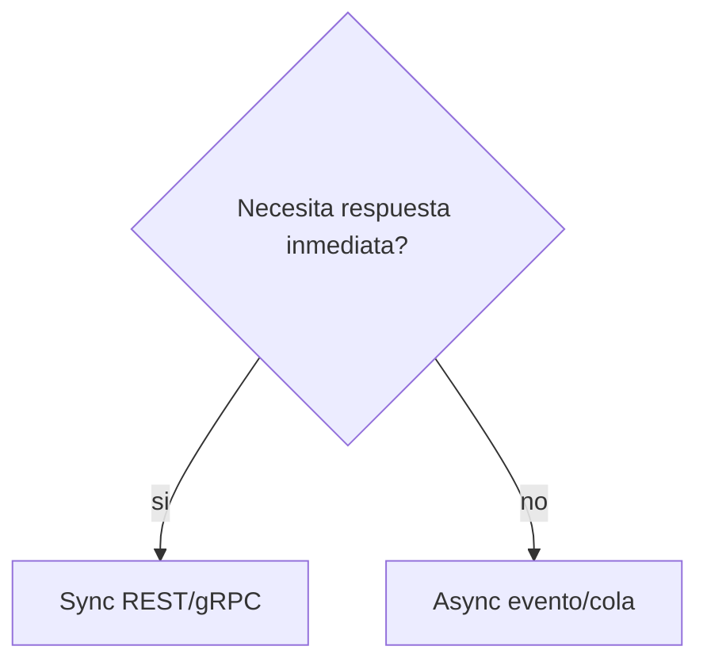

# Módulo 5 · Comunicación síncrona y asíncrona en Spring

Los microservicios se coordinan por contratos. La comunicación puede ser síncrona (request-response) o asíncrona (eventos/mensajes). Este módulo cubre REST/WebClient, gRPC, mensajería con Spring Cloud Stream, y criterios de elección con idempotencia y timeouts.

**Entorno de referencia verificado (2026-05-22):** JDK 27.0.1.0.2, Spring Boot 3.5.0 referencia. Se ejecutan smokes de contratos, timeouts e idempotencia con Java puro. WebClient/gRPC/Kafka/RabbitMQ reales requieren dependencias/infra; **Nota de verificación**.

## Aprende construyendo

### Tema 1: REST con Spring MVC y WebClient · Intermedio · 150 min

Caso guía: `orders` consulta `catalog` por HTTP.

#### REST y cliente reactivo/bloqueante

**Definición formal.** REST expone recursos por HTTP. WebClient es cliente HTTP no bloqueante de Spring; RestClient/RestTemplate son alternativas (RestTemplate en mantenimiento).

**Contrato / internals.** REST sobre HTTP: recursos, verbos, códigos de estado, contratos JSON. WebClient: cliente reactivo/no bloqueante con filtros, timeout y codecs. Configurar `connectTimeout/readTimeout`; manejar errores por status.


**Cuándo usarlo / cuándo no.** Úsalo para request-response simple/interoperable. No hagas cadenas síncronas largas.

**Ejemplo mínimo enfocado (ejecutable).**

```bash
mkdir -p sm5-rest
cd sm5-rest
```

Crea el archivo `Rest.java`:

```java
import java.net.http.*; import java.net.*; import java.time.Duration;
public class Rest {
  public static void main(String[] args) throws Exception {
    var client = HttpClient.newBuilder().connectTimeout(Duration.ofMillis(500)).build();
    var req = HttpRequest.newBuilder(URI.create("http://127.0.0.1:1")).timeout(Duration.ofMillis(200)).GET().build();
    try { client.send(req, HttpResponse.BodyHandlers.ofString()); }
    catch (Exception e) { System.out.println("timeout-or-connect-error"); }
  }
}
```

```bash
javac Rest.java
java Rest
```

**Caso de uso real.** WebClient con timeout, retry selectivo e idempotency key.

**Error común.** Sin timeout.

**Síntoma.** hilos/recursos colgados. **Causa.** dependencia lenta. **Corrección.** connect/read timeout, budget total. **Señal observable.** pool agotado, p99 alto.

**Verificación (JDK 27.0.1.0.2, 2026-05-22).** Salida: `timeout-or-connect-error`.

### Tema 2: gRPC con Spring · Avanzado · 120 min

Caso guía: comunicación interna de baja latencia.

#### gRPC/Protobuf

**Definición formal.** gRPC usa HTTP/2 y Protobuf para contratos tipados y streaming.

**Contrato / internals.** gRPC usa HTTP/2 + Protobuf; contrato en `.proto`, stubs generados. Soporta unary/streaming. Requiere compatibilidad de esquema (campos, números); no exponer directamente a browsers sin gateway.


**Cuándo usarlo / cuándo no.** Interno alto volumen. No público browser-first sin gateway.

**Ejemplo mínimo enfocado (ejecutable).**

```bash
mkdir -p sm5-grpc
cd sm5-grpc
```

Crea el archivo `Grpc.java`:

```java
public class Grpc {
  static boolean compatible(int oldField, int newField){ return oldField == newField; }
  public static void main(String[] args){ System.out.println(compatible(1,1)); System.out.println(compatible(1,2)); }
}
```

```bash
javac Grpc.java
java Grpc
```

**Caso de uso real.** `grpc-spring-boot-starter` con deadlines.

**Error común.** Reusar tag Protobuf.

**Síntoma.** deserialización inválida. **Causa.** incompatibilidad de campo. **Corrección.** no reusar tags, agregar campos nuevos. **Señal observable.** errores tras deploy.

**Verificación (JDK 27.0.1.0.2, 2026-05-22).** Salida: `true`, `false`. **Nota de verificación:** gRPC real requiere dependencias Protobuf/grpc.

### Tema 3: Mensajería con Spring Cloud Stream · Avanzado · 150 min

Caso guía: publicar `OrderCreated` a Kafka/Rabbit.

#### Cloud Stream

**Definición formal.** Spring Cloud Stream abstrae binder de mensajería (Kafka/RabbitMQ) mediante bindings funcionales.

**Contrato / internals.** Spring Cloud Stream abstrae binder (Kafka/RabbitMQ); app produce/consume por bindings `Supplier/Function/Consumer`. Configura destination, group, content-type, errores/DLQ por binder.


**Cuándo usarlo / cuándo no.** Úsalo para eventos/integración desacoplada. No para respuesta inmediata simple.

**Ejemplo mínimo enfocado (ejecutable).**

```bash
mkdir -p sm5-msg
cd sm5-msg
```

Crea el archivo `Msg.java`:

```java
import java.util.*;
public class Msg {
  static Set<String> processed = new HashSet<>();
  static String consume(String id){ if(!processed.add(id)) return "duplicate"; return "processed"; }
  public static void main(String[] args){ System.out.println(consume("e1")); System.out.println(consume("e1")); }
}
```

```bash
javac Msg.java
java Msg
```

**Caso de uso real.** `Supplier/Function/Consumer` bindings.

**Error común.** Consumidor no idempotente.

**Síntoma.** efectos duplicados. **Causa.** at-least-once. **Corrección.** idempotency key/outbox. **Señal observable.** mismo eventId repetido.

**Verificación (JDK 27.0.1.0.2, 2026-05-22).** Salida: `processed`, `duplicate`.

### Tema 4: Sync vs async, timeouts e idempotencia · Avanzado · 120 min

Caso guía: cobro inmediato vs notificación diferida.

#### Criterio

**Definición formal.** Sync acopla tiempo; async acopla por contrato de mensaje y tolera demora.

**Contrato / internals.** Sync: caller espera respuesta; acopla disponibilidad/latencia. Async: mensaje/evento desacopla tiempo; requiere idempotencia, retries, DLQ. Timeout obligatorio en sync; correlation/trace en ambos.




**Ejemplo mínimo enfocado (ejecutable).**

```bash
mkdir -p sm5-decision
cd sm5-decision
```

Crea el archivo `Decide.java`:

```java
public class Decide {
  static String choose(boolean immediate, boolean eventualOk){ if(immediate) return "sync"; if(eventualOk) return "async"; return "coordinate"; }
  public static void main(String[] args){ System.out.println(choose(true,false)); System.out.println(choose(false,true)); }
}
```

```bash
javac Decide.java
java Decide
```

**Error común.** Cadena síncrona larga.

**Síntoma.** cascada de fallos. **Causa.** acoplamiento temporal. **Corrección.** async, timeout, bulkhead. **Señal observable.** waterfall de spans largos.

**Caso real.** Consulta de stock al cobrar: sync con timeout corto. Envío de email: async por evento, con idempotencia y DLQ.


**Verificación (JDK 27.0.1.0.2, 2026-05-22).** Salida: `sync`, `async`.

### Tema 5: HTTP Service Clients declarativos y RSocket · Avanzado · 120 min

**Contrato / internals.** HTTP Service Client declarativo: interface Java anotada, Spring genera proxy. RSocket: protocolo reactivo con request-response/stream/fire-and-forget/channel sobre TCP/WebSocket. Elegir por semántica y tooling.


Caso guía: `orders-service` debe consultar `users-service`. Quieres un contrato tipado sin boilerplate, con timeout y observabilidad. Además, un canal interno de telemetría necesita streaming; evalúas RSocket.

#### Definición formal

**HTTP Service Clients declarativos.** En Spring, una interfaz Java anotada con `@HttpExchange`/`@GetExchange`/`@PostExchange` define el contrato HTTP; Spring genera un proxy que ejecuta requests. Spring Framework 6/Boot 3 introdujeron el modelo; Spring Framework 7/Boot 4 consolidan registro/configuración (por ejemplo `@ImportHttpServices` y grupos/properties).

**RSocket.** Protocolo de mensajería binaria reactiva con modelos request-response, fire-and-forget, request-stream y channel. Soporta backpressure y transporte TCP/WebSocket.

#### Contrato / internals

- **HTTP declarativo:** la interfaz es el contrato; la implementación es proxy. Configuración: base URL, timeouts, headers, codecs, autenticación, métricas/trazas.
- **Errores:** 4xx/5xx deben manejarse explícitamente; no tratar respuestas no exitosas como éxito silencioso.
- **RSocket:** requiere acuerdo de routing/metadata y semántica de interacción. Request-stream/channel implican manejo de flujo y cancelación.
- **Límite:** HTTP declarativo simplifica llamadas; no elimina decisiones de resiliencia (timeout, retry, circuit breaker, idempotencia).

#### Cuándo usarlo / cuándo no

**HTTP Service Clients:** úsalos para APIs HTTP tipadas y estables. **No** cuando necesitas control bajo nivel por request o streaming no HTTP.

**RSocket:** úsalo para streaming bidireccional, baja latencia o backpressure entre servicios compatibles. **No** por defecto si REST/mensajería cubren el caso con menor complejidad operativa.

#### Ejemplo mínimo ejecutable

Smoke de contrato declarativo (la interfaz define el método; una implementación fake simula el proxy):

Crea el archivo `HttpClientSmoke.java`:

```java
interface OrdersClient {
  String byId(String id);
}

class FakeOrdersClient implements OrdersClient {
  public String byId(String id) { return "order:" + id; }
}

public class HttpClientSmoke {
  public static void main(String[] args) {
    OrdersClient client = new FakeOrdersClient();
    System.out.println(client.byId("A1"));
  }
}
```

```bash
javac HttpClientSmoke.java
java HttpClientSmoke
```

Salida esperada:

```text
order:A1
```

Smoke de decisión de protocolo:

Crea el archivo `ProtocolChoice.java`:

```java
public class ProtocolChoice {
  static String choose(boolean streaming, boolean bidi) {
    if (streaming || bidi) return "RSOCKET";
    return "HTTP";
  }
  public static void main(String[] args) {
    System.out.println(choose(false, false));
    System.out.println(choose(true, false));
  }
}
```

```bash
javac ProtocolChoice.java
java ProtocolChoice
```

Salida esperada:

```text
HTTP
RSOCKET
```

#### Caso real

`orders-service` define `UsersClient` con `@GetExchange("/users/{id}")`; en Boot 4 se registra por grupo con timeout de 2s y observabilidad. Para telemetría continua, un canal interno usa RSocket request-stream; para CRUD normal se mantiene HTTP.

#### Error común

**Síntoma.** threads/requests colgados esperando respuesta remota. **Causa.** cliente HTTP sin timeout o con timeout excesivo. **Corrección.** configurar connect/read/response timeout, presupuesto total y circuit breaker donde aplique. **Señal observable.** métricas de cliente con latencia creciente y pool saturado.

**Síntoma.** arquitectura más compleja sin beneficio. **Causa.** adoptar RSocket para CRUD simple. **Corrección.** usar RSocket solo cuando el modelo de interacción lo justifique. **Señal observable.** más incidentes operativos sin mejora de latencia/flujo.

#### Verificación

Smokes Java ejecutados localmente (2026-05-22, JDK 27.0.1.0.2): `order:A1`, `HTTP`, `RSOCKET`.

**Nota de verificación:** no se ejecutó Spring HTTP Service Client real ni RSocket end-to-end en esta sesión. Verificación propuesta:

```bash
# HTTP Service Client
./mvnw -Dtest=*UsersClientIT test

# RSocket
./mvnw -Dtest=*RSocket* test
```

Resultado esperado: el proxy HTTP invoca el endpoint stub con timeout configurado; el test RSocket recibe stream/bidireccional según el modelo elegido.

## Cierre

Elige comunicación por contrato y modo de fallo. HTTP Service Clients reducen boilerplate; gRPC y RSocket se justifican por necesidades reales; async mensajería desacopla tiempo.

## Checklist

- Timeout en toda llamada remota.
- Idempotencia en consumidores.
- Contratos versionados.
- Sync solo cuando aporta valor inmediato.
- Cliente declarativo o WebClient elegido por control necesario.
