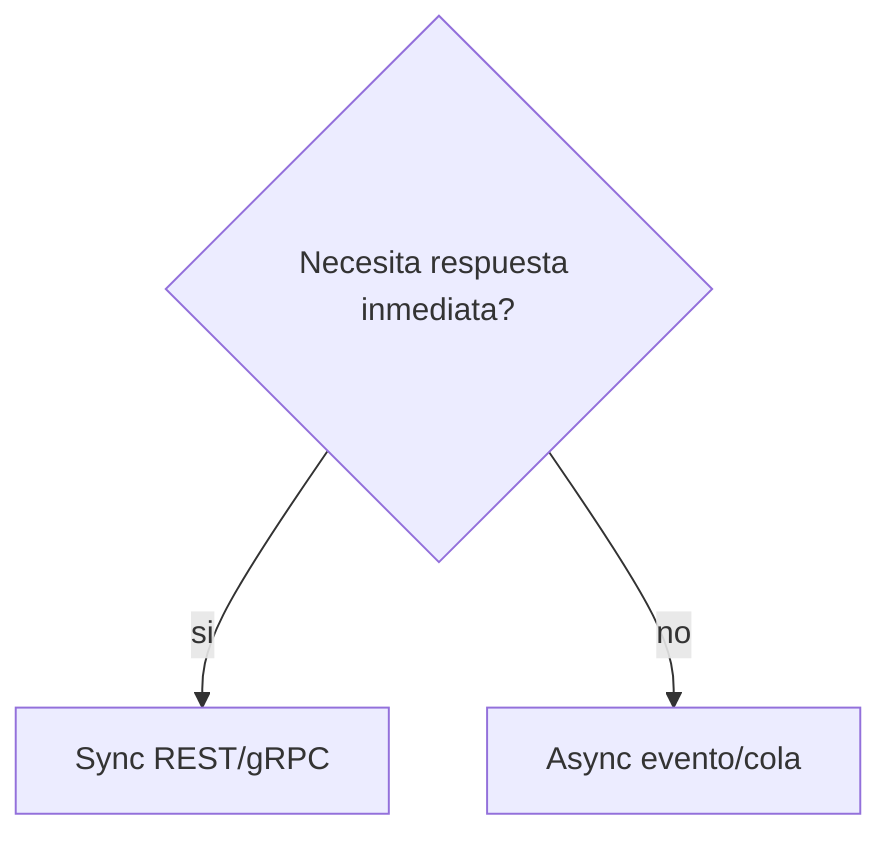

# Módulo 5 · Comunicación síncrona y asíncrona en Spring

Los microservicios se coordinan por contratos. La comunicación puede ser síncrona (request-response) o asíncrona (eventos/mensajes). Este módulo cubre REST/WebClient, gRPC, mensajería con Spring Cloud Stream, y criterios de elección con idempotencia y timeouts.

**Entorno de referencia verificado (2026-05-22):** JDK 27.0.1.0.2, Spring Boot 3.5.0 referencia. Se ejecutan smokes de contratos, timeouts e idempotencia con Java puro. WebClient/gRPC/Kafka/RabbitMQ reales requieren dependencias/infra; **Nota de verificación**.

## Aprende construyendo

### Tema 1: REST con Spring MVC y WebClient · Intermedio · 150 min

Caso guía: `orders` consulta `catalog` por HTTP.

#### REST y cliente reactivo/bloqueante

**Definición formal.** REST expone recursos por HTTP. WebClient es cliente HTTP no bloqueante de Spring; RestClient/RestTemplate son alternativas (RestTemplate en mantenimiento).

**Cuándo usarlo / cuándo no.** Úsalo para request-response simple/interoperable. No hagas cadenas síncronas largas.

**Ejemplo mínimo enfocado (ejecutable).**

```bash
mkdir -p sm5-rest
cd sm5-rest
```

Crea el archivo `Rest.java`:

```java
import java.net.http.*; import java.net.*; import java.time.Duration;
public class Rest {
  public static void main(String[] args) throws Exception {
    var client = HttpClient.newBuilder().connectTimeout(Duration.ofMillis(500)).build();
    var req = HttpRequest.newBuilder(URI.create("http://127.0.0.1:1")).timeout(Duration.ofMillis(200)).GET().build();
    try { client.send(req, HttpResponse.BodyHandlers.ofString()); }
    catch (Exception e) { System.out.println("timeout-or-connect-error"); }
  }
}
```

```bash
javac Rest.java
java Rest
```

**Caso de uso real.** WebClient con timeout, retry selectivo e idempotency key.

**Error común.** Sin timeout.

**Síntoma.** hilos/recursos colgados. **Causa.** dependencia lenta. **Corrección.** connect/read timeout, budget total. **Señal observable.** pool agotado, p99 alto.

**Verificación (JDK 27.0.1.0.2, 2026-05-22).** Salida: `timeout-or-connect-error`.

### Tema 2: gRPC con Spring · Avanzado · 120 min

Caso guía: comunicación interna de baja latencia.

#### gRPC/Protobuf

**Definición formal.** gRPC usa HTTP/2 y Protobuf para contratos tipados y streaming.

**Cuándo usarlo / cuándo no.** Interno alto volumen. No público browser-first sin gateway.

**Ejemplo mínimo enfocado (ejecutable).**

```bash
mkdir -p sm5-grpc
cd sm5-grpc
```

Crea el archivo `Grpc.java`:

```java
public class Grpc {
  static boolean compatible(int oldField, int newField){ return oldField == newField; }
  public static void main(String[] args){ System.out.println(compatible(1,1)); System.out.println(compatible(1,2)); }
}
```

```bash
javac Grpc.java
java Grpc
```

**Caso de uso real.** `grpc-spring-boot-starter` con deadlines.

**Error común.** Reusar tag Protobuf.

**Síntoma.** deserialización inválida. **Causa.** incompatibilidad de campo. **Corrección.** no reusar tags, agregar campos nuevos. **Señal observable.** errores tras deploy.

**Verificación (JDK 27.0.1.0.2, 2026-05-22).** Salida: `true`, `false`. **Nota de verificación:** gRPC real requiere dependencias Protobuf/grpc.

### Tema 3: Mensajería con Spring Cloud Stream · Avanzado · 150 min

Caso guía: publicar `OrderCreated` a Kafka/Rabbit.

#### Cloud Stream

**Definición formal.** Spring Cloud Stream abstrae binder de mensajería (Kafka/RabbitMQ) mediante bindings funcionales.

**Cuándo usarlo / cuándo no.** Úsalo para eventos/integración desacoplada. No para respuesta inmediata simple.

**Ejemplo mínimo enfocado (ejecutable).**

```bash
mkdir -p sm5-msg
cd sm5-msg
```

Crea el archivo `Msg.java`:

```java
import java.util.*;
public class Msg {
  static Set<String> processed = new HashSet<>();
  static String consume(String id){ if(!processed.add(id)) return "duplicate"; return "processed"; }
  public static void main(String[] args){ System.out.println(consume("e1")); System.out.println(consume("e1")); }
}
```

```bash
javac Msg.java
java Msg
```

**Caso de uso real.** `Supplier/Function/Consumer` bindings.

**Error común.** Consumidor no idempotente.

**Síntoma.** efectos duplicados. **Causa.** at-least-once. **Corrección.** idempotency key/outbox. **Señal observable.** mismo eventId repetido.

**Verificación (JDK 27.0.1.0.2, 2026-05-22).** Salida: `processed`, `duplicate`.

### Tema 4: Sync vs async, timeouts e idempotencia · Avanzado · 120 min

Caso guía: cobro inmediato vs notificación diferida.

#### Criterio

**Definición formal.** Sync acopla tiempo; async acopla por contrato de mensaje y tolera demora.



**Ejemplo mínimo enfocado (ejecutable).**

```bash
mkdir -p sm5-decision
cd sm5-decision
```

Crea el archivo `Decide.java`:

```java
public class Decide {
  static String choose(boolean immediate, boolean eventualOk){ if(immediate) return "sync"; if(eventualOk) return "async"; return "coordinate"; }
  public static void main(String[] args){ System.out.println(choose(true,false)); System.out.println(choose(false,true)); }
}
```

```bash
javac Decide.java
java Decide
```

**Error común.** Cadena síncrona larga.

**Síntoma.** cascada de fallos. **Causa.** acoplamiento temporal. **Corrección.** async, timeout, bulkhead. **Señal observable.** waterfall de spans largos.

**Verificación (JDK 27.0.1.0.2, 2026-05-22).** Salida: `sync`, `async`.

### Tema 5: HTTP Service Clients declarativos y RSocket · Avanzado · 120 min

Caso guía: un servicio Spring Boot llama a otro servicio interno; quieres un cliente declarativo con contrato claro y evaluar RSocket solo si necesitas streaming/bidireccionalidad.

#### HTTP Service Clients declarativos

**Definición formal.** Spring Framework 6/Boot 3+ introdujo interfaces HTTP declarativas; Spring Framework 7 / Spring Boot 4 consolidan el modelo con `@HttpExchange`, `@ImportHttpServices` y configuración por grupos, permitiendo proxies sin boilerplate manual.

```java
@HttpExchange(url = "http://orders:8080")
public interface OrdersClient {
  @GetExchange("/orders/{id}")
  OrderDto byId(@PathVariable String id);
}
```

**Contrato.** Define métodos, tipos, headers/parámetros, base URL, timeouts y observabilidad en la configuración del cliente. Con Spring Boot 4, la auto-configuración simplifica el registro de clientes HTTP.

**Cuándo usarlo / cuándo no.** Úsalo para llamadas REST internas/externas con contratos claros. No lo uses si necesitas control muy bajo nivel por request; usa `WebClient`/`RestClient` directamente.

**Error común.** generar clientes sin timeout. **Síntoma.** hilos/requests colgados. **Causa.** defaults inadecuados. **Corrección.** timeout de conexión/lectura, presupuesto total. **Señal observable.** spans remotos sin fin.

#### RSocket

**Definición formal.** RSocket es un protocolo reactivo sobre TCP/WebSocket con request-response, fire-and-forget, request-stream y channel.

**Cuándo usarlo / cuándo no.** Úsalo cuando necesitas streaming/bidireccional con backpressure. No lo uses por defecto si REST/async messaging resuelve el caso con más simplicidad operativa.

**Nota de verificación.** No se ejecutó un ejemplo RSocket end-to-end en esta sesión. Verificar con Spring Boot + `spring-boot-starter-rsocket`, dos apps, y prueba de request-stream.

## Cierre

Elige comunicación por contrato y modo de fallo. HTTP Service Clients reducen boilerplate; gRPC y RSocket se justifican por necesidades reales; async mensajería desacopla tiempo.

## Checklist

- Timeout en toda llamada remota.
- Idempotencia en consumidores.
- Contratos versionados.
- Sync solo cuando aporta valor inmediato.
- Cliente declarativo o WebClient elegido por control necesario.
