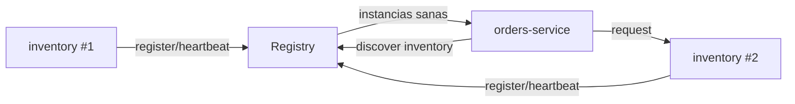
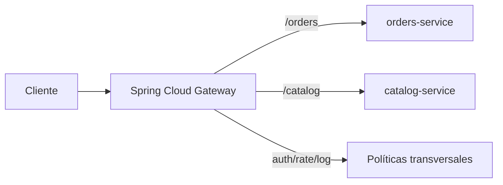
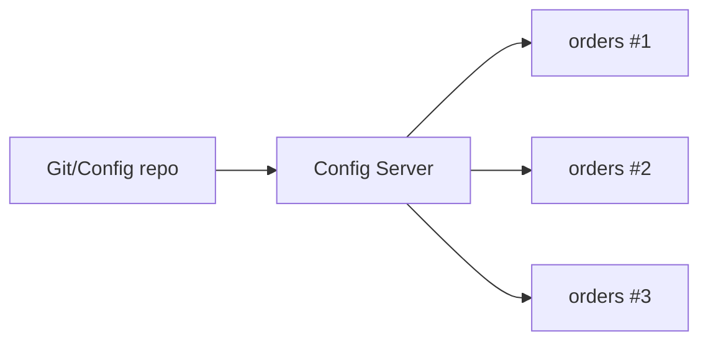
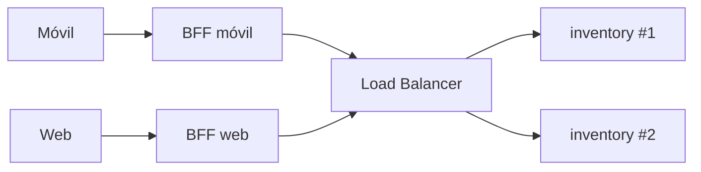

# Módulo 6 · Infraestructura distribuida con Spring Cloud

Una vez que hay múltiples servicios, aparecen problemas transversales: descubrir instancias, enrutar tráfico, distribuir configuración y balancear carga. Spring Cloud aporta componentes para estos concerns. El criterio importa más que el componente: úsalo cuando resuelve un problema real de tu plataforma.

**Entorno de referencia verificado (2026-05-22):** JDK 27.0.1.0.2. Los smokes validan la lógica de discovery, routing, config lookup y balanceo con Java puro. Eureka/Consul/Nacos/Gateway/Config Server requieren infraestructura; se incluyen **Notas de verificación** honestas.

## Aprende construyendo

### Tema 1: Service discovery con Eureka/Consul/Nacos · Intermedio · 150 min

## El problema

`orders-service` necesita llamar a `inventory-service`. En desarrollo pusiste `http://localhost:8082`. En producción hay tres instancias, una se cae, otra se despliega con IP nueva y el autoscaler crea una cuarta. La URL hardcodeada deja de funcionar.

El síntoma es simple y brutal: errores `Connection refused` después de cada despliegue. El problema real es tratar instancias efímeras como direcciones fijas.

## La idea clave

Piensa en la recepción de un edificio de oficinas. No buscas a una persona por su silla; preguntas en recepción por el nombre del equipo y te indican qué oficina está disponible ahora. Service discovery es esa recepción: los servicios se registran con nombre y salud, y los consumidores preguntan por nombre lógico.



La analogía tiene límite: la recepción puede tener información desactualizada por unos segundos. Por eso discovery no reemplaza timeouts, retries ni circuit breakers.

## Construyendo la solución

Vas a modelar un registry mínimo para entender el contrato antes de usar Eureka/Consul/Nacos.

**Archivo:** `Disc.java` → registry con registro y consulta.

```java
import java.util.*;
public class Disc {
  static Map<String, List<String>> registry = new HashMap<>();
  static void register(String name, String addr) {
    registry.computeIfAbsent(name, k -> new ArrayList<>()).add(addr);
  }
  static List<String> discover(String name) {
    return registry.getOrDefault(name, List.of());
  }
  public static void main(String[] args) {
    register("inventory", "10.0.0.2:8080");
    register("inventory", "10.0.0.3:8080");
    System.out.println(discover("inventory").size());
    System.out.println(discover("missing").size());
  }
}
```

**Archivo:** `application.yml` → ejemplo Nacos en Spring Cloud.

```yaml
spring:
  application:
    name: orders-service
  cloud:
    nacos:
      discovery:
        server-addr: localhost:8848
```

**Lectura del código:** el consumidor pregunta por `inventory`, no por IP. El registry devuelve instancias disponibles. En producción, el heartbeat/health check elimina instancias no sanas.

## Verificando con un experimento

1. Registra dos instancias y consulta. Esperas `2`.
2. Consulta un servicio inexistente. Esperas `0`, no una excepción no controlada.
3. Simula caída eliminando una instancia del mapa. Observa cómo el resultado cambia; en discovery real, el health check provoca ese efecto.

Salida esperada:

```text
2
0
```

## Cierre del módulo y trade-offs

El registry eliminó la dependencia de IPs fijas. A cambio, agregaste un componente más que puede fallar, tener caché stale o requerir operación. En Kubernetes, muchas veces DNS/Service es suficiente y no necesitas Eureka/Nacos.

| Opción | Cuándo usarla | Cuándo NO usarla |
|---|---|---|
| Kubernetes DNS/Service | Plataforma K8s, discovery simple | Necesitas metadata/health rica fuera de K8s |
| Eureka/Consul/Nacos | Entornos dinámicos, multi-runtime, metadata | Cuando duplica discovery nativo sin valor |
| URL hardcodeada | Nunca en producción dinámica | Siempre evita en servicios escalables |

**Error común.** IP hardcodeada en configuración. **Síntoma.** fallos tras escalar o redeploy. **Causa.** la instancia cambió de dirección. **Arreglo.** usar nombre lógico + discovery/DNS y health checks. **Señal observable.** `Connection refused` a IP vieja.

**Pregunta de entrevista.** ¿Cuándo elegirías Kubernetes DNS en lugar de Eureka/Nacos?  
**Respuesta modelo.** Elegiría Kubernetes DNS cuando la plataforma ya ofrece registro, resolución y health endpoints mediante Services, y no necesito features adicionales de discovery. Usaría Eureka/Consul/Nacos cuando el entorno no es puramente Kubernetes, necesito metadata rica, o la organización ya opera ese registry con garantías claras.

**Transferencia.**

1. **[NO-USAR-X]** Un monolito con una sola instancia fija en VM. ¿Agregas Eureka? Respuesta: **No usar service discovery adicional** si no hay dinamismo real.
2. Tienes 30 microservicios en K8s y 5 VMs legacy. ¿Qué estrategia de discovery propones?
3. El registry cae. ¿Cómo diseñas al cliente para degradar con caché o DNS?

#### Definición formal

Service discovery es el mecanismo por el cual servicios registran su dirección y salud, y otros servicios localizan instancias disponibles por nombre lógico. Puede ser client-side, server-side o delegado a la plataforma.

#### Contrato / internals

- **Registro:** `name`, `host`, `port`, metadata, estado de salud.
- **Heartbeat/health:** el registry expira instancias no sanas.
- **Lookup:** por nombre lógico; resultado puede estar cacheado.
- **Consistencia:** eventual; clientes deben tolerar stale entries.
- **Nacos:** integra naming y config; útil en Spring Cloud Alibaba.

#### Ejemplo mínimo ejecutable

```bash
javac Disc.java
java Disc
```

Salida esperada:

```text
2
0
```

#### Caso real

`orders-service` llama `http://inventory-service/api/stock`. En K8s, resuelve por DNS. En entorno híbrido, Nacos/Eureka provee el registro.

#### Verificación

Smoke Java ejecutado localmente (2026-05-22, JDK 27.0.1.0.2): `2`, `0`.

**Nota de verificación:** no se ejecutó Nacos/Eureka/Consul real. Verificación propuesta: levantar Nacos standalone, registrar servicio y consultar instancias sanas.

### Tema 2: Spring Cloud Gateway · Intermedio · 150 min

## El problema

El frontend móvil consume cinco microservicios. Cada uno tiene URL, autenticación, CORS y rate limit distintos. Cada cambio de topología obliga a cambiar el cliente. Además, no hay un punto único para observabilidad de borde.

## La idea clave

El gateway es la recepción central del edificio: todos entran por una puerta, se verifica credencial, se registra la visita y se dirige a la oficina correcta. La recepción no hace el trabajo de cada oficina; solo enruta y aplica políticas transversales.



## Construyendo la solución

**Archivo:** `Gw.java` → routing mínimo.

```java
import java.util.*;
public class Gw {
  static Map<String, String> routes = Map.of("/orders", "orders-svc", "/catalog", "catalog-svc");
  static String route(String path) { return routes.getOrDefault(path, "404"); }
  public static void main(String[] args) {
    System.out.println(route("/orders"));
    System.out.println(route("/x"));
  }
}
```

**Archivo:** `application.yml` → ruta en Spring Cloud Gateway.

```yaml
spring:
  cloud:
    gateway:
      routes:
        - id: orders
          uri: lb://orders-service
          predicates:
            - Path=/orders/**
          filters:
            - RemoveRequestHeader=Cookie
```

**Lectura:** `lb://` usa load balancing por nombre lógico. Los filtros aplican concerns transversales: auth, rate limit, headers, correlation ID. El gateway no debe contener reglas de negocio.

## Verificando con un experimento

1. Rutea `/orders`. Esperas `orders-svc`.
2. Rutea `/x`. Esperas `404`.
3. Agrega un filtro de rate limit y simula ráfaga. Esperas `429` controlado, no saturación de servicios internos.

Salida esperada:

```text
orders-svc
404
```

## Cierre del módulo y trade-offs

El gateway simplificó la entrada al sistema. El costo es otro componente crítico en el borde: debe ser observable, resiliente y acotado.

| Opción | Cuándo usarla | Cuándo NO usarla |
|---|---|---|
| Spring Cloud Gateway | Routing/filtros transversales en borde | Lógica de dominio o agregaciones complejas |
| BFF | Adaptación por canal cliente | Reemplazar gateway borde sin necesidad |
| Llamar directo a servicios | Sistema interno pequeño | Clientes externos con múltiples servicios |

**Error común.** Gateway con lógica de negocio. **Síntoma.** cambios de dominio requieren redeploy de gateway. **Causa.** responsabilidades mal ubicadas. **Arreglo.** políticas transversales en gateway, dominio en servicios. **Señal observable.** gateway con reglas de negocio y acoplamiento alto.

**Pregunta de entrevista.** ¿Qué responsabilidades pertenecen a un API Gateway y cuáles no?  
**Respuesta modelo.** En el gateway pongo concerns transversales: routing, autenticación inicial, rate limit, observabilidad, CORS y transformación simple. No pongo reglas de dominio, transacciones de negocio ni orquestación compleja que pertenezca a servicios o BFF.

**Transferencia.**

1. **[NO-USAR-X]** Calcular descuento de negocio en gateway. Respuesta: **No usar gateway** para lógica de dominio.
2. Necesitas un endpoint móvil que agregue 3 servicios. ¿Gateway, BFF o servicio de dominio?
3. El gateway cae. ¿Cómo reduces blast radius?

#### Definición formal

Un API Gateway es un punto de entrada que enruta requests a servicios internos y aplica políticas transversales como autenticación, rate limiting, observabilidad y transformación de cabeceras.

#### Contrato / internals

- **Route:** id, URI destino, predicates, filters.
- **Filtros:** pre/post, auth, rate limit, rewrite, circuit breaker.
- **Borde:** TLS, CORS, límites, logging, correlation ID.
- **Límite:** no debe ser monolito de negocio.

#### Ejemplo mínimo ejecutable

```bash
javac Gw.java
java Gw
```

Salida esperada:

```text
orders-svc
404
```

#### Caso real

Gateway enruta `/orders/**` a `orders-service` y `/catalog/**` a `catalog-service`, aplica JWT validation y añade `X-Correlation-Id`.

#### Verificación

Smoke Java ejecutado localmente (2026-05-22, JDK 27.0.1.0.2): `orders-svc`, `404`.

**Nota de verificación:** no se ejecutó Spring Cloud Gateway real. Verificación propuesta: app Gateway con rutas y `curl` contra endpoints.

### Tema 3: Spring Cloud Config y configuración centralizada · Intermedio · 120 min

## El problema

Tienes 12 instancias de `orders-service`. Necesitas cambiar un timeout de 500ms a 800ms. Hoy eso implica editar envs en varios lugares, reinicios inconsistentes y una instancia olvidada con la configuración vieja.

## La idea clave

La configuración centralizada es como el manual operativo en la sala de control. Todos los operadores leen el mismo manual versionado. Si cambia una instrucción, se sabe qué versión cambió, quién la cambió y cómo volver atrás. El peligro es gritar un cambio por megáfono sin coordinación: cada operador puede reaccionar distinto.



## Construyendo la solución

**Archivo:** `Cfg.java` → lookup de config.

```java
import java.util.*;
public class Cfg {
  static Map<String, String> cfg = Map.of("orders.timeoutMs", "500");
  public static void main(String[] args) {
    System.out.println(cfg.get("orders.timeoutMs"));
  }
}
```

**Archivo:** `application.yml` de cliente Config.

```yaml
spring:
  application:
    name: orders-service
  config:
    import: optional:configserver:http://localhost:8888
```

**Lectura:** la config vive fuera del artefacto. El versionado en Git da auditoría y rollback. Secretos sensibles deben ir a secret manager, no en texto plano.

## Verificando con un experimento

1. Cambia `orders.timeoutMs` a `800`. Esperas que las instancias que refrescan vean el nuevo valor.
2. Simula refresh masivo sin coordinación. Observa comportamientos inconsistentes.
3. Revisa versión en Git. Esperas poder revertir con un commit.

Salida esperada:

```text
500
```

## Cierre del módulo y trade-offs

La configuración centralizada mejora consistencia y auditoría. También introduce dependencia de infraestructura y riesgo en refresh dinámico.

| Opción | Cuándo usarla | Cuándo NO usarla |
|---|---|---|
| Config Server + Git | Muchas instancias/servicios, auditoría | Config simple y estática |
| Config inmutable por deploy | Preferible para cambios sensibles | Cuando necesitas cambio dinámico frecuente |
| Secretos en Git plano | Nunca | Nunca |

**Error común.** Refresh masivo sin control. **Síntoma.** comportamiento inconsistente entre instancias. **Causa.** cambio en caliente no coordinado. **Arreglo.** versionar config, rollout controlado, preferir config inmutable. **Señal observable.** instancias con distinto timeout.

**Pregunta de entrevista.** ¿Cuándo prefieres configuración inmutable por despliegue en lugar de refresh dinámico?  
**Respuesta modelo.** Prefiero config inmutable para cambios sensibles o que afectan comportamiento de negocio, porque el despliegue es trazable y reversible. Uso refresh dinámico solo para parámetros seguros, con control de rollout, observabilidad y capacidad de rollback.

**Transferencia.**

1. **[NO-USAR-X]** Guardar password de DB en `application.yml` en Git. Respuesta: **No usar** Git plano para secretos; usar secret manager/Vault.
2. Tienes 200 instancias y un cambio de feature flag. ¿Refresh dinámico o deploy?
3. ¿Cómo auditas quién cambió el timeout y cuándo?

#### Definición formal

La configuración centralizada externaliza propiedades de múltiples servicios en una fuente común versionada, permitiendo consistencia, auditoría y control de cambios.

#### Contrato / internals

- **Fuente:** Git, Vault, filesystem.
- **Perfiles:** `dev`, `test`, `prod`.
- **Refresh:** arranque o `/actuator/refresh`; usar con cuidado.
- **Secretos:** secret manager, cifrado, acceso mínimo.
- **Límite:** cambio dinámico puede crear inconsistencia.

#### Ejemplo mínimo ejecutable

```bash
javac Cfg.java
java Cfg
```

Salida esperada:

```text
500
```

#### Caso real

Config Server sirve `orders-service.yml` desde Git. El equipo cambia timeout por PR, revisa diff y hace rollout gradual.

#### Verificación

Smoke Java ejecutado localmente (2026-05-22, JDK 27.0.1.0.2): `500`.

**Nota de verificación:** no se ejecutó Config Server real. Verificación propuesta: servidor Config con repo Git y cliente Spring Boot.

### Tema 4: Load balancing y BFF · Intermedio · 120 min

## El problema

`inventory-service` tiene tres instancias. Sin balanceo, todas las requests caen en una sola y se satura, mientras las otras están ociosas. Además, el cliente móvil recibe payloads pesados pensados para web.

## La idea clave

El load balancer es el organizador de filas en un banco: dirige al siguiente cliente a la ventanilla disponible. El BFF es un asesor especializado por canal: al cliente móvil le entrega solo lo que necesita, sin cambiar las reglas del banco.



## Construyendo la solución

**Archivo:** `Lb.java` → round-robin simple.

```java
import java.util.*;
public class Lb {
  static List<String> instances = List.of("i1", "i2");
  static String pick(int req) { return instances.get(req % instances.size()); }
  public static void main(String[] args) {
    System.out.println(pick(0));
    System.out.println(pick(1));
    System.out.println(pick(2));
  }
}
```

**Archivo:** `BffController.java` → BFF adapta payload.

```java
@RestController
@RequestMapping("/mobile/catalog")
public class BffController {
  private final CatalogClient catalog;
  public BffController(CatalogClient catalog) { this.catalog = catalog; }
  @GetMapping("/{id}")
  MobileProductDto get(@PathVariable String id) {
    ProductDto p = catalog.get(id);
    return new MobileProductDto(p.id(), p.name(), p.price());
  }
}
```

**Lectura:** el balanceador reparte carga; el BFF adapta forma, no reglas de negocio.

## Verificando con un experimento

1. Envía 3 requests al balanceador. Esperas `i1`, `i2`, `i1`.
2. Crea un BFF que aplique descuento propio. Observa inconsistencia entre web y móvil: eso es un smell.
3. Retira una instancia. Esperas que el algoritmo evite la instancia no sana.

Salida esperada:

```text
i1
i2
i1
```

## Cierre del módulo y trade-offs

Balancear mejora uso de capacidad; BFF mejora experiencia por canal. Ambos fallan cuando absorben responsabilidades que no les pertenecen.

| Opción | Cuándo usarla | Cuándo NO usarla |
|---|---|---|
| Load balancer | Múltiples instancias, escalado horizontal | Instancia única sin crecimiento |
| BFF | Canales con necesidades distintas | Duplicar lógica de dominio |
| Agregación en gateway | Transformación simple | Orquestación compleja de negocio |

**Error común.** BFF con lógica de dominio. **Síntoma.** inconsistencias entre clientes. **Causa.** reglas duplicadas. **Arreglo.** BFF compone/adapta; dominio vive en servicios. **Señal observable.** bugs distintos por canal.

**Pregunta de entrevista.** ¿Qué diferencia hay entre API Gateway y BFF?  
**Respuesta modelo.** El gateway es el punto de entrada transversal para todo el sistema: routing, auth, rate limit y observabilidad. El BFF se enfoca en un canal específico, como móvil o web, y adapta/compon respuestas para ese cliente. Ninguno debe contener reglas de dominio.

**Transferencia.**

1. **[NO-USAR-X]** Duplicar cálculo de impuestos en BFF móvil y web. Respuesta: **No usar BFF** para reglas de dominio; centralizar en servicio.
2. Tienes web, móvil y partner API. ¿Cuántos BFFs crearías?
3. ¿Qué harías si el BFF empieza a hacer orquestación compleja?

#### Definición formal

El **load balancing** distribuye solicitudes entre instancias para mejorar disponibilidad y uso de capacidad. Un **BFF (Backend for Frontend)** es un backend por canal de cliente que adapta y compone APIs sin duplicar reglas de dominio.

#### Contrato / internals

- **Algoritmos:** round-robin, least connections, weighted.
- **Salud:** quitar instancias no sanas del pool.
- **BFF:** adapta payload, agrega llamadas, maneja concerns de canal.
- **Límite:** BFF no es dueño de reglas de negocio.

#### Ejemplo mínimo ejecutable

```bash
javac Lb.java
java Lb
```

Salida esperada:

```text
i1
i2
i1
```

#### Caso real

Spring Cloud LoadBalancer reparte llamadas a `inventory-service`. Un BFF móvil devuelve solo `id,name,price`, mientras web recibe ficha completa.

#### Verificación

Smoke Java ejecutado localmente (2026-05-22, JDK 27.0.1.0.2): `i1`, `i2`, `i1`.

**Nota de verificación:** no se ejecutó Spring Cloud LoadBalancer/Gateway/BFF real. Verificación propuesta: dos instancias de servicio, cliente con `lb://` y BFF con endpoint móvil.

## Cierre del módulo

La infraestructura distribuida resuelve cross-cutting concerns, pero cada pieza agrega modos de fallo. Usa discovery o DNS según plataforma, gateway para políticas transversales, config centralizada con auditoría y BFF para adaptar canales. Si el componente no elimina un dolor real, no lo agregues.

## Checklist

- Nombre lógico en lugar de IP hardcodeada.
- Gateway fino, observable y sin lógica de dominio.
- Config centralizada versionada; secretos fuera de Git.
- Load balancing con instancias sanas.
- BFF adapta, no duplica dominio.
- Nota de verificación honesta cuando falta infra.
