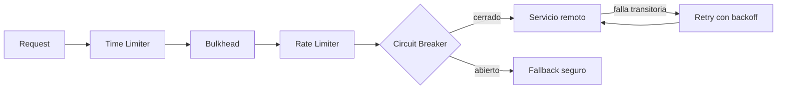

# Módulo 7 · Resiliencia y tolerancia a fallos en Tienda Aurora

En distribución, el fallo parcial es normal: un servicio lento, una red inestable o una dependencia caída no son excepciones raras. Resiliencia significa diseñar degradación controlada, no asumir disponibilidad perfecta. Este módulo cubre Resilience4j, timeouts, bulkheads, fallbacks y chaos engineering con criterio operativo, usando Tienda Aurora como proyecto integrador.

**Entorno de referencia verificado (2026-05-22):** JDK 27.0.1.0.2. Los smokes validan la lógica de breaker/retry/timeout/bulkhead/fallback en Java puro. Resilience4j, Spring Boot Actuator y Toxiproxy requieren dependencias e infraestructura; se incluyen notas de verificación honestas.

### Tema 1: Circuit breaker, retry, rate limiter, bulkhead, time limiter · Avanzado · 180 min

## El problema: una dependencia lenta tumba un flujo completo

Tienda Aurora depende de `inventory-service` para confirmar stock. Un martes, `inventory-service` empieza a responder en 8 segundos. `order-service` sigue esperando, sus hilos se agotan, y ahora tampoco puede atender pedidos que no necesitan inventario. Una dependencia lenta tumbó un flujo completo. Reintentar a ciegas empeora el problema: si el servicio está caído, cada reintento agrega carga. Necesitas límites, no esperanza.

## La idea clave: patrones como tablero eléctrico

Piensa en el tablero eléctrico de una casa. El circuit breaker corta la corriente cuando detecta una falla, para evitar un incendio. El retry es volver a encender un interruptor, pero solo si tiene sentido y con espera. El rate limiter es la válvula que limita cuánta agua pasa por minuto. El bulkhead son los compartimentos estancos de un barco: una filtración no hunde toda la nave. El time limiter es el temporizador que apaga el horno si nadie lo atiende.

Ningún patrón basta solo. Un retry sin timeout puede bloquear hilos. Un breaker sin fallback solo devuelve error más rápido. La resiliencia es una composición de patrones con criterio.



## Construyendo la solución con Resilience4j

Tienda Aurora usa Gradle. El `build.gradle.kts` de `orders-service` incluye Resilience4j:

```kotlin
// orders-service/build.gradle.kts
dependencies {
    implementation("io.github.resilience4j:resilience4j-spring-boot3:2.2.0")
    implementation("org.springframework.boot:spring-boot-starter-aop")
    implementation("org.springframework.boot:spring-boot-starter-actuator")
}
```

La configuración en `application.yml` define límites conservadores para `inventory-service`:

```yaml
resilience4j:
  circuitbreaker:
    instances:
      inventory:
        slidingWindowSize: 10
        failureRateThreshold: 50
        waitDurationInOpenState: 10s
  retry:
    instances:
      inventory:
        maxAttempts: 3
        waitDuration: 200ms
        retryExceptions:
          - java.io.IOException
  timelimiter:
    instances:
      inventory:
        timeoutDuration: 1s
  bulkhead:
    instances:
      inventory:
        maxConcurrentCalls: 20
```

El cliente de inventario aplica los patrones con fallback seguro:

```java
@Service
public class InventoryClient {
    @CircuitBreaker(name = "inventory", fallbackMethod = "fallback")
    @Retry(name = "inventory")
    @TimeLimiter(name = "inventory")
    @Bulkhead(name = "inventory")
    public CompletableFuture<StockView> getStock(String productId) {
        return CompletableFuture.supplyAsync(() -> remoteCall(productId));
    }

    private CompletableFuture<StockView> fallback(String productId, Exception ex) {
        return CompletableFuture.completedFuture(StockView.unknown(productId));
    }
}
```

El breaker abre cuando la tasa de fallos supera el umbral. `@Retry` solo aplica a excepciones transitorias configuradas. El fallback devuelve una respuesta segura, no inventa stock. El time limiter evita esperar indefinidamente. El bulkhead aísla la capacidad para que una dependencia lenta no agote todos los hilos.

## Verificando con un experimento

El siguiente smoke modela la lógica de decisión de Resilience4j (breaker, retry, timeout, bulkhead, fallback) en Java puro.

```java
public class ResilienceSmoke {
    static String breaker(boolean open) { return open ? "fallback" : "call"; }
    static boolean retryable(int status) { return status == 503 || status == 429; }
    static String withTimeout(int timeoutMs, int remoteMs) {
        return remoteMs <= timeoutMs ? "ok" : "timeout->fallback";
    }
    static boolean bulkheadAllowed(int current, int max) { return current < max; }

    public static void main(String[] args) {
        System.out.println(breaker(true));
        System.out.println(retryable(503));
        System.out.println(retryable(400));
        System.out.println(withTimeout(1000, 300));
        System.out.println(withTimeout(1000, 2000));
        System.out.println(bulkheadAllowed(19, 20));
        System.out.println(bulkheadAllowed(20, 20));
    }
}
```

```bash
javac ResilienceSmoke.java
java ResilienceSmoke
```

Salida esperada:

```text
fallback
true
false
ok
timeout->fallback
true
false
```

El experimento real consiste en: bajar `timeoutDuration` a `100ms` con un servicio que tarda 300ms y observar fallos por timeout y activación del fallback. Cambiar `maxAttempts` a `5` sin backoff en un servicio caído y observar tormenta de reintentos en métricas. Abrir el breaker y verificar que la llamada falla rápido.

## Cierre y trade-offs

La dependencia de inventario dejó de tumbar pedidos completos. El sistema ahora degrada: si inventario falla, responde rápido con una decisión segura. Ganaste control, pero agregaste complejidad: umbrales, métricas, fallbacks y pruebas de fallo.

El error más común es retry sin backoff en operación no idempotente. El síntoma son cobros duplicados o tormenta de requests. La causa es reintento ciego ante 503/timeout. La corrección es reintentar solo transitorios idempotentes, con backoff+jitter y límite. La señal observable son ráfagas de requests tras error y efectos duplicados.

**Pregunta de entrevista.** ¿Por qué un Circuit Breaker no reemplaza a un timeout?  
**Respuesta modelo.** El timeout limita cuánto espera una llamada individual. El circuit breaker observa la salud de la dependencia a lo largo del tiempo y corta llamadas cuando la tasa de fallos indica problema. Sin timeout, una llamada puede colgar hilos antes de que el breaker aprenda. Sin breaker, cada request sigue pagando el costo del fallo.

**Transferencia.**

1. **[NO-USAR-X]** Un endpoint de validación de RUT devuelve 400 por formato inválido. ¿Aplicas retry con backoff? Respuesta: **No usar retry**; es error determinista del cliente.
2. Tu servicio de recomendaciones es opcional en checkout. ¿Qué combinación de breaker, timeout y fallback usarías?
3. El servicio de pagos es crítico y no idempotente. ¿Cómo evitas duplicados si hay timeout después de enviar la solicitud?

### Tema 2: Timeouts en cascada · Avanzado · 120 min

## Timeouts en cascada

`checkout-service` llama a `order-service`, que llama a `payment-service`. `payment-service` tarda 10 segundos. El cliente ya canceló a los 2 segundos, pero los servicios internos siguen ocupados esperando. El sistema hace trabajo inútil y agota hilos.

Un timeout budget reparte el tiempo total entre saltos: cada servicio recibe un límite y lo respeta. Si el cliente tiene 2s, checkout recibe 1.8s, order 1.2s, payment 800ms. Si payment excede 800ms, se corta y se devuelve error controlado.

```java
public class TimeoutBudgetSmoke {
    static boolean withinBudget(int totalMs, int a, int b, int c) {
        return (a + b + c) <= totalMs;
    }

    public static void main(String[] args) {
        System.out.println(withinBudget(2000, 200, 800, 800));
        System.out.println(withinBudget(2000, 500, 800, 800));
    }
}
```

```bash
javac TimeoutBudgetSmoke.java
java TimeoutBudgetSmoke
```

Salida esperada:

```text
true
false
```

El error más común es timeout mayor que el del cliente. El síntoma es trabajo inútil tras cancelación. La causa son budgets desalineados. La corrección es propagar deadline/budget y configurar connect/read/request timeout.

### Tema 3: Fallback strategies · Intermedio · 120 min

## Fallback strategies

El servicio de recomendaciones cae. El usuario intenta comprar café en Tienda Aurora y el checkout falla completo, aunque las recomendaciones no son necesarias para pagar. Una dependencia opcional tumbó un flujo crítico.

Un fallback es como el cajero que, cuando el sommelier no está disponible, te cobra el café y omite la recomendación. Preserva lo esencial. Un fallback bueno preserva la experiencia crítica y hace visible la degradación. Un fallback malo oculta fallos y viola reglas de negocio.

```java
import java.util.*;

public class FallbackSmoke {
    static List<String> recommend(boolean fail) {
        if (fail) return List.of(); // fallback: lista vacía
        return List.of("cafe", "taza");
    }

    public static void main(String[] args) {
        System.out.println(recommend(true).size());
        System.out.println(recommend(false).size());
    }
}
```

```bash
javac FallbackSmoke.java
java FallbackSmoke
```

Salida esperada:

```text
0
2
```

Si recomendaciones falla, checkout muestra catálogo sin personalización. Si pagos falla, checkout devuelve error controlado y no confirma el pedido. El error más común es fallback que viola negocio: aprobar un pago, confirmar stock inexistente o autorizar acceso.

### Tema 4: Chaos engineering · Avanzado · 120 min

## Chaos engineering

Tienes circuit breakers, timeouts y fallbacks configurados. Nadie sabe si funcionan. El primer incidente real ocurre en Black Friday, y descubres que el fallback no estaba conectado.

Chaos engineering es como un simulacro de incendio. No enciendes el edificio; pruebas que la alarma suena, las rutas de salida funcionan y la gente sabe actuar. Inyectas fallos controlados para validar hipótesis.

```java
public class ChaosSmoke {
    static String outcome(boolean timeoutInjected, boolean fallback) {
        if (timeoutInjected && fallback) return "degraded";
        if (timeoutInjected) return "error";
        return "ok";
    }

    public static void main(String[] args) {
        System.out.println(outcome(true, true));
        System.out.println(outcome(true, false));
    }
}
```

```bash
javac ChaosSmoke.java
java ChaosSmoke
```

Salida esperada:

```text
degraded
error
```

El primer caso es la resiliencia funcionando: degradación controlada. El segundo es la deuda de resiliencia: sin fallback, el fallo se propaga. Chaos engineering convierte la resiliencia en evidencia.

## Cierre

La resiliencia no es un decorador: es un presupuesto de fallos. Timeouts, breakers, retries, bulkheads y fallbacks deben configurarse con métricas, probarse con caos controlado y revisarse cuando cambia el sistema. La ficha rápida del capítulo anterior protegía lecturas; aquí aprendiste a proteger la cadena de llamadas cuando el mundo real falla.

## Checklist

- Timeout en toda llamada remota.
- Retry solo en fallos transitorios idempotentes.
- Fallback seguro y observable.
- Bulkhead/rate limit donde hay saturación.
- Experimentos de chaos con hipótesis y abort conditions.
- Nota de verificación honesta cuando falta infra.
