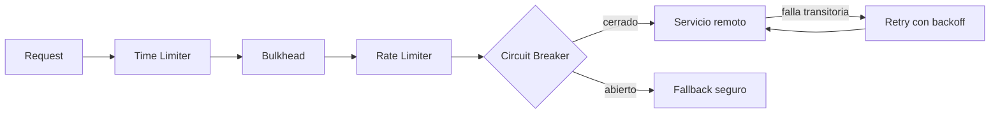
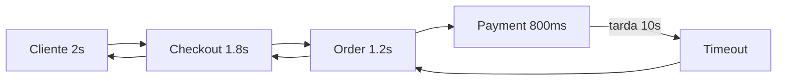
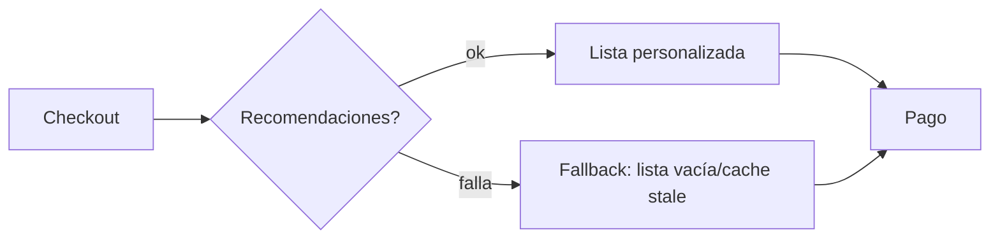
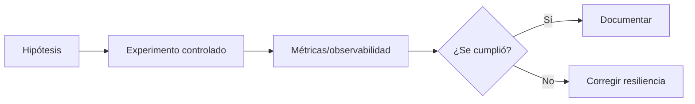

# Módulo 7 · Resiliencia y tolerancia a fallos con Spring

En distribución, el fallo parcial es normal: un servicio lento, una red inestable o una dependencia caída no son excepciones raras. Resiliencia significa diseñar degradación controlada, no asumir disponibilidad perfecta. Este módulo cubre Resilience4j, timeouts, bulkheads, fallbacks y chaos engineering con criterio operativo.

**Entorno de referencia verificado (2026-05-22):** JDK 27.0.1.0.2. Los smokes validan la lógica de breaker/retry/timeout/bulkhead/fallback en Java puro. La integración real con Resilience4j, Spring Boot Actuator y Toxiproxy requiere dependencias e infraestructura; se incluye **Nota de verificación** honesta.

## Aprende construyendo

### Tema 1: Circuit breaker, retry, rate limiter, bulkhead, time limiter · Avanzado · 180 min

#### Paso 1 · El dolor

Tienda Aurora depende de `inventory-service` para confirmar stock. Un martes, `inventory-service` empieza a responder en 8 segundos. `order-service` sigue esperando, sus hilos se agotan, y ahora tampoco puede atender pedidos que no necesitan inventario. Una dependencia lenta tumbó un flujo completo.

Reintentar a ciegas empeora el problema: si el servicio está caído, cada reintento agrega carga. Necesitas límites, no esperanza.

#### Paso 2 · La intuición

Piensa en el tablero eléctrico de una casa. El **circuit breaker** corta la corriente cuando detecta una falla, para evitar un incendio. El **retry** es volver a encender un interruptor, pero solo si tiene sentido y con espera. El **rate limiter** es la válvula que limita cuánta agua pasa por minuto. El **bulkhead** son los compartimentos estancos de un barco: una filtración no hunde toda la nave. El **time limiter** es el temporizador que apaga el horno si nadie lo atiende.



Ningún patrón basta solo. Un retry sin timeout puede bloquear hilos. Un breaker sin fallback solo devuelve error más rápido. La resiliencia es una composición.

#### Paso 3 · La construcción

Vas a modelar las decisiones básicas de Resilience4j. Primero entiendes la lógica; después la conectas a Spring Boot.

**Archivo:** `pom.xml` → agrega Resilience4j para Spring Boot.

```xml
<dependency>
  <groupId>io.github.resilience4j</groupId>
  <artifactId>resilience4j-spring-boot3</artifactId>
</dependency>
<dependency>
  <groupId>org.springframework.boot</groupId>
  <artifactId>spring-boot-starter-aop</artifactId>
</dependency>
```

**Archivo:** `src/main/resources/application.yml` → configura límites conservadores.

```yaml
resilience4j:
  circuitbreaker:
    instances:
      inventory:
        slidingWindowSize: 10
        failureRateThreshold: 50
        waitDurationInOpenState: 10s
  retry:
    instances:
      inventory:
        maxAttempts: 3
        waitDuration: 200ms
        retryExceptions:
          - java.io.IOException
  timelimiter:
    instances:
      inventory:
        timeoutDuration: 1s
```

**Archivo:** `InventoryClient.java` → aplica patrones y fallback.

```java
@Service
public class InventoryClient {
  @CircuitBreaker(name = "inventory", fallbackMethod = "fallback")
  @Retry(name = "inventory")
  @TimeLimiter(name = "inventory")
  public CompletableFuture<StockView> getStock(String productId) {
    return CompletableFuture.supplyAsync(() -> remoteCall(productId));
  }

  private CompletableFuture<StockView> fallback(String productId, Exception ex) {
    return CompletableFuture.completedFuture(StockView.unknown(productId));
  }
}
```

**Lectura del código:** el breaker abre cuando la tasa de fallos supera el umbral. `@Retry` solo aplica a excepciones transitorias configuradas. El fallback devuelve una respuesta segura, no inventa stock. El time limiter evita esperar indefinidamente.

#### Paso 4 · El experimento

1. Baja `timeoutDuration` a `100ms` con un servicio que tarda 300ms. Observas fallos por timeout y activación del fallback.
2. Cambia `maxAttempts` a `5` sin backoff en un servicio caído. Observas tormenta de reintentos en métricas.
3. Abre el breaker y verifica que la llamada falla rápido. Esperas `fallback`, no 8 segundos de espera.

**Salida esperada (smoke lógico):**

```text
fallback
true
false
```

#### Paso 5 · El cierre

La dependencia de inventario dejó de tumbar pedidos completos. El sistema ahora degrada: si inventario falla, responde rápido con una decisión segura. Ganaste control, pero agregaste complejidad: umbrales, métricas, fallbacks y pruebas de fallo.

| Patrón | Cuándo usarlo | Cuándo NO usarlo |
|---|---|---|
| Circuit Breaker | Dependencia remota inestable, fallo repetido | Lógica local pura o fallo que requiere corrección inmediata |
| Retry | Error transitorio e idempotente (503, timeout corto) | Operaciones no idempotentes o errores de validación |
| Bulkhead | Aislar recursos por dependencia | Cuando el overhead de partición no se justifica |
| Rate Limiter | Proteger servicio ante picos o abuso | Cuando bloquea tráfico legítimo sin estrategia de backpressure |
| Time Limiter | Toda llamada remota con SLA | Cuando no hay política de cancelación/fallback |

**Error común.** Retry sin backoff en operación no idempotente. **Síntoma.** cobros duplicados o tormenta de requests. **Causa.** reintento ciego ante 503/timeout. **Arreglo.** reintentar solo transitorios idempotentes, con backoff+jitter y límite. **Señal observable.** ráfagas de requests tras error y efectos duplicados.

**Pregunta de entrevista.** ¿Por qué un Circuit Breaker no reemplaza a un timeout?  
**Respuesta modelo.** El timeout limita cuánto espera una llamada individual. El circuit breaker observa la salud de la dependencia a lo largo del tiempo y corta llamadas cuando la tasa de fallos indica problema. Sin timeout, una llamada puede colgar hilos antes de que el breaker aprenda. Sin breaker, cada request sigue pagando el costo del fallo.

**Transferencia.**

1. **[NO-USAR-X]** Un endpoint de validación de RUT devuelve 400 por formato inválido. ¿Aplicas retry con backoff? Respuesta: **No usar retry**; es error determinista del cliente.
2. Tu servicio de recomendaciones es opcional en checkout. ¿Qué combinación de breaker, timeout y fallback usarías?
3. El servicio de pagos es crítico y no idempotente. ¿Cómo evitas duplicados si hay timeout después de enviar la solicitud?

#### Definición formal

Un **circuit breaker** evita llamadas a una dependencia con alta tasa de fallos. Un **retry** reintenta operaciones transitorias. Un **rate limiter** limita la tasa de ejecución. Un **bulkhead** aísla capacidad para evitar agotamiento compartido. Un **time limiter** acota el tiempo máximo de espera.

#### Contrato / internals

- **Circuit breaker:** estados `CLOSED`, `OPEN`, `HALF_OPEN`; ventana deslizante y umbral de fallos.
- **Retry:** máximo de intentos, backoff, jitter, lista de excepciones/retries permitidos.
- **Bulkhead:** semáforo o pool aislado por dependencia.
- **Rate limiter:** permisos por periodo y tiempo de espera.
- **Time limiter:** timeout + cancelación; el fallback debe ser seguro.
- **Métricas:** tasa de fallos, llamadas lentas, estado del breaker, retries, rechazos.

#### Ejemplo mínimo ejecutable

Crea el archivo `Res.java`:

```java
public class Res {
  static String breaker(boolean open) { return open ? "fallback" : "call"; }
  static boolean retryable(int status) { return status == 503 || status == 429; }
  public static void main(String[] args) {
    System.out.println(breaker(true));
    System.out.println(retryable(503));
    System.out.println(retryable(400));
  }
}
```

```bash
javac Res.java
java Res
```

Salida esperada:

```text
fallback
true
false
```

#### Caso real

`order-service` llama a `inventory-service` con `@CircuitBreaker`, `@Retry` solo para `IOException/TimeoutException`, `@TimeLimiter` de 1s y bulkhead de 20 llamadas concurrentes. Si inventario falla, devuelve `StockView.unknown` y permite continuar con flujo degradado.

#### Verificación

Smoke Java ejecutado localmente (2026-05-22, JDK 27.0.1.0.2): `fallback`, `true`, `false`.

**Nota de verificación:** no se ejecutó Resilience4j/Spring Boot real en esta sesión. Verificación propuesta: test con Spring Boot + Resilience4j, dependencia simulada con WireMock/Toxiproxy y aserción de métricas/estado del breaker.

### Tema 2: Timeouts en cascada · Avanzado · 120 min

#### Paso 1 · El dolor

`checkout-service` llama a `order-service`, que llama a `payment-service`. `payment-service` tarda 10 segundos. El cliente ya canceló a los 2 segundos, pero los servicios internos siguen ocupados esperando. El sistema hace trabajo inútil y agota hilos.

#### Paso 2 · La intuición

Imagina una cadena de llamadas telefónicas con espera. Si la primera persona cuelga a los 2 minutos, no tiene sentido que la tercera siga esperando 10. Un **timeout budget** reparte el tiempo total entre saltos: cada servicio recibe un límite y lo respeta.



#### Paso 3 · La construcción

**Archivo:** `Budget.java` → valida presupuesto de tiempo.

```java
public class Budget {
  static boolean withinBudget(int totalMs, int a, int b, int c) {
    return (a + b + c) <= totalMs;
  }
  public static void main(String[] args) {
    System.out.println(withinBudget(1000, 200, 300, 400));
    System.out.println(withinBudget(1000, 500, 500, 500));
  }
}
```

**Archivo:** `application.yml` → timeouts explícitos por cliente.

```yaml
spring:
  http:
    clients:
      payment:
        connect-timeout: 200ms
        read-timeout: 800ms
```

**Lectura:** el presupuesto total no puede ser la suma ingenua de máximos. Cada salto debe tener timeout menor al presupuesto restante y alineado al SLA del cliente.

#### Paso 4 · El experimento

1. Configura `payment` con 10s y cliente con 2s. Observas trabajo descartado y hilos ocupados.
2. Reduce `payment` a 800ms y propaga deadline. Observas fallo rápido y liberación de recursos.
3. Simula latencia con Toxiproxy. Esperas timeout controlado, no bloqueo indefinido.

Salida esperada del smoke:

```text
true
false
```

#### Paso 5 · El cierre

El timeout budget evita que un servicio lento consuma recursos después de que el cliente ya se fue. Es un límite simple, pero requiere disciplina en todos los hops.

| Estrategia | Cuándo usarla | Cuándo NO usarla |
|---|---|---|
| Timeout por hop | Toda llamada remota | Nunca omitir en red |
| Deadline propagation | Cadenas multi-servicio | Request local en memoria |
| Timeout infinito/default | Casi nunca | Producción distribuida |

**Error común.** Timeout mayor que el del cliente. **Síntoma.** trabajo inútil tras cancelación. **Causa.** budgets desalineados. **Arreglo.** propagar deadline/budget y configurar connect/read/request timeout. **Señal observable.** respuestas tardías descartadas y threads ocupados.

**Pregunta de entrevista.** ¿Cómo defines timeouts en una cadena de microservicios?  
**Respuesta modelo.** Defino un presupuesto total desde el SLA del cliente y lo reparto por hop, dejando margen para procesamiento. Cada llamada remota tiene connect/read timeout explícito y, cuando es posible, se propaga deadline. Mido p99 y ajusto para evitar fallos falsos o esperas inútiles.

**Transferencia.**

1. **[NO-USAR-X]** Llamada interna en memoria dentro del mismo proceso. ¿Aplicas timeout de red? Respuesta: **No usar timeout de red**; no hay hop remoto.
2. Tu SLA es 1500ms y tienes 3 hops. Propón un budget.
3. Un servicio de reportes tarda 30s por diseño. ¿Cómo lo expones sin romper el budget del request interactivo?

#### Definición formal

Un **timeout budget** es el tiempo máximo que una operación puede consumir, repartido entre saltos de una cadena distribuida. El objetivo es limitar espera, liberar recursos y evitar trabajo inútil.

#### Contrato / internals

- **Tipos:** connect timeout, read timeout, write timeout, request timeout.
- **Budget:** total < SLA usuario; cada hop consume una parte.
- **Deadline propagation:** enviar tiempo restante o deadline absoluto.
- **Cancelación:** idealmente interrumpir trabajo downstream; no siempre posible.
- **Límite:** timeout demasiado agresivo genera falsos errores.

#### Ejemplo mínimo ejecutable

```bash
javac Budget.java
java Budget
```

Salida esperada:

```text
true
false
```

#### Caso real

`checkout` tiene SLA 2s. Asigna 200ms a gateway, 800ms a orders, 800ms a payment y 200ms de margen. Si payment excede 800ms, se corta y se devuelve error controlado.

#### Verificación

Smoke Java ejecutado localmente (2026-05-22, JDK 27.0.1.0.2): `true`, `false`.

**Nota de verificación:** no se ejecutó cadena distribuida real. Verificación propuesta: WireMock/Toxiproxy con latencia artificial y métricas de timeout.

### Tema 3: Fallback strategies · Intermedio · 120 min

#### Paso 1 · El dolor

El servicio de recomendaciones cae. El usuario intenta comprar café en Tienda Aurora y el checkout falla completo, aunque las recomendaciones no son necesarias para pagar. Una dependencia opcional tumbó un flujo crítico.

#### Paso 2 · La intuición

Cuando el sommelier de la tienda no está disponible, el cajero no cierra la tienda. Te cobra el café y omite la recomendación. Un **fallback** es esa respuesta alternativa segura: no finge que todo está bien, pero preserva lo esencial.



#### Paso 3 · La construcción

**Archivo:** `Fb.java` → fallback seguro para dependencia opcional.

```java
import java.util.*;
public class Fb {
  static List<String> recs(boolean fail) {
    if (fail) return List.of();
    return List.of("cafe", "taza");
  }
  public static void main(String[] args) {
    System.out.println(recs(true).size());
    System.out.println(recs(false).size());
  }
}
```

**Archivo:** `RecommendationClient.java` → fallback en Spring.

```java
@CircuitBreaker(name = "recs", fallbackMethod = "fallback")
public List<ProductDto> recommend(String userId) {
  return remoteRecommendations(userId);
}

private List<ProductDto> fallback(String userId, Exception ex) {
  log.warn("recommendations fallback userId={} cause={}", userId, ex.toString());
  return List.of();
}
```

**Lectura:** el fallback es visible en logs/métricas. No oculta el fallo; degrada el comportamiento.

#### Paso 4 · El experimento

1. Simula caída de recomendaciones. Esperas checkout exitoso con lista vacía.
2. Simula caída de pagos. **No** debes usar fallback que “apruebe” el pago. Esperas error controlado.
3. Marca fallback con métrica. Observas cuántas veces se usó.

Salida esperada:

```text
0
2
```

#### Paso 5 · El cierre

Un fallback bueno preserva la experiencia crítica y hace visible la degradación. Un fallback malo oculta fallos y viola reglas de negocio.

| Fallback | Cuándo usarlo | Cuándo NO usarlo |
|---|---|---|
| Lista vacía/default | Dato opcional, no crítico | Estado financiero o autorización |
| Cache stale marcada | Lectura tolerante a frescura | Precio/saldo/regla regulatoria crítica |
| Error controlado | Operación crítica no segura de degradar | Nunca ocultar con éxito falso |

**Error común.** Fallback que viola negocio. **Síntoma.** datos incorrectos aceptados como éxito. **Causa.** degradación mal elegida. **Arreglo.** clasificar criticidad y definir fallback por dominio. **Señal observable.** respuestas “ok” con efectos inválidos.

**Pregunta de entrevista.** ¿Cuándo un fallback es peligroso?  
**Respuesta modelo.** Es peligroso cuando oculta un fallo crítico o devuelve un valor que viola una invariante de negocio, como aprobar un pago, confirmar stock inexistente o autorizar acceso. En esos casos prefiero fallar rápido con error controlado y observabilidad.

**Transferencia.**

1. **[NO-USAR-X]** Pago con tarjeta: el proveedor cae. ¿Usas fallback “pago aprobado”? Respuesta: **No usar fallback** que invente éxito.
2. Recomendaciones caídas en home: diseña un fallback seguro.
3. Tipo de cambio desactualizado 10 minutos: ¿cuándo sería aceptable cache stale?

#### Definición formal

Un **fallback** es una respuesta alternativa segura cuando una dependencia falla o excede su presupuesto. Debe preservar invariantes de negocio y ser observable.

#### Contrato / internals

- **Clasificación:** dependencia crítica vs opcional.
- **Tipos:** valor por defecto, cache stale, degradación funcional, error controlado.
- **Observabilidad:** log, métrica y traza del fallback.
- **Límite:** no usar para esconder fallos críticos.

#### Ejemplo mínimo ejecutable

```bash
javac Fb.java
java Fb
```

Salida esperada:

```text
0
2
```

#### Caso real

Si recomendaciones falla, checkout muestra catálogo sin personalización. Si pagos falla, checkout devuelve error controlado y no confirma el pedido.

#### Verificación

Smoke Java ejecutado localmente (2026-05-22, JDK 27.0.1.0.2): `0`, `2`.

**Nota de verificación:** no se ejecutó Resilience4j real. Verificación propuesta: test de integración con dependencia caída y aserción de respuesta degradada/métrica.

### Tema 4: Chaos engineering · Avanzado · 120 min

#### Paso 1 · El dolor

Tienes circuit breakers, timeouts y fallbacks configurados. Nadie sabe si funcionan. El primer incidente real ocurre en Black Friday, y descubres que el fallback no estaba conectado.

#### Paso 2 · La intuición

Chaos engineering es como un simulacro de incendio. No enciendes el edificio para destruirlo; pruebas que la alarma suena, las rutas de salida funcionan y la gente sabe actuar. Inyectas fallos controlados para validar hipótesis.



#### Paso 3 · La construcción

**Archivo:** `Chaos.java` → modelo simple de resultado ante falla inyectada.

```java
public class Chaos {
  static String outcome(boolean timeoutInjected, boolean fallback) {
    if (timeoutInjected && fallback) return "degraded";
    if (timeoutInjected) return "error";
    return "ok";
  }
  public static void main(String[] args) {
    System.out.println(outcome(true, true));
    System.out.println(outcome(true, false));
  }
}
```

**Archivo:** experimento (definición).

```yaml
hypothesis: "Si inventory tarda 2s, checkout degrada recomendaciones en <3s"
blast_radius: "1 instancia canary"
abort_conditions:
  - "error rate > 5%"
  - "p95 checkout > 3s"
metrics:
  - http_server_errors
  - fallback_count
  - checkout_latency_p95
```

**Lectura:** el experimento tiene hipótesis, alcance, métricas y condición de aborto. Sin eso, solo estás rompiendo cosas.

#### Paso 4 · El experimento

1. Inyecta 2s de latencia con Toxiproxy a inventory. Esperas `degraded`, no caída total.
2. Quita el fallback y repite. Esperas `error`; ese resultado indica deuda de resiliencia.
3. Define abort condition. Si el error rate supera el límite, detienes el experimento.

Salida esperada:

```text
degraded
error
```

#### Paso 5 · El cierre

Chaos engineering convierte la resiliencia en evidencia. No busca caos; busca confianza bajo fallos controlados.

| Práctica | Cuándo usarla | Cuándo NO usarla |
|---|---|---|
| Chaos en staging | Siempre antes de producción | Omitir por “falta de tiempo” |
| Chaos en producción | Madurez alta, observabilidad, blast radius pequeño | Sin abort conditions ni on-call |
| Inyección aleatoria sin hipótesis | Nunca | Nunca |

**Error común.** Inyectar caos sin hipótesis. **Síntoma.** ruido sin aprendizaje. **Causa.** experimento no definido. **Arreglo.** hipótesis, steady state, blast radius, métricas, abort conditions. **Señal observable.** incidentes sin conclusiones o métricas.

**Pregunta de entrevista.** ¿Qué hace que un experimento de chaos engineering sea útil?  
**Respuesta modelo.** Una hipótesis clara, un estado estable medible, un blast radius limitado, métricas de éxito/fallo y condiciones de aborto. El objetivo es aprender cómo se comporta el sistema ante fallos y corregirlo antes del incidente real.

**Transferencia.**

1. **[NO-USAR-X]** Inyectar fallos en producción sin métricas ni abort condition. Respuesta: **No usar chaos** así; primero staging y controles.
2. Diseña un experimento para caída de Redis en catálogo.
3. ¿Qué métrica demostraría que el fallback realmente protegió el checkout?

#### Definición formal

**Chaos engineering** es la disciplina de experimentar con fallos controlados para validar hipótesis sobre la resiliencia del sistema en condiciones reales o cercanas a producción.

#### Contrato / internals

- **Hipótesis:** qué esperas que ocurra.
- **Steady state:** métricas normales.
- **Inyección:** latencia, fallo, pérdida de paquetes, caída de instancia.
- **Blast radius:** alcance limitado.
- **Abort conditions:** umbral para detener.
- **Resultado:** aprendizaje y acción correctiva.

#### Ejemplo mínimo ejecutable

```bash
javac Chaos.java
java Chaos
```

Salida esperada:

```text
degraded
error
```

#### Caso real

Se inyecta 2s de latencia en `inventory-service` con Toxiproxy en staging. Checkout usa fallback de stock desconocido y mantiene p95 < 3s. Se documenta el resultado y se agrega alerta de fallback rate.

#### Verificación

Smoke Java ejecutado localmente (2026-05-22, JDK 27.0.1.0.2): `degraded`, `error`.

**Nota de verificación:** no se ejecutó Toxiproxy/Chaos Mesh real. Verificación propuesta: experimento controlado en staging con métricas, abort conditions y runbook.

## Cierre

La resiliencia no es un decorador: es un presupuesto de fallos. Timeouts, breakers, retries, bulkheads y fallbacks deben configurarse con métricas, probarse con caos controlado y revisarse cuando cambia el sistema. La ficha rápida del capítulo anterior protegía lecturas; aquí aprendiste a proteger la cadena de llamadas cuando el mundo real falla.

## Checklist

- Timeout en toda llamada remota.
- Retry solo en fallos transitorios idempotentes.
- Fallback seguro y observable.
- Bulkhead/rate limit donde hay saturación.
- Experimentos de chaos con hipótesis y abort conditions.
- Nota de verificación honesta cuando falta infra.