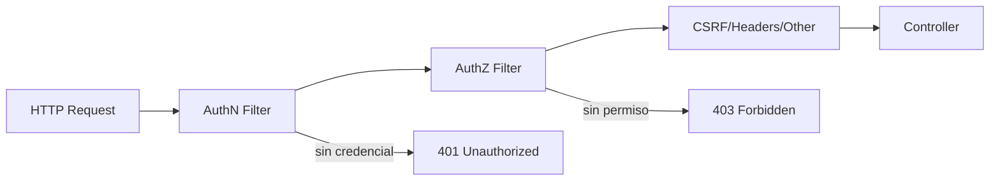
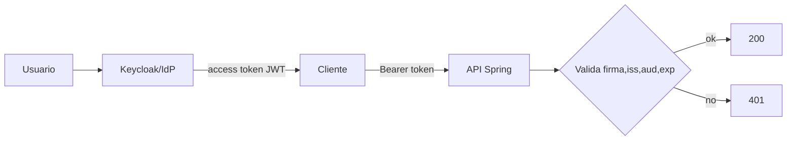
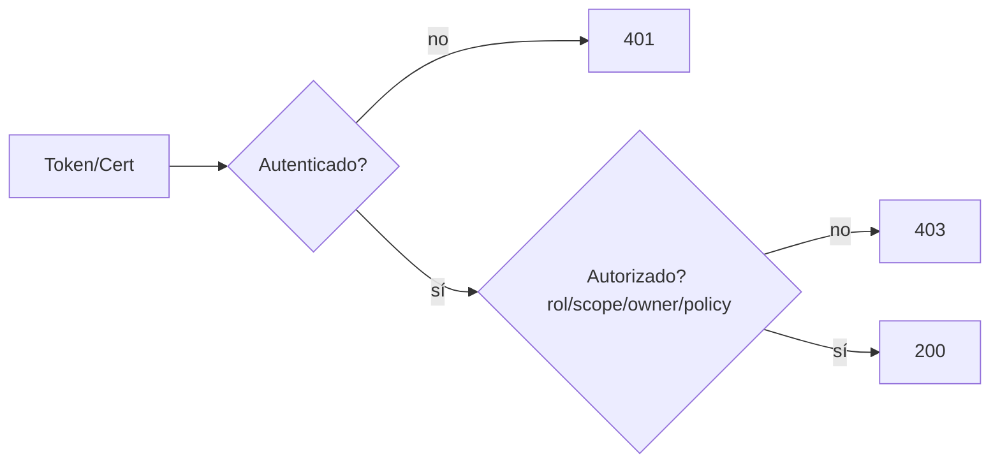
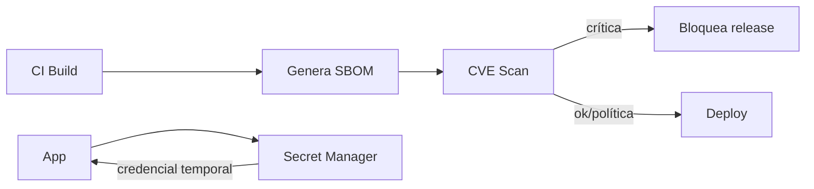

# Módulo 8 · Seguridad en microservicios Spring

La seguridad en sistemas distribuidos no es una feature: es una propiedad del sistema. Cada request cruza redes, servicios y identidades; asumir confianza por “estar adentro” es el camino rápido al incidente. Este módulo construye defensa en profundidad con Spring Security, OAuth2/OIDC, RBAC, mTLS/Zero-Trust, secretos y cadena de suministro.

**Entorno de referencia verificado (2026-05-22):** JDK 27.0.1.0.2. Los smokes ejecutan lógica de autenticación/autorización, validación de claims, RBAC/ownership y gates de secretos/CVE en Java puro. Spring Security, Keycloak, Vault, mTLS y herramientas SBOM/CVE reales requieren infraestructura; se incluyen **Notas de verificación** honestas.

## Aprende construyendo

### Tema 1: Spring Security filter chain · Intermedio · 150 min

#### Paso 1 · El dolor

Tienda Aurora expone `/api/orders` para clientes y `/actuator/health` para el orquestador. Un desarrollador, apurado, deshabilita seguridad para “probar rápido” y olvida reactivarla. A la semana, alguien descubre el endpoint y crea pedidos sin autenticación. El frontend tenía un botón oculto, pero la API no tenía control.

El síntoma es un 200 donde debía haber 401. La causa es confundir interfaz con seguridad.

#### Paso 2 · La intuición

Piensa en un edificio con recepcionista, torniquete y guardias por piso. No importa que la puerta lateral “no esté en el mapa”: cada acceso pasa por controles. La **filter chain** de Spring Security es esa secuencia de controles: cada request entra por la cadena y puede ser autenticada, autorizada o rechazada antes de tocar tu lógica de negocio.



La analogía tiene límite: en APIs stateless con JWT, no usas sesión de servidor como en una app web clásica. Pero la idea de cadena de controles se mantiene.

#### Paso 3 · La construcción

Primero modelas la decisión de acceso. Después lo conectas a `SecurityFilterChain`.

**Archivo:** `Sec.java` → regla mínima de acceso.

```java
public class Sec {
  static int status(String path, boolean auth) {
    if (path.equals("/health")) return 200;
    return auth ? 200 : 401;
  }
  public static void main(String[] args) {
    System.out.println(status("/health", false));
    System.out.println(status("/orders", false));
    System.out.println(status("/orders", true));
  }
}
```

**Archivo:** `SecurityConfig.java` → cadena explícita en Spring Boot 3.

```java
@Bean
SecurityFilterChain securityFilterChain(HttpSecurity http) throws Exception {
  return http
      .csrf(csrf -> csrf.disable())
      .sessionManagement(sm -> sm.sessionCreationPolicy(SessionCreationPolicy.STATELESS))
      .authorizeHttpRequests(auth -> auth
          .requestMatchers("/actuator/health").permitAll()
          .requestMatchers("/api/orders/**").authenticated()
          .anyRequest().denyAll())
      .oauth2ResourceServer(oauth -> oauth.jwt(Customizer.withDefaults()))
      .build();
}
```

**Lectura del código:** la cadena es explícita. `/actuator/health` es público por necesidad operativa; `/api/orders/**` exige autenticación; `anyRequest().denyAll()` cierra por defecto. Stateless evita sesión del servidor para APIs con token.

#### Paso 4 · El experimento

1. Llama `/orders` sin token. Esperas `401`.
2. Llama `/health` sin token. Esperas `200`.
3. Cambia `anyRequest().denyAll()` por `permitAll()`. Observa cómo un endpoint nuevo queda expuesto por accidente. Vuelve a `denyAll()`.

Salida esperada del smoke:

```text
200
401
200
```

#### Paso 5 · El cierre

La filter chain convirtió la seguridad en una política explícita. Ganaste control, pero también responsabilidad: cada ruta nueva debe clasificarse conscientemente.

**Cuándo usarlo / cuándo no.** Usa `SecurityFilterChain` explícita en toda API. No confíes en seguridad por frontend, por red interna o por “nadie conoce la URL”. No uses `permitAll()` como atajo salvo rutas públicas justificadas.

| Decisión | Cuándo | Cuándo NO |
|---|---|---|
| `denyAll()` por defecto | APIs con superficie controlada | Prototipo local desechable, con riesgo consciente |
| Stateless + JWT | APIs de microservicios | App web server-rendered con sesión clásica |
| CSRF deshabilitado | API stateless sin cookies de sesión | Formularios browser con cookies |

**Error común.** Confiar en seguridad solo en frontend. **Síntoma.** acceso directo a API sin auth devuelve 200. **Causa.** falta control backend. **Arreglo.** authN/authZ en backend, default deny, pruebas de autorización. **Señal observable.** `curl` sin token accede a recurso protegido.

**Pregunta de entrevista.** ¿Por qué `anyRequest().denyAll()` es una buena práctica en APIs?  
**Respuesta modelo.** Porque obliga a clasificar explícitamente cada ruta nueva. Reduce el riesgo de exponer endpoints por olvido cuando se agrega funcionalidad. La seguridad por defecto debe ser restrictiva; los permisos se abren de forma deliberada y auditable.

**Transferencia.**

1. **[NO-USAR-X]** Endpoint `/admin/reports` nuevo sin regla explícita. ¿Lo dejas pasar con `permitAll()` temporal en producción? Respuesta: **No usar permitAll temporal**; agregar regla explícita y test 401/403.
2. Tienes `/actuator/health` y `/actuator/prometheus`. ¿Ambos deben ser públicos?
3. Una app web usa cookies de sesión. ¿Deshabilitas CSRF igual que en API stateless?

#### Definición formal

Spring Security procesa requests mediante una cadena de filtros que autentican, autorizan y aplican protecciones. La `SecurityFilterChain` define qué reglas aplican a qué rutas.

#### Contrato / internals

- **Orden de filtros:** importa; autenticación antes de autorización.
- **Authentication:** quién es. **Authorization:** qué puede hacer.
- **Stateless:** sin `HttpSession` para identidad; token por request.
- **ExceptionTranslation:** traduce fallos a 401/403.
- **Default deny:** toda ruta no clasificada debe rechazarse.

#### Ejemplo mínimo ejecutable

```bash
javac Sec.java
java Sec
```

Salida esperada:

```text
200
401
200
```

#### Caso real

Tienda Aurora protege `/api/pedidos/**` con JWT y deja `/actuator/health` público para probes de Kubernetes. El equipo agrega tests que verifican 401 sin token y 403 sin rol.

#### Verificación

Smoke Java ejecutado localmente (2026-05-22, JDK 27.0.1.0.2): `200`, `401`, `200`.

**Nota de verificación:** no se ejecutó Spring Security real en esta sesión. Verificación propuesta: `@SpringBootTest` + `MockMvc` verificando 200/401/403 por ruta y credencial.

### Tema 2: JWT y OAuth2/OIDC · Avanzado · 180 min

#### Paso 1 · El dolor

El equipo implementó login y genera un JWT. Un atacante copia el token, cambia el campo `role` a `ADMIN` en el payload base64, y la API lo acepta porque solo decodifica el JSON, no valida la firma. Otro token expirado hace días sigue funcionando porque nadie revisa `exp`.

El síntoma es acceso indebido. La causa es tratar un JWT como texto confiable.

#### Paso 2 · La intuición

Un JWT es como un pase de backstage firmado. Mirar el pase no basta: hay que verificar la firma, quién lo emitió, para qué evento sirve y si ya venció. OAuth2 es el sistema que delega autorización; OIDC agrega identidad sobre OAuth2. El access token autoriza; el ID token identifica.



#### Paso 3 · La construcción

**Archivo:** `Jwt.java` → validación mínima de claims.

```java
import java.util.*;
public class Jwt {
  static boolean valid(Map<String, Object> claims, String aud) {
    return "iss1".equals(claims.get("iss"))
        && aud.equals(claims.get("aud"))
        && (int) claims.get("exp") > 100;
  }
  public static void main(String[] args) {
    System.out.println(valid(Map.of("iss", "iss1", "aud", "orders", "exp", 200), "orders"));
    System.out.println(valid(Map.of("iss", "bad", "aud", "orders", "exp", 200), "orders"));
  }
}
```

**Archivo:** `application.yml` → Resource Server en Spring.

```yaml
spring:
  security:
    oauth2:
      resourceserver:
        jwt:
          issuer-uri: https://idp.tienda-aurora.local/realms/aurora
```

**Lectura:** el smoke solo muestra la lógica de claims. En producción, Spring Security valida firma con JWKS del issuer, `iss`, `aud`, `exp`, `nbf` y algoritmo permitido. Nunca aceptes `alg=none`.

#### Paso 4 · El experimento

1. Token con `iss` correcto y `exp` futuro. Esperas `true`.
2. Token con `iss` incorrecto. Esperas `false`.
3. Token expirado (`exp` menor al tiempo actual). En producción debe dar 401. En el smoke, modela el caso cambiando el umbral.

Salida esperada:

```text
true
false
```

#### Paso 5 · El cierre

Validar claims y firma convierte el token en una prueba criptográfica, no en un JSON decorativo. El costo es operar IdP, claves, rotación y latencia de validación.

**Cuándo usarlo / cuándo no.** Usa OAuth2/OIDC cuando hay identidad delegada, SSO o APIs protegidas. No aceptes tokens sin validar firma, issuer, audience, expiración y algoritmo. No uses ID token para autorizar APIs; usa access token.

| Token | Uso | No usar para |
|---|---|---|
| Access token | Autorizar acceso a API | Identidad de UI rica |
| ID token | Identidad del usuario en cliente OIDC | Autorizar microservicios |
| Refresh token | Obtener nuevo access token | Llamar APIs de negocio |

**Error común.** Solo decodificar JWT. **Síntoma.** token forjado o expirado aceptado. **Causa.** no validar firma/claims. **Arreglo.** validar firma JWKS, `iss`, `aud`, `exp`, `nbf`, `alg` permitido. **Señal observable.** token manipulado produce 200.

**Pregunta de entrevista.** ¿Qué diferencia hay entre OAuth2 y OIDC?  
**Respuesta modelo.** OAuth2 es un framework de autorización: permite que un cliente obtenga acceso delegado a recursos. OIDC es una capa de identidad sobre OAuth2: agrega autenticación del usuario, ID token y claims de identidad. En APIs, normalmente valido el access token; el ID token lo consume el cliente que necesita identidad.

**Transferencia.**

1. **[NO-USAR-X]** Token con `alg=none` o firma inválida. ¿Lo aceptas si el payload “se ve bien”? Respuesta: **No usar token sin firma válida**.
2. Un access token válido para `catalog-service` llega a `orders-service`. ¿Debe aceptarse?
3. El IdP rota claves JWKS. ¿Qué debe soportar tu Resource Server?

#### Definición formal

JWT es un formato de token firmado/cifrado con claims. OAuth2 delega autorización; OIDC agrega identidad sobre OAuth2. El Resource Server valida el token antes de autorizar el request.

#### Contrato / internals

- **Claims críticos:** `iss`, `aud`, `exp`, `nbf`, `sub`, scopes/roles.
- **Firma:** validar contra JWKS; cachear claves con cuidado.
- **Algoritmo:** allowlist explícita; rechazar `none`.
- **Revocación:** tokens cortos + refresh; introspección si aplica.
- **Límite:** JWT no revocado puede ser válido hasta expirar.

#### Ejemplo mínimo ejecutable

```bash
javac Jwt.java
java Jwt
```

Salida esperada:

```text
true
false
```

#### Caso real

Gateway o Resource Server valida JWT emitido por Keycloak. `orders-service` extrae roles/scopes y aplica autorización por endpoint y por recurso.

#### Verificación

Smoke Java ejecutado localmente (2026-05-22, JDK 27.0.1.0.2): `true`, `false`.

**Nota de verificación:** no se ejecutó Keycloak/OIDC real. Verificación propuesta: realm Keycloak, cliente, usuario, token y llamada a Resource Server con token válido, expirado, audiencia incorrecta y firma inválida.

### Tema 3: RBAC, scopes y mTLS/Zero-Trust · Avanzado · 150 min

#### Paso 1 · El dolor

Un usuario autenticado descubre que puede borrar pedidos ajenos cambiando el ID en la URL. El token era válido, pero la API solo verificó login. En otro incidente, un servicio interno falso en la red llama a un endpoint interno porque “la red es privada”.

Autenticación sin autorización es media cerradura. Red privada sin identidad es confianza ciega.

#### Paso 2 · La intuición

RBAC es la llave que abre solo ciertas puertas según tu rol. Ownership es la regla adicional: puedes entrar a tu habitación, no a la del vecino. mTLS es pedir identificación a ambos lados de la conversación. Zero-Trust es la política: nadie entra solo por estar dentro del edificio.



#### Paso 3 · La construcción

**Archivo:** `Rbac.java` → rol y ownership.

```java
import java.util.*;
public class Rbac {
  static boolean canDelete(Set<String> roles) { return roles.contains("ADMIN"); }
  static boolean canRead(String owner, String userId) { return owner.equals(userId); }
  public static void main(String[] args) {
    System.out.println(canDelete(Set.of("USER")));
    System.out.println(canDelete(Set.of("ADMIN")));
    System.out.println(canRead("u1", "u1"));
    System.out.println(canRead("u1", "u2"));
  }
}
```

**Archivo:** `SecurityConfig.java` → reglas por rol.

```java
.authorizeHttpRequests(auth -> auth
    .requestMatchers(HttpMethod.DELETE, "/api/orders/**").hasRole("ADMIN")
    .requestMatchers("/api/orders/**").hasAnyRole("USER", "ADMIN")
    .anyRequest().denyAll())
```

**Archivo:** `application.yml` → mTLS (conceptual, requiere certificados).

```yaml
server:
  ssl:
    client-auth: need
    key-store: classpath:server.p12
    trust-store: classpath:trust.p12
```

**Lectura:** RBAC cubre permisos gruesos. Ownership/ABAC cubre reglas por recurso. mTLS autentica workloads. Zero-Trust combina identidad, least privilege, cifrado y observabilidad.

#### Paso 4 · El experimento

1. Usuario con rol `USER` intenta borrar. Esperas `false`/403.
2. Usuario `ADMIN` intenta borrar. Esperas `true`/200.
3. Usuario `u2` intenta leer recurso de `u1`. Esperas `false`/403.
4. Servicio interno sin certificado cliente válido intenta llamar endpoint mTLS. Esperas fallo de handshake/401 según configuración.

Salida esperada:

```text
false
true
true
false
```

#### Paso 5 · El cierre

La autorización por recurso evita el “autenticado pero no autorizado”. mTLS/Zero-Trust evita confianza implícita en la red. El costo es gestión de identidades, certificados, policies y auditoría.

**Cuándo usarlo / cuándo no.** Usa RBAC para permisos gruesos, scopes para delegación OAuth2 y ownership/ABAC para reglas por recurso. Usa mTLS/Zero-Trust en service-to-service sensible. No uses solo autenticación. No asumas que la red privada es confiable.

| Control | Cuándo | Cuándo NO |
|---|---|---|
| RBAC | Roles estables, permisos gruesos | Reglas finas por atributo/recurso |
| Ownership/ABAC | Decisiones por recurso/tenant/atributo | Permiso global simple |
| mTLS | Identidad de workload, east-west sensible | Tráfico público browser sin gestión cliente |

**Error común.** Solo validar login. **Síntoma.** usuario autenticado borra recursos ajenos. **Causa.** falta authZ por rol/ownership. **Arreglo.** checks por rol/scope y por recurso. **Señal observable.** auditoría muestra 200 en operaciones prohibidas.

**Error común.** Confiar en red plana. **Síntoma.** servicio falso llama endpoint interno. **Causa.** no hay identidad de workload. **Arreglo.** mTLS/identidad + policy + observabilidad. **Señal observable.** requests internos sin identidad verificable.

**Pregunta de entrevista.** ¿Cuál es la diferencia entre autenticación y autorización?  
**Respuesta modelo.** Autenticación verifica quién es la identidad; autorización decide qué puede hacer sobre qué recurso. En microservicios necesito ambas: un JWT válido puede autenticar al usuario, pero aún debo verificar rol, scope, tenant u ownership antes de permitir la operación.

**Transferencia.**

1. **[NO-USAR-X]** Endpoint interno solo protegido por “está en VPC privada”. Respuesta: **No usar red privada como único control**; agregar identidad y autorización.
2. Un usuario puede ver sus pedidos y un soporte puede ver pedidos de su tenant. ¿RBAC puro o ABAC?
3. ¿Cómo rotas certificados mTLS sin caída?

#### Definición formal

RBAC autoriza por roles; scopes delegan permisos en OAuth2; ABAC decide por atributos. mTLS autentica ambas partes del canal TLS. Zero-Trust es un modelo donde ninguna request se confía por defecto.

#### Contrato / internals

- **AuthN != AuthZ:** 401 vs 403.
- **RBAC:** roles como `ADMIN/USER`.
- **ABAC/policy:** atributos como owner, tenant, sensibilidad.
- **mTLS:** certificados, CA, rotación, revocación.
- **Zero-Trust:** identidad fuerte, least privilege, segmentación, auditoría.

#### Ejemplo mínimo ejecutable

```bash
javac Rbac.java
java Rbac
```

Salida esperada:

```text
false
true
true
false
```

#### Caso real

`DELETE /api/orders/{id}` exige `ROLE_ADMIN`. `GET /api/orders/{id}` permite `USER` solo si el pedido pertenece al usuario. Entre servicios, `billing` se autentica por mTLS y solo puede llamar `POST /payments/capture`.

#### Verificación

Smoke Java ejecutado localmente (2026-05-22, JDK 27.0.1.0.2): `false`, `true`, `true`, `false`.

**Nota de verificación:** no se ejecutó mTLS/Keycloak/mesh. Verificación propuesta: Spring Security Resource Server con tests 200/401/403 y dos servicios con certificados cliente/servidor.

### Tema 4: Vault, gestión de secretos, SBOM y CVE scanning · Intermedio · 120 min

#### Paso 1 · El dolor

La contraseña de base de datos está en `application-prod.yml` dentro del repositorio. Alguien hace fork por error y el secreto queda expuesto. En paralelo, una dependencia con CVE crítica entra por una actualización menor y nadie lo detecta antes del release.

El incidente no fue un hacker sofisticado: fue un secreto en Git y un pipeline sin gate de supply chain.

#### Paso 2 · La intuición

Un secreto es como la llave maestra: no se deja pegada en la pared del pasillo. Se guarda en una caja fuerte con acceso auditado y se cambia periódicamente. El SBOM es la lista de ingredientes del producto; el CVE scan es revisar si algún ingrediente tiene retiro sanitario. No garantiza que el plato sea perfecto, pero evita servir algo con alerta conocida.



#### Paso 3 · La construcción

**Archivo:** `Vault.java` → contrato mínimo de secreto y gate.

```java
public class Vault {
  static String getSecret(String name) {
    if (name == null || name.isBlank()) throw new IllegalArgumentException("missing");
    return "***";
  }
  static boolean releaseBlocked(int criticalCves) { return criticalCves > 0; }
  public static void main(String[] args) {
    System.out.println(getSecret("db"));
    try { getSecret(""); } catch (Exception e) { System.out.println(e.getMessage()); }
    System.out.println(releaseBlocked(1));
  }
}
```

**Archivo:** `application.yml` → referencia a secreto, no valor.

```yaml
spring:
  datasource:
    password: ${DB_PASSWORD}
```

**Archivo:** CI (conceptual).

```bash
syft dir:. -o cyclonedx-json > sbom.json
grype sbom:sbom.json --fail-on critical
```

**Lectura:** el secreto se inyecta en runtime. El SBOM describe el artefacto. El scanner aplica una política; CVE crítica bloquea el release.

#### Paso 4 · El experimento

1. Pide un secreto válido. Esperas `***` (nunca imprimir el real).
2. Pide un secreto vacío. Esperas error controlado `missing`.
3. Simula una CVE crítica. Esperas `releaseBlocked=true`.

Salida esperada:

```text
***
missing
true
```

#### Paso 5 · El cierre

La gestión de secretos y SBOM/CVE no hacen el sistema invulnerable, pero eliminan dos fallas evitables: secretos expuestos y dependencias vulnerables sin control.

**Cuándo usarlo / cuándo no.** Usa secret manager, rotación, SBOM y scanning en todo pipeline. No guardes secretos en Git, logs o tickets. No ignores CVE crítica sin análisis de alcance y fecha de remediación.

| Control | Cuándo | Cuándo NO |
|---|---|---|
| Vault/Secret Manager | Secretos runtime, rotación, auditoría | Hardcode en repo |
| SBOM | Todo artefacto desplegable | Build sin trazabilidad de dependencias |
| CVE gate | CI/CD y release | “Lo miramos después” en crítica |

**Error común.** Secreto en repositorio. **Síntoma.** credencial filtrada. **Causa.** `.env`/YAML commiteado. **Arreglo.** secret manager, pre-commit scanning, rotación inmediata. **Señal observable.** alerta de secret scanning o uso desde IP no esperada.

**Error común.** Sin gate de CVE. **Síntoma.** dependencia vulnerable llega a prod. **Causa.** no hay SBOM/scan/política. **Arreglo.** generar SBOM, escanear en CI, bloquear por severidad. **Señal observable.** CVE crítica en reporte post-release.

**Pregunta de entrevista.** ¿Un SBOM “limpio” garantiza seguridad?  
**Respuesta modelo.** No. Un SBOM inventaría componentes y el scan detecta vulnerabilidades conocidas; eso es necesario, pero no cubre vulnerabilidades zero-day, mala configuración, secretos expuestos o lógica insegura. Es un control de cadena de suministro, no una prueba total de seguridad.

**Transferencia.**

1. **[NO-USAR-X]** Subir `.env` con password real “porque el repo es privado”. Respuesta: **No usar secretos en Git**; privado no equivale a seguro.
2. Una CVE crítica no tiene fix disponible hoy. ¿Qué haces?
3. ¿Cómo rotas una credencial de DB sin tumbar el servicio?

#### Definición formal

Un secret manager almacena, entrega, rota y audita secretos. Un SBOM es el inventario de componentes de un artefacto. CVE scanning compara componentes con vulnerabilidades conocidas.

#### Contrato / internals

- **Secreto:** fuera de git/logs; acceso por identidad.
- **Rotación:** TTL, renovación, revocación.
- **SBOM:** CycloneDX/SPDX; generado por build.
- **CVE scan:** política por severidad, exploitabilidad y alcance.
- **Límite:** control necesario, no suficiente.

#### Ejemplo mínimo ejecutable

```bash
javac Vault.java
java Vault
```

Salida esperada:

```text
***
missing
true
```

#### Caso real

Vault entrega credenciales DB con TTL y auditoría. En CI, Syft genera SBOM y Grype/Trivy bloquea releases con CVE crítica según política.

#### Verificación

Smoke Java ejecutado localmente (2026-05-22, JDK 27.0.1.0.2): `***`, `missing`, `true`.

**Nota de verificación:** no se ejecutó Vault/Syft/Trivy/Grype real. Verificación propuesta: `syft dir:. -o cyclonedx-json > sbom.json` y `grype sbom:sbom.json --fail-on critical`; configurar Vault con credencial temporal y rotación.

## Cierre

La seguridad distribuida se construye en capas: identidad, autorización, transporte, secretos y cadena de suministro. Ninguna capa reemplaza a otra. El objetivo no es “estar seguro”, sino reducir riesgo, detectar fallos rápido y limitar el impacto cuando algo sale mal.

## Checklist

- Filtro de seguridad explícito y default deny.
- JWT validado por firma, `iss`, `aud`, `exp` y `alg`.
- Autorización por rol/scope y por recurso.
- mTLS/Zero-Trust donde la comunicación interna sea sensible.
- Secretos fuera de Git; rotación y auditoría.
- SBOM y CVE scan con gate por severidad.
