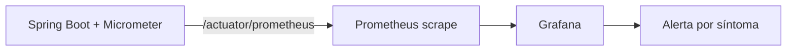
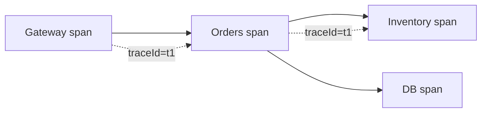
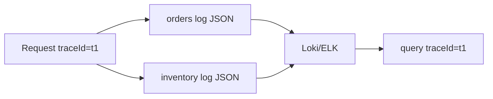
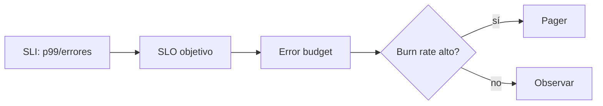

# Módulo 9 · Observabilidad en Spring

Tienda Aurora tiene 5 microservicios en producción. Cuando un usuario reporta que "el checkout falló", los logs locales de cada servicio no bastan para reconstruir qué pasó. Necesitas responder tres preguntas: qué está pasando (métricas), dónde está pasando (trazas) y por qué pasó (logs correlacionados). Necesitas responder tres preguntas: qué está pasando (métricas), dónde está pasando (trazas) y por qué pasó (logs correlacionados). Este módulo construye observabilidad con Micrometer, OpenTelemetry, logs estructurados y SLOs.

**Entorno de referencia verificado (2026-05-22):** JDK 27.0.1.0.2. Los smokes validan lógica de contadores, propagación de traceId, logs JSON y alertas por SLO en Java puro. Prometheus, Grafana, OTel Collector, Tempo/Loki y Spring Boot Actuator reales requieren infraestructura; se incluyen **Notas de verificación** honestas.

## Aprende construyendo

### Tema 1: Micrometer y Prometheus · Intermedio · 150 min

`catalog-service` empieza a responder lento después de un despliegue. El equipo revisa CPU y memoria: parecen normales. Los usuarios se quejan, pero nadie puede decir cuántas requests fallan, cuál endpoint es lento ni si el problema empezó antes o después del despliegue. Sin métricas, la discusión se vuelve opinión.

Las métricas son el tablero de instrumentos de un avión. No te dicen la causa raíz de todo, pero te dicen si estás perdiendo altitud, velocidad o combustible. **RED** (Rate, Errors, Duration) mide la experiencia del servicio; **USE** (Utilization, Saturation, Errors) mide recursos. Micrometer es la fachada que expone métricas; Prometheus las recolecta; Grafana las visualiza.



**Archivo:** `Metrics.java` → contador mínimo por status.

```java
import java.util.*;
public class Metrics {
  static Map<String, Integer> counter = new HashMap<>();
  static void inc(String key) { counter.put(key, counter.getOrDefault(key, 0) + 1); }
  public static void main(String[] args) {
    inc("200"); inc("500"); inc("200");
    System.out.println(counter.get("200"));
    System.out.println(counter.get("500"));
  }
}
```

**Archivo:** `application.yml` → exponer Prometheus en Spring Boot.

```yaml
management:
  endpoints:
    web:
      exposure:
        include: health,info,prometheus
  metrics:
    tags:
      application: catalog-service
```

**Archivo:** instrumentación.

```java
@RestController
class CatalogController {
  private final Counter hits;
  CatalogController(MeterRegistry registry) {
    this.hits = registry.counter("catalog.cache.hit", "cache", "redis");
  }
  @GetMapping("/products/{id}")
  ProductDto get(@PathVariable String id) {
    hits.increment();
    return service.get(id);
  }
}
```

**Lectura:** usa `counter` para acumulados, `timer` para latencia, `gauge` para estado actual. Los tags deben tener baja cardinalidad: `status=200` sí, `userId=...` no.

1. Incrementa dos `200` y un `500`. Esperas `2` y `1`.
2. Agrega un tag con `userId`. En Prometheus, la cardinalidad crece por usuario y degrada el TSDB. Evítalo.
3. Mide p95/p99 con histogramas, no solo promedio. Un promedio de 100ms puede esconder 1% de requests a 5s.

Salida esperada:

```text
2
1
```

Las métricas dieron visibilidad inmediata. No explican por sí solas la causa raíz, pero permiten detectar síntomas, acotar impacto y alertar con criterio.

**Cuándo usarlo / cuándo no.** Usa métricas RED/USE en todo servicio productivo. No uses labels de alta cardinalidad. No alertes por cada métrica interna sin impacto al usuario.

| Tipo | Cuándo | Cuándo NO |
|---|---|---|
| Counter | Eventos acumulados: requests, errores, cache hits | Valores que suben y bajan |
| Gauge | Estado actual: conexiones, cola, tamaño | Acumulados históricos |
| Timer/Histogram | Latencia, tamaño, duración | Cardinalidad alta por label |

**Error común.** Label con alta cardinalidad (`userId`, `orderId`). **Síntoma.** Prometheus se degrada o se vuelve costoso. **Causa.** cada valor crea una serie temporal. **Arreglo.** labels bajos en cardinalidad; detalle por request va a traces/logs. **Señal observable.** series activas crecen sin límite.

**Pregunta de entrevista.** ¿Por qué p99 es más útil que el promedio para latencia?  
**Respuesta modelo.** El promedio oculta outliers: puedes tener promedio 100ms mientras el 1% de usuarios espera 5 segundos. p99 muestra la experiencia de la cola lenta y suele correlacionar mejor con quejas reales, timeouts y saturación.

**Transferencia.**

1. **[NO-USAR-X]** Usar `userId` como label Prometheus. Respuesta: **No usar alta cardinalidad** en métricas; mover ese detalle a logs/traces.
2. Diseña 4 métricas RED para `orders-service`.
3. ¿Cuándo usarías gauge en lugar de counter?

#### Definición formal

Micrometer es una fachada de métricas para JVM. Prometheus recolecta métricas por scrape. Las métricas representan agregados numéricos en el tiempo.

#### Contrato / internals

- **Counter:** monotónico, se reinicia en restart.
- **Gauge:** valor actual.
- **Timer/Histogram:** distribución; permite p95/p99.
- **Labels/tags:** baja cardinalidad.
- **Scrape:** `/actuator/prometheus` expone formato Prometheus.

#### Ejemplo mínimo ejecutable

```bash
javac Metrics.java
java Metrics
```

Salida esperada:

```text
2
1
```

#### Caso real

`catalog-service` expone `http.server.requests`, `cache.hit` y latencia p99. El dashboard muestra el pico de 500 tras el deploy.

#### Verificación

Smoke Java ejecutado localmente (2026-05-22, JDK 27.0.1.0.2): `2`, `1`.

**Nota de verificación:** no se ejecutó Prometheus/Grafana real. Verificación propuesta: Spring Boot Actuator + Prometheus scrape + consulta PromQL.

### Tema 2: OpenTelemetry por defecto: métricas, trazas y logs correlacionados · Avanzado · 150 min

Una compra falla con 500. El log de `gateway` dice timeout, el de `orders` dice error al llamar inventory, y el de `inventory` dice consulta lenta a DB. Están en tres servicios, tres formatos y tres relojes. Reconstruir la historia lleva 40 minutos.

Una traza distribuida es como el número de seguimiento de un paquete. Cada oficina por donde pasa el paquete sella el mismo número. Puedes ver el recorrido completo, no solo el sello local. En OTel, ese número es el `traceId`; cada sello es un `span`.



**Archivo:** `Trace.java` → correlación por traceId.

```java
import java.util.*;
public class Trace {
  static Map<String, String> span(String traceId, String name) {
    return Map.of("traceId", traceId, "name", name);
  }
  public static void main(String[] args) {
    var root = span("t1", "http");
    var child = span(root.get("traceId"), "db");
    System.out.println(root.get("traceId").equals(child.get("traceId")));
    System.out.println(child.get("name"));
  }
}
```

**Archivo:** configuración conceptual Spring Boot/OTel.

```yaml
management:
  tracing:
    sampling:
      probability: 1.0
otel:
  exporter:
    otlp:
      endpoint: http://localhost:4317
```

**Lectura:** el `traceId` se propaga por headers W3C `traceparent`. Cada servicio crea spans hijos. El collector recibe OTLP y exporta a Tempo/Jaeger.

1. Crea root y child con el mismo `traceId`. Esperas `true`.
2. Omite la propagación de contexto entre servicios. Esperas spans huérfanos con traceIds distintos.
3. Agrega un atributo `db.statement` sensible. Observa el riesgo: redáctalo.

Salida esperada:

```text
true
db
```

La traza conectó la falla end-to-end. Ganaste visibilidad; pagaste costo de instrumentación, sampling y backend de observabilidad.

**Cuándo usarlo / cuándo no.** Usa OTel en todo sistema multi-servicio o con latencia difícil de explicar. No uses trazas para guardar datos sensibles sin redacción. No confundas instrumentar con arreglar.

| Señal | Cuándo | Detalle |
|---|---|---|
| Métricas | Síntomas agregados | baja cardinalidad |
| Traces | Recorrido request | alta cardinalidad controlada por sampling |
| Logs | Evidencia detallada | correlacionar con traceId |

**Error común.** Trazas cortadas. **Síntoma.** spans huérfanos. **Causa.** no propagar `traceparent`. **Arreglo.** instrumentar clientes HTTP/mensajería y validar propagación. **Señal observable.** múltiples traces para una sola request.

**Pregunta de entrevista.** ¿Qué relación hay entre métricas, logs y trazas?  
**Respuesta modelo.** Las métricas muestran agregados y síntomas, como tasa de error o p99. Las trazas muestran el recorrido de una request específica entre servicios. Los logs dan detalle contextual de eventos. Correlacionados por `traceId`, permiten pasar de síntoma a causa con evidencia.

**Transferencia.**

1. **[NO-USAR-X]** Meter `userId` como tag de métrica para depurar una request. Respuesta: **No usar métricas para alta cardinalidad**; usar trace/log con control.
2. Una request pasa por HTTP y luego por Kafka. ¿Qué debes propagar?
3. ¿Qué sampling usarías en producción con alto volumen?

#### Definición formal

OpenTelemetry es un estándar para instrumentar, generar, recolectar y exportar telemetría (traces, metrics, logs). Un trace es un conjunto de spans correlacionados por `traceId`.

#### Contrato / internals

- **Context propagation:** W3C `traceparent`/`tracestate`.
- **Span:** nombre, duración, status, atributos, eventos, parent.
- **OTLP:** protocolo de exportación al collector.
- **Sampling:** controla volumen/costo.
- **Límite:** spans sin propagación quedan huérfanos.

#### Ejemplo mínimo ejecutable

```bash
javac Trace.java
java Trace
```

Salida esperada:

```text
true
db
```

#### Caso real

Gateway crea span raíz; orders crea hijo para DB y para inventory. En Tempo se ve que inventory DB consumió 2.8s del total.

#### Verificación

Smoke Java ejecutado localmente (2026-05-22, JDK 27.0.1.0.2): `true`, `db`.

**Nota de verificación:** no se ejecutó OTel Collector/Tempo. Verificación propuesta: app Spring Boot instrumentada, collector OTLP y consulta de traza end-to-end.

### Tema 3: Logs estructurados y propagación de contexto · Intermedio · 120 min

Durante un incidente, el equipo busca “error pedido” en logs. Aparecen 12.000 líneas de cinco servicios. Nadie sabe cuáles pertenecen al usuario afectado. Los logs son texto libre, sin `traceId`, sin `service`, sin estructura.

Un log estructurado es como un formulario con campos, no una nota en servilleta. Si todos usan el mismo formulario, puedes filtrar por `traceId=t1`. Si cada uno escribe texto libre, dependes de suerte y `grep`.



**Archivo:** `Log.java` → log JSON mínimo.

```java
public class Log {
  static String json(String level, String msg, String trace) {
    return "{\"level\":\"" + level + "\",\"traceId\":\"" + trace + "\",\"msg\":\"" + msg + "\"}";
  }
  public static void main(String[] args) {
    String line = json("INFO", "created", "t1");
    System.out.println(line.contains("traceId"));
    System.out.println(line.contains("t1"));
  }
}
```

**Archivo:** `logback-spring.xml` (conceptual).

```xml
<configuration>
  <appender name="JSON" class="ch.qos.logback.core.ConsoleAppender">
    <encoder class="net.logstash.logback.encoder.LogstashEncoder"/>
  </appender>
  <root level="INFO"><appender-ref ref="JSON"/></root>
</configuration>
```

**Lectura:** en Spring, MDC guarda `traceId/spanId` por request. El encoder JSON los emite. Nunca loguees secretos, tokens o PII sin redacción.

1. Emite log con `traceId=t1`. Esperas `true`, `true`.
2. Emite logs sin `traceId`. Intenta reconstruir incidente: el costo de búsqueda explota.
3. Loguea un token por error. Observa el riesgo de seguridad; agrega redacción.

Salida esperada:

```text
true
true
```

Los logs estructurados no son más logs; son evidencia consultable. Con `traceId` y campos consistentes, el incidente se reconstruye en minutos.

**Cuándo usarlo / cuándo no.** Usa JSON estructurado y MDC en producción. No loguees secretos, tokens, passwords o payloads sensibles. No uses DEBUG masivo permanente en producción.

| Campo | Por qué | Riesgo si falta |
|---|---|---|
| timestamp | ordenar eventos | cronología confusa |
| level | severidad | ruido |
| service/env | origen | ambigüedad |
| traceId/spanId | correlación | búsqueda manual |
| event/msg | significado | log inútil |

**Error común.** Logs de texto libre sin IDs. **Síntoma.** no se puede reconstruir incidente. **Causa.** falta estructura y correlación. **Arreglo.** JSON + MDC + propagación traceId. **Señal observable.** depuración depende de `grep` manual.

**Pregunta de entrevista.** ¿Por qué logs estructurados en microservicios?  
**Respuesta modelo.** Porque permiten consultar y correlacionar eventos entre servicios con campos consistentes, especialmente `traceId`. En texto libre, cada servicio formatea distinto y la reconstrucción de incidentes se vuelve lenta y frágil.

**Transferencia.**

1. **[NO-USAR-X]** Loguear `Authorization: Bearer ...` en INFO. Respuesta: **No usar logs para secretos**; redactar.
2. ¿Qué campos mínimos exigirías en todos los servicios?
3. ¿Cómo correlacionas log con trace en Grafana/Loki/Tempo?

#### Definición formal

Logging estructurado emite registros con campos consistentes y consultables. La correlación conecta eventos por identificadores compartidos como `traceId`.

#### Contrato / internals

- **MDC:** contexto por request/hilo.
- **Formato:** JSON o key-value estable.
- **Redacción:** secretos/PII fuera.
- **Niveles:** usar con intención.
- **Correlación:** traceId/spanId/requestId.

#### Ejemplo mínimo ejecutable

```bash
javac Log.java
java Log
```

Salida esperada:

```text
true
true
```

#### Caso real

Filtro HTTP pone `traceId` en MDC. Todos los servicios loguean JSON con el mismo campo. El equipo filtra `traceId=t1` y ve la cadena completa.

#### Verificación

Smoke Java ejecutado localmente (2026-05-22, JDK 27.0.1.0.2): `true`, `true`.

**Nota de verificación:** no se ejecutó Logback JSON/Loki/ELK. Verificación propuesta: emitir logs en entorno con Loki y consultar por `traceId`.

### Tema 4: SLO, p99 y alerting · Intermedio · 120 min

El equipo tiene 200 alertas al día: CPU alta, GC, un pod reinició, latencia de un endpoint interno. Nadie las mira. El día que el checkout falla para usuarios reales, la alerta importante queda enterrada en ruido. Esto es alert fatigue.

Un SLO es como un acuerdo de servicio con el usuario: “el 99.9% de checkouts responden en menos de 300ms”. El error budget es cuánto puedes fallar sin romper el acuerdo. Alertar por burn rate es avisar cuando estás gastando ese presupuesto demasiado rápido, no cuando una CPU sube por 30 segundos sin afectar a nadie.



**Archivo:** `Slo.java` → alerta por síntoma.

```java
public class Slo {
  static boolean page(int p99, double err) { return p99 > 300 || err > 0.01; }
  public static void main(String[] args) {
    System.out.println(page(200, 0.001));
    System.out.println(page(500, 0.001));
  }
}
```

**Archivo:** regla Prometheus (conceptual).

```yaml
groups:
- name: checkout-slo
  rules:
  - alert: CheckoutSLOBurnRateHigh
    expr: checkout_error_ratio > 0.01
    for: 5m
    labels: { severity: page }
```

**Lectura:** la alerta se dispara por impacto al usuario (latencia/errores), no por CPU aislada. CPU puede ser una señal secundaria de diagnóstico.

1. p99 200ms, error 0.1%. Esperas `false`.
2. p99 500ms. Esperas `true`.
3. CPU 95% pero p99 y errores normales. Esperas no paginar; solo observar.

Salida esperada:

```text
false
true
```

SLOs y alertas por síntoma reducen ruido y enfocan la respuesta en el usuario. El costo es definir SLIs correctos y mantenerlos.

**Cuándo usarlo / cuándo no.** Usa SLOs para servicios productivos. Alerta por burn rate/síntomas. No pagines por toda causa interna; usa dashboards para diagnóstico.

| Señal | Alertar | Solo diagnóstico |
|---|---|---|
| p99/error rate/SLO burn | Sí | No |
| CPU spike corto sin impacto | No | Sí |
| disco 95% con riesgo claro | Sí, según contexto | también |

**Error común.** Alert fatigue. **Síntoma.** alertas ignoradas. **Causa.** alertar por CPU/ruido sin impacto. **Arreglo.** alertas por síntoma/SLO, severidad y runbook. **Señal observable.** muchas páginas, pocas acciones.

**Pregunta de entrevista.** ¿Qué es un error budget y para qué sirve?  
**Respuesta modelo.** Es la cantidad de fallos/latencia permitida por el SLO en un periodo. Sirve para balancear velocidad y confiabilidad: si el budget se quema rápido, el equipo prioriza estabilidad; si sobra, puede asumir más riesgo de cambio.

**Transferencia.**

1. **[NO-USAR-X]** Paginar por cada spike de CPU de 10 segundos sin impacto en p99. Respuesta: **No usar alertas de causa como pager** sin síntoma.
2. Define un SLI y SLO para `GET /products/{id}`.
3. ¿Qué harías si el error budget se agota a mitad de mes?

#### Definición formal

SLI es un indicador medible. SLO es el objetivo sobre ese indicador. Error budget es la tolerancia al fallo. Alerting notifica cuando el síntoma o burn rate requiere acción.

#### Contrato / internals

- **SLI:** disponibilidad, latencia p99, tasa de error.
- **SLO:** objetivo por ventana temporal.
- **Burn rate:** velocidad de consumo del budget.
- **Runbook:** toda alerta paginable necesita acción clara.
- **Límite:** mala elección de SLI genera falsas alarmas o ceguera.

#### Ejemplo mínimo ejecutable

```bash
javac Slo.java
java Slo
```

Salida esperada:

```text
false
true
```

#### Caso real

SLO: 99.9% de `GET /products/{id}` < 300ms. Se alerta por burn rate alto; CPU alta queda como panel de diagnóstico.

#### Verificación

Smoke Java ejecutado localmente (2026-05-22, JDK 27.0.1.0.2): `false`, `true`.

**Nota de verificación:** no se ejecutó Prometheus/Alertmanager/Grafana real. Verificación propuesta: definir reglas de burn rate y simular fallos con load test.

Observabilidad no es “tener dashboards”: es poder explicar el comportamiento del sistema con evidencia. Métricas para síntomas, trazas para recorrido, logs para detalle, SLOs para decidir cuándo actuar.

## Checklist

- RED/USE medidos con baja cardinalidad.
- Traces propagados con W3C `traceparent`.
- Logs JSON con `traceId/spanId`.
- Alertas por síntoma/SLO, no por ruido.
- Nota de verificación honesta cuando falta infraestructura.
