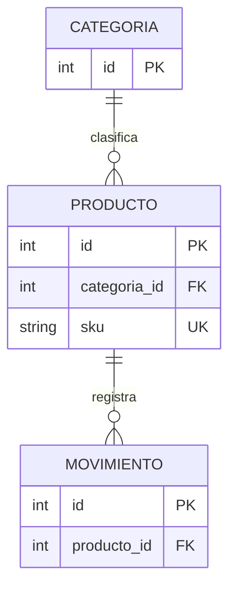
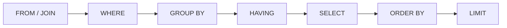
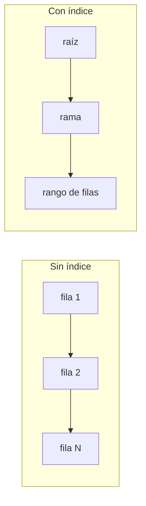
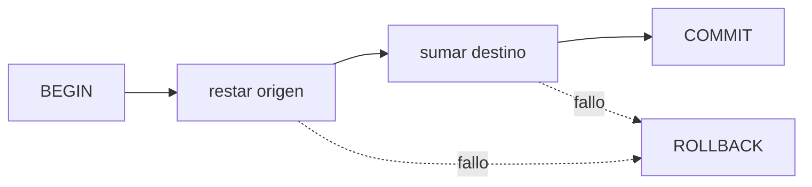
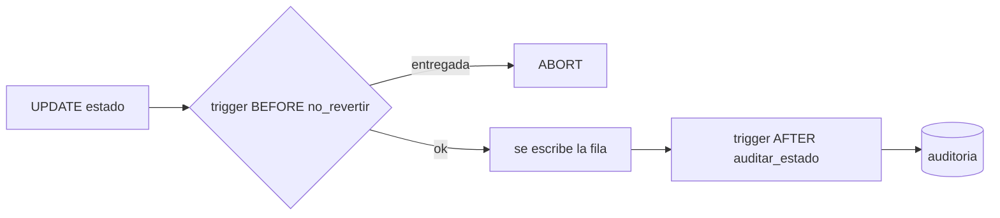
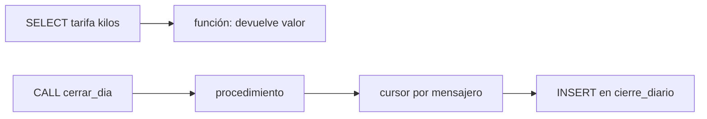
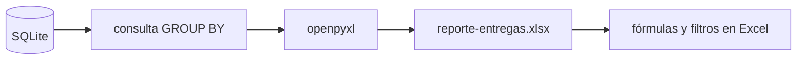

# Módulo 0: Modelado de datos, SQL y persistencia

> **Requisitos de este curso:** [Fundamentos](/curso/foundations). Lo que esos cursos enseñan aquí se usa sin volver a explicarlo; si algo no te suena, vuelve a su capítulo antes de seguir.

**Entorno comprobado para esta edición (2026-11-24):** Python 3.13.18 con SQLite 3.53.1 (módulo `sqlite3` de la biblioteca estándar) en Linux x86_64. El Tema 6 se ejecutó con `psql` contra PostgreSQL 16.15. El Tema 7 usa openpyxl 3.1.5 y LibreOffice 24.2.7 para recalcular fórmulas. Todas las salidas son literales de esas ejecuciones. Los comandos `docker` del Tema 6 no se ejecutaron en este entorno: el mismo archivo SQL se ejecutó con `psql` sobre un servidor local.

**Al terminar este módulo podrás:**
- modelar entidades y relaciones, y crear el esquema desde un archivo de migración;
- consultar con `SELECT` y `JOIN` usando parámetros;
- proteger los datos con restricciones y transacciones;
- medir el efecto de un índice;
- llevar una consulta SQL a un reporte de Excel.

**Qué necesitas saber antes:** Módulo 1 (variables, funciones, excepciones con `try`/`except`) y Módulo 2 (listas,
diccionarios y el inventario JSON del Proyecto 2).

## Aprende construyendo


### Tema 1: Del mundo real al modelo relacional · Intermedio · 60 min

<details open>
<summary><strong>Capa 1 — Lectura</strong></summary>

#### Objetivos
Al terminar este tema podrás:
- identificar entidades, atributos y relaciones en una situación de RutaFlow;
- traducir ese modelo a tablas con clave primaria y clave foránea en SQLite;
- comprobar si la base protege la integridad referencial al borrar un dato;
- explicar con una medición por qué un modelo normalizado evita datos contradictorios.

**Conceptos clave:** persistencia, base de datos relacional, SQL, conexión, entidad, atributo, relación, tabla, fila, columna, clave primaria, clave foránea, integridad referencial, normalización

#### El problema
El equipo de RutaFlow guarda sus tareas en un archivo JSON. Cada tarea repite el nombre y el color de su categoría.
Ayer alguien escribió «Trabajo» con mayúscula y el reporte mostró dos categorías distintas. Hoy borraron una
categoría y nadie supo qué pasó con sus tareas. ¿Cómo se organiza un dato para que exista en un solo lugar y nadie
pueda dejarlo huérfano?

#### Glosario del tema

**persistencia**
- **Definición técnica:** propiedad de un dato de sobrevivir al proceso que lo creó, porque quedó escrito en un almacenamiento no volátil (disco).
- **En palabras sencillas:** que el dato siga ahí mañana, aunque cierres el programa o apagues el computador.
- **Dónde se rompe la comparación:** escribir en disco no basta; si el programa falla a mitad de una escritura, el dato puede quedar a medias (Tema 4).
- **Ejemplo:** ejecutas el esquema de `modelo.py` sobre `rutaflow.db`, cierras el programa y en otra ejecución `SELECT COUNT(*) FROM tareas` devuelve `[(2,)]`.
- **Error típico:** usar `sqlite3.connect(":memory:")` y esperar encontrar los datos después: esa base vive solo en la memoria del proceso.

**base de datos relacional**
- **Definición técnica:** sistema que guarda los datos en tablas relacionadas por valores comunes y los consulta con SQL. SQLite es una que vive en un archivo.
- **En palabras sencillas:** un archivador con cajones (tablas) donde cada ficha puede apuntar a fichas de otro cajón.
- **Dónde se rompe la comparación:** el archivador no te impide guardar basura; la base sí puede rechazarla si declaras reglas.
- **Ejemplo:** `SELECT name FROM sqlite_master WHERE type = 'table'` sobre la base de `modelo.py` devuelve `[('categorias',), ('tareas',)]`.
- **Error típico:** tratar la base como una hoja de cálculo y meter todo en una sola tabla gigante.

**SQL**
- **Definición técnica:** lenguaje declarativo estándar para definir estructuras (`CREATE TABLE`), modificar datos (`INSERT`, `UPDATE`, `DELETE`) y consultarlos (`SELECT`).
- **En palabras sencillas:** el idioma en el que le pides cosas a la base: dices qué quieres, no cómo buscarlo.
- **Dónde se rompe la comparación:** cada motor tiene su dialecto; SQLite y PostgreSQL comparten la base del idioma pero no todos los detalles.
- **Ejemplo:** `SELECT * FROM categorias` devuelve `[(1, 'trabajo'), (2, 'personal')]`.
- **Error típico:** escribir mal el nombre de una tabla: `SELECT * FROM tarea` produce `sqlite3.OperationalError: no such table: tarea`.

**conexión**
- **Definición técnica:** objeto `sqlite3.Connection` que abre un archivo de base de datos (o una base en memoria) y ejecuta sentencias SQL sobre él con `execute`.
- **En palabras sencillas:** la línea telefónica abierta entre tu programa y la base; por ella mandas SQL y recibes filas.
- **Dónde se rompe la comparación:** una llamada se corta sola al colgar; una conexión debe cerrarse con `close()` o se queda abierta.
- **Ejemplo:** `sqlite3.connect(":memory:").execute("PRAGMA foreign_keys").fetchone()` devuelve `(0,)`: las claves foráneas vienen apagadas.
- **Error típico:** conectarse a `"rutaflow.db"` desde otra carpeta: SQLite crea un archivo vacío nuevo en vez de avisar.

**entidad**
- **Definición técnica:** cosa del dominio con identidad propia sobre la que el sistema guarda información; en el modelo relacional se representa con una tabla.
- **En palabras sencillas:** un sustantivo importante del negocio: tarea, categoría, mensajero, envío.
- **Dónde se rompe la comparación:** no todo sustantivo es entidad; «color» es una característica de la categoría, no una entidad.
- **Ejemplo:** la entidad Categoría vive en la tabla `categorias`; `SELECT COUNT(*) FROM categorias` devuelve `[(2,)]`.
- **Error típico:** crear una tabla por cada valor posible (`tareas_trabajo`, `tareas_personal`) en vez de una entidad con un atributo.

**atributo**
- **Definición técnica:** propiedad de una entidad que tiene un nombre y un tipo de dato; en la tabla se convierte en una columna.
- **En palabras sencillas:** un dato que describe a la entidad: el título de una tarea, el nombre de una categoría.
- **Dónde se rompe la comparación:** un atributo guarda un solo valor; una lista de valores pide otra tabla.
- **Ejemplo:** `SELECT nombre FROM categorias` devuelve `[('trabajo',), ('personal',)]`.
- **Error típico:** guardar varias cosas en un atributo, como `"azul,urgente"`, y luego no poder filtrar por una de ellas.

**relación**
- **Definición técnica:** asociación entre entidades con una cardinalidad, por ejemplo uno a muchos: una categoría agrupa muchas tareas y cada tarea tiene una categoría.
- **En palabras sencillas:** cómo se conectan las cosas: «esta tarea es de esta categoría».
- **Dónde se rompe la comparación:** en la base la relación no es una flecha: es un número guardado en una columna de la tabla «muchos».
- **Ejemplo:** `SELECT titulo FROM tareas WHERE categoria_id = 1` devuelve `[('Pagar factura',)]`, las tareas de la categoría 1.
- **Error típico:** poner la referencia en el lado equivocado: una columna `tarea_id` en `categorias` solo admite una tarea por categoría.

**tabla**
- **Definición técnica:** estructura con un nombre y un conjunto fijo de columnas tipadas que almacena filas; se crea con `CREATE TABLE`.
- **En palabras sencillas:** una cuadrícula con encabezados fijos; cada renglón es un registro.
- **Dónde se rompe la comparación:** a diferencia de una hoja de cálculo, las filas no tienen un orden garantizado si no lo pides.
- **Ejemplo:** `SELECT name, type FROM pragma_table_info('tareas')` devuelve `[('id', 'INTEGER'), ('titulo', 'TEXT'), ('categoria_id', 'INTEGER')]`.
- **Error típico:** crear dos veces la misma tabla: `table categorias already exists`; usa `CREATE TABLE IF NOT EXISTS` si el script se repite.

**fila**
- **Definición técnica:** registro de una tabla con un valor por cada columna; en Python, `sqlite3` la entrega como una tupla.
- **En palabras sencillas:** un renglón de la cuadrícula: una tarea concreta con todos sus datos.
- **Dónde se rompe la comparación:** una fila no se identifica por su posición, sino por su clave primaria.
- **Ejemplo:** `SELECT * FROM tareas WHERE id = 2` devuelve `[(2, 'Comprar pan', 2)]`.
- **Error típico:** confiar en «la tercera fila»: tras borrar o reordenar, la tercera ya es otra.

**columna**
- **Definición técnica:** atributo de una tabla con un nombre, un tipo declarado y reglas opcionales, presente en todas sus filas.
- **En palabras sencillas:** un encabezado de la cuadrícula y todos los valores que hay debajo.
- **Dónde se rompe la comparación:** SQLite admite que guardes texto en una columna `INTEGER` si no declaras `STRICT`; otros motores lo rechazan.
- **Ejemplo:** `SELECT titulo FROM tareas` devuelve `[('Pagar factura',), ('Comprar pan',)]`.
- **Error típico:** pedir una columna que no existe: `no such column: estatus`.

**clave primaria (PRIMARY KEY)**
- **Definición técnica:** columna (o conjunto de columnas) cuyo valor identifica de forma única cada fila y no puede repetirse.
- **En palabras sencillas:** la cédula de la fila: dos filas nunca tienen la misma.
- **Dónde se rompe la comparación:** la cédula la asigna el Estado; aquí, si no das un `id`, SQLite asigna el siguiente libre.
- **Ejemplo:** tras `INSERT INTO categorias(nombre) VALUES ('bodega')`, `SELECT last_insert_rowid()` devuelve `[(3,)]`.
- **Error típico:** repetir un `id` a mano: `INSERT INTO categorias(id, nombre) VALUES (1, 'otra')` produce `UNIQUE constraint failed: categorias.id`.

**clave foránea (FOREIGN KEY)**
- **Definición técnica:** columna que guarda la clave primaria de otra tabla y declara con `REFERENCES` que ese valor debe existir allí.
- **En palabras sencillas:** una nota que dice «esta tarea pertenece a la categoría número 1», con la promesa de que la 1 existe.
- **Dónde se rompe la comparación:** en SQLite la promesa solo se cumple si activas `PRAGMA foreign_keys = ON` en cada conexión.
- **Ejemplo:** con las claves activas, `INSERT INTO tareas(titulo, categoria_id) VALUES ('Llamar cliente', 99)` produce `FOREIGN KEY constraint failed`.
- **Error típico:** declarar `REFERENCES` y suponer que ya protege: sin el `PRAGMA`, SQLite acepta el 99 sin quejarse.

**integridad referencial**
- **Definición técnica:** garantía de que toda clave foránea apunta a una fila que existe; el motor la verifica al insertar, actualizar o borrar.
- **En palabras sencillas:** ninguna tarea queda señalando una categoría que ya no existe.
- **Dónde se rompe la comparación:** la base no adivina qué querías; rechaza el borrado, salvo que declares otra acción como `ON DELETE CASCADE`.
- **Ejemplo:** tras borrar la categoría 1 sin claves activas, `PRAGMA foreign_key_check` devuelve `[('tareas', 1, 'categorias', 0)]`: la tarea 1 quedó huérfana.
- **Error típico:** descubrir los huérfanos meses después, cuando un reporte cuenta tareas sin categoría.

**normalización**
- **Definición técnica:** proceso de diseño que reparte los atributos en tablas. Cada hecho se guarda una vez y depende solo de la clave de su tabla.
- **En palabras sencillas:** no copiar el mismo dato en muchos lugares; guardarlo una vez y apuntar a él.
- **Dónde se rompe la comparación:** normalizar no es partir todo en mil tablas; un reporte que solo se lee puede repetir datos a propósito.
- **Ejemplo:** cambiar el color de «trabajo» en `categorias` afecta `1` fila; en la tabla repetida afecta `2` y deja una fila vieja.
- **Error típico:** repetir texto escrito a mano («trabajo» y «Trabajo») y obtener dos categorías donde había una.

#### ► CÓMO FUNCIONA
Modelar es pasar de palabras a tablas en tres pasos. Primero subrayas los **sustantivos** que importan: son las
entidades. Después anotas qué dato describe a cada una: son los atributos. Al final, para cada par de entidades,
preguntas «¿cuántos de un lado van con uno del otro?»: esa es la relación.

Una relación uno a muchos se guarda poniendo una **clave foránea en la tabla del lado «muchos»**. En el
inventario de la bodega de RutaFlow, una categoría clasifica muchos productos y cada producto registra muchos
movimientos de entrada o salida:



Lee el diagrama así: `||` significa «exactamente uno» y `o{` significa «cero o muchos». `PK` marca la clave
primaria, `FK` la foránea y `UK` un valor único. En este tema usas `CREATE TABLE`, `INSERT` y `SELECT *` de forma
básica; el Tema 2 las explica a fondo.

#### Problema resuelto 1.1
Modela las tareas de RutaFlow con dos tablas relacionadas. Luego comprueba qué pasa al borrar una categoría que
todavía tiene tareas, con las claves foráneas apagadas y encendidas.

**Razonamiento:**
1. Entidades: Categoría y Tarea. Relación: una categoría tiene muchas tareas; cada tarea tiene una categoría.
2. La clave foránea va en `tareas` (el lado «muchos»): columna `categoria_id` que referencia `categorias(id)`.
3. Para comparar, ejecuta el mismo borrado dos veces: una sin `PRAGMA foreign_keys = ON` y otra con él.
4. Si la base protege la integridad, el segundo borrado debe fallar con `IntegrityError`.

```python
# modelo.py — categorías y tareas de RutaFlow con clave foránea
import sqlite3

ESQUEMA = """
CREATE TABLE categorias(
  id INTEGER PRIMARY KEY,
  nombre TEXT NOT NULL UNIQUE
);
CREATE TABLE tareas(
  id INTEGER PRIMARY KEY,
  titulo TEXT NOT NULL,
  categoria_id INTEGER NOT NULL REFERENCES categorias(id)
);
INSERT INTO categorias(nombre) VALUES ('trabajo'), ('personal');
INSERT INTO tareas(titulo, categoria_id) VALUES ('Pagar factura', 1), ('Comprar pan', 2);
"""


def probar_borrado(activar_claves):
    conexion = sqlite3.connect(":memory:")
    if activar_claves:
        conexion.execute("PRAGMA foreign_keys = ON")
    conexion.executescript(ESQUEMA)
    print("foreign_keys =", conexion.execute("PRAGMA foreign_keys").fetchone()[0])
    try:
        conexion.execute("DELETE FROM categorias WHERE nombre = 'trabajo'")
        print("  borrado aceptado; categorías:", conexion.execute("SELECT * FROM categorias").fetchall())
        print("  tareas:", conexion.execute("SELECT * FROM tareas").fetchall())
    except sqlite3.IntegrityError as error:
        print("  borrado rechazado:", error)
    conexion.close()


probar_borrado(activar_claves=False)
probar_borrado(activar_claves=True)
```

```text
$ python3 modelo.py
foreign_keys = 0
  borrado aceptado; categorías: [(2, 'personal')]
  tareas: [(1, 'Pagar factura', 1), (2, 'Comprar pan', 2)]
foreign_keys = 1
  borrado rechazado: FOREIGN KEY constraint failed
```

**Explicación por partes.**
- Líneas 5–8: la tabla `categorias` con su clave primaria `id` y un `nombre` que no puede faltar ni repetirse.
- Línea 12: `categoria_id` es la clave foránea; `REFERENCES categorias(id)` declara a qué apunta.
- Líneas 14–15: dos categorías y dos tareas; la tarea «Pagar factura» apunta a la categoría 1.
- Líneas 20–22: una base en memoria nueva por cada prueba; el `PRAGMA` se activa antes de crear las tablas.
- Primera prueba: el borrado se acepta y la tarea 1 sigue apuntando a una categoría 1 que ya no existe.
- Segunda prueba: con el `PRAGMA`, SQLite rechaza el borrado y la integridad se conserva.

> **Error común.** Declarar `REFERENCES` y creer que ya estás protegido. En SQLite las claves foráneas vienen
> apagadas: `PRAGMA foreign_keys` devuelve `0` y el borrado deja huérfanos sin ningún mensaje. Ejecuta
> `PRAGMA foreign_keys = ON` justo después de abrir cada conexión.

> **Buena práctica.** Nombra las tablas en plural (`tareas`) y las claves foráneas como `<entidad>_id`
> (`categoria_id`). Quien lee el esquema entiende la relación sin abrir el diagrama.

#### Problema resuelto 1.2
Compara un diseño que repite el nombre y el color de la categoría en cada tarea con uno normalizado. Cambia el
color de «trabajo» a morado en ambos y cuenta cuántas filas toca cada `UPDATE`.

**Razonamiento:**
1. En el diseño repetido, el color de «trabajo» vive en cada tarea de esa categoría.
2. En el normalizado, vive una sola vez en `categorias`; las tareas solo guardan el número.
3. `cursor.rowcount` dice cuántas filas cambió la última sentencia: esa es la medición.

```python
# normalizar.py — el mismo dato repetido contra el dato en un solo lugar
import sqlite3

conexion = sqlite3.connect(":memory:")
conexion.executescript("""
CREATE TABLE tareas_mal_disenadas(
  id INTEGER PRIMARY KEY,
  titulo TEXT,
  categoria_nombre TEXT,
  categoria_color TEXT
);
INSERT INTO tareas_mal_disenadas(titulo, categoria_nombre, categoria_color) VALUES
  ('Pagar factura', 'trabajo', 'azul'),
  ('Revisar ruta', 'trabajo', 'azul'),
  ('Cargar camión', 'Trabajo', 'azul'),
  ('Comprar pan', 'personal', 'verde');

CREATE TABLE categorias(id INTEGER PRIMARY KEY, nombre TEXT NOT NULL UNIQUE, color TEXT NOT NULL);
CREATE TABLE tareas(
  id INTEGER PRIMARY KEY,
  titulo TEXT NOT NULL,
  categoria_id INTEGER NOT NULL REFERENCES categorias(id)
);
INSERT INTO categorias(nombre, color) VALUES ('trabajo', 'azul'), ('personal', 'verde');
INSERT INTO tareas(titulo, categoria_id) VALUES
  ('Pagar factura', 1), ('Revisar ruta', 1), ('Cargar camión', 1), ('Comprar pan', 2);
""")

malo = conexion.execute(
    "UPDATE tareas_mal_disenadas SET categoria_color = 'morado' WHERE categoria_nombre = 'trabajo'"
)
print("diseño repetido: filas cambiadas =", malo.rowcount)
print(conexion.execute("SELECT titulo, categoria_nombre, categoria_color FROM tareas_mal_disenadas").fetchall())

bueno = conexion.execute("UPDATE categorias SET color = 'morado' WHERE nombre = 'trabajo'")
print("diseño normalizado: filas cambiadas =", bueno.rowcount)
print(conexion.execute("SELECT * FROM categorias").fetchall())
```

```text
$ python3 normalizar.py
diseño repetido: filas cambiadas = 2
[('Pagar factura', 'trabajo', 'morado'), ('Revisar ruta', 'trabajo', 'morado'), ('Cargar camión', 'Trabajo', 'azul'), ('Comprar pan', 'personal', 'verde')]
diseño normalizado: filas cambiadas = 1
[(1, 'trabajo', 'morado'), (2, 'personal', 'verde')]
```

**Explicación por partes.**
- Líneas 6–16: el diseño repetido; observa la línea 15, donde alguien escribió «Trabajo» con mayúscula.
- Líneas 18–26: el diseño normalizado; el color aparece una sola vez, en la línea 24.
- Líneas 29–32: el `UPDATE` cambia 2 filas y deja «Cargar camión» en azul: la base ahora se contradice.
- Líneas 35–36: el mismo cambio en el diseño normalizado toca 1 fila y todas las tareas lo ven.

> **Prevenir errores.** Si un `UPDATE` tiene que tocar muchas filas para cambiar **un** hecho, el modelo repite
> datos. Antes de crear una columna de texto, pregúntate si ese texto describe a otra entidad.

#### Checkpoint 1.1
En `modelo.py`, con las claves activas, ¿qué pasa si en lugar de borrar «trabajo» borras «personal»?

Respuesta: también se rechaza con `FOREIGN KEY constraint failed`, porque la tarea «Comprar pan» apunta a la
categoría 2. Solo se puede borrar una categoría sin tareas.

</details>

<details>
<summary><strong>Capa 2 — Construcción</strong></summary>

#### Paso 1 · Prepara la carpeta
Crea la carpeta del módulo y entra en ella:

```bash
mkdir -p fundamentos-sqlite/src
cd fundamentos-sqlite
```

#### Paso 2 · Dibuja el modelo
Escribe en papel las entidades Categoría, Producto y Movimiento, sus atributos y las dos relaciones uno a muchos.
Compáralo con el diagrama de «Cómo funciona».

#### Paso 3 · Comprueba la integridad
Guarda `modelo.py` en `src/`, ejecútalo con `python3 src/modelo.py` y confirma las dos líneas `foreign_keys`. La
segunda prueba debe terminar con `borrado rechazado: FOREIGN KEY constraint failed`.

#### Paso 4 · Agrega los movimientos
Añade al esquema una tabla `movimientos(id, producto_id, cantidad)` con `producto_id` como clave foránea hacia
`productos(id)`. Con las claves activas, inserta un movimiento del producto 99. Debes ver
`FOREIGN KEY constraint failed`.

#### Paso 5 · Mide la normalización
Ejecuta `normalizar.py` y anota los dos valores de `filas cambiadas`. Deben ser `2` y `1`.

#### Resumen
- La **persistencia** mantiene los datos después de cerrar el programa; una **base de datos relacional** los guarda en tablas.
- Una **entidad** se vuelve **tabla**; cada **atributo**, **columna**; cada registro, **fila**.
- La **clave primaria** identifica cada fila; la **clave foránea** guarda la clave de otra tabla y expresa la **relación**.
- La **integridad referencial** impide huérfanos, pero en SQLite exige `PRAGMA foreign_keys = ON` en cada **conexión**.
- La **normalización** guarda cada hecho una vez; se mide contando las filas que toca un `UPDATE`.

#### Ejercicio verificable 1
Básico. Crea `mensajeros(id, nombre)` y `envios(id, guia, mensajero_id)` con clave foránea. Inserta un mensajero y
dos envíos. Con las claves activas, inserta un envío con `mensajero_id = 7`.

Respuesta esperada: `sqlite3.IntegrityError: FOREIGN KEY constraint failed`. La clave foránea va en `envios`, el
lado «muchos» de la relación.

#### Ejercicio verificable 2
Intermedio. En `normalizar.py`, cambia el filtro del primer `UPDATE` por `WHERE lower(categoria_nombre) = 'trabajo'`.
¿Cuántas filas cambian ahora?

Respuesta esperada: `3`. `lower` convierte «Trabajo» a minúsculas y la fila olvidada entra en el cambio. Es un
parche: el diseño normalizado no necesita ese truco.

#### Ejercicio verificable 3
Reto. En una base sin claves activas, borra la categoría 1 de `modelo.py`, guarda el cambio con `commit()` y
ejecuta `PRAGMA foreign_key_check`. Explica cada valor de la fila que devuelve.

Respuesta esperada: `[('tareas', 1, 'categorias', 0)]`. Significa: en la tabla `tareas`, la fila con `id` 1 apunta
a `categorias` y rompe la clave foránea número 0 de esa tabla.

#### En el trabajo
Antes de escribir una sola línea de un backend, los equipos dibujan el modelo entidad-relación y lo revisan con
quien conoce el negocio. Un error de modelo es caro: cambiar dónde vive un dato con millones de filas exige una
migración. Por eso las empresas activan las claves foráneas desde el primer día y ejecutan `foreign_key_check`
antes de cada migración importante.

</details>

### Tema 2: SQL para definir, escribir, consultar y relacionar · Intermedio · 60 min

<details open>
<summary><strong>Capa 1 — Lectura</strong></summary>

#### Objetivos
Al terminar este tema podrás:
- crear un esquema desde un archivo de migración y aplicarlo una sola vez;
- insertar filas y consultarlas con `SELECT`, `WHERE` y `ORDER BY`;
- combinar tablas con `JOIN` y `LEFT JOIN` y resumirlas con `GROUP BY`;
- provocar una inyección SQL real y corregirla con una consulta parametrizada.

**Conceptos clave:** CREATE TABLE, INSERT, SELECT, WHERE, ORDER BY, JOIN, LEFT JOIN, GROUP BY, función de agregado, cursor, consulta parametrizada, inyección SQL, migración

#### El problema
La jefa de bodega de RutaFlow pide cada lunes dos datos. Primero, qué productos tienen menos de 5 unidades, con su
categoría. Segundo, cuántas unidades hay por categoría. Además, la pantalla de búsqueda recibe el SKU que escribe
cualquier usuario. ¿Cómo se piden esos datos a la base y cómo se evita que un texto malicioso cambie la consulta?

#### Glosario del tema

**CREATE TABLE**
- **Definición técnica:** sentencia DDL (lenguaje de definición de datos) que crea una tabla con sus columnas, tipos y restricciones.
- **En palabras sencillas:** la orden que dibuja la cuadrícula vacía con sus encabezados y sus reglas.
- **Dónde se rompe la comparación:** el dibujo queda guardado en la base; puedes leerlo después en `sqlite_master`.
- **Ejemplo:** `SELECT sql FROM sqlite_master WHERE name = 'categorias'` devuelve el texto `CREATE TABLE categorias (...)` que la creó.
- **Error típico:** ejecutar el script dos veces: la segunda falla con `table categorias already exists`.

**INSERT**
- **Definición técnica:** sentencia DML (manipulación de datos) que agrega filas a una tabla; las columnas omitidas toman su `DEFAULT` o `NULL`.
- **En palabras sencillas:** escribir un renglón nuevo en la cuadrícula.
- **Dónde se rompe la comparación:** un renglón en papel siempre entra; la base lo rechaza si rompe una regla.
- **Ejemplo:** `INSERT INTO productos(sku, nombre) VALUES ('H-30', 'Martillo')` agrega 1 fila y `stock` queda en `0` por su `DEFAULT`.
- **Error típico:** repetir un SKU: `UNIQUE constraint failed: productos.sku`.

**SELECT**
- **Definición técnica:** sentencia que lee datos y devuelve un conjunto de filas con las columnas pedidas, sin modificar la tabla.
- **En palabras sencillas:** la pregunta que le haces a la base; la respuesta es una tabla nueva y temporal.
- **Dónde se rompe la comparación:** sin `ORDER BY` el orden de la respuesta no está garantizado, aunque hoy salga ordenada.
- **Ejemplo:** `SELECT sku, nombre FROM productos` devuelve `[('A-10', 'Teclado'), ('A-11', 'Mouse'), ('E-20', 'Caja mediana'), ('E-21', 'Cinta'), ('S-99', 'Muestra')]`.
- **Error típico:** dejar una comilla sin cerrar: `WHERE nombre = 'Teclado` produce `unrecognized token: "'Teclado"`.

**WHERE**
- **Definición técnica:** cláusula que filtra las filas y conserva solo las que hacen verdadera una condición.
- **En palabras sencillas:** el colador: deja pasar las filas que cumplen la regla.
- **Dónde se rompe la comparación:** un colador no compara tipos; SQLite compara `stock = 'cuatro'` sin error y devuelve `[]`.
- **Ejemplo:** `SELECT sku FROM productos WHERE stock < 5 AND categoria_id = 1` devuelve `[('A-10',)]`.
- **Error típico:** comparar con `= NULL`; para buscar vacíos se usa `IS NULL`.

**ORDER BY**
- **Definición técnica:** cláusula que ordena el resultado por una o más expresiones, ascendente (`ASC`, por defecto) o descendente (`DESC`).
- **En palabras sencillas:** pedir la respuesta ordenada, de menor a mayor o al revés.
- **Dónde se rompe la comparación:** los `NULL` también se ordenan: en SQLite van primero con `ASC` y al final con `DESC`.
- **Ejemplo:** `SELECT sku, stock FROM productos ORDER BY stock DESC LIMIT 2` devuelve `[('E-21', 40), ('A-11', 12)]`.
- **Error típico:** ordenar números guardados como texto: `'12'` queda antes que `'4'`.

**JOIN (INNER JOIN)**
- **Definición técnica:** operación que combina filas de dos tablas cuando cumplen la condición `ON`; las filas sin pareja se descartan.
- **En palabras sencillas:** juntar cada producto con su categoría usando el número que comparten.
- **Dónde se rompe la comparación:** si un producto no tiene categoría, desaparece del resultado sin aviso.
- **Ejemplo:** `SELECT p.sku FROM productos p JOIN categorias c ON c.id = p.categoria_id` devuelve 4 filas; `S-99` no sale porque no tiene categoría.
- **Error típico:** usar `id` sin prefijo cuando ambas tablas lo tienen: `ambiguous column name: id`.

**LEFT JOIN**
- **Definición técnica:** combinación que conserva todas las filas de la tabla izquierda y rellena con `NULL` las columnas de la derecha cuando no hay pareja.
- **En palabras sencillas:** juntar productos con categorías sin perder los productos huérfanos.
- **Dónde se rompe la comparación:** un `WHERE` sobre la tabla derecha puede volver a esconder las filas con `NULL`.
- **Ejemplo:** `SELECT p.sku FROM productos p LEFT JOIN categorias c ON c.id = p.categoria_id WHERE c.id IS NULL` devuelve `[('S-99',)]`.
- **Error típico:** filtrar `WHERE c.nombre <> 'Empaque'`: devuelve `[('A-10',), ('A-11',)]` y pierde `S-99`, porque `NULL <> 'Empaque'` no es verdadero.

**GROUP BY**
- **Definición técnica:** cláusula que reúne las filas con el mismo valor en las columnas indicadas y produce una fila por grupo.
- **En palabras sencillas:** hacer montoncitos por categoría y luego contar o sumar cada montón.
- **Dónde se rompe la comparación:** los productos sin categoría forman su propio montón, con clave `NULL`.
- **Ejemplo:** `SELECT categoria_id, COUNT(*) FROM productos GROUP BY categoria_id` devuelve `[(None, 1), (1, 2), (2, 2)]`.
- **Error típico:** pedir una columna que no está agrupada (`sku`); SQLite no falla y devuelve un valor cualquiera del grupo.

**función de agregado**
- **Definición técnica:** función que recibe muchas filas y devuelve un solo valor: `COUNT`, `SUM`, `MIN`, `MAX`, `AVG`.
- **En palabras sencillas:** la calculadora que resume un montón en un número.
- **Dónde se rompe la comparación:** ignora los `NULL`: `COUNT(categoria_id)` no cuenta productos sin categoría.
- **Ejemplo:** `SELECT COUNT(*), SUM(stock), MIN(stock), MAX(stock), AVG(stock) FROM productos` devuelve `[(5, 60, 1, 40, 12.0)]`.
- **Error típico:** esperar `0` de un `SUM` sin filas: devuelve `NULL` (`None` en Python), como pasa con «Herramientas».

**cursor**
- **Definición técnica:** objeto `sqlite3.Cursor` que ejecuta una sentencia y entrega su resultado con `fetchone()` (una fila) o `fetchall()` (todas).
- **En palabras sencillas:** el dedo que recorre la respuesta renglón por renglón.
- **Dónde se rompe la comparación:** el dedo no vuelve atrás: después de leer una fila, `fetchone()` entrega la siguiente.
- **Ejemplo:** con `cursor = conexion.execute("SELECT sku FROM productos")`, dos `fetchone()` seguidos devuelven `('A-10',)` y `('A-11',)`.
- **Error típico:** llamar `fetchall()` dos veces y recibir `[]` la segunda, porque el cursor ya llegó al final.

**consulta parametrizada**
- **Definición técnica:** sentencia con marcadores `?` cuyos valores se envían aparte; el motor nunca interpreta esos valores como código SQL.
- **En palabras sencillas:** un formulario con casillas: el usuario llena la casilla, pero no puede reescribir el formulario.
- **Dónde se rompe la comparación:** los marcadores sirven para valores, no para nombres de tablas o columnas.
- **Ejemplo:** `conexion.execute("SELECT nombre FROM productos WHERE sku = ?", ("E-21",))` devuelve `[('Cinta',)]`.
- **Error típico:** pasar el texto sin tupla: `("A-10")` es un `str` de 4 letras y produce `Incorrect number of bindings supplied. The current statement uses 1, and there are 4 supplied.`.

**inyección SQL**
- **Definición técnica:** vulnerabilidad en la que un dato del usuario, unido como texto a la sentencia, cambia su estructura y su significado.
- **En palabras sencillas:** el usuario escribe en la casilla un pedazo de orden y la base le obedece.
- **Dónde se rompe la comparación:** no hace falta un «hacker»: un apellido con apóstrofo como O'Brien ya rompe la consulta concatenada.
- **Ejemplo:** con `sku = "x' OR '1'='1"`, la consulta concatenada devuelve todos los productos en vez de ninguno.
- **Error típico:** «limpiar» comillas a mano; la única defensa fiable es la consulta parametrizada.

**migración**
- **Definición técnica:** archivo versionado con las sentencias que llevan el esquema de una versión a la siguiente; se aplica una sola vez y queda registrado.
- **En palabras sencillas:** la receta numerada de cambios de la base: la 001 crea las tablas, la 002 agrega una columna.
- **Dónde se rompe la comparación:** una receta se puede repetir; una migración repetida falla o duplica datos, por eso se registra su versión.
- **Ejemplo:** tras aplicar `migracion_001.sql`, `PRAGMA user_version` devuelve `1` y la segunda ejecución la salta.
- **Error típico:** editar una migración ya aplicada en otro equipo; se escribe una migración nueva.

#### ► CÓMO FUNCIONA
Escribes `SELECT` primero, pero el motor no lo ejecuta primero. Lógicamente, la base arma las filas con `FROM` y
`JOIN`, las filtra con `WHERE` y las agrupa con `GROUP BY`. Después filtra grupos con `HAVING`, calcula las
columnas de `SELECT` y al final ordena y recorta:



Ese orden explica dos reglas. Un alias creado en `SELECT` (como `unidades`) sirve en `ORDER BY`, pero no en
`WHERE`. Y un filtro sobre un total (`SUM(...) > 10`) va en `HAVING`, porque en `WHERE` los grupos aún no existen.

#### Problema resuelto 2.1
Responde las dos preguntas de la jefa de bodega sobre un inventario con tres categorías y cinco productos. Uno de
ellos, `S-99`, no tiene categoría.

**Razonamiento:**
1. Stock bajo: filtrar `stock < 5` y traer el nombre de la categoría con un `JOIN`.
2. Para no perder `S-99`, el `JOIN` debe ser `LEFT JOIN`; se muestra también el `JOIN` simple para comparar.
3. Unidades por categoría: partir de `categorias`, unir sus productos, agrupar por categoría y sumar `stock`.

```python
# consultas.py — inventario de la bodega de RutaFlow
import sqlite3

conexion = sqlite3.connect(":memory:")
conexion.executescript("""
CREATE TABLE categorias (
  id INTEGER PRIMARY KEY,
  nombre TEXT NOT NULL UNIQUE
);
CREATE TABLE productos (
  id INTEGER PRIMARY KEY,
  sku TEXT NOT NULL UNIQUE,
  nombre TEXT NOT NULL,
  stock INTEGER NOT NULL DEFAULT 0 CHECK (stock >= 0),
  categoria_id INTEGER,
  FOREIGN KEY (categoria_id) REFERENCES categorias(id)
);
INSERT INTO categorias(nombre) VALUES ('Periféricos'), ('Empaque'), ('Herramientas');
INSERT INTO productos(sku, nombre, stock, categoria_id) VALUES
  ('A-10', 'Teclado', 4, 1),
  ('A-11', 'Mouse', 12, 1),
  ('E-20', 'Caja mediana', 3, 2),
  ('E-21', 'Cinta', 40, 2),
  ('S-99', 'Muestra', 1, NULL);
""")


def mostrar(titulo, sql):
    print("--", titulo)
    cursor = conexion.execute(sql)
    for fila in cursor.fetchall():
        print("  ", fila)


mostrar("Stock bajo con su categoría (LEFT JOIN)", """
SELECT p.sku, p.nombre, p.stock, c.nombre AS categoria
FROM productos AS p
LEFT JOIN categorias AS c ON c.id = p.categoria_id
WHERE p.stock < 5
ORDER BY p.stock ASC""")

mostrar("Stock bajo solo con categoría (JOIN)", """
SELECT p.sku, c.nombre
FROM productos AS p
JOIN categorias AS c ON c.id = p.categoria_id
WHERE p.stock < 5
ORDER BY p.sku""")

mostrar("Unidades por categoría (GROUP BY)", """
SELECT c.nombre, COUNT(p.id) AS productos, SUM(p.stock) AS unidades
FROM categorias c
LEFT JOIN productos p ON p.categoria_id = c.id
GROUP BY c.id, c.nombre
ORDER BY unidades DESC""")
```

```text
$ python3 consultas.py
-- Stock bajo con su categoría (LEFT JOIN)
   ('S-99', 'Muestra', 1, None)
   ('E-20', 'Caja mediana', 3, 'Empaque')
   ('A-10', 'Teclado', 4, 'Periféricos')
-- Stock bajo solo con categoría (JOIN)
   ('A-10', 'Periféricos')
   ('E-20', 'Empaque')
-- Unidades por categoría (GROUP BY)
   ('Empaque', 2, 43)
   ('Periféricos', 2, 16)
   ('Herramientas', 0, None)
```

**Explicación por partes.**
- Líneas 6–17: el esquema de la bodega; la línea 14 da `stock` por defecto 0 y prohíbe negativos.
- Líneas 18–24: los datos de prueba; la línea 24 inserta `S-99` con `categoria_id` en `NULL`.
- Líneas 28–32: `mostrar` ejecuta la consulta, recibe un cursor y recorre todas sus filas.
- Líneas 36–40: `LEFT JOIN` conserva `S-99` con categoría `None`; `ORDER BY` pone primero el stock más bajo.
- Líneas 43–47: el `JOIN` simple descarta `S-99`: solo salen dos productos.
- Líneas 50–54: «Herramientas» no tiene productos: `COUNT` da `0` y `SUM` da `None`, que `DESC` deja al final.

> **Error común.** Escribir `SELECT id, nombre FROM productos p JOIN categorias c ON c.id = p.categoria_id`.
> SQLite responde `sqlite3.OperationalError: ambiguous column name: id`, porque las dos tablas tienen `id`.
> Prefija cada columna con su alias: `p.id`, `c.nombre`.

> **Buena práctica.** Da un alias corto a cada tabla (`productos AS p`) y escribe cada cláusula en su propia
> línea. Una consulta de reporte se lee como un párrafo y se revisa cláusula por cláusula.

#### Problema resuelto 2.2
La búsqueda por SKU recibe el texto `x' OR '1'='1`. Compara la consulta armada con `+` y la parametrizada.

**Razonamiento:**
1. Con `+`, el texto del usuario se pega dentro de las comillas y cierra la comilla antes de tiempo.
2. La sentencia resultante es `... WHERE sku = 'x' OR '1'='1'`, y `'1'='1'` siempre es verdadero.
3. Con `?`, el texto completo es un valor: se busca un SKU que se llame literalmente así.

```python
# inyeccion.py — texto concatenado contra consulta parametrizada
import sqlite3

conexion = sqlite3.connect(":memory:")
cursor = conexion.cursor()
cursor.execute("CREATE TABLE productos (sku TEXT, nombre TEXT)")
cursor.executemany("INSERT INTO productos VALUES (?, ?)", [("A-1", "lápiz"), ("B-2", "regla")])
sku = "x' OR '1'='1"  # entrada maliciosa escrita en un formulario

# Incorrecto: el texto del usuario se vuelve parte del SQL
cursor.execute("SELECT * FROM productos WHERE sku = '" + sku + "'")
print("concatenando:", cursor.fetchall())

# Correcto: el driver envía el SQL y el dato por separado
cursor.execute("SELECT * FROM productos WHERE sku = ?", (sku,))
print("parametrizado:", cursor.fetchall())
```

```text
$ python3 inyeccion.py
concatenando: [('A-1', 'lápiz'), ('B-2', 'regla')]
parametrizado: []
```

**Explicación por partes.**
- Línea 5: `conexion.cursor()` crea un cursor explícito; `cursor.execute` funciona igual que `conexion.execute`.
- Línea 7: `executemany` repite el mismo `INSERT` parametrizado para cada tupla de la lista.
- Línea 11: la concatenación entrega toda la tabla a quien no conocía ningún SKU.
- Línea 15: el marcador `?` y la tupla `(sku,)` devuelven `[]`: ningún producto tiene ese SKU.

> **Error común.** Pasar un solo parámetro sin coma: `execute("... WHERE sku = ?", "A-10")`. Python ve un texto de
> 4 caracteres y responde `sqlite3.ProgrammingError: Incorrect number of bindings supplied. The current statement
> uses 1, and there are 4 supplied.`. Escribe la tupla con coma: `("A-10",)`.

> **Prevenir errores.** Busca en tu proyecto `execute(` seguido de `+` o de una f-string. Cada coincidencia con
> datos externos es una inyección esperando un usuario creativo.

#### Checkpoint 2.1
En el Problema resuelto 2.1, ¿qué devuelve la tercera consulta si cambias `LEFT JOIN` por `JOIN`?

Respuesta: desaparece la fila de «Herramientas», porque no tiene productos con los que emparejarse. Quedan
`('Empaque', 2, 43)` y `('Periféricos', 2, 16)`.

</details>

<details>
<summary><strong>Capa 2 — Construcción</strong></summary>

#### Paso 1 · Prepara la carpeta
Crea la carpeta y entra en ella:

```bash
mkdir -p fundamentos-sql/src
cd fundamentos-sql
```

#### Paso 2 · Escribe la migración
Guarda el esquema en un archivo versionado. `PRAGMA user_version` es un número que SQLite guarda en la base: lo
usarás como versión del esquema.

```sql
-- migracion_001.sql — esquema inicial del inventario
CREATE TABLE categorias (
  id INTEGER PRIMARY KEY,
  nombre TEXT NOT NULL UNIQUE
);
CREATE TABLE productos (
  id INTEGER PRIMARY KEY,
  sku TEXT NOT NULL UNIQUE,
  nombre TEXT NOT NULL,
  stock INTEGER NOT NULL DEFAULT 0 CHECK (stock >= 0),
  categoria_id INTEGER REFERENCES categorias(id)
);
PRAGMA user_version = 1;
```

#### Paso 3 · Aplica la migración una sola vez
El programa lee la versión, aplica el archivo si hace falta y lista las tablas. Ejecútalo dos veces:

```python
# aplicar.py — aplica la migración 001 a inventario.db una sola vez
import sqlite3
from pathlib import Path

conexion = sqlite3.connect("inventario.db")
version = conexion.execute("PRAGMA user_version").fetchone()[0]
if version >= 1:
    print("migración 001 ya aplicada; versión", version)
else:
    conexion.executescript(Path("migracion_001.sql").read_text(encoding="utf-8"))
    print("migración 001 aplicada; versión", conexion.execute("PRAGMA user_version").fetchone()[0])
tablas = conexion.execute("SELECT name FROM sqlite_master WHERE type = 'table' ORDER BY name")
print("tablas:", [fila[0] for fila in tablas])
conexion.close()
```

```text
$ python3 aplicar.py
migración 001 aplicada; versión 1
tablas: ['categorias', 'productos']
$ python3 aplicar.py
migración 001 ya aplicada; versión 1
tablas: ['categorias', 'productos']
```

La segunda ejecución no vuelve a crear las tablas: por eso no aparece `table categorias already exists`.

#### Paso 4 · Consulta y defiende la búsqueda
Ejecuta `consultas.py` e `inyeccion.py` y compara tus salidas con las de los problemas resueltos. Luego cambia la
línea 11 de `inyeccion.py` por una consulta parametrizada y confirma que la salida `concatenando:` queda en `[]`.

#### Resumen
- `CREATE TABLE` define la estructura; `INSERT` agrega filas; una **migración** versionada aplica esos cambios una sola vez.
- `SELECT` lee; `WHERE` filtra filas; `ORDER BY` ordena; el motor los evalúa en un orden lógico distinto al escrito.
- `JOIN` descarta filas sin pareja; `LEFT JOIN` las conserva con `NULL`.
- `GROUP BY` forma grupos y cada **función de agregado** resume un grupo en un valor.
- Un **cursor** entrega las filas con `fetchone()` o `fetchall()`.
- La **consulta parametrizada** (`?` más una tupla) es la defensa contra la **inyección SQL**.

#### Ejercicio verificable 1
Básico. Sobre la base de `consultas.py`, pide los dos productos con más stock, de mayor a menor.

Respuesta esperada: `SELECT sku, stock FROM productos ORDER BY stock DESC LIMIT 2` devuelve `[('E-21', 40), ('A-11', 12)]`.

#### Ejercicio verificable 2
Intermedio. Escribe una consulta que liste los productos sin categoría usando `LEFT JOIN`.

Respuesta esperada: `SELECT p.sku FROM productos p LEFT JOIN categorias c ON c.id = p.categoria_id WHERE c.id IS NULL`
devuelve `[('S-99',)]`.

#### Ejercicio verificable 3
Reto. Escribe una búsqueda por parte del nombre que reciba el texto del usuario de forma segura. Pruébala con
`"ca"`.

Respuesta esperada: `conexion.execute("SELECT sku, nombre FROM productos WHERE nombre LIKE ? ORDER BY sku", ("%ca%",))`
devuelve `[('E-20', 'Caja mediana')]`. Los `%` van dentro del valor, nunca pegados al SQL.

#### En el trabajo
En un backend, cada pantalla de listado es un `SELECT` con `JOIN` y cada formulario termina en un `INSERT`
parametrizado. Las migraciones viven en el repositorio junto al código y una herramienta (Alembic, Flyway,
Liquibase) las aplica en orden en cada ambiente. La inyección SQL sigue en el OWASP Top 10: los revisores de código
rechazan cualquier `execute` con texto concatenado.

</details>

### Tema 3: Índices, restricciones y planes de consulta · Intermedio · 50 min

<details open>
<summary><strong>Capa 1 — Lectura</strong></summary>

#### Objetivos
Al terminar este tema podrás:
- declarar restricciones `NOT NULL`, `UNIQUE`, `CHECK` y `DEFAULT` y leer el error literal de cada una;
- crear un índice y comprobar con `EXPLAIN QUERY PLAN` el paso de `SCAN` a `SEARCH`;
- elegir el orden de las columnas de un índice compuesto según las consultas;
- medir el costo que cada índice agrega a las escrituras.

**Conceptos clave:** restricción, NOT NULL, UNIQUE, CHECK, DEFAULT, índice, EXPLAIN QUERY PLAN, SCAN y SEARCH, índice compuesto, selectividad

#### El problema
La tabla de tareas de RutaFlow ya tiene 10 000 filas y la pantalla «pendientes» tarda cada día más. Al mismo
tiempo, alguien cargó un producto sin nombre y otro con stock negativo. ¿Cómo se consigue que la base rechace los
datos imposibles y que encuentre rápido las 100 tareas pendientes entre 10 000?

#### Glosario del tema

**restricción**
- **Definición técnica:** regla declarada en el esquema que el motor verifica en cada `INSERT` y `UPDATE`; si se viola, la sentencia falla con `IntegrityError`.
- **En palabras sencillas:** un portero en la puerta de la tabla que revisa cada dato antes de dejarlo entrar.
- **Dónde se rompe la comparación:** el portero solo revisa lo que le dijiste; las reglas no declaradas no existen para él.
- **Ejemplo:** en `restricciones.py`, tres intentos inválidos fallan y `SELECT * FROM productos` sigue devolviendo solo `[(1, 'A-10', 'Teclado', 0)]`.
- **Error típico:** validar solo en Python; otro programa que escriba en la misma base se salta esa validación.

**NOT NULL**
- **Definición técnica:** restricción de columna que prohíbe el valor `NULL` (ausencia de valor).
- **En palabras sencillas:** «este dato es obligatorio».
- **Dónde se rompe la comparación:** un texto vacío `''` no es `NULL`; `NOT NULL` lo deja pasar.
- **Ejemplo:** `INSERT INTO productos(sku) VALUES ('A-11')` produce `NOT NULL constraint failed: productos.nombre`.
- **Error típico:** agregar después una columna obligatoria sin valor por defecto: `Cannot add a NOT NULL column with default value NULL`.

**UNIQUE**
- **Definición técnica:** restricción que impide que dos filas tengan el mismo valor en una columna o combinación de columnas; el motor crea un índice para comprobarla.
- **En palabras sencillas:** «no puede haber dos iguales».
- **Dónde se rompe la comparación:** distingue mayúsculas (`'a@x.co'` y `'A@x.co'` entran ambos) y admite varios `NULL`.
- **Ejemplo:** repetir `'A-10'` produce `UNIQUE constraint failed: productos.sku`.
- **Error típico:** comprobar en Python si el SKU existe y luego insertarlo: dos usuarios a la vez pasan la comprobación.

**CHECK**
- **Definición técnica:** restricción con una condición booleana que cada fila debe cumplir.
- **En palabras sencillas:** una regla de negocio escrita dentro de la tabla, como «el stock no baja de cero».
- **Dónde se rompe la comparación:** si la condición da `NULL`, el `CHECK` la acepta; combínalo con `NOT NULL`.
- **Ejemplo:** `UPDATE productos SET stock = -3 WHERE sku = 'A-10'` produce `CHECK constraint failed: stock >= 0`.
- **Error típico:** declarar `CHECK (stock >= 0)` sin `NOT NULL`: un `INSERT` con `stock` en `NULL` se acepta.

**DEFAULT**
- **Definición técnica:** valor que el motor asigna a una columna cuando el `INSERT` no la menciona.
- **En palabras sencillas:** el valor de fábrica que se usa si no dices nada.
- **Dónde se rompe la comparación:** si escribes `NULL` a propósito, el `DEFAULT` no se aplica.
- **Ejemplo:** `INSERT INTO productos(sku, nombre) VALUES ('A-10', 'Teclado')` guarda `stock` en `0`.
- **Error típico:** usar `DEFAULT` para tapar un dato que debía ser obligatorio.

**índice**
- **Definición técnica:** estructura auxiliar ordenada (un árbol B en SQLite) que asocia valores de una o más columnas con la ubicación de sus filas.
- **En palabras sencillas:** el índice alfabético al final de un libro: vas directo a la página sin leerlo entero.
- **Dónde se rompe la comparación:** el libro no cambia; la tabla sí, y cada cambio obliga a actualizar el índice.
- **Ejemplo:** tras `CREATE INDEX idx_tareas_estado ON tareas(estado)`, `SELECT name, tbl_name FROM sqlite_master WHERE type = 'index'` devuelve `[('idx_tareas_estado', 'tareas')]`.
- **Error típico:** crearlo dos veces: `index idx_tareas_estado already exists`; usa `CREATE INDEX IF NOT EXISTS` en migraciones.

**EXPLAIN QUERY PLAN**
- **Definición técnica:** prefijo que hace que SQLite no ejecute la consulta y devuelva, en cambio, el plan que usaría para resolverla.
- **En palabras sencillas:** preguntarle a la base «¿cómo vas a buscar esto?» antes de que lo busque.
- **Dónde se rompe la comparación:** el plan describe la estrategia, no mide el tiempo; para medir hay que ejecutar.
- **Ejemplo:** `EXPLAIN QUERY PLAN SELECT titulo FROM tareas WHERE id = 7` devuelve `SEARCH tareas USING INTEGER PRIMARY KEY (rowid=?)` en su cuarta columna.
- **Error típico:** leer la tupla completa en vez de la cuarta columna (`fila[3]`), que es la que trae el texto del plan.

**SCAN y SEARCH**
- **Definición técnica:** `SCAN` significa recorrer todas las filas de la tabla. `SEARCH` significa llegar a las filas pedidas por un índice o por la clave primaria.
- **En palabras sencillas:** leer el libro entero contra ir al índice y saltar a la página.
- **Dónde se rompe la comparación:** en tablas pequeñas un `SCAN` es tan rápido que no importa.
- **Ejemplo:** `WHERE lower(estado) = 'pendiente'` da `SCAN tareas` aunque exista `idx_tareas_estado`, porque el índice guarda `estado`, no `lower(estado)`.
- **Error típico:** crear el índice y no comprobar el plan: una función sobre la columna lo deja sin uso.

**índice compuesto**
- **Definición técnica:** índice sobre varias columnas, ordenado primero por la primera, luego por la segunda dentro de cada valor de la primera, y así sucesivamente.
- **En palabras sencillas:** una guía telefónica: ordenada por apellido y, dentro de cada apellido, por nombre.
- **Dónde se rompe la comparación:** buscar solo por nombre en la guía obliga a leerla entera; igual pasa con la segunda columna.
- **Ejemplo:** con `(categoria_id, stock)`, `WHERE categoria_id = 2 AND stock < 5` usa el índice, pero `WHERE stock < 5` da `SCAN productos`.
- **Error típico:** elegir el orden de las columnas al azar en vez de mirar qué filtran las consultas reales.

**selectividad**
- **Definición técnica:** proporción de filas que devuelve un filtro; un filtro muy selectivo devuelve una fracción pequeña de la tabla.
- **En palabras sencillas:** cuánto descarta el colador: cuanto menos deja pasar, más ayuda el índice.
- **Dónde se rompe la comparación:** la selectividad depende del valor buscado: «pendiente» es raro y «completada» es casi todo.
- **Ejemplo:** `SELECT estado, COUNT(*) * 100.0 / (SELECT COUNT(*) FROM tareas) FROM tareas GROUP BY estado` devuelve `[('completada', 99.0), ('pendiente', 1.0)]`.
- **Error típico:** indexar una columna con dos valores repartidos a medias: el índice casi nunca ahorra lecturas.

#### ► CÓMO FUNCIONA
Sin índice, para encontrar las tareas pendientes la base lee las 10 000 filas una por una. Con un índice sobre
`estado`, baja por un árbol ordenado desde la raíz hasta el rango donde empiezan las pendientes y solo lee esas
filas:



El índice no es gratis. Ocupa espacio y cada `INSERT`, `UPDATE` o `DELETE` debe actualizarlo. Las restricciones
`UNIQUE` y `PRIMARY KEY` crean su propio índice automático: por eso buscar por SKU ya es un `SEARCH`.

#### Problema resuelto 3.1
Declara las reglas del producto en la tabla e intenta tres cargas inválidas: sin nombre, con SKU repetido y con
stock negativo.

**Razonamiento:**
1. Cada regla de negocio se traduce en una restricción: nombre obligatorio, SKU único, stock no negativo.
2. Cada intento va en su propio `try` para ver el mensaje exacto de cada violación.
3. Al final se consulta la tabla: solo debe quedar la fila válida.

```python
# restricciones.py — la base rechaza datos que rompen las reglas
import sqlite3

conexion = sqlite3.connect(":memory:")
conexion.execute("""
CREATE TABLE productos (
  id INTEGER PRIMARY KEY,
  sku TEXT NOT NULL UNIQUE,
  nombre TEXT NOT NULL,
  stock INTEGER NOT NULL DEFAULT 0 CHECK (stock >= 0)
)""")
conexion.execute("INSERT INTO productos(sku, nombre) VALUES ('A-10', 'Teclado')")

intentos = [
    ("sin nombre", "INSERT INTO productos(sku) VALUES ('A-11')"),
    ("sku repetido", "INSERT INTO productos(sku, nombre) VALUES ('A-10', 'Otro teclado')"),
    ("stock negativo", "UPDATE productos SET stock = -3 WHERE sku = 'A-10'"),
]
for motivo, sql in intentos:
    try:
        conexion.execute(sql)
        print(f"{motivo}: aceptado")
    except sqlite3.IntegrityError as error:
        print(f"{motivo}: rechazado -> {error}")

print("filas guardadas:", conexion.execute("SELECT * FROM productos").fetchall())
```

```text
$ python3 restricciones.py
sin nombre: rechazado -> NOT NULL constraint failed: productos.nombre
sku repetido: rechazado -> UNIQUE constraint failed: productos.sku
stock negativo: rechazado -> CHECK constraint failed: stock >= 0
filas guardadas: [(1, 'A-10', 'Teclado', 0)]
```

**Explicación por partes.**
- Líneas 8–10: cada restricción se escribe junto a su columna; la línea 10 combina `NOT NULL`, `DEFAULT` y `CHECK`.
- Línea 12: el primer producto no menciona `stock`, así que el `DEFAULT` lo deja en `0`.
- Líneas 14–18: la lista de intentos guarda un motivo y la sentencia que lo provoca.
- Líneas 19–24: cada mensaje dice qué restricción falló y en qué columna, sin que escribas un solo `if`.

> **Error común.** Confiar en `CHECK` para datos ausentes. `INSERT INTO p(sku, stock) VALUES ('A-2', NULL)` en una
> tabla con `CHECK (stock >= 0)` y sin `NOT NULL` se acepta y guarda `None`. La comparación con `NULL` da `NULL`, y
> `CHECK` solo rechaza lo que da falso.

> **Buena práctica.** Declara las reglas en la base **y** valida en el programa. La base es la última línea de
> defensa; el programa da mensajes amables al usuario.

#### Problema resuelto 3.2
Mide cómo cambia el plan de la consulta de tareas pendientes al crear un índice sobre `estado`.

**Razonamiento:**
1. Crear 10 000 tareas donde solo 1 de cada 100 está pendiente: un filtro muy selectivo.
2. Pedir el plan con `EXPLAIN QUERY PLAN` antes y después del índice.
3. `ANALYZE` guarda estadísticas de la tabla para que el planificador decida con datos.

```python
# indice.py — plan de consulta antes y después de crear un índice
import sqlite3

conexion = sqlite3.connect(":memory:")
conexion.execute(
    "CREATE TABLE tareas (id INTEGER PRIMARY KEY, titulo TEXT NOT NULL, estado TEXT NOT NULL)"
)
conexion.executemany(
    "INSERT INTO tareas(titulo, estado) VALUES (?, ?)",
    (
        (f"Tarea {numero}", "pendiente" if numero % 100 == 0 else "completada")
        for numero in range(10_000)
    ),
)
conexion.commit()


def mostrar_plan(etiqueta):
    print(etiqueta)
    plan = conexion.execute(
        "EXPLAIN QUERY PLAN SELECT titulo FROM tareas WHERE estado = ?",
        ("pendiente",),
    )
    for fila in plan:
        print(f"  {fila[3]}")


mostrar_plan("Antes del índice:")
conexion.execute("CREATE INDEX idx_tareas_estado ON tareas(estado)")
conexion.execute("ANALYZE")
mostrar_plan("Después del índice:")
pendientes = conexion.execute("SELECT COUNT(*) FROM tareas WHERE estado = 'pendiente'").fetchone()[0]
print("pendientes:", pendientes, "de 10000")
conexion.close()
```

```text
$ python3 indice.py
Antes del índice:
  SCAN tareas
Después del índice:
  SEARCH tareas USING INDEX idx_tareas_estado (estado=?)
pendientes: 100 de 10000
```

**Explicación por partes.**
- Líneas 8–14: `executemany` inserta 10 000 filas desde un generador; cada número múltiplo de 100 es «pendiente».
- Líneas 18–25: `mostrar_plan` imprime la cuarta columna (`fila[3]`) de cada paso del plan.
- Línea 28: sin índice, el plan es `SCAN tareas`: lectura completa.
- Líneas 29–31: con el índice, el plan es `SEARCH ... USING INDEX idx_tareas_estado (estado=?)`.
- Líneas 32–33: el filtro devuelve 100 filas de 10 000, una selectividad del 1 %.

Ahora comprueba el orden de un índice compuesto con cuatro consultas:

```python
# compuesto.py — el orden de las columnas en un índice compuesto
import sqlite3

conexion = sqlite3.connect(":memory:")
conexion.execute("""
CREATE TABLE productos (
  id INTEGER PRIMARY KEY,
  sku TEXT NOT NULL UNIQUE,
  stock INTEGER NOT NULL,
  categoria_id INTEGER NOT NULL
)""")
conexion.execute("CREATE INDEX idx_productos_categoria_stock ON productos(categoria_id, stock)")

consultas = [
    "SELECT sku FROM productos WHERE categoria_id = 2 AND stock < 5",
    "SELECT sku FROM productos WHERE categoria_id = 2",
    "SELECT sku FROM productos WHERE stock < 5",
    "SELECT stock FROM productos WHERE sku = 'A-10'",
]
for sql in consultas:
    plan = conexion.execute("EXPLAIN QUERY PLAN " + sql).fetchall()
    print(sql)
    print("  ->", plan[0][3])
```

```text
$ python3 compuesto.py
SELECT sku FROM productos WHERE categoria_id = 2 AND stock < 5
  -> SEARCH productos USING INDEX idx_productos_categoria_stock (categoria_id=? AND stock<?)
SELECT sku FROM productos WHERE categoria_id = 2
  -> SEARCH productos USING INDEX idx_productos_categoria_stock (categoria_id=?)
SELECT sku FROM productos WHERE stock < 5
  -> SCAN productos
SELECT stock FROM productos WHERE sku = 'A-10'
  -> SEARCH productos USING INDEX sqlite_autoindex_productos_1 (sku=?)
```

La tercera consulta filtra solo por `stock`, la segunda columna del índice: el plan vuelve a `SCAN`. La cuarta usa
`sqlite_autoindex_productos_1`, el índice que SQLite creó solo por el `UNIQUE` de `sku`.

Cada índice se actualiza en cada escritura. Este programa inserta 200 000 filas con 0, 1 y 3 índices y mide el
tiempo:

```python
# costo_indices.py — cada índice extra se actualiza en cada INSERT
import sqlite3
import time


def medir_insercion(cantidad_indices):
    conexion = sqlite3.connect(":memory:")
    conexion.execute("CREATE TABLE envios (id INTEGER PRIMARY KEY, guia TEXT, zona TEXT, kilos REAL)")
    columnas = ["guia", "zona", "kilos"][:cantidad_indices]
    for columna in columnas:
        conexion.execute(f"CREATE INDEX idx_{columna} ON envios({columna})")
    filas = [(f"RF-{n}", f"Z{n % 7}", n % 30 + 0.5) for n in range(200_000)]
    inicio = time.perf_counter()
    conexion.executemany("INSERT INTO envios(guia, zona, kilos) VALUES (?, ?, ?)", filas)
    conexion.commit()
    return time.perf_counter() - inicio


for indices in (0, 1, 3):
    print(f"{indices} índices: {medir_insercion(indices):.2f} s para 200000 filas")
```

```text
$ python3 costo_indices.py
0 índices: 0.11 s para 200000 filas
1 índices: 0.22 s para 200000 filas
3 índices: 0.47 s para 200000 filas
```

> **Rendimiento.** En esta ejecución, tres índices multiplicaron el tiempo de inserción por más de cuatro. Tus números
> cambiarán según la máquina, pero la proporción se repite: crea solo los índices que alguna consulta usa.

#### Checkpoint 3.1
En `indice.py`, ¿qué plan obtienes si la consulta fuera `WHERE titulo = 'Tarea 5'`?

Respuesta: `SCAN tareas`. El índice está sobre `estado`, no sobre `titulo`; para esa búsqueda haría falta
`CREATE INDEX idx_tareas_titulo ON tareas(titulo)`.

</details>

<details>
<summary><strong>Capa 2 — Construcción</strong></summary>

#### Paso 1 · Prepara la carpeta
Crea la carpeta del ejemplo y entra en ella:

```bash
mkdir -p ejemplo-indice && cd ejemplo-indice
```

#### Paso 2 · Provoca cada restricción
Guarda y ejecuta `restricciones.py`. Debes ver tres líneas `rechazado` con los mensajes `NOT NULL`, `UNIQUE` y
`CHECK`, y una sola fila guardada.

#### Paso 3 · Compara los planes
Guarda `indice.py` y ejecútalo con `python3 indice.py`. Confirma el paso de `SCAN tareas` a
`SEARCH tareas USING INDEX idx_tareas_estado (estado=?)`.

#### Paso 4 · Prueba el orden del índice compuesto
Ejecuta `compuesto.py`. Después agrega `CREATE INDEX idx_productos_stock ON productos(stock)` antes del ciclo y
vuelve a ejecutarlo: la tercera consulta debe cambiar a `SEARCH`.

#### Paso 5 · Mide el costo
Ejecuta `costo_indices.py` dos veces y anota los tiempos. Comprueba que el orden se mantiene: 0 índices es lo más
rápido y 3 índices lo más lento.

#### Resumen
- Una **restricción** hace que la base rechace datos inválidos con `IntegrityError` y un mensaje literal.
- `NOT NULL` exige valor; `UNIQUE` prohíbe repetidos; `CHECK` exige una condición; `DEFAULT` rellena lo omitido.
- Un **índice** acelera búsquedas y cuesta en escrituras y espacio.
- `EXPLAIN QUERY PLAN` muestra si la consulta hace **SCAN** (todo) o **SEARCH** (por índice).
- En un **índice compuesto** importa el orden: sirve para filtrar por la primera columna, sola o con las siguientes.
- La **selectividad** indica cuánto ayuda un índice: cuanto menos filas devuelve el filtro, mejor.

#### Ejercicio verificable 1
Básico. Sobre la tabla de `restricciones.py`, intenta `INSERT INTO productos(sku, nombre, stock) VALUES ('A-12', 'Mouse', -1)`.

Respuesta esperada: `sqlite3.IntegrityError: CHECK constraint failed: stock >= 0`.

#### Ejercicio verificable 2
Intermedio. En una tabla `tareas` vacía con la estructura de `indice.py`, pide el plan de
`SELECT estado FROM tareas WHERE titulo = 'Tarea 5'`, crea `idx_tareas_titulo` y pídelo otra vez.

Respuesta esperada: primero `SCAN tareas`; después `SEARCH tareas USING INDEX idx_tareas_titulo (titulo=?)`.

#### Ejercicio verificable 3
Reto. En `compuesto.py`, logra que `WHERE stock < 5` use un índice sin borrar el compuesto. ¿Qué plan obtienes?

Respuesta esperada: con `CREATE INDEX idx_productos_stock ON productos(stock)`, el plan es
`SEARCH productos USING INDEX idx_productos_stock (stock<?)`. Ahora cada escritura actualiza un índice más.

#### En el trabajo
En una empresa, la consulta lenta se diagnostica con el plan, no con intuición: `EXPLAIN` en SQLite, `EXPLAIN
ANALYZE` en PostgreSQL. Los equipos revisan los índices en cada migración y borran los que ninguna consulta usa,
porque frenan las escrituras. Las restricciones evitan los incidentes más caros: datos imposibles que ya se
facturaron o se despacharon.

</details>

### Tema 4: Transacciones, concurrencia y elección SQL/NoSQL · Intermedio · 60 min

<details open>
<summary><strong>Capa 1 — Lectura</strong></summary>

#### Objetivos
Al terminar este tema podrás:
- agrupar varias escrituras en una transacción con `BEGIN`, `COMMIT` y `ROLLBACK`;
- demostrar que un fallo a mitad de camino deja la base exactamente como estaba;
- reproducir el error `database is locked` cuando dos conexiones escriben a la vez;
- decidir con criterios concretos cuándo un dato va en tablas y cuándo en un documento.

**Conceptos clave:** transacción, BEGIN, COMMIT, ROLLBACK, atomicidad, ACID, modo autocommit, concurrencia, bloqueo, NoSQL

#### El problema
RutaFlow traslada mercancía entre la bodega Norte y la Sur. Un traslado son dos escrituras: restar en el origen y
sumar en el destino. Si el programa falla entre las dos, desaparecen unidades. Y si dos cajeros mueven el mismo
producto a la vez, ¿quién gana? Necesitas que las dos escrituras ocurran juntas o no ocurran.

#### Glosario del tema

**transacción**
- **Definición técnica:** unidad de trabajo formada por una o más sentencias que la base aplica completa o descarta completa.
- **En palabras sencillas:** un paquete de cambios con la regla «todo o nada».
- **Dónde se rompe la comparación:** mientras no confirmas, los otros usuarios siguen viendo los datos viejos.
- **Ejemplo:** en `mover_stock.py`, el traslado fallido hacia el destino 99 deja `[(1, 'Norte', 6), (2, 'Sur', 4)]`, igual que antes.
- **Error típico:** hacer cada `UPDATE` por separado: si el segundo falla, el primero ya quedó guardado.

**BEGIN**
- **Definición técnica:** sentencia que abre una transacción explícita; los cambios siguientes quedan pendientes hasta `COMMIT` o `ROLLBACK`.
- **En palabras sencillas:** «a partir de aquí, nada es definitivo».
- **Dónde se rompe la comparación:** no se pueden anidar: dentro de una transacción no puedes abrir otra.
- **Ejemplo:** tras `BEGIN`, `conexion.in_transaction` pasa de `False` a `True`.
- **Error típico:** ejecutar `BEGIN` dos veces: `cannot start a transaction within a transaction`.

**COMMIT**
- **Definición técnica:** sentencia que confirma la transacción: sus cambios se vuelven permanentes y visibles para las demás conexiones.
- **En palabras sencillas:** firmar el paquete de cambios.
- **Dónde se rompe la comparación:** una firma se puede impugnar; un `COMMIT` no se deshace, solo se corrige con otra transacción.
- **Ejemplo:** `BEGIN`, `UPDATE productos SET stock = 8 WHERE id = 2`, `COMMIT` y luego `SELECT stock FROM productos WHERE id = 2` devuelve `(8,)`.
- **Error típico:** `COMMIT` sin transacción abierta: `cannot commit - no transaction is active`.

**ROLLBACK**
- **Definición técnica:** sentencia que descarta todos los cambios de la transacción abierta y devuelve la base al estado anterior a `BEGIN`.
- **En palabras sencillas:** romper el paquete sin abrirlo.
- **Dónde se rompe la comparación:** solo deshace lo que hizo la base; un correo enviado desde Python ya salió.
- **Ejemplo:** `BEGIN`, `UPDATE productos SET stock = 0 WHERE id = 1` muestra `(0,)`; tras `ROLLBACK` vuelve a `(7,)`.
- **Error típico:** atrapar la excepción y no ejecutar `ROLLBACK`: la transacción queda abierta y bloquea a los demás.

**atomicidad**
- **Definición técnica:** propiedad por la cual una transacción no puede quedar aplicada en parte: o se ven todos sus efectos o ninguno.
- **En palabras sencillas:** el traslado no se puede partir en dos mitades.
- **Dónde se rompe la comparación:** «átomo» suena a indivisible; por dentro la transacción sí tiene pasos, pero nadie ve los intermedios.
- **Ejemplo:** sin transacción, restar 3 en Norte y sumar en el destino 99 (`rowcount` `0`) deja el stock total en `7`. Se perdieron 3 unidades.
- **Error típico:** comprobar el resultado solo al final; el daño ya ocurrió en el primer `UPDATE`.

**ACID**
- **Definición técnica:** las cuatro garantías de una transacción: Atomicidad, Consistencia (respeta las restricciones), Aislamiento (no ve trabajo a medias) y Durabilidad (lo confirmado sobrevive a un corte).
- **En palabras sencillas:** la promesa completa de la base: todo o nada, sin romper reglas, sin mirar a medias, sin olvidar.
- **Dónde se rompe la comparación:** el aislamiento tiene niveles; no todos los motores aíslan igual por defecto.
- **Ejemplo:** consistencia: `UPDATE productos SET stock = stock - 100 WHERE id = 1` produce `CHECK constraint failed: stock >= 0`; durabilidad: tras `COMMIT`, cerrar y reabrir `d.db`, `SELECT COUNT(*)` devuelve `(1,)`.
- **Error típico:** creer que ACID protege la lógica del programa; si restas mal, la base guarda fielmente un dato malo.

**modo autocommit**
- **Definición técnica:** en `sqlite3`, `isolation_level=None` desactiva las transacciones implícitas del módulo; cada sentencia se confirma sola salvo que abras `BEGIN`.
- **En palabras sencillas:** tú decides dónde empieza y termina cada paquete; Python no abre ninguno a escondidas.
- **Dónde se rompe la comparación:** en el modo por defecto, Python abre una transacción antes de cada `INSERT` o `UPDATE` sin avisarte.
- **Ejemplo:** con la conexión por defecto, tras un `INSERT`, `in_transaction` ya es `True` e `isolation_level` es `''`.
- **Error típico:** mezclar modos: en el modo por defecto, un `BEGIN` después de un `INSERT` da `cannot start a transaction within a transaction`.

**concurrencia**
- **Definición técnica:** situación en la que varias conexiones o procesos acceden a los mismos datos en intervalos de tiempo que se solapan.
- **En palabras sencillas:** dos cajeros tocando el mismo producto al mismo tiempo.
- **Dónde se rompe la comparación:** «al mismo tiempo» no exige dos procesadores; basta con que una transacción empiece antes de que otra termine.
- **Ejemplo:** en `bloqueo.py`, B lee `10` mientras A ya restó 3 pero aún no confirma.
- **Error típico:** probar solo con un usuario y descubrir los choques en producción.

**bloqueo**
- **Definición técnica:** mecanismo con el que el motor reserva un recurso para una transacción; SQLite permite un solo escritor a la vez en todo el archivo.
- **En palabras sencillas:** el turno para escribir: mientras A lo tiene, B espera o recibe un «ocupado».
- **Dónde se rompe la comparación:** PostgreSQL bloquea filas, no el archivo entero: dos escritores en filas distintas no se estorban.
- **Ejemplo:** con `timeout=0`, el `UPDATE` de B mientras A tiene el turno produce `database is locked`.
- **Error típico:** dejar una transacción abierta mientras esperas al usuario; todos los demás escritores se quedan sin turno.

**NoSQL**
- **Definición técnica:** familia de bases que no usan el modelo de tablas relacionadas; la más común guarda documentos JSON completos y anidados (MongoDB, Firestore).
- **En palabras sencillas:** guardar la ficha entera del pedido en una sola carpeta, en vez de repartirla en cajones relacionados.
- **Dónde se rompe la comparación:** «sin SQL» no significa sin reglas ni sin transacciones; significa que las reglas y uniones las defines de otra forma.
- **Ejemplo:** SQLite puede guardar un documento JSON: `SELECT json_extract(doc, '$.cliente.ciudad'), json_array_length(doc, '$.paquetes') FROM envios_doc` devuelve `[('Bogotá', 2)]`.
- **Error típico:** elegir NoSQL «porque escala» para datos muy relacionados como inventario y movimientos, y reimplementar los `JOIN` a mano.

#### ► CÓMO FUNCIONA
Una transacción tiene un solo camino feliz y una salida de emergencia en cada paso. Si cualquier paso falla, el
programa ejecuta `ROLLBACK` y la base vuelve al estado de `BEGIN`:



Para elegir entre SQL y NoSQL, pregunta cómo se **consultan** los datos. Si combinas entidades (productos con
movimientos, envíos con mensajeros) y necesitas reglas entre ellas, usa tablas. Si siempre lees y escribes la ficha
completa y su forma cambia mucho, un documento es razonable. Muchos sistemas combinan ambos.

#### Problema resuelto 4.1
Traslada stock entre bodegas de forma atómica. Un traslado a un destino inexistente debe dejar las dos bodegas
intactas.

**Razonamiento:**
1. Validar antes de tocar la base: cantidad positiva y bodegas distintas.
2. Abrir `BEGIN`; restar en el origen solo si alcanza el stock (`AND stock >= ?`).
3. `rowcount` dice si cada `UPDATE` encontró su fila; si no, lanzar `ValueError`.
4. Cualquier excepción ejecuta `ROLLBACK` y se vuelve a lanzar para que quien llamó se entere.

```python
# mover_stock.py — traslado entre bodegas: todo o nada
import sqlite3

conexion = sqlite3.connect(":memory:", isolation_level=None)  # sin transacciones implícitas
conexion.executescript("""
CREATE TABLE productos (id INTEGER PRIMARY KEY, bodega TEXT NOT NULL, stock INTEGER NOT NULL CHECK (stock >= 0));
INSERT INTO productos VALUES (1, 'Norte', 10), (2, 'Sur', 0);
""")


def mover_stock(conexion, origen, destino, cantidad):
    if cantidad <= 0:
        raise ValueError("La cantidad debe ser positiva")
    if origen == destino:
        raise ValueError("El origen y el destino deben ser distintos")

    try:
        conexion.execute("BEGIN")
        filas_origen = conexion.execute(
            "UPDATE productos SET stock = stock - ? WHERE id = ? AND stock >= ?",
            (cantidad, origen, cantidad),
        ).rowcount
        if filas_origen != 1:
            raise ValueError("El origen no existe o no tiene stock suficiente")
        filas_destino = conexion.execute(
            "UPDATE productos SET stock = stock + ? WHERE id = ?",
            (cantidad, destino),
        ).rowcount
        if filas_destino != 1:
            raise ValueError("El destino no existe")
        conexion.execute("COMMIT")
    except Exception:
        conexion.execute("ROLLBACK")
        raise


def mostrar(etiqueta):
    print(etiqueta, conexion.execute("SELECT id, bodega, stock FROM productos").fetchall())


mostrar("inicio:      ")
mover_stock(conexion, 1, 2, 4)
mostrar("mueve 4:     ")
try:
    mover_stock(conexion, 1, 99, 3)
except ValueError as error:
    print("fallo:", error)
mostrar("tras fallo:  ")
```

```text
$ python3 mover_stock.py
inicio:       [(1, 'Norte', 10), (2, 'Sur', 0)]
mueve 4:      [(1, 'Norte', 6), (2, 'Sur', 4)]
fallo: El destino no existe
tras fallo:   [(1, 'Norte', 6), (2, 'Sur', 4)]
```

**Explicación por partes.**
- Línea 4: `isolation_level=None` deja que el programa controle `BEGIN`, `COMMIT` y `ROLLBACK`.
- Líneas 12–15: las validaciones que no necesitan la base se hacen antes de abrir la transacción.
- Líneas 19–24: el `UPDATE` del origen solo afecta la fila si hay stock suficiente; si no, `rowcount` es `0`.
- Líneas 25–30: el destino 99 no existe; `rowcount` es `0` y se lanza `ValueError`.
- Líneas 32–34: `ROLLBACK` deshace la resta de la línea 20 y `raise` reenvía el error.
- Salida: tras el fallo, Norte sigue en 6 y Sur en 4; no se perdió ninguna unidad.

> **Error común.** Llamar `COMMIT` o `ROLLBACK` cuando no hay transacción abierta. SQLite responde
> `sqlite3.OperationalError: cannot commit - no transaction is active` o `cannot rollback - no transaction is active`.
> Suele pasar cuando el `BEGIN` quedó dentro de un `if` que no se ejecutó.

> **Buena práctica.** Usa `rowcount` para comprobar que cada escritura tocó las filas que esperabas. Un `UPDATE`
> que no encuentra su fila no es un error para SQL: devuelve `0` filas en silencio.

#### Problema resuelto 4.2
Dos conexiones (dos cajeros) intentan descontar stock del mismo producto a la vez. Observa qué ve y qué puede hacer
la segunda mientras la primera no confirma.

**Razonamiento:**
1. Las dos conexiones abren el mismo archivo; `timeout=0` hace que no esperen el turno.
2. A abre `BEGIN IMMEDIATE`, que pide el turno de escritura desde el inicio, y resta 3.
3. B intenta restar 5: debe fallar. B intenta leer: debe ver el valor confirmado, no el de A.
4. Cuando A confirma, B ya puede escribir.

```python
# bloqueo.py — dos conexiones quieren escribir a la vez
import sqlite3
from pathlib import Path

Path("bodega.db").unlink(missing_ok=True)
caja_a = sqlite3.connect("bodega.db", isolation_level=None, timeout=0)
caja_b = sqlite3.connect("bodega.db", isolation_level=None, timeout=0)
caja_a.execute("CREATE TABLE productos (id INTEGER PRIMARY KEY, stock INTEGER NOT NULL)")
caja_a.execute("INSERT INTO productos VALUES (1, 10)")

caja_a.execute("BEGIN IMMEDIATE")                       # A toma el permiso de escritura
caja_a.execute("UPDATE productos SET stock = stock - 3 WHERE id = 1")
try:
    caja_b.execute("UPDATE productos SET stock = stock - 5 WHERE id = 1")
except sqlite3.OperationalError as error:
    print("B no pudo escribir:", error)
print("B lee mientras A no confirma:", caja_b.execute("SELECT stock FROM productos").fetchone()[0])

caja_a.execute("COMMIT")                                # A libera el permiso
caja_b.execute("UPDATE productos SET stock = stock - 5 WHERE id = 1")
print("stock final:", caja_b.execute("SELECT stock FROM productos").fetchone()[0])
caja_a.close()
caja_b.close()
```

```text
$ python3 bloqueo.py
B no pudo escribir: database is locked
B lee mientras A no confirma: 10
stock final: 2
```

**Explicación por partes.**
- Líneas 6–7: dos conexiones al mismo archivo; en memoria no compartirían datos.
- Línea 11: `BEGIN IMMEDIATE` toma el turno de escritura antes del primer cambio.
- Líneas 13–16: B no consigue el turno y recibe `database is locked` al instante.
- Línea 17: B lee `10`, el último valor confirmado: el cambio de A está aislado.
- Líneas 19–21: tras el `COMMIT` de A, B resta 5: 10 − 3 − 5 = 2.

> **Prevenir errores.** En un programa real usa un `timeout` de unos segundos (el valor por defecto es 5) y
> transacciones cortas. Nunca esperes una respuesta del usuario con una transacción abierta.

#### Checkpoint 4.1
En `mover_stock.py`, ¿qué pasaría si borras la línea 33 (`ROLLBACK`) pero dejas el `raise`?

Respuesta: la resta del origen queda pendiente en una transacción abierta. La misma conexión ya ve Norte en `3`, y
el siguiente traslado falla con `cannot start a transaction within a transaction`.

</details>

<details>
<summary><strong>Capa 2 — Construcción</strong></summary>

#### Paso 1 · Prepara la carpeta
Crea la carpeta del ejemplo y entra en ella:

```bash
mkdir -p ejemplo-transaccion && cd ejemplo-transaccion
```

#### Paso 2 · Completa una tarea con su historial
Marcar una tarea como completada y registrar el cambio en el historial deben ocurrir juntos. Guarda este programa,
que simula un fallo entre las dos escrituras:

```python
# historial.py — completar una tarea y registrarla en el historial, juntos
import sqlite3

conexion = sqlite3.connect("tareas.db", isolation_level=None)
conexion.executescript("""
CREATE TABLE IF NOT EXISTS tareas(id INTEGER PRIMARY KEY, titulo TEXT, estado TEXT NOT NULL DEFAULT 'pendiente');
CREATE TABLE IF NOT EXISTS historial(id INTEGER PRIMARY KEY, tarea_id INTEGER NOT NULL, accion TEXT NOT NULL);
INSERT OR IGNORE INTO tareas(id, titulo, estado) VALUES (2, 'enviar pedido', 'pendiente');
""")


def completar_con_transaccion(tarea_id, simular_fallo=False):
    try:
        conexion.execute("BEGIN")
        conexion.execute("UPDATE tareas SET estado='completada' WHERE id=?", (tarea_id,))
        if simular_fallo:
            raise RuntimeError("fallo simulado: el disco se llenó")
        conexion.execute("INSERT INTO historial(tarea_id, accion) VALUES (?, 'completada')", (tarea_id,))
        conexion.execute("COMMIT")
        print("Confirmado")
    except Exception as error:
        conexion.execute("ROLLBACK")
        print("Revertido:", error)


completar_con_transaccion(2, simular_fallo=True)
print(conexion.execute("SELECT id, estado FROM tareas WHERE id=2").fetchone())
print(conexion.execute("SELECT * FROM historial WHERE tarea_id=2").fetchall())
completar_con_transaccion(2)
print(conexion.execute("SELECT id, estado FROM tareas WHERE id=2").fetchone())
print(conexion.execute("SELECT * FROM historial WHERE tarea_id=2").fetchall())
conexion.close()
```

```text
$ python3 historial.py
Revertido: fallo simulado: el disco se llenó
(2, 'pendiente')
[]
Confirmado
(2, 'completada')
[(1, 2, 'completada')]
```

Con el fallo simulado, la tarea sigue `pendiente` y el historial está vacío. Sin fallo, ambos cambios aparecen
juntos. Como la base vive en `tareas.db`, borra ese archivo antes de repetir la prueba.

#### Paso 3 · Rompe la atomicidad a propósito
En `mover_stock.py`, comenta las líneas 18, 31 y 33 (`BEGIN`, `COMMIT`, `ROLLBACK`). Ejecuta el traslado al destino
99 y suma el stock: el total baja de 10 a 7.

#### Paso 4 · Reproduce el bloqueo
Ejecuta `bloqueo.py`. Luego cambia `timeout=0` por `timeout=2` en la línea 7. La línea 14 esperará 2 segundos y
mostrará el mismo `database is locked`, porque A no suelta el turno a tiempo.

#### Resumen
- Una **transacción** agrupa sentencias con la regla todo o nada.
- `BEGIN` la abre; `COMMIT` confirma; `ROLLBACK` descarta y vuelve al estado inicial.
- La **atomicidad** es la A de **ACID**, junto con consistencia, aislamiento y durabilidad.
- El **modo autocommit** (`isolation_level=None`) te deja controlar las transacciones sin sorpresas.
- En **concurrencia**, SQLite da el **bloqueo** de escritura a un solo escritor; los demás ven `database is locked`.
- **NoSQL** sirve para documentos que se leen completos; los datos muy relacionados van en tablas.

#### Ejercicio verificable 1
Básico. En `mover_stock.py`, intenta mover 50 unidades de la bodega 2 a la 1. ¿Qué mensaje sale y cómo queda la
tabla?

Respuesta esperada: `El origen no existe o no tiene stock suficiente`. La tabla sigue en
`[(1, 'Norte', 6), (2, 'Sur', 4)]`, porque el `UPDATE` con `AND stock >= ?` no tocó ninguna fila.

#### Ejercicio verificable 2
Intermedio. En una conexión con `isolation_level=None`, ejecuta `COMMIT` sin haber abierto nada. ¿Qué error ves?

Respuesta esperada: `sqlite3.OperationalError: cannot commit - no transaction is active`.

#### Ejercicio verificable 3
Reto. Guarda en una tabla `envios_doc(id, doc)` el documento
`{"guia": "RF-7", "paquetes": [{"kilos": 2.5}, {"kilos": 1.0}], "cliente": {"ciudad": "Bogotá"}}` con
`json.dumps(..., ensure_ascii=False)` y una consulta parametrizada. Obtén la ciudad y el número de paquetes con SQL.

Respuesta esperada: `SELECT json_extract(doc, '$.cliente.ciudad'), json_array_length(doc, '$.paquetes') FROM envios_doc`
devuelve `[('Bogotá', 2)]`. Para sumar kilos de muchos envíos, unas tablas `envios` y `paquetes` serían más simples.

#### En el trabajo
Los pagos, los traslados de inventario y los cambios de estado con auditoría siempre van en una transacción. En los
frameworks se declara con una anotación o un bloque (`@Transactional` en Spring, `with conexion:` en Python). Los
equipos registran en un ADR por qué eligieron SQL o NoSQL para cada dato, con las consultas reales como argumento.

</details>

### Tema 5: SQL avanzado: subconsultas, vistas, triggers y funciones de ventana · Intermedio · 60 min

<details open>
<summary><strong>Capa 1 — Lectura</strong></summary>

#### Objetivos
Al terminar este tema podrás:
- escribir subconsultas en `WHERE`, en `SELECT` y en `FROM`, y distinguir una correlacionada;
- guardar una consulta como vista y consultarla como si fuera una tabla;
- automatizar una auditoría y una regla de negocio con triggers;
- ordenar dentro de grupos sin perder filas con funciones de ventana.

**Conceptos clave:** subconsulta, subconsulta correlacionada, tabla derivada, vista, trigger, OLD y NEW, RAISE, función de ventana, PARTITION BY, RANK

#### El problema
La coordinación de RutaFlow pide cuatro cosas. Quiere las entregas más pesadas que el promedio y la efectividad por
zona. También la entrega más pesada de cada mensajero y un registro automático de cada cambio de estado. Además, una entrega ya
entregada no debe volver atrás, la cambie quien la cambie. Con `SELECT`, `JOIN` y `GROUP BY` solos no alcanza.

#### Glosario del tema

**subconsulta**
- **Definición técnica:** `SELECT` escrito entre paréntesis dentro de otra sentencia; su resultado se usa como un valor, una lista o una tabla.
- **En palabras sencillas:** una pregunta dentro de otra pregunta: primero averiguas el promedio y luego comparas con él.
- **Dónde se rompe la comparación:** el motor no siempre la ejecuta «primero»; puede reescribirla como un `JOIN`.
- **Ejemplo:** `SELECT nombre FROM mensajero WHERE id IN (SELECT mensajero_id FROM entrega WHERE estado = 'fallida')` devuelve `[('Beto',)]`.
- **Error típico:** usar `=` con una subconsulta que devuelve varias filas; SQLite no falla y toma solo la primera (`[('Ana',)]` en vez de tres mensajeros).

**subconsulta correlacionada**
- **Definición técnica:** subconsulta que usa columnas de la consulta exterior, por lo que se evalúa una vez por cada fila exterior.
- **En palabras sencillas:** por cada mensajero, una pregunta pequeña sobre sus propias entregas.
- **Dónde se rompe la comparación:** parece un ciclo de Python, pero el motor puede optimizarla; aun así, en tablas grandes suele ser más lenta que un `GROUP BY`.
- **Ejemplo:** `SELECT nombre, (SELECT MAX(kilos) FROM entrega e WHERE e.mensajero_id = m.id) FROM mensajero m ORDER BY nombre` devuelve `[('Ana', 8.5), ('Beto', 3.0), ('Caro', 12.0)]`.
- **Error típico:** olvidar el alias exterior (`m.id`) y comparar la columna consigo misma: la subconsulta deja de depender de cada fila.

**tabla derivada**
- **Definición técnica:** subconsulta escrita en el `FROM`; su resultado actúa como una tabla temporal para la consulta exterior.
- **En palabras sencillas:** un borrador intermedio sobre el que haces una segunda cuenta.
- **Dónde se rompe la comparación:** el borrador no se guarda; desaparece al terminar la consulta.
- **Ejemplo:** `SELECT zona, SUM(total) FROM (SELECT * FROM resumen_mensajero) GROUP BY zona ORDER BY zona` devuelve `[('Norte', 4), ('Sur', 2)]`.
- **Error típico:** filtrar un agregado con `WHERE` en vez de `HAVING`: `HAVING COUNT(*) > 1 AND kilos > 100` no falla, pero devuelve `[]`.

**vista**
- **Definición técnica:** consulta guardada con nombre en el esquema (`CREATE VIEW`); se consulta como una tabla y se recalcula en cada uso.
- **En palabras sencillas:** un atajo con nombre para una consulta larga que usas a menudo.
- **Dónde se rompe la comparación:** no guarda filas propias: si cambian las entregas, la vista cambia sola.
- **Ejemplo:** `SELECT * FROM resumen_mensajero ORDER BY nombre` devuelve `[('Ana', 'Norte', 2, 2), ('Beto', 'Sur', 2, 1), ('Caro', 'Norte', 2, 1)]`.
- **Error típico:** escribir en ella: `INSERT INTO resumen_mensajero ...` produce `cannot modify resumen_mensajero because it is a view`.

**trigger**
- **Definición técnica:** bloque de sentencias que el motor ejecuta automáticamente antes (`BEFORE`) o después (`AFTER`) de un `INSERT`, `UPDATE` o `DELETE` sobre una tabla.
- **En palabras sencillas:** una alarma programada: «cada vez que cambie el estado, anótalo».
- **Dónde se rompe la comparación:** se dispara aunque el valor no cambie: `UPDATE ... SET estado = estado` también lo activa.
- **Ejemplo:** `SELECT name, tbl_name FROM sqlite_master WHERE type = 'trigger'` devuelve `[('auditar_estado', 'entrega')]` en una base con ese trigger.
- **Error típico:** auditar sin filtro: con solo `auditar_estado`, `UPDATE entrega SET estado = estado` guarda `(10, 'entregada', 'entregada')` y `(14, 'pendiente', 'pendiente')`.

**OLD y NEW**
- **Definición técnica:** dentro de un trigger de fila, `OLD` es la fila antes del cambio y `NEW` la fila después. `INSERT` solo tiene `NEW`; `DELETE`, solo `OLD`.
- **En palabras sencillas:** la foto de antes y la foto de después de la fila que se modificó.
- **Dónde se rompe la comparación:** en un trigger `BEFORE`, la foto `NEW` todavía no está guardada en la tabla.
- **Ejemplo:** tras `UPDATE entrega SET estado = 'entregada' WHERE id = 14`, la auditoría guarda `(14, 'pendiente', 'entregada')`: `OLD.estado` y `NEW.estado`.
- **Error típico:** usar `OLD` en un trigger de `INSERT`, donde no hay fila anterior.

**RAISE**
- **Definición técnica:** función de SQLite usable en triggers; `RAISE(ABORT, 'mensaje')` cancela la sentencia en curso y devuelve ese mensaje como error.
- **En palabras sencillas:** el trigger dice «no» y explica por qué.
- **Dónde se rompe la comparación:** `ABORT` deshace solo la sentencia actual; las anteriores de la transacción siguen pendientes.
- **Ejemplo:** `UPDATE entrega SET estado = 'fallida' WHERE id = 10` produce `IntegrityError: una entrega entregada no puede cambiar de estado`.
- **Error típico:** escribir la regla solo en Python; un script de mantenimiento con SQL directo se la salta.

**función de ventana**
- **Definición técnica:** función que calcula un valor para cada fila mirando un conjunto de filas relacionadas (la ventana), definido con `OVER (...)`, sin agruparlas en una sola.
- **En palabras sencillas:** cada fila conserva su lugar y recibe un dato sobre su grupo, como «eres la segunda más pesada».
- **Dónde se rompe la comparación:** a diferencia de `GROUP BY`, no reduce filas: salen tantas como entraron.
- **Ejemplo:** `SELECT id, kilos, SUM(kilos) OVER (ORDER BY id) FROM entrega` da un acumulado que termina en `(15, 4.0, 30.5)`.
- **Error típico:** usarla en `WHERE`: `misuse of window function RANK()`; se calcula en una tabla derivada y se filtra afuera.

**PARTITION BY**
- **Definición técnica:** parte de `OVER` que divide las filas en grupos independientes; la función de ventana se reinicia en cada grupo.
- **En palabras sencillas:** hacer la cuenta por separado para cada mensajero.
- **Dónde se rompe la comparación:** parece `GROUP BY`, pero las filas no se juntan.
- **Ejemplo:** `ROUND(AVG(kilos) OVER (PARTITION BY mensajero_id), 2)` pone `5.25` en las dos entregas de Ana.
- **Error típico:** olvidarlo: el ranking se calcula sobre todas las entregas y no por mensajero.

**RANK**
- **Definición técnica:** función de ventana que numera las filas según el `ORDER BY` de su ventana; las filas empatadas reciben el mismo puesto y el siguiente salta.
- **En palabras sencillas:** el podio: dos empatados en primer lugar y el siguiente queda tercero.
- **Dónde se rompe la comparación:** `ROW_NUMBER()` nunca empata; desempata de forma arbitraria.
- **Ejemplo:** con dos entregas de 8.5 kg de Ana, `RANK()` da `1, 1, 3` y `ROW_NUMBER()` da `1, 2, 3`.
- **Error típico:** usar `RANK() = 1` para «una sola fila por grupo» y recibir dos cuando hay empate.

#### ► CÓMO FUNCIONA
Las subconsultas y las vistas reorganizan **preguntas**. Los triggers reaccionan a **cambios**. Este es el camino de
un `UPDATE` sobre el estado de una entrega con los dos triggers del Problema resuelto 5.2:



Las funciones de ventana se calculan después de `WHERE` y `GROUP BY` y antes de `ORDER BY`. Por eso no se pueden
filtrar en `WHERE`: cuando el `WHERE` corre, todavía no existen.

#### Problema resuelto 5.1
Con tres mensajeros y seis entregas, responde tres preguntas. ¿Qué entregas superan el peso promedio? ¿Cuál es la
efectividad por zona? ¿Cómo se ordenan los kilos dentro de cada mensajero?

**Razonamiento:**
1. El promedio es un solo valor: subconsulta en `WHERE`.
2. Contar entregas por mensajero sin `GROUP BY`: subconsulta correlacionada en `SELECT`.
3. La efectividad por zona reutiliza un resumen por mensajero: vista más tabla derivada.
4. «La más pesada de cada uno» sin perder filas: `RANK()` con `PARTITION BY`.

```python
# consultas_avanzadas.py — subconsultas, vista y función de ventana
import sqlite3

db = sqlite3.connect(":memory:")
db.executescript("""
CREATE TABLE mensajero (id INTEGER PRIMARY KEY, nombre TEXT NOT NULL, zona TEXT NOT NULL);
CREATE TABLE entrega (
  id INTEGER PRIMARY KEY,
  mensajero_id INTEGER NOT NULL REFERENCES mensajero(id),
  kilos REAL NOT NULL,
  estado TEXT NOT NULL CHECK (estado IN ('pendiente', 'entregada', 'fallida'))
);
INSERT INTO mensajero VALUES (1, 'Ana', 'Norte'), (2, 'Beto', 'Sur'), (3, 'Caro', 'Norte');
INSERT INTO entrega VALUES
  (10, 1, 2.0, 'entregada'), (11, 1, 8.5, 'entregada'), (12, 2, 1.0, 'fallida'),
  (13, 2, 3.0, 'entregada'), (14, 3, 12.0, 'pendiente'), (15, 3, 4.0, 'entregada');

-- Vista: una consulta guardada con nombre, se consulta como si fuera una tabla
CREATE VIEW resumen_mensajero AS
SELECT m.nombre, m.zona, COUNT(e.id) AS total,
       SUM(e.estado = 'entregada') AS entregadas
FROM mensajero m LEFT JOIN entrega e ON e.mensajero_id = m.id
GROUP BY m.id, m.nombre, m.zona;
""")


def mostrar(titulo, sql):
    print(f"-- {titulo}")
    for fila in db.execute(sql):
        print("  ", fila)


mostrar("Subconsulta en WHERE: entregas más pesadas que el promedio",
        "SELECT id, kilos FROM entrega WHERE kilos > (SELECT AVG(kilos) FROM entrega) ORDER BY id")
mostrar("Subconsulta correlacionada en SELECT: entregas por mensajero",
        "SELECT nombre, (SELECT COUNT(*) FROM entrega e WHERE e.mensajero_id = m.id) FROM mensajero m ORDER BY nombre")
mostrar("Subconsulta en FROM sobre la vista: efectividad por zona",
        """SELECT zona, ROUND(100.0 * SUM(entregadas) / SUM(total)) AS efectividad
           FROM (SELECT * FROM resumen_mensajero) GROUP BY zona ORDER BY zona""")
mostrar("Función de ventana: ranking de kilos dentro de cada mensajero",
        """SELECT mensajero_id, id, kilos,
                  RANK() OVER (PARTITION BY mensajero_id ORDER BY kilos DESC) AS puesto
           FROM entrega ORDER BY mensajero_id, puesto""")
```

```text
$ python3 consultas_avanzadas.py
-- Subconsulta en WHERE: entregas más pesadas que el promedio
   (11, 8.5)
   (14, 12.0)
-- Subconsulta correlacionada en SELECT: entregas por mensajero
   ('Ana', 2)
   ('Beto', 2)
   ('Caro', 2)
-- Subconsulta en FROM sobre la vista: efectividad por zona
   ('Norte', 75.0)
   ('Sur', 50.0)
-- Función de ventana: ranking de kilos dentro de cada mensajero
   (1, 11, 8.5, 1)
   (1, 10, 2.0, 2)
   (2, 13, 3.0, 1)
   (2, 12, 1.0, 2)
   (3, 14, 12.0, 1)
   (3, 15, 4.0, 2)
```

**Explicación por partes.**
- Línea 11: `CHECK ... IN (...)` limita el estado a tres valores (ficha de `CHECK` en el Tema 3).
- Líneas 19–23: la vista; `SUM(e.estado = 'entregada')` suma 1 por cada comparación verdadera.
- Línea 34: el promedio es 5.08 kg; solo las entregas 11 y 14 lo superan.
- Línea 36: `m.id` viene de la consulta exterior; la subconsulta se evalúa por cada mensajero.
- Líneas 38–39: Norte tiene 3 de 4 entregadas (75 %); Sur, 1 de 2 (50 %).
- Líneas 41–43: el puesto se reinicia en 1 para cada `mensajero_id`.

> **Error común.** Filtrar con una función de ventana en `WHERE`:
> `SELECT id FROM entrega WHERE RANK() OVER (ORDER BY kilos) = 1` produce
> `sqlite3.OperationalError: misuse of window function RANK()`. Calcula el ranking en una tabla derivada y filtra en
> la consulta exterior.

> **Buena práctica.** Pon nombre a las vistas por lo que responden (`resumen_mensajero`), no por cómo se calculan.
> Así el reporte no cambia cuando optimizas la consulta interna.

#### Problema resuelto 5.2
Registra cada cambio de estado en una tabla de auditoría y prohíbe que una entrega `entregada` cambie de estado.

**Razonamiento:**
1. La auditoría ocurre **después** del cambio y necesita el antes y el después: trigger `AFTER` con `OLD` y `NEW`.
2. La prohibición debe actuar **antes** de escribir: trigger `BEFORE` con `WHEN OLD.estado = 'entregada'`.
3. `RAISE(ABORT, ...)` cancela la sentencia con un mensaje claro.

```python
# triggers.py — reglas que la base ejecuta sola en cada cambio
import sqlite3

db = sqlite3.connect(":memory:")
db.executescript("""
CREATE TABLE entrega (
  id INTEGER PRIMARY KEY,
  estado TEXT NOT NULL CHECK (estado IN ('pendiente', 'entregada', 'fallida'))
);
CREATE TABLE auditoria (entrega_id INTEGER, antes TEXT, despues TEXT);
INSERT INTO entrega VALUES (10, 'entregada'), (14, 'pendiente');

-- Trigger de auditoría: se ejecuta solo, después de cada cambio de estado
CREATE TRIGGER auditar_estado AFTER UPDATE OF estado ON entrega
BEGIN
  INSERT INTO auditoria VALUES (OLD.id, OLD.estado, NEW.estado);
END;

-- Trigger de regla de negocio: una entrega entregada no vuelve atrás
CREATE TRIGGER no_revertir BEFORE UPDATE OF estado ON entrega
WHEN OLD.estado = 'entregada'
BEGIN
  SELECT RAISE(ABORT, 'una entrega entregada no puede cambiar de estado');
END;
""")

db.execute("UPDATE entrega SET estado = 'entregada' WHERE id = 14")
print("auditoría:", db.execute("SELECT * FROM auditoria").fetchall())
try:
    db.execute("UPDATE entrega SET estado = 'fallida' WHERE id = 10")
except sqlite3.IntegrityError as error:
    print("rechazado por trigger:", error)
print("estados:", db.execute("SELECT * FROM entrega ORDER BY id").fetchall())
```

```text
$ python3 triggers.py
auditoría: [(14, 'pendiente', 'entregada')]
rechazado por trigger: una entrega entregada no puede cambiar de estado
estados: [(10, 'entregada'), (14, 'entregada')]
```

**Explicación por partes.**
- Líneas 14–17: el trigger de auditoría copia el `id`, el estado anterior y el nuevo.
- Líneas 20–24: `WHEN` hace que el trigger solo actúe si la fila ya estaba entregada.
- Línea 27: la entrega 14 pasa de pendiente a entregada y la auditoría lo registra sola.
- Líneas 29–32: la entrega 10 ya estaba entregada: `RAISE` cancela el cambio con `IntegrityError`.
- Línea 33: la entrega 10 sigue `entregada`; el `ABORT` deshizo la sentencia.

> **Prevenir errores.** Agrega `WHEN OLD.estado <> NEW.estado` al trigger de auditoría. Así un `UPDATE` que no
> cambia el valor no llena la tabla con filas inútiles.

#### Checkpoint 5.1
En `triggers.py`, después de rechazar el cambio de la entrega 10, ¿cuántas filas tiene `auditoria`?

Respuesta: una sola, `(14, 'pendiente', 'entregada')`. El trigger `BEFORE` canceló la sentencia antes de escribir,
así que el trigger `AFTER` nunca se disparó.

</details>

<details>
<summary><strong>Capa 2 — Construcción</strong></summary>

#### Paso 1 · Prepara la carpeta
Crea la carpeta y entra en ella:

```bash
mkdir sql-avanzado && cd sql-avanzado
```

#### Paso 2 · Ejecuta las consultas
Guarda `consultas_avanzadas.py` y ejecútalo con `python3 consultas_avanzadas.py`. Compara cada bloque con la salida
del Problema resuelto 5.1.

#### Paso 3 · Agrega los triggers
Guarda `triggers.py` y ejecútalo. Confirma la línea `rechazado por trigger` y que la entrega 10 sigue `entregada`.

#### Paso 4 · Afina la auditoría
Agrega `WHEN OLD.estado <> NEW.estado` al trigger `auditar_estado`. Antes de la línea 27, ejecuta
`UPDATE entrega SET estado = estado WHERE id = 14`. La auditoría debe terminar con una sola fila.

#### Resumen
- Una **subconsulta** responde una pregunta intermedia; la **subconsulta correlacionada** se evalúa por cada fila exterior.
- Una **tabla derivada** es una subconsulta en `FROM`; una **vista** es una consulta guardada con nombre.
- Un **trigger** se ejecuta solo ante un cambio; usa **OLD y NEW** para ver la fila antes y después.
- `RAISE(ABORT, ...)` cancela la sentencia y convierte una regla de negocio en un error de la base.
- Una **función de ventana** calcula sobre un grupo sin juntar filas; **PARTITION BY** define el grupo y **RANK** numera con empates.

#### Ejercicio verificable 1
Básico. Lista los mensajeros que tienen al menos una entrega `fallida`, con una subconsulta.

Respuesta esperada: `SELECT nombre FROM mensajero WHERE id IN (SELECT mensajero_id FROM entrega WHERE estado = 'fallida')`
devuelve `[('Beto',)]`.

#### Ejercicio verificable 2
Intermedio. Calcula el acumulado de kilos de todas las entregas ordenadas por `id`. ¿Cuál es el último valor?

Respuesta esperada: `SELECT id, kilos, SUM(kilos) OVER (ORDER BY id) FROM entrega` termina en `(15, 4.0, 30.5)`.

#### Ejercicio verificable 3
Reto. Sin el trigger `no_revertir`, crea `auditar_estado` con `WHEN OLD.estado <> NEW.estado`. Ejecuta
`UPDATE entrega SET estado = estado` y luego cambia la entrega 14 a `fallida`.

Respuesta esperada: tras el primer `UPDATE`, `auditoria` sigue en `[]`. Tras el segundo, contiene
`[(14, 'pendiente', 'fallida')]`.

#### En el trabajo
Los reportes de operación se construyen sobre vistas que el equipo de datos mantiene. Las funciones de ventana
responden preguntas típicas de negocio: «el último estado de cada envío», «el mejor mensajero de cada zona». Los
triggers de auditoría son comunes en sistemas regulados. La lógica de negocio compleja, en cambio, suele vivir en la
aplicación, donde se prueba con más facilidad.

</details>

### Tema 6: Procedimientos almacenados, funciones y cursores con PL/pgSQL · Intermedio · 60 min

<details open>
<summary><strong>Capa 1 — Lectura</strong></summary>

#### Objetivos
Al terminar este tema podrás:
- escribir una función en PL/pgSQL y usarla dentro de un `SELECT`;
- escribir un procedimiento y ejecutarlo con `CALL`, y explicar por qué no se usa `SELECT`;
- recorrer un resultado fila por fila con un cursor implícito (`FOR`) y uno explícito (`OPEN`, `FETCH`, `CLOSE`);
- lanzar una excepción con `RAISE EXCEPTION` y capturarla con `EXCEPTION WHEN`.

**Conceptos clave:** PostgreSQL, PL/pgSQL, función almacenada, procedimiento almacenado, CALL, cursor explícito, RAISE NOTICE y RAISE EXCEPTION, bloque DO, EXCEPTION WHEN, PERFORM

#### El problema
RutaFlow migró sus entregas a PostgreSQL. La tarifa se calcula en tres aplicaciones distintas y cada una redondea
los kilos a su manera. Además, cada noche alguien ejecuta a mano el cierre del día por mensajero. ¿Cómo se guarda
la regla de la tarifa y el proceso de cierre **dentro** de la base, para que todos usen la misma versión?

#### Glosario del tema

**PostgreSQL**
- **Definición técnica:** sistema gestor de bases de datos relacional de código abierto que funciona como servidor: los programas se conectan a él por red.
- **En palabras sencillas:** una base como SQLite, pero que vive en su propio programa y atiende a muchos clientes a la vez.
- **Dónde se rompe la comparación:** SQLite es un archivo que abre tu programa; PostgreSQL es un servicio que hay que instalar, arrancar y al que hay que autenticarse.
- **Ejemplo:** `SELECT version();` devolvió `PostgreSQL 16.15 (Ubuntu 16.15-0ubuntu0.24.04.1) on x86_64-pc-linux-gnu, ...` en el servidor usado para este tema.
- **Error típico:** pegar SQL de SQLite sin revisar el dialecto: tipos como `serial` o `numeric(6,2)` y comillas dobles se comportan distinto.

**PL/pgSQL**
- **Definición técnica:** lenguaje procedimental de PostgreSQL que añade variables, condiciones (`IF`), ciclos (`LOOP`, `FOR`) y manejo de errores al SQL.
- **En palabras sencillas:** SQL con las herramientas de un lenguaje de programación, ejecutándose dentro del servidor.
- **Dónde se rompe la comparación:** no es Python: cada sentencia termina en `;`, la asignación es `:=` y el cuerpo va entre `$$`.
- **Ejemplo:** `SELECT tarifa(2.1) AS t1, tarifa(3) AS t2;` devuelve `8600 | 8600`, porque `ceil` redondea 2.1 hacia 3.
- **Error típico:** usar `%` en `RAISE` sin pasar el valor: `too few parameters specified for RAISE`.

**función almacenada**
- **Definición técnica:** rutina guardada en la base con `CREATE FUNCTION` que recibe parámetros, devuelve un valor y se invoca dentro de una expresión SQL.
- **En palabras sencillas:** una fórmula con nombre que vive en la base y cualquiera puede usar en sus consultas.
- **Dónde se rompe la comparación:** no puede confirmar ni deshacer transacciones; corre dentro de la transacción de quien la llama.
- **Ejemplo:** en `SELECT guia, kilos, tarifa(kilos) FROM entrega`, la fila de `BO-4` (7.25 kg) muestra `14600`.
- **Error típico:** pasarle un texto: `SELECT tarifa('dos')` produce `invalid input syntax for type numeric: "dos"`.

**procedimiento almacenado**
- **Definición técnica:** rutina guardada con `CREATE PROCEDURE` que ejecuta un proceso, no devuelve un valor en una expresión y se invoca con `CALL`.
- **En palabras sencillas:** un botón con nombre que dispara una tarea completa, como el cierre del día.
- **Dónde se rompe la comparación:** a diferencia de la función, sí puede ejecutar `COMMIT` dentro de su cuerpo en PostgreSQL 11 o superior.
- **Ejemplo:** `SELECT proname, prokind FROM pg_proc WHERE proname IN ('tarifa', 'cerrar_dia')` devuelve `cerrar_dia | p` y `tarifa | f`.
- **Error típico:** llamarlo con `SELECT cerrar_dia();`: `ERROR:  cerrar_dia() is a procedure` con la pista `To call a procedure, use CALL.`.

**CALL**
- **Definición técnica:** sentencia SQL que ejecuta un procedimiento almacenado con sus argumentos.
- **En palabras sencillas:** apretar el botón del procedimiento.
- **Dónde se rompe la comparación:** no sirve para funciones, aunque las dos parezcan «rutinas».
- **Ejemplo:** `CALL cerrar_dia();` llena `cierre_diario` y muestra un aviso por cada mensajero.
- **Error típico:** `CALL tarifa(2);` produce `ERROR:  tarifa(integer) is not a procedure` con la pista `To call a function, use SELECT.`.

**cursor explícito (PL/pgSQL)**
- **Definición técnica:** variable que representa una consulta abierta en el servidor; se abre con `OPEN`, entrega filas con `FETCH` y se libera con `CLOSE`.
- **En palabras sencillas:** un marcapáginas sobre el resultado: lees un renglón, avanzas, y al final lo guardas.
- **Dónde se rompe la comparación:** el `FOR fila IN cursor LOOP` hace el `OPEN`, los `FETCH` y el `CLOSE` por ti.
- **Ejemplo:** en `cursor_explicito.sql`, dos `FETCH` entregan `BO-2` y `BO-5`, y el total por cobrar es `16000`.
- **Error típico:** hacer `FETCH` sin `OPEN`: `cursor variable "c_guias" is null`.

**RAISE NOTICE y RAISE EXCEPTION**
- **Definición técnica:** `RAISE NOTICE` envía un mensaje informativo al cliente y sigue; `RAISE EXCEPTION` lanza un error que aborta la sentencia, salvo que se capture.
- **En palabras sencillas:** `NOTICE` es un `print`; `EXCEPTION` es un `raise ValueError`.
- **Dónde se rompe la comparación:** un `NOTICE` no se guarda en ninguna tabla: si nadie lo lee, se pierde.
- **Ejemplo:** `SELECT tarifa(-1);` produce `ERROR:  kilos debe ser positivo: -1` y la línea `CONTEXT:  PL/pgSQL function tarifa(numeric) line 4 at RAISE`.
- **Error típico:** usar `RAISE NOTICE` para un dato inválido: el proceso sigue y guarda un resultado malo.

**bloque DO**
- **Definición técnica:** sentencia que ejecuta un bloque anónimo de PL/pgSQL una sola vez, sin guardarlo en la base.
- **En palabras sencillas:** un borrador de procedimiento que se usa y se tira.
- **Dónde se rompe la comparación:** no recibe parámetros ni devuelve resultados; solo actúa y emite avisos.
- **Ejemplo:** `DO $$ BEGIN RAISE NOTICE 'hola desde un bloque DO: %', 2 + 3; END $$;` muestra `NOTICE:  hola desde un bloque DO: 5`.
- **Error típico:** escribir `SELECT tarifa(2);` dentro del bloque: `query has no destination for result data`.

**EXCEPTION WHEN**
- **Definición técnica:** sección de un bloque PL/pgSQL que captura errores por nombre de condición (`division_by_zero`, `raise_exception`) y ejecuta un manejador.
- **En palabras sencillas:** el `except` de PL/pgSQL.
- **Dónde se rompe la comparación:** al entrar al manejador, PostgreSQL deshace todo lo que hizo el bloque antes del error.
- **Ejemplo:** `DO $$ BEGIN PERFORM 1 / 0; EXCEPTION WHEN division_by_zero THEN RAISE NOTICE 'capturado: %', SQLERRM; END $$;` muestra `NOTICE:  capturado: division by zero`.
- **Error típico:** capturar `OTHERS` y no hacer nada: el error desaparece sin dejar rastro.

**PERFORM**
- **Definición técnica:** sentencia PL/pgSQL que ejecuta una consulta y descarta su resultado.
- **En palabras sencillas:** «hazlo, no me importa la respuesta».
- **Dónde se rompe la comparación:** fuera de PL/pgSQL no existe; en SQL normal escribes `SELECT`.
- **Ejemplo:** `PERFORM tarifa(0);` dentro del `DO` de `plpgsql.sql` termina en `NOTICE:  error controlado: kilos debe ser positivo: 0`.
- **Error típico:** usar `SELECT` sin `INTO`; PostgreSQL responde con la pista `If you want to discard the results of a SELECT, use PERFORM instead.`.

#### ► CÓMO FUNCIONA
Una función responde: se usa donde va un valor, como una columna de un `SELECT`. Un procedimiento actúa: se
ejecuta solo, con `CALL`, y puede recorrer datos y escribir en otras tablas.



Para recorrer filas, PL/pgSQL usa un cursor. La forma corta es `FOR fila IN cursor LOOP`. La forma larga (`OPEN`,
`FETCH`, `EXIT WHEN NOT FOUND`, `CLOSE`) te da control para detenerte antes o combinar dos cursores.

#### Problema resuelto 6.1
Guarda en PostgreSQL la tarifa (5000 más 1200 por cada kilo o fracción) y el cierre diario por mensajero. Prueba
también que un peso de 0 kg produce un error que se puede capturar.

**Razonamiento:**
1. La tarifa devuelve un número y se usa por fila: es una función. `ceil` cuenta la fracción como kilo completo.
2. El cierre recorre mensajeros y escribe en `cierre_diario`: es un procedimiento con un cursor.
3. Un peso no positivo es un dato imposible: `RAISE EXCEPTION`. Un bloque `DO` demuestra cómo capturarlo.

Arranca un servidor PostgreSQL 16 desechable con Docker y ejecuta el archivo:

```bash
mkdir plpgsql && cd plpgsql
docker run -d --rm --name pg-fundamentos-m4 -e POSTGRES_PASSWORD=dev -p 127.0.0.1:5432:5432 postgres:16
until docker exec pg-fundamentos-m4 pg_isready -U postgres; do sleep 1; done
docker exec -i pg-fundamentos-m4 psql -U postgres -q -X < plpgsql.sql
```

```sql
-- plpgsql.sql — tarifa y cierre diario de RutaFlow en PostgreSQL
DROP TABLE IF EXISTS entrega, cierre_diario;
CREATE TABLE entrega (
  id serial PRIMARY KEY,
  guia text UNIQUE NOT NULL,
  mensajero text NOT NULL,
  kilos numeric(6,2) NOT NULL CHECK (kilos > 0),
  estado text NOT NULL DEFAULT 'pendiente'
);
CREATE TABLE cierre_diario (mensajero text PRIMARY KEY, entregadas int, kilos numeric(8,2));
INSERT INTO entrega (guia, mensajero, kilos, estado) VALUES
  ('BO-1', 'ana', 2.5, 'entregada'), ('BO-2', 'ana', 4, 'pendiente'),
  ('BO-3', 'beto', 1, 'entregada'), ('BO-4', 'beto', 7.25, 'entregada');

-- FUNCIÓN: devuelve un valor y se usa dentro de un SELECT
CREATE OR REPLACE FUNCTION tarifa(p_kilos numeric) RETURNS integer
LANGUAGE plpgsql IMMUTABLE AS $$
BEGIN
  IF p_kilos <= 0 THEN
    RAISE EXCEPTION 'kilos debe ser positivo: %', p_kilos;
  END IF;
  RETURN 5000 + ceil(p_kilos) * 1200;
END $$;

-- PROCEDIMIENTO: recorre un CURSOR y guarda el cierre de cada mensajero
CREATE OR REPLACE PROCEDURE cerrar_dia()
LANGUAGE plpgsql AS $$
DECLARE
  fila record;
  c_mensajeros CURSOR FOR
    SELECT mensajero, count(*) AS n, sum(kilos) AS k
    FROM entrega WHERE estado = 'entregada' GROUP BY mensajero ORDER BY mensajero;
BEGIN
  DELETE FROM cierre_diario;
  FOR fila IN c_mensajeros LOOP                       -- el FOR abre, recorre y cierra el cursor
    INSERT INTO cierre_diario VALUES (fila.mensajero, fila.n, fila.k);
    RAISE NOTICE 'cierre de %: % entregas, % kg', fila.mensajero, fila.n, fila.k;
  END LOOP;
END $$;

SELECT guia, kilos, tarifa(kilos) AS tarifa FROM entrega ORDER BY guia;
CALL cerrar_dia();
SELECT * FROM cierre_diario ORDER BY mensajero;

-- Manejo de excepciones dentro de un bloque anónimo
DO $$
BEGIN
  PERFORM tarifa(0);
EXCEPTION WHEN raise_exception THEN
  RAISE NOTICE 'error controlado: %', SQLERRM;
END $$;
```

```text
$ psql -U postgres -q -X < plpgsql.sql
NOTICE:  table "entrega" does not exist, skipping
NOTICE:  table "cierre_diario" does not exist, skipping
 guia | kilos | tarifa 
------+-------+--------
 BO-1 |  2.50 |   8600
 BO-2 |  4.00 |   9800
 BO-3 |  1.00 |   6200
 BO-4 |  7.25 |  14600
(4 rows)

NOTICE:  cierre de ana: 1 entregas, 2.50 kg
NOTICE:  cierre de beto: 2 entregas, 8.25 kg
 mensajero | entregadas | kilos 
-----------+------------+-------
 ana       |          1 |  2.50
 beto      |          2 |  8.25
(2 rows)

NOTICE:  error controlado: kilos debe ser positivo: 0
```

**Explicación por partes.**
- Línea 2: el `DROP ... IF EXISTS` permite repetir el script; la primera vez avisa que las tablas no existían.
- Líneas 16–23: la función; `IMMUTABLE` declara que el mismo peso siempre da la misma tarifa.
- Línea 22: `ceil(2.5)` es 3, así que `BO-1` cuesta 5000 + 3 × 1200 = 8600.
- Líneas 30–32: el cursor declara la consulta de entregadas agrupadas por mensajero.
- Líneas 35–38: el `FOR` abre el cursor, inserta una fila por mensajero, emite un aviso y cierra el cursor.
- Líneas 46–51: `PERFORM` llama la función con 0; `EXCEPTION WHEN raise_exception` captura el error y `SQLERRM` trae su mensaje.

> **Error común.** Llamar un procedimiento como si fuera función. `SELECT cerrar_dia();` produce
> `ERROR:  cerrar_dia() is a procedure` y la pista `HINT:  To call a procedure, use CALL.`. Lee siempre la línea
> `HINT`: PostgreSQL te dice la corrección.

> **Buena práctica.** Prefija los parámetros (`p_kilos`) y las variables (`v_total`). Si un parámetro se llama igual
> que una columna, PostgreSQL no sabe a cuál te refieres y la consulta falla por ambigüedad.

#### Problema resuelto 6.2
Calcula el total por cobrar de las entregas pendientes, recorriéndolas una por una con un cursor explícito.

**Razonamiento:**
1. Asegurar una segunda entrega pendiente (`BO-5`) sin fallar si ya existe: `ON CONFLICT (guia) DO NOTHING`.
2. Declarar el cursor sobre las pendientes, abrirlo y pedir filas con `FETCH` hasta que `FOUND` sea falso.
3. Acumular la tarifa de cada entrega y cerrar el cursor al final.

```sql
-- cursor_explicito.sql — recorrer guías una por una con OPEN, FETCH y CLOSE
INSERT INTO entrega (guia, mensajero, kilos) VALUES ('BO-5', 'beto', 0.4)
ON CONFLICT (guia) DO NOTHING;

DO $$
DECLARE
  c_guias CURSOR FOR SELECT guia, kilos FROM entrega WHERE estado = 'pendiente' ORDER BY guia;
  v_guia text;
  v_kilos numeric;
  v_total integer := 0;
BEGIN
  OPEN c_guias;
  LOOP
    FETCH c_guias INTO v_guia, v_kilos;
    EXIT WHEN NOT FOUND;                       -- FOUND es falso cuando ya no hay filas
    v_total := v_total + tarifa(v_kilos);
    RAISE NOTICE 'pendiente %: % kg', v_guia, v_kilos;
  END LOOP;
  CLOSE c_guias;
  RAISE NOTICE 'total por cobrar: %', v_total;
END $$;
```

```text
$ psql -U postgres -q -X < cursor_explicito.sql
NOTICE:  pendiente BO-2: 4.00 kg
NOTICE:  pendiente BO-5: 0.40 kg
NOTICE:  total por cobrar: 16000
```

**Explicación por partes.**
- Líneas 2–3: `ON CONFLICT` hace que el script se pueda repetir sin `duplicate key`.
- Línea 7: el cursor se declara, pero todavía no consulta nada.
- Líneas 12–15: `OPEN` ejecuta la consulta; cada `FETCH` llena dos variables; `EXIT WHEN NOT FOUND` termina el ciclo.
- Línea 16: la función del Problema resuelto 6.1 se reutiliza: 9800 + 6200 = 16000.
- Línea 19: `CLOSE` libera el cursor en el servidor.

> **Prevenir errores.** Escribe `EXIT WHEN NOT FOUND` justo después de cada `FETCH`. Sin esa línea, el `LOOP` nunca
> termina y la sesión queda ocupada hasta que la canceles.

#### Checkpoint 6.1
¿Qué tarifa devuelve `tarifa(0.4)` y por qué?

Respuesta: `6200`. `ceil(0.4)` es 1, así que la tarifa es 5000 + 1 × 1200. Es la tarifa de `BO-5` en el Problema
resuelto 6.2.

</details>

<details>
<summary><strong>Capa 2 — Construcción</strong></summary>

#### Paso 1 · Arranca el servidor
Ejecuta los comandos `docker` del Problema resuelto 6.1. `pg_isready` debe terminar con `accepting connections`.

#### Paso 2 · Crea la función y el procedimiento
Guarda `plpgsql.sql` y ejecútalo con `docker exec -i pg-fundamentos-m4 psql -U postgres -q -X < plpgsql.sql`. Compara
la tabla de tarifas y el cierre con la salida del problema resuelto.

#### Paso 3 · Recorre con un cursor explícito
Guarda `cursor_explicito.sql` y ejecútalo con el mismo comando. Ejecútalo dos veces: el total sigue en `16000`.

#### Paso 4 · Provoca los errores
Ejecuta `SELECT cerrar_dia();` y `CALL tarifa(2);` dentro de `psql` y lee las líneas `HINT`. Al terminar, detén el
servidor con `docker stop pg-fundamentos-m4`.

#### Resumen
- **PostgreSQL** es un servidor relacional; **PL/pgSQL** agrega variables, ciclos y manejo de errores al SQL.
- Una **función almacenada** devuelve un valor y se usa en `SELECT`; un **procedimiento almacenado** ejecuta un proceso con **CALL**.
- Un **cursor explícito** se abre, se lee con `FETCH` y se cierra; `FOR ... IN cursor LOOP` hace esos pasos por ti.
- **RAISE NOTICE y RAISE EXCEPTION** informan o detienen; **EXCEPTION WHEN** captura el error por su nombre.
- Un **bloque DO** ejecuta PL/pgSQL una vez; **PERFORM** ejecuta una consulta y descarta su resultado.

#### Ejercicio verificable 1
Básico. ¿Qué devuelve `SELECT tarifa(10);`?

Respuesta esperada: `17000`. Son 5000 + 10 × 1200; `ceil(10)` es 10.

#### Ejercicio verificable 2
Intermedio. Ejecuta `CALL tarifa(2);`. Copia el error y la pista exactos.

Respuesta esperada: `ERROR:  tarifa(integer) is not a procedure` y `HINT:  To call a function, use SELECT.`.

#### Ejercicio verificable 3
Reto. Después de `plpgsql.sql`, marca `BO-2` como entregada y vuelve a ejecutar el cierre. ¿Qué filas tiene
`cierre_diario`?

Respuesta esperada: con `UPDATE entrega SET estado = 'entregada' WHERE guia = 'BO-2';` y `CALL cerrar_dia();`, la
tabla queda en `ana | 2 | 6.50` y `beto | 2 | 8.25`. El `DELETE` de la línea 34 evita duplicar filas.

#### En el trabajo
Bancos, aseguradoras y operadores logísticos guardan en la base las reglas que varias aplicaciones deben compartir,
como una tarifa o un cierre contable. Los procedimientos se ejecutan desde tareas programadas o desde el backend con
`CALL`. El costo es que esa lógica se prueba y se versiona aparte del código. Por eso los equipos la guardan en
migraciones y la cubren con pruebas.

</details>

### Tema 7: De SQL a Excel: reportes con tablas y fórmulas vivas · Intermedio · 50 min

<details open>
<summary><strong>Capa 1 — Lectura</strong></summary>

#### Objetivos
Al terminar este tema podrás:
- convertir el resultado de una consulta SQL en una hoja de Excel con encabezados tomados del cursor;
- escribir fórmulas que Excel recalcula y darles formato de porcentaje;
- crear una tabla de Excel con filtros y estilo;
- verificar el archivo generado leyéndolo de nuevo, distinguiendo fórmulas de valores calculados.

**Conceptos clave:** openpyxl, libro y hoja, celda, cursor.description, fórmula viva, formato numérico, tabla de Excel, data_only

#### El problema
La gerencia de RutaFlow no abre bases de datos: abre Excel. Cada lunes alguien copia a mano el resumen por zona y
escribe los porcentajes con la calculadora. Si un número de la base cambia, el porcentaje queda viejo. ¿Cómo se
genera el archivo directamente desde SQL, con fórmulas que se actualicen solas?

#### Glosario del tema

**openpyxl**
- **Definición técnica:** biblioteca de Python, externa a la biblioteca estándar, que lee y escribe archivos `.xlsx` (formato Office Open XML) sin necesitar Excel instalado.
- **En palabras sencillas:** la herramienta que le permite a Python fabricar y abrir libros de Excel.
- **Dónde se rompe la comparación:** fabrica el archivo, pero no es Excel: no calcula las fórmulas que escribe.
- **Ejemplo:** `pip install openpyxl` instaló la versión 3.1.5 usada en este tema.
- **Error típico:** ejecutar el script sin instalarla: `ModuleNotFoundError: No module named 'openpyxl'`.

**libro y hoja**
- **Definición técnica:** el libro (`Workbook`) es el archivo `.xlsx`; contiene una o más hojas (`Worksheet`), cada una con su nombre y su cuadrícula.
- **En palabras sencillas:** el libro es la carpeta y las hojas son las páginas con pestaña.
- **Dónde se rompe la comparación:** un libro nuevo ya trae una hoja llamada `Sheet`; no empieza vacío.
- **Ejemplo:** `Workbook().active.title` devuelve `'Sheet'`; en el reporte se renombra a `"Resumen por zona"`.
- **Error típico:** pedir una hoja con otro nombre: `libro["Resumen"]` produce `KeyError: 'Worksheet Resumen does not exist.'`.

**celda**
- **Definición técnica:** intersección de una columna (letra) y una fila (número) que guarda un valor, una fórmula y un formato; se accede con `hoja["B2"]`.
- **En palabras sencillas:** una casilla de la cuadrícula con su dirección, como en el juego de batalla naval.
- **Dónde se rompe la comparación:** en Excel las filas empiezan en 1, no en 0 como las listas de Python.
- **Ejemplo:** tras `hoja["B2"] = 5`, `hoja["B2"].value` devuelve `5` y `hoja.cell(row=2, column=2).coordinate` devuelve `'B2'`.
- **Error típico:** escribir los datos desde la fila 1 y pisar los encabezados.

**cursor.description**
- **Definición técnica:** atributo del cursor de `sqlite3` con una tupla por columna del resultado; el primer elemento de cada tupla es el nombre de la columna.
- **En palabras sencillas:** los encabezados de la respuesta de la base.
- **Dónde se rompe la comparación:** solo el nombre tiene valor; los otros seis campos vienen en `None` en SQLite.
- **Ejemplo:** `conexion.execute("SELECT 1 AS uno, 'x' AS letra").description` devuelve `(('uno', None, None, None, None, None, None), ('letra', None, None, None, None, None, None))`.
- **Error típico:** escribir los encabezados a mano y olvidarse de cambiarlos cuando cambia la consulta.

**fórmula viva**
- **Definición técnica:** texto que empieza con `=` guardado en una celda. La aplicación de hojas de cálculo lo evalúa al abrir el archivo y cuando cambian sus celdas de origen.
- **En palabras sencillas:** la celda guarda la cuenta, no el resultado; si cambias un dato, el resultado cambia solo.
- **Dónde se rompe la comparación:** openpyxl guarda la fórmula como texto: el resultado no existe hasta que una aplicación la calcula.
- **Ejemplo:** tras `hoja["C2"] = "=B2*2"`, `hoja["C2"].value` devuelve `'=B2*2'` y `hoja["C2"].data_type` devuelve `'f'` (fórmula).
- **Error típico:** calcular el porcentaje en Python y escribir el número: el reporte deja de ser vivo.

**formato numérico**
- **Definición técnica:** propiedad `number_format` de la celda que define cómo se **muestra** el valor sin cambiar el valor guardado.
- **En palabras sencillas:** el disfraz del número: `0.6667` se ve como `67%`.
- **Dónde se rompe la comparación:** el disfraz no redondea el valor: las cuentas siguen usando todos los decimales.
- **Ejemplo:** tras `hoja["D2"] = 0.6667` y `hoja["D2"].number_format = "0%"`, el valor sigue siendo `0.6667` y el formato es `'0%'`.
- **Error típico:** multiplicar por 100 y además aplicar `0%`: Excel muestra `6667%`.

**tabla de Excel**
- **Definición técnica:** objeto `Table` que marca un rango con encabezados como tabla estructurada: agrega filtros, estilo de bandas y un nombre propio.
- **En palabras sencillas:** convertir un rango suelto en una tabla con flechitas de filtro en cada encabezado.
- **Dónde se rompe la comparación:** el rango no crece solo desde Python; si agregas filas, debes ampliar `ref`.
- **Ejemplo:** en el reporte, `list(hoja.tables.keys())` devuelve `['ResumenZonas']` con rango `'A1:E3'`.
- **Error típico:** usar espacios en el nombre: `Table(displayName="Resumen Zonas", ...)` produce `ValueError: Table names cannot have spaces`.

**data_only**
- **Definición técnica:** parámetro de `load_workbook`; con `data_only=True` lee el último valor calculado guardado en el archivo en lugar del texto de la fórmula.
- **En palabras sencillas:** pedir el resultado, no la cuenta.
- **Dónde se rompe la comparación:** si ninguna aplicación calculó el archivo, no hay resultado guardado y obtienes `None`.
- **Ejemplo:** recién creado por openpyxl, `load_workbook("reporte-entregas.xlsx", data_only=True)` entrega `None` en la columna de efectividad.
- **Error típico:** abrir con `data_only=True`, modificar y guardar: las fórmulas se pierden y quedan solo valores.

#### ► CÓMO FUNCIONA
El trabajo se reparte. **SQL agrupa y cuenta**, porque lo hace mejor y más rápido. **Excel presenta, filtra y
recalcula**, porque es donde trabaja quien lee el reporte. Python solo une las dos partes:



Una fórmula escrita por openpyxl viaja como texto dentro del `.xlsx`. Excel o LibreOffice la calculan al abrir el
archivo. Por eso la verificación tiene dos niveles: leer las fórmulas y, si quieres los números, recalcular.

#### Problema resuelto 7.1
Genera `reporte-entregas.xlsx` con el resumen por zona: envíos, entregadas, kilos y efectividad como fórmula, más
una fila de total y una tabla con filtros.

**Razonamiento:**
1. La consulta agrupa por zona; `cursor.description` da los encabezados sin escribirlos a mano.
2. Los datos empiezan en la fila 2; la efectividad de la fila `i` es `=C{i}/B{i}`, con formato `0%`.
3. La tabla de Excel cubre encabezados y datos; el total va debajo, fuera de la tabla.
4. Para verificar, el script vuelve a abrir el archivo y muestra cada fila.

```bash
mkdir sql-excel && cd sql-excel
pip install openpyxl
```

```python
# reporte_excel.py — de una consulta SQL a un Excel con fórmulas vivas
import sqlite3
from openpyxl import Workbook, load_workbook
from openpyxl.styles import Font
from openpyxl.worksheet.table import Table, TableStyleInfo

db = sqlite3.connect(":memory:")
db.executescript("""
CREATE TABLE entrega (guia TEXT, zona TEXT, mensajero TEXT, kilos REAL, estado TEXT);
INSERT INTO entrega VALUES
 ('BO-1','Norte','Ana',2.5,'entregada'), ('BO-2','Norte','Ana',4,'fallida'),
 ('BO-3','Sur','Beto',1,'entregada'),    ('BO-4','Sur','Beto',7.25,'entregada'),
 ('BO-5','Norte','Caro',3,'entregada');
""")

# SQL hace el trabajo pesado (agrupar); Excel presenta, filtra y calcula sobre el resultado
consulta = """
SELECT zona, COUNT(*) AS envios,
       SUM(estado = 'entregada') AS entregadas,
       ROUND(SUM(kilos), 2) AS kilos
FROM entrega GROUP BY zona ORDER BY zona
"""
cursor = db.execute(consulta)
columnas = [c[0] for c in cursor.description]
filas = cursor.fetchall()

libro = Workbook()
hoja = libro.active
hoja.title = "Resumen por zona"
hoja.append(columnas + ["efectividad"])
for i, fila in enumerate(filas, start=2):
    hoja.append(list(fila) + [f"=C{i}/B{i}"])        # fórmula viva: Excel la recalcula
    hoja[f"E{i}"].number_format = "0%"
for celda in hoja[1]:
    celda.font = Font(bold=True)
total = len(filas) + 2
hoja[f"A{total}"] = "Total"
hoja[f"B{total}"] = f"=SUM(B2:B{total - 1})"
tabla = Table(displayName="ResumenZonas", ref=f"A1:E{total - 1}")
tabla.tableStyleInfo = TableStyleInfo(name="TableStyleMedium9", showRowStripes=True)
hoja.add_table(tabla)                                # tabla de Excel: filtros y estilo
libro.save("reporte-entregas.xlsx")

# Verificación: volver a leer el archivo generado
leido = load_workbook("reporte-entregas.xlsx")["Resumen por zona"]
for fila in leido.iter_rows(values_only=True):
    print(fila)
```

```text
$ python3 reporte_excel.py
('zona', 'envios', 'entregadas', 'kilos', 'efectividad')
('Norte', 3, 2, 9.5, '=C2/B2')
('Sur', 2, 2, 8.25, '=C3/B3')
('Total', '=SUM(B2:B3)', None, None, None)
```

**Explicación por partes.**
- Líneas 18–21: `SUM(estado = 'entregada')` cuenta entregadas; `ROUND(..., 2)` deja dos decimales en kilos.
- Línea 24: cada elemento de `cursor.description` es una tupla; `c[0]` es el nombre de la columna.
- Líneas 31–33: `enumerate(..., start=2)` da el número de fila de Excel; la fórmula usa ese número.
- Líneas 36–38: el total queda en la fila 4 con `=SUM(B2:B3)`.
- Líneas 39–41: la tabla `ResumenZonas` cubre `A1:E3` y activa los filtros.
- Salida: la columna de efectividad muestra el texto de la fórmula, no un número. Eso es correcto.

> **Error común.** Nombrar la tabla con espacios. `Table(displayName="Resumen Zonas", ref="A1:E3")` termina con
> `ValueError: Table names cannot have spaces`. Usa nombres en *PascalCase* (`ResumenZonas`) o con guion bajo.

> **Buena práctica.** Deja que SQL agregue y que Excel solo calcule proporciones simples sobre esas filas. Si
> mueves el `GROUP BY` a Excel, el archivo pesa más y la lógica queda repartida en dos lugares.

#### Problema resuelto 7.2
Comprueba que las fórmulas producen los números esperados. Lee el archivo con `data_only=True` antes y después de
recalcularlo con LibreOffice en modo sin ventana.

**Razonamiento:**
1. Recién generado, el archivo no tiene valores calculados: se espera `None`.
2. LibreOffice puede abrirlo, recalcular y guardarlo de nuevo con `--convert-to xlsx`.
3. Después, Norte debe dar 2/3 ≈ 0.667, Sur 1 y el total 5.

```python
# verificar.py — fórmulas guardadas contra valores calculados
import sys
from openpyxl import load_workbook

archivo = sys.argv[1]
hoja = load_workbook(archivo, data_only=True).active   # data_only: valores, no fórmulas
for fila in hoja.iter_rows(min_row=2, values_only=True):
    print(fila)
```

```text
$ python3 verificar.py reporte-entregas.xlsx
('Norte', 3, 2, 9.5, None)
('Sur', 2, 2, 8.25, None)
('Total', None, None, None, None)
$ soffice --headless --convert-to xlsx --outdir calculado reporte-entregas.xlsx > /dev/null
$ python3 verificar.py calculado/reporte-entregas.xlsx
('Norte', 3, 2, 9.5, 0.666666666666667)
('Sur', 2, 2, 8.25, 1)
('Total', 5, None, None, None)
```

**Explicación por partes.**
- Línea 5: el nombre del archivo llega como argumento, así el mismo programa revisa los dos archivos.
- Línea 6: `data_only=True` pide los valores calculados; `.active` es la primera hoja.
- Primera ejecución: la columna de efectividad y el total están en `None`; nadie los calculó aún.
- Segunda ejecución: LibreOffice calculó `0.666666666666667` para Norte, `1` para Sur y `5` en el total.

> **Prevenir errores.** Si no tienes LibreOffice, abre el archivo en Excel y revisa la columna E. Nunca entregues un
> reporte verificado solo con `data_only=True` sobre un archivo recién creado: los `None` no prueban nada.

#### Checkpoint 7.1
Si en la base cambias `BO-2` a `entregada` y vuelves a ejecutar `reporte_excel.py`, ¿qué muestra Excel en la
efectividad de Norte?

Respuesta: `100%`. La consulta devuelve 3 entregadas de 3 envíos, y la fórmula `=C2/B2` da 1, que el formato `0%`
muestra como `100%`.

</details>

<details>
<summary><strong>Capa 2 — Construcción</strong></summary>

#### Paso 1 · Prepara el entorno
Crea la carpeta `sql-excel`, instala openpyxl con `pip install openpyxl` y comprueba la versión con
`python3 -c "import openpyxl; print(openpyxl.__version__)"`.

#### Paso 2 · Genera el reporte
Guarda `reporte_excel.py` y ejecútalo. La salida debe mostrar cuatro filas, con fórmulas en la columna E y en el total.

#### Paso 3 · Abre el archivo
Abre `reporte-entregas.xlsx` en Excel o LibreOffice. Comprueba que los encabezados tienen flechas de filtro y que
la efectividad se ve como `67%` y `100%`.

#### Paso 4 · Verifica los valores
Guarda `verificar.py` y ejecútalo antes y después de recalcular, como en el Problema resuelto 7.2.

#### Resumen
- **openpyxl** escribe y lee `.xlsx` desde Python; un **libro** contiene **hojas** y cada hoja, **celdas**.
- **cursor.description** entrega los nombres de las columnas de la consulta.
- Una **fórmula viva** se guarda como texto que empieza con `=` y la calcula la aplicación de hojas de cálculo.
- El **formato numérico** cambia cómo se ve un valor, no el valor.
- Una **tabla de Excel** agrega filtros y estilo a un rango con nombre.
- `data_only=True` lee valores calculados; en un archivo recién creado devuelve `None`.

#### Ejercicio verificable 1
Básico. Agrega una columna F `kilos_promedio` con la fórmula `=D{i}/B{i}` en cada fila de datos. ¿Qué valor muestra
LibreOffice para Norte?

Respuesta esperada: `3.16666666666667` (9.5 kg entre 3 envíos). En el archivo, la celda F2 guarda el texto `=D2/B2`.

#### Ejercicio verificable 2
Intermedio. Cambia `displayName="ResumenZonas"` por `displayName="Resumen Zonas"` y ejecuta el script.

Respuesta esperada: `ValueError: Table names cannot have spaces`. El archivo no se guarda, porque el error ocurre
antes de `libro.save`.

#### Ejercicio verificable 3
Reto. Agrega una hoja `Detalle` con todas las entregas ordenadas por guía, usando `libro.create_sheet("Detalle")` y
`cursor.description` para los encabezados. Lee el archivo y muestra los nombres de las hojas y las filas de `Detalle`.

Respuesta esperada: `libro.sheetnames` devuelve `['Resumen por zona', 'Detalle']` y `max_row` de `Detalle` es `6`:
un encabezado y cinco entregas.

#### En el trabajo
Muchas áreas de una empresa viven en Excel: finanzas, operaciones, comercial. Un reporte generado desde SQL con
fórmulas vivas evita las copias a mano y sus errores. En producción, estos scripts corren en una tarea programada y
envían el archivo por correo o lo dejan en una carpeta compartida. Para tableros interactivos se usan herramientas
de BI, pero el Excel generado sigue siendo el formato que todos abren.

</details>

### Proyecto 4: migrar el inventario JSON a SQLite

<details open>
<summary><strong>Capa 1 — Lectura</strong></summary>

En el Proyecto 2 (Módulo 2) guardaste el inventario de la bodega en `inventario.json`. Ahora lo pasas a la base relacional de este módulo:
categorías y productos en tablas separadas, restricciones que rechazan datos inválidos y una sola transacción. Si
un producto falla, no se migra ninguno.

**Criterios de aceptación:**
- el esquema tiene `categorias` y `productos` con clave primaria, clave foránea, `UNIQUE` y `CHECK`;
- todos los `INSERT` son consultas parametrizadas;
- un SKU repetido cancela la migración completa y la base queda con 0 productos;
- con datos válidos, el número de productos en la base es igual al número de objetos del JSON.

</details>

<details>
<summary><strong>Capa 2 — Construcción</strong></summary>

#### Paso 1 · Prepara los datos
Crea `inventario.json` con un SKU repetido a propósito:

```json
[
  {
    "sku": "A-10",
    "nombre": "Teclado",
    "stock": 4,
    "categoria": "Periféricos"
  },
  {
    "sku": "A-11",
    "nombre": "Mouse",
    "stock": 12,
    "categoria": "Periféricos"
  },
  {
    "sku": "E-20",
    "nombre": "Caja mediana",
    "stock": 3,
    "categoria": "Empaque"
  }
]
```

#### Paso 2 · Escribe la migración
El programa crea el esquema, activa las claves foráneas y migra dentro de una transacción. La categoría se busca con
una subconsulta en el mismo `INSERT`:

```python
# migrar_json.py — pasa inventario.json a inventario.db en una sola transacción
import json
import sqlite3
from pathlib import Path

productos = json.loads(Path("inventario.json").read_text(encoding="utf-8"))
Path("inventario.db").unlink(missing_ok=True)
conexion = sqlite3.connect("inventario.db", isolation_level=None)
conexion.execute("PRAGMA foreign_keys = ON")
conexion.executescript("""
CREATE TABLE categorias (id INTEGER PRIMARY KEY, nombre TEXT NOT NULL UNIQUE);
CREATE TABLE productos (
  id INTEGER PRIMARY KEY,
  sku TEXT NOT NULL UNIQUE,
  nombre TEXT NOT NULL,
  stock INTEGER NOT NULL CHECK (stock >= 0),
  categoria_id INTEGER NOT NULL REFERENCES categorias(id)
);
""")

try:
    conexion.execute("BEGIN")
    for producto in productos:
        conexion.execute("INSERT OR IGNORE INTO categorias(nombre) VALUES (?)", (producto["categoria"],))
        conexion.execute(
            "INSERT INTO productos(sku, nombre, stock, categoria_id) "
            "VALUES (?, ?, ?, (SELECT id FROM categorias WHERE nombre = ?))",
            (producto["sku"], producto["nombre"], producto["stock"], producto["categoria"]),
        )
    conexion.execute("COMMIT")
    print("migrados:", len(productos))
except sqlite3.IntegrityError as error:
    conexion.execute("ROLLBACK")
    print("migración cancelada:", error, "| producto:", producto["sku"])
print("productos en la base:", conexion.execute("SELECT COUNT(*) FROM productos").fetchone()[0])
conexion.close()
```

```text
$ python3 migrar_json.py
migrados: 3
productos en la base: 3
$ python3 migrar_json.py
migrados: 3
productos en la base: 3
```

La primera ejecución encuentra `E-20` repetido, ejecuta `ROLLBACK` y deja 0 productos. Tras borrar el objeto
repetido del JSON, la segunda ejecución migra los 3.

#### Paso 3 · Consulta el resultado
Con la base migrada, aplica las consultas del Tema 2: stock bajo con `LEFT JOIN` y unidades por categoría. Después
genera el reporte del Tema 7 a partir de estas tablas.

</details>
