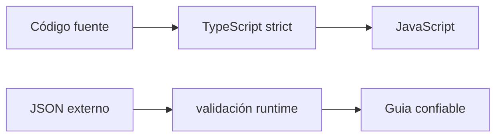
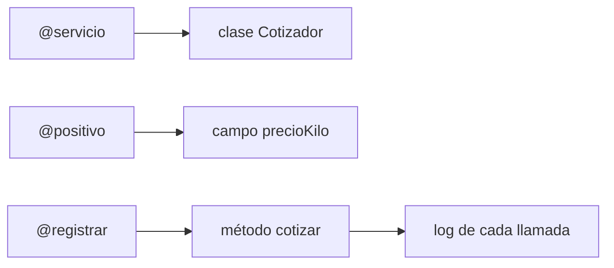
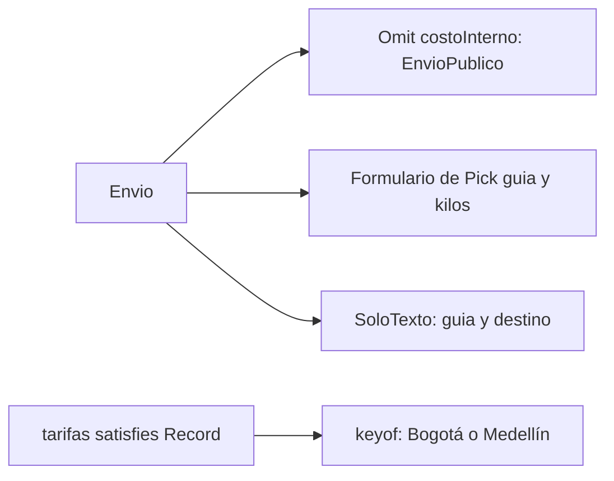

# Módulo 0: TypeScript esencial para devs de JavaScript

> **Requisitos de este curso:** [JavaScript](/curso/javascript). Lo que esos cursos enseñan aquí se usa sin volver a explicarlo; si algo no te suena, vuelve a su capítulo antes de seguir.


## Aprende construyendo


### Tema 1: Tipos básicos, interfaces y type aliases · Intermedio · 40 min

<details open>
<summary><strong>Capa 1 — Lectura</strong></summary>

#### ► DE QUÉ TRATA
Al finalizar podrás instalar TypeScript, modelar una entrega con unión e interfaz y comprobar tipos sin generar archivos. Separarás el comando de creación del estado completo de una guía del proyecto.

</details>

<details>
<summary><strong>Capa 2 — Construcción</strong></summary>

#### Código y verificación
```bash
npm install --save-dev typescript
npx tsc --init
```

```bash
mkdir ejemplo-typescript-basico
cd ejemplo-typescript-basico
npm init -y
npm install -D typescript
mkdir src
```

```ts
export type EstadoGuia = "CREADA" | "EN_RUTA" | "ENTREGADA";

export interface CrearGuia {
  numero: string;
  pesoKg: number;
  notas?: string; // Solo este dato puede estar ausente durante creación.
}

export interface Guia extends CrearGuia {
  estado: EstadoGuia;
  creadaEn: Date;
}

export function crearGuia(entrada: CrearGuia): Guia {
  return {
    ...entrada,
    estado: "CREADA",
    creadaEn: new Date(),
  };
}
```

```bash
npx tsc --noEmit
```

</details>

### Tema 2: Narrowing y union types · Intermedio · 40 min

<details open>
<summary><strong>Capa 1 — Lectura</strong></summary>

#### ► DE QUÉ TRATA
Al finalizar podrás modelar eventos con una unión discriminada, reducir el tipo mediante switch y obligar al compilador a detectar variantes sin manejar. Describirás eventos de geolocalización y entrega del proyecto sin conversiones inseguras.

</details>

<details>
<summary><strong>Capa 2 — Construcción</strong></summary>

#### Código y verificación
```bash
mkdir ejemplo-unions-ts
cd ejemplo-unions-ts
npm init -y
npm install -D typescript
mkdir src
```

```ts
type EventoGuia =
  | { tipo: "UBICACION_ACTUALIZADA"; latitud: number; longitud: number }
  | { tipo: "ENTREGA_CONFIRMADA"; receptor: string };

function assertNever(valor: never): never {
  throw new Error(`Evento no manejado: ${JSON.stringify(valor)}`);
}

export function describirEvento(evento: EventoGuia): string {
  switch (evento.tipo) {
    case "UBICACION_ACTUALIZADA":
      // El discriminante reduce evento y habilita coordenadas con seguridad.
      return `Posición ${evento.latitud}, ${evento.longitud}`;
    case "ENTREGA_CONFIRMADA":
      return `Recibió ${evento.receptor}`;
    default:
      return assertNever(evento);
  }
}
```

```bash
npx tsc --noEmit
```

</details>

### Tema 3: tsconfig esencial y modo strict · Intermedio · 45 min

<details open>
<summary><strong>Capa 1 — Lectura</strong></summary>

#### ► DE QUÉ TRATA
Al finalizar podrás configurar un proyecto estricto, manejar índices posiblemente ausentes y convertir unknown en una guía validada en runtime. Establecerás la frontera confiable entre JSON externo y el dominio del proyecto.

#### ► LA ANALOGÍA
**Conceptos clave:** `strict`, `noImplicitAny`, `noUncheckedIndexedAccess`, límites de TypeScript en runtime.

`tsconfig.json` configura el comportamiento del compilador de TypeScript para un proyecto, y la opción más importante de todas es `"strict": true`, que activa simultáneamente un conjunto completo de verificaciones más rigurosas (incluyendo `noImplicitAny`, `strictNullChecks`, y varias otras), en vez de tener que activarlas manualmente una por una. Adoptar `strict` desde el inicio de un proyecto nuevo es la práctica ampliamente recomendada por la comunidad de TypeScript, porque migrar un proyecto grande existente hacia el modo estricto después de haberlo desarrollado sin él suele revelar una cantidad considerable de errores de tipo previamente ocultos, un esfuerzo de corrección que crece proporcionalmente con el tamaño acumulado del proyecto.

`noImplicitAny`, incluida dentro de `strict`, exige que cada parámetro y variable tenga un tipo explícito o inferible; sin esta opción, TypeScript permitiría silenciosamente que una variable sin anotación de tipo explícita se trate implícitamente como `any` (el tipo que desactiva completamente la verificación de tipos, aceptando cualquier valor y cualquier operación sobre él sin ninguna comprobación), socavando silenciosamente gran parte del valor real que TypeScript ofrece. `strictNullChecks`, otra verificación clave incluida en `strict`, obliga a manejar explícitamente los casos donde un valor podría ser `null` o `undefined`, en vez de asumir implícitamente (y con frecuencia incorrectamente) que un valor siempre está presente, una fuente extremadamente común de errores en tiempo de ejecución en JavaScript puro sin esta protección adicional del compilador.

`noUncheckedIndexedAccess`, una opción adicional recomendada más allá del propio `strict`, hace que acceder a un array o a un objeto mediante un índice (`array[i]`) devuelva un tipo que incluye explícitamente `undefined` en su unión, reflejando con precisión la realidad de que ese índice específico podría estar fuera de rango, en vez de asumir optimistamente (y de forma potencialmente incorrecta) que el acceso siempre produce un valor válido del tipo esperado del array.

Es fundamental entender un límite real e importante de TypeScript, incluso en su configuración más estricta posible: todas estas verificaciones ocurren exclusivamente en tiempo de compilación, sobre el código fuente tal como está escrito; TypeScript no tiene ninguna forma de verificar en tiempo de ejecución que datos provenientes de una fuente externa (como la respuesta JSON de una API, vista en el Módulo 6) realmente cumplen la forma declarada por una `interface`. Si una API cambia su formato de respuesta sin que el código TypeScript se actualice para reflejarlo, TypeScript confiará ciegamente en la anotación de tipo declarada (`interface Usuario`), sin verificar en absoluto que los datos reales recibidos en tiempo de ejecución realmente tengan esa forma exacta, un desajuste que solo una biblioteca de validación en tiempo de ejecución (como Zod) puede detectar de forma efectiva, verificando explícitamente la forma real de los datos externos en el momento en que se reciben, más allá de lo que TypeScript puede garantizar únicamente en tiempo de compilación.

**Analogía:** el modo `strict` de TypeScript es como un inspector de calidad extremadamente meticuloso que revisa cada pieza de un producto antes de que salga de la fábrica (tiempo de compilación); pero ese inspector nunca puede garantizar que un proveedor externo de materia prima (una API externa) siga entregando exactamente la especificación acordada en cada envío futuro, sin un control de calidad adicional específico verificando cada envío real a su llegada.

**¿Por qué es importante?** El modo estricto maximiza las garantías que TypeScript puede ofrecer en tiempo de compilación, pero entender que esas garantías no se extienden a datos externos verificados únicamente en tiempo de ejecución es esencial para diseñar aplicaciones robustas frente a APIs externas que puedan cambiar o comportarse de forma inesperada.

#### ► CÓMO FUNCIONA


</details>

<details>
<summary><strong>Capa 2 — Construcción</strong></summary>

#### Código y verificación
```bash
mkdir ejemplo-strict-ts
cd ejemplo-strict-ts
npm init -y
npm install -D typescript
mkdir src
```

```json
{
  "compilerOptions": {
    "target": "ES2022",
    "module": "ESNext",
    "moduleResolution": "Bundler",
    "strict": true,
    "noUncheckedIndexedAccess": true,
    "noEmit": true
  },
  "include": ["src"]
}
```


```ts
import type { Guia, EstadoGuia } from "../dominio/guia";

const estados: readonly string[] = ["CREADA", "EN_RUTA", "ENTREGADA"];

function esRegistro(valor: unknown): valor is Record<string, unknown> {
  return typeof valor === "object" && valor !== null;
}

function esEstado(valor: unknown): valor is EstadoGuia {
  return typeof valor === "string" && estados.includes(valor);
}

export function parsearGuia(valor: unknown): Guia {
  if (!esRegistro(valor)) {
    throw new TypeError("La guía debe ser un objeto");
  }
  if (
    typeof valor.numero !== "string" ||
    typeof valor.pesoKg !== "number" ||
    !esEstado(valor.estado) ||
    typeof valor.creadaEn !== "string" ||
    Number.isNaN(Date.parse(valor.creadaEn)) ||
    (valor.notas !== undefined && typeof valor.notas !== "string")
  ) {
    throw new TypeError("La guía externa no cumple el contrato");
  }

  // Se construye una entidad nueva solo después de validar todos sus campos.
  return {
    numero: valor.numero,
    pesoKg: valor.pesoKg,
    estado: valor.estado,
    creadaEn: new Date(valor.creadaEn),
    ...(valor.notas === undefined ? {} : { notas: valor.notas }),
  };
}
```

```bash
npx tsc
npm test -- src/api/parsear-guia.test.ts
```

</details>

### Tema 4: Generics · Avanzado · 40 min

<details open>
<summary><strong>Capa 1 — Lectura</strong></summary>

#### ► DE QUÉ TRATA
Al finalizar podrás crear una abstracción genérica que preserve la relación entre entidad e identificador, usar inferencia y añadir restricciones solo cuando sean necesarias. Implementarás un repositorio en memoria tipado para guías del proyecto.

</details>

<details>
<summary><strong>Capa 2 — Construcción</strong></summary>

#### Código y verificación
```bash
mkdir ejemplo-generics-ts
cd ejemplo-generics-ts
npm init -y
npm install -D typescript
mkdir src
```

```ts
export interface Repositorio<T, Id> {
  obtener(id: Id): Promise<T | undefined>;
  guardar(id: Id, entidad: T): Promise<void>;
}

export class RepositorioMemoria<T, Id> implements Repositorio<T, Id> {
  private readonly datos = new Map<Id, T>();

  async obtener(id: Id): Promise<T | undefined> {
    return this.datos.get(id);
  }

  async guardar(id: Id, entidad: T): Promise<void> {
    // El mismo T usado al crear el repositorio controla cada escritura.
    this.datos.set(id, entidad);
  }
}
```

```bash
npx tsc --noEmit
```

</details>

### Tema 5: Decoradores estándar de TypeScript 5 · Avanzado · 45 min

<details open>
<summary><strong>Capa 1 — Lectura</strong></summary>

#### ► DE QUÉ TRATA
Al finalizar podrás escribir decoradores de clase, método y campo con la sintaxis estándar de TypeScript 5, usar su objeto de contexto y explicar la diferencia con los decoradores experimentales que usan Angular y NestJS. Prerrequisito: temas «tsconfig esencial y modo strict» y «…

#### ► LA ANALOGÍA
Un **decorador** es una función que recibe la clase, el método o el campo que decora y un **objeto de contexto** (`ClassMethodDecoratorContext`, `ClassFieldDecoratorContext`…) con su nombre y tipo. Un decorador de método puede devolver una función que reemplaza al método; uno de campo puede devolver un inicializador que transforma el valor inicial; uno de clase puede registrar o reemplazar la clase. TypeScript 5 implementa la **propuesta estándar de TC39**. Los frameworks que usan `"experimentalDecorators": true` siguen la versión antigua, con otra firma y metadatos de reflexión: no se mezclan.

**Analogía:** un decorador es un sello que se estampa en un documento: el documento es el mismo, pero el sello agrega una regla ("revisado", "registrar en el archivo").

**Diagrama:**



**¿Por qué es importante?** porque entender los decoradores te permite leer Angular, NestJS o TypeORM sin magia y escribir los tuyos sin depender de la API experimental.
**Fuente oficial:** [TypeScript 5.0: Decorators](https://www.typescriptlang.org/docs/handbook/release-notes/typescript-5-0.html#decorators), [TC39: Decorators proposal](https://github.com/tc39/proposal-decorators).
**Conceptos clave:** decorador de clase, método y campo, objeto de contexto, inicializador, propuesta TC39, `experimentalDecorators`.
**Cuándo no usarlo:** no uses decoradores para lógica de negocio central: esconden comportamiento. Úsalos para preocupaciones transversales como registro, validación o registro de servicios.

**Transferencia al proyecto integrador «Seguimiento público accesible»:** registra con un decorador cada consulta al API de seguimiento y su tiempo de respuesta.
Como **siguiente** paso, aplica lo aprendido en el proyecto integrador del track y compara el resultado con lo que esperabas.
**Errores comunes:** activar `experimentalDecorators` y mezclar su firma antigua con la sintaxis estándar de TypeScript 5, produciendo errores de tipos confusos; esperar que un decorador de campo como `@positivo` se valide al compilar, cuando en realidad se ejecuta recién al crear cada instancia.

#### ► CÓMO FUNCIONA


</details>

<details>
<summary><strong>Capa 2 — Construcción</strong></summary>

#### Código y verificación

```bash
mkdir ts-decoradores && cd ts-decoradores
npm init -y && npm install -D typescript@5
mkdir src
```

```json
{
  "compilerOptions": {
    "target": "ES2022",
    "module": "nodenext",
    "strict": true,
    "outDir": "dist",
    "rootDir": "src"
  }
}
```

```typescript
// Decoradores estándar de TypeScript 5 (propuesta TC39), sin experimentalDecorators

// Decorador de método: mide y registra cada llamada
function registrar<This, Args extends unknown[], R>(
  metodo: (this: This, ...args: Args) => R,
  contexto: ClassMethodDecoratorContext<This, (this: This, ...args: Args) => R>,
) {
  const nombre = String(contexto.name);
  return function (this: This, ...args: Args): R {
    const resultado = metodo.call(this, ...args);
    console.log(`[log] ${nombre}(${args.join(', ')}) -> ${resultado}`);
    return resultado;
  };
}

// Decorador de campo: valida el valor inicial
function positivo(_valor: undefined, contexto: ClassFieldDecoratorContext) {
  return (inicial: number) => {
    if (inicial <= 0) throw new RangeError(`${String(contexto.name)} debe ser positivo`);
    return inicial;
  };
}

// Decorador de clase: registra la clase en un catálogo de servicios
const catalogo: string[] = [];
function servicio(clase: Function, contexto: ClassDecoratorContext) {
  catalogo.push(String(contexto.name));
}

@servicio
class Cotizador {
  @positivo precioKilo = 1200;

  @registrar
  cotizar(ciudad: string, kilos: number): number {
    return (ciudad === 'Bogotá' ? 5000 : 9000) + kilos * this.precioKilo;
  }
}

const cotizador = new Cotizador();
cotizador.cotizar('Bogotá', 2);
cotizador.cotizar('Cali', 1);
console.log('Servicios registrados:', catalogo);
```

```bash
npx tsc && node dist/decoradores.js
```

```text
[log] cotizar(Bogotá, 2) -> 7400
[log] cotizar(Cali, 1) -> 10200
Servicios registrados: [ 'Cotizador' ]
```

</details>

### Tema 6: TypeScript avanzado: sobrecargas, tipos mapeados, condicionales y satisfies · Avanzado · 30 min

<details open>
<summary><strong>Capa 1 — Lectura</strong></summary>

#### ► DE QUÉ TRATA
Al finalizar podrás declarar sobrecargas de funciones, derivar tipos con Omit, Pick y tipos mapeados, filtrar propiedades con tipos condicionales, construir nombres con tipos de plantilla y validar objetos con satisfies sin perder sus tipos literales. Prerrequisitos: Temas 1 a 4…

#### ► CÓMO FUNCIONA


</details>

<details>
<summary><strong>Capa 2 — Construcción</strong></summary>

#### Código y verificación


```bash
mkdir ts-avanzado && cd ts-avanzado
npm init -y && npm install -D typescript@5
mkdir src
```

```json
{
  "compilerOptions": {
    "target": "ES2022",
    "module": "nodenext",
    "strict": true,
    "outDir": "dist",
    "rootDir": "src"
  }
}
```

```typescript
// 1) Sobrecargas: varias firmas públicas, una implementación
function buscar(guia: string): string;
function buscar(guias: string[]): string[];
function buscar(entrada: string | string[]): string | string[] {
  const estado = (g: string) => `${g}: en ruta`;
  return Array.isArray(entrada) ? entrada.map(estado) : estado(entrada);
}
const uno: string = buscar('BO-1');            // el tipo de retorno depende de la firma usada
const varios: string[] = buscar(['BO-2', 'BO-3']);

// 2) Tipos mapeados: derivar tipos de otros en lugar de copiarlos
interface Envio { guia: string; kilos: number; destino: string; costoInterno: number }
type EnvioPublico = Omit<Envio, 'costoInterno'>;
type Formulario<T> = { [K in keyof T]: { valor: T[K]; error?: string } };
const formulario: Formulario<Pick<Envio, 'guia' | 'kilos'>> = {
  guia: { valor: 'BO-4' },
  kilos: { valor: 0, error: 'debe ser positivo' },
};

// 3) Tipos condicionales y de plantilla
type Evento = 'creado' | 'despachado' | 'entregado';
type Manejador = `al${Capitalize<Evento>}`;            // 'alCreado' | 'alDespachado' | 'alEntregado'
type SoloTexto<T> = { [K in keyof T as T[K] extends string ? K : never]: T[K] };
const textos: SoloTexto<Envio> = { guia: 'BO-5', destino: 'Cali' };

// 4) satisfies: valida la forma sin perder el tipo literal más preciso
const tarifas = {
  Bogotá: 5000,
  Medellín: 7000,
} satisfies Record<string, number>;
type CiudadConTarifa = keyof typeof tarifas;           // 'Bogotá' | 'Medellín', no string
const ciudad: CiudadConTarifa = 'Medellín';

const publico: EnvioPublico = { guia: 'BO-6', kilos: 2, destino: 'Bogotá' };
const manejadores: Record<Manejador, () => string> = {
  alCreado: () => 'notificar a bodega',
  alDespachado: () => 'notificar al cliente',
  alEntregado: () => 'cerrar la guía',
};
console.log(uno, varios);
console.log(formulario.kilos.error, Object.keys(textos), tarifas[ciudad]);
console.log(Object.keys(publico), manejadores.alEntregado());
```

```bash
npx tsc && node dist/tipos-avanzados.js
```

```text
BO-1: en ruta [ 'BO-2: en ruta', 'BO-3: en ruta' ]
debe ser positivo [ 'guia', 'destino' ] 7000
[ 'guia', 'kilos', 'destino' ] cerrar la guía
```

</details>

### Comprueba lo construido

<details open>
<summary><strong>Capa 1 — Lectura</strong></summary>

</details>

<details>
<summary><strong>Capa 2 — Construcción</strong></summary>

#### Nota de construcción
Este tema es principalmente conceptual en esta versión. La verificación se realiza con las preguntas de comprensión y el criterio de cuándo NO usar comprueba lo construido.

</details>
